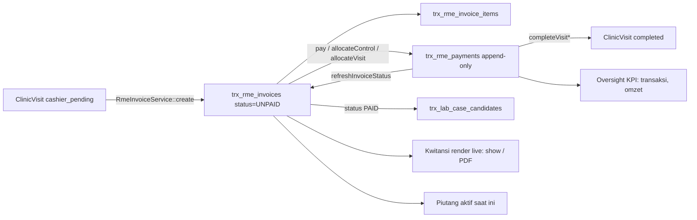
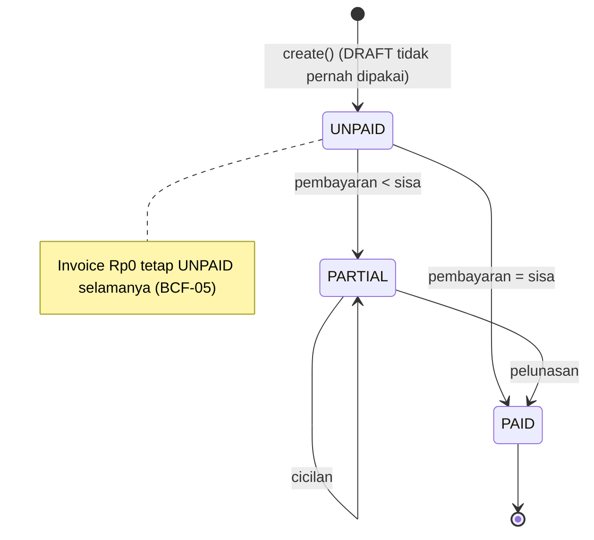
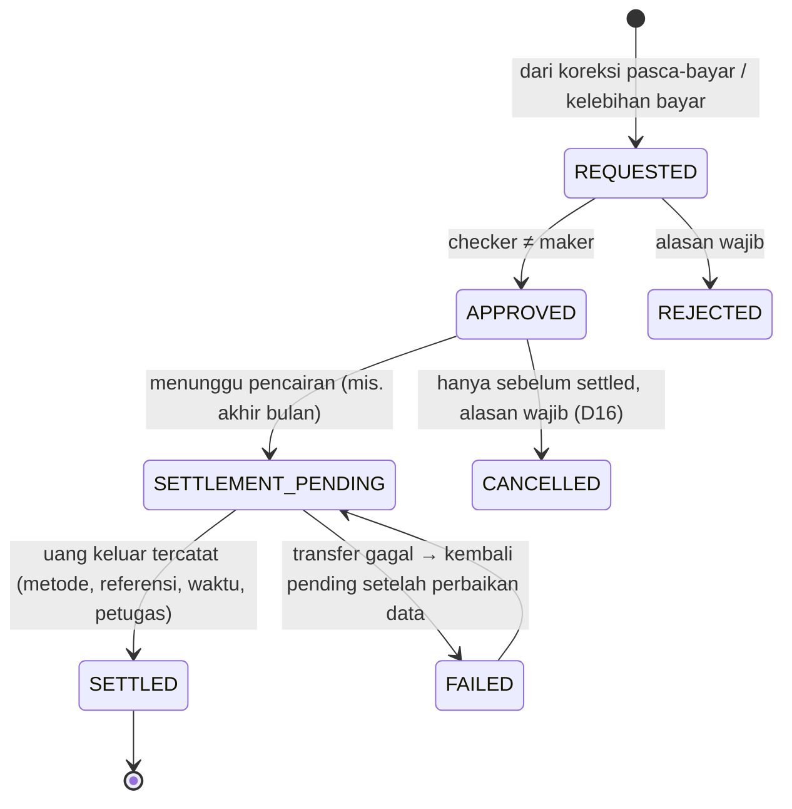
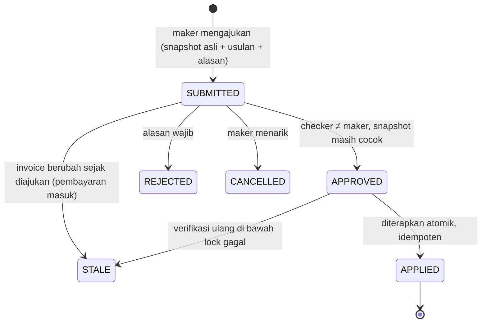

# AUDIT-RME-BILLING-CORRECTION-PAYMENT-REFUND-FOUNDATION-1

> **Jenis:** audit fondasi finansial, read-only. **Bukan implementasi.**
> **Fitur yang disiapkan:** `FEATURE-RME-BILLING-CORRECTION-PAYMENT-ADJUSTMENT-1` (belum dimulai, belum aktif).
> **Rule terkait:** `.cursor/rules/188-rme-billing-correction-financial-integrity-foundation.mdc`.
> **Tanggal:** 2026-10-16 (WITA, UTC+8).

**AUDIT GO ≠ FEATURE GO.** Dokumen ini tidak mengaktifkan koreksi, refund, maupun penyesuaian Rp0. Tidak ada
invoice, pembayaran, kwitansi, piutang, peran, atau izin produksi yang diubah oleh audit ini.

Label yang dipakai di seluruh dokumen:

| Label | Arti |
|---|---|
| **CURRENT** | Perilaku produksi yang terverifikasi dari kode dan/atau data produksi read-only. |
| **APPROVED_SCOPE** | Kebutuhan yang sudah diminta/ditetapkan owner untuk fitur mendatang. Belum diimplementasikan. |
| **PROPOSED** | Rancangan audit. Bukan keputusan, bukan perilaku produksi. |
| **PENDING_OWNER_DECISION** | Pilihan bisnis yang belum diputuskan (lihat §26). |
| **HYPOTHESIS** | Dugaan yang belum direproduksi. |

---

## 1. Ringkasan Eksekutif

Sistem billing RME DaengtisiaMS **saat ini tidak punya kemampuan koreksi, refund, atau penyesuaian sama sekali** — dan
itu adalah alasan mengapa datanya masih bersih. Invoice dan pembayaran "imutabel karena ketiadaan jalur ubah", bukan
karena kontrol yang dirancang. Begitu fitur koreksi dibangun, beberapa asumsi diam-diam di kode saat ini akan
menjadi cacat.

Temuan terpenting (detail di §14):

1. **Harga ditentukan kasir, bukan server.** `unit_price` dan `discount` diketik bebas; `mst_tariffs` tidak pernah
   dibaca; diskon tidak dibatasi sehingga subtotal item bisa negatif. Kasir sudah bisa membuat tagihan **Rp0 tanpa
   persetujuan apa pun hari ini** — workflow "Rp0 dengan approval" tidak bermakna sebelum celah ini ditutup. (BCF-01, HIGH)
2. **Tidak ada jejak audit finansial.** Modul `RmeInvoice` tidak menulis satu baris pun ke `sys_audit_logs` —
   pembuatan invoice dan pencatatan pembayaran tidak ter-audit. (BCF-02, HIGH)
3. **Kelebihan bayar tidak terlihat.** `remainingAmount()` di-clamp ke 0; bila `grand_total` diturunkan di bawah total
   bayar, kewajiban refund lenyap dari setiap layar dan status menjadi `PAID`. (BCF-04, MEDIUM laten)
4. **Kwitansi dirender ulang dari data live setiap kali.** Tidak ada snapshot, versi, atau audit cetak; setelah koreksi,
   cetak ulang kwitansi lama akan diam-diam menampilkan angka baru. (BCF-06)
5. **`paid_at` sepenuhnya input klien** (`required|date`, tanpa batas) dan menentukan periode omzet. (BCF-03, MEDIUM)
6. **Invoice Rp0 menjadi "zombie UNPAID".** Tidak bisa dibayar, tidak pernah menjadi `PAID`, dan terus terhitung
   "belum dibayar" di dasbor Owner/RME. Terbukti di produksi (invoice #36). (BCF-05, MEDIUM)
7. **Ketentuan refund sudah DICETAK di invoice** (disetujui owner 2026-10-12) — tetapi sistem tidak punya satu pun
   catatan refund. Pasien dijanjikan proses yang tidak ada di sistem. (BCF-14, governance)

Keputusan:

```
AUDIT_RELEASE            : GO (artefak dokumentasi + rules; tanpa perubahan runtime)
IMPLEMENTATION_DECISION  : CONDITIONAL_GO — hanya Fase 0 (prasyarat) dan Fase A (fondasi request+approval),
                           setelah D1, D2, D10, D11, D21 diputuskan owner.
                           Fase C–E (koreksi pasca-bayar, refund, kwitansi revisi) = NO_GO sampai
                           D4, D5, D6, D7, D8, D9, D12, D18 diputuskan.
FEATURE_ACTIVE           : NO
```

---

## 2. Verifikasi Baseline

| Item | Nilai terverifikasi |
|---|---|
| Base kanonik (remote) | `feature/sprint-26-phase-26-8-stabilization-closure-go-watch-no-go-report` @ `9294c238` (tree `780602ca`) |
| Produksi HEAD | `3b1e03e0e7db0f8f4f543cf57537433c7f81cf7b`, tree `faedd63a`, tag exact-match `revision-oversight-dashboard-date-range-1-go` |
| Selisih base vs produksi | 1 commit docs-only (`9294c238`, PR #483) — runtime identik |
| Rule terakhir | 187 (`187-oversight-dashboard-date-range-foundation.mdc`); 188 bebas |
| Deploy terakhir | `storage/logs/deploy-runner/latest.status` = `exit=0` |
| Worktree audit | terisolasi, dibuat dari ref remote (bukan checkout utama yang berada di cabang lama) |

Laporan sebelumnya (PR #482/#483, rule 187, SHA `3b1e03e0`) **cocok** dengan keadaan aktual. Tidak ada delta produksi.

**Snapshot produksi (read-only, `BEGIN TRANSACTION READ ONLY`, agregat tanpa PII, 2026-10-16 pagi WITA):**

| Metrik | Nilai |
|---|---|
| Invoice RME aktif | 6 — `PAID` 5 (Rp3.548.000), `UNPAID` 1 (Rp0) |
| Invoice soft-deleted / grand_total negatif / diskon > 0 | 0 / 0 / 0 |
| Item invoice | 7 — `treatment_id` NULL: 1, `unit_price` 0: 1, subtotal negatif: 0 |
| Pembayaran RME | 7, total Rp3.548.000 — soft-deleted 0, `payment_batch_uuid` NULL: **6**, `payment_method_id` NULL: 1 |
| Batch non-NULL | 1 — batch multi-invoice: 0, batch lintas-cabang: 0 |
| Invoice kelebihan bayar / `PAID` tak lunas | 0 / 0 |
| `paid_at` di masa depan / sebelum invoice dibuat | 0 / 0 |
| Pembayaran dengan cabang ≠ cabang invoice | 0 |
| Kunjungan `cashier_pending` | 1 (belum ber-invoice) |
| Billing lab (`trx_invoices` / `trx_payments`) | 0 / 0 |
| Tabel bernama refund/correction/adjust/credit | **tidak ada** (hanya `trx_goods_receipts*`, domain inventori) |
| Izin bernama correction/refund/adjust | **tidak ada** |
| Master tindakan | 13; kategori Konsultasi berisi `TRT-CONS` (1 tarif terdaftar); tidak ada tindakan bernama "Kontrol" |

---

## 3. Arsitektur Invoice

**CURRENT.** Modul `app/Modules/RmeInvoice` (30 file PHP, 4.829 baris) memiliki Controller → FormRequest → Service →
RepositoryInterface → Repository → Model.

| Komponen | File |
|---|---|
| Model | `Models/RmeInvoice.php`, `Models/RmeInvoiceItem.php`, `Models/RmePayment.php`, `Models/RmeReceivableFollowUp.php` |
| Layanan | `Services/RmeInvoiceService.php`, `Services/RmePaymentService.php`, `Services/RmeControlReceivableService.php`, `Services/RmeLabIntegrationService.php`, `Services/DoctorPerformanceReportService.php`, `Services/CashierHandoffStatusService.php`, dua generator nomor |
| Repositori | `Repositories/RmeInvoiceRepository.php`, `Repositories/RmePaymentRepository.php` (+ interface) |
| Policy | `Policies/RmeInvoicePolicy.php` |
| Dokumen | `Support/RmeInvoiceDocument.php` (value object, integer sen) |

**Skema** (`database/migrations/2026_06_14_200001_create_trx_rme_invoices_table.php`):
`branch_id`, `clinic_visit_id`, `patient_id`, `medical_record_id` (nullable), `cashier_id`, `invoice_number`
(**unique**, :18), `status` (default `DRAFT`, :19), `subtotal`, `discount_total`, `grand_total` (tersimpan, :20-22),
`notes`, timestamps, **softDeletes** (:25). **Tidak ada** kolom versi, kolom kunci optimistik, atau kolom `paid_amount`.

Item (`..._200002_create_trx_rme_invoice_items_table.php`): `rme_invoice_id` (**cascadeOnDelete**, :13),
`treatment_id` **nullable** (:14), `description` teks bebas wajib (:15), `qty`, `unit_price`, `discount` (rupiah absolut),
`subtotal`, `doctor_id` nullable. **Tanpa** softDeletes, tanpa snapshot nama/kategori tindakan.

**Domain lab terpisah dan tidak boleh dicampur:** `trx_invoices` / `trx_payments` (`..._080001`, `..._080003`), modul
`app/Modules/Invoice` dengan `InvoiceWorkflowService::void` (`:62`, satu orang, tanpa approval). Rule 186 #18 melarang
KPI oversight membaca `trx_payments`.



---

## 4. Siklus Hidup Invoice

**CURRENT** — status didefinisikan di `RmeInvoice.php:23-39`: `DRAFT`, `UNPAID`, `PARTIAL`, `PAID`, `VOID`.

| Status | Dibuat oleh | Ditulis di kode? | Dapat dibayar | Item dapat diubah |
|---|---|---|---|---|
| `DRAFT` | — | **Tidak pernah ditulis** (hanya dibaca: mis. `RmeInvoiceRepository.php:113`) | Tidak (`isPayable`, :166-169) | Tidak ada jalur |
| `UNPAID` | `RmeInvoiceService::create` (`:198`) — invoice selalu lahir `UNPAID` | Ya | Ya | Tidak ada jalur |
| `PARTIAL` | `RmePaymentService::refreshInvoiceStatus` (`:465-474`) | Ya | Ya | Tidak ada jalur |
| `PAID` | `refreshInvoiceStatus` saat sisa ≤ 0 | Ya | Tidak | Tidak ada jalur |
| `VOID` | — | **Tidak pernah ditulis** (hanya disaring oleh laporan, mis. `DoctorPerformanceReportService.php:376`) | Tidak | Tidak ada jalur |



Catatan: kolom `status` ber-default `'DRAFT'` di database (migrasi `..._200001:19`), sehingga insert yang tidak menyertakan
`status` akan menulis `DRAFT`. Tidak ada insert aplikasi yang melakukannya; hanya `RmeInvoiceFactory` (uji) yang memakai
`DRAFT`/`VOID`. Penulis status di aplikasi hanya dua: `RmeInvoiceService.php:198` dan `RmePaymentService.php:470-472`.

**Titik komitmen finansial:** total menjadi final di dalam transaksi `create()` (`RmeInvoiceService.php:132`, item
`:231`, total `:246-252`). Sesudahnya `RmeInvoiceRepository::update()` (`:129`) hanya dipanggil untuk menulis ulang
`status`. **Tidak ada endpoint edit, hapus, atau void invoice** (rute kasir `routes/web.php:1350-1369`: index, handoff,
receivables, export, follow-up, create, store, show, payment create/store, receipt, receipt PDF).

**Gap imutabilitas (INVOICE_MUTATION_MATRIX):**

| Jalur | Status | Bukti |
|---|---|---|
| Ubah item/total lewat aplikasi | Tidak ada | tidak ada rute/metode |
| Soft delete invoice | Skema mengizinkan, aplikasi tidak memanggil | migrasi :25; 0 baris produksi |
| Hapus item | Kaskade bila invoice di-hard-delete | migrasi item :13 |
| `RmeInvoice::recalculateTotals()` | **Cacat laten**: menjumlah `subtotal` (sudah dikurangi diskon) lalu mengurangi diskon lagi | `RmeInvoice.php:137-144`; tidak dipanggil di mana pun |
| Re-atribusi pasien | Workflow merge pasien memindahkan `patient_id` invoice & pembayaran | `PatientOwnedRecordRegistry.php:33-34` |

**CORRECTION_ENTRY_POINTS (PROPOSED):** satu-satunya jalur sah untuk mengubah item/total adalah layanan koreksi baru
yang berjalan di dalam transaksi dan mengunci baris invoice (`lockForUpdate`) — pola yang sama dengan `pay()`
(`RmePaymentService.php:39`).

---

## 5. Arsitektur Pembayaran

**CURRENT** — skema `..._200003_create_trx_rme_payments_table.php` + `..._2026_06_17_100001` (batch) + `680200`
(indeks `branch_id, paid_at DESC INCLUDE amount`, khusus PostgreSQL):
`branch_id`, `rme_invoice_id` (restrictOnDelete), `clinic_visit_id`, `patient_id`, `cashier_id`,
`payment_method_id` (nullable), `payment_number` (**unique**, :19), `amount`, `paid_at`, `reference_number`, `notes`,
`payment_batch_uuid` (nullable uuid), timestamps, **softDeletes** (:25). **Tidak ada** kolom status/void/reversal.

| Aspek | Perilaku saat ini | Bukti |
|---|---|---|
| Penulis | hanya `recordPayment()` | `RmePaymentService.php:365-388` |
| Repositori | hanya `create`, `forInvoice`, `latestPaymentNumberForMonth` — **tanpa update/delete** | `RmePaymentRepository.php:12,17,26` |
| Kunci | baris invoice dikunci `lockForUpdate` di ketiga jalur | `:39`, `:95/:107`, `:237/:249` |
| Batas jumlah | `amount > 0` (`:424-435`) dan `≤ sisa` (`:46-50`); permintaan `min:0.01` | `CreateRmePaymentRequest` |
| `paid_at` | **dari input klien**, aturan `required|date` saja; form default `now()` (UTC aplikasi) | request rules; `payment/create.blade.php:318`; `:383` |
| Cabang pembayaran | = cabang **invoice**, bukan cabang kasir | `:375` |
| Cakupan cabang kasir | `RmeWorkingBranchScope::allows` di layanan | `:390-422` |
| Status invoice | diturunkan dari `SUM(amount)` | `:465-474` |
| Kunjungan selesai | pembayaran > 0 (penuh atau sebagian) menyelesaikan kunjungan `cashier_pending` | `:487-497`, `:533-542` |
| Kandidat lab | dibuat setelah commit bila invoice `PAID` | `:544`, `RmeLabIntegrationService.php:27-29` |
| Audit | **tidak ada** penulisan `sys_audit_logs` di seluruh modul | grep `AuditLog` di `app/Modules/RmeInvoice` = 0 |

**Kesimpulan imutabilitas:** pembayaran **append-only secara de-facto**. Tidak ada endpoint yang mengubah `amount`.
Namun imutabilitas tidak ditegakkan di database: soft delete dimungkinkan, dan `paidAmount()` (`RmeInvoice.php:146-149`)
mengecualikan baris soft-deleted — soft delete langsung di DB akan diam-diam mengubah saldo dan omzet (BCF-09).

**PAYMENT_DEPENDENCY_MAP** — konsumen yang mengasumsikan pembayaran append-only (dari Graphify + grep tabel mentah,
24 file `app/`): `ClinicOversight/Repositories/OversightKpiRepository.php` (transaksi/omzet/piutang),
`RmeInvoice/Services/DoctorPerformanceReportService.php` (`:416` ditagih = `grand_total`, `:424` dibayar),
`RmeInvoice/Controllers/RmeInvoiceController.php` (piutang, `:255-266`), `Reporting/Services/OwnerDashboardKpiService.php`
(`:149` collection rate), `Reporting/Services/OwnerDashboardRmeLabKpiService.php`, `Reporting/Services/RmeDashboardKpiService.php`,
`RmeDashboard/Controllers/RmeDashboardController.php`, `PatientMerge/*`, `Services/DataQuality/Dq1AuditService.php`,
registri arsitektur/metrik, dan layanan monitoring.

---

## 6. Payment Batch dan Carry-over

**CURRENT.**

* `payment_batch_uuid` dibuat **satu kali per aksi kasir** — hanya di `allocateControlPayment` (`:92`) dan
  `allocateVisitPayment` (`:234`). Pembayaran biasa `pay()` menulis **NULL** (`recordPayment` default `null`, `:372`).
  Produksi: 6 dari 7 pembayaran NULL.
* Satu batch bisa mencakup beberapa invoice (piutang lama FIFO + invoice saat ini) dan — karena `branch_id` mengikuti
  invoice (`:375`) — **beberapa cabang**. Produksi: 0 batch multi-invoice, 0 batch lintas-cabang (kemampuan ada, belum terjadi).
* KPI oversight: `COUNT(DISTINCT COALESCE(payment_batch_uuid, 'payment:'||id))` (`OversightKpiRepository.php:36`),
  diatribusikan ke **cabang invoice** (`:70`, `:88-95`). NULL ditangani benar (satu baris = satu transaksi).

**Skenario (CARRY_OVER_RISK_MATRIX):**

| Kasus | Risiko bila koreksi menimpa pembayaran | Rancangan aman (PROPOSED) |
|---|---|---|
| A. Satu invoice dalam batch dikoreksi | Mengubah `amount` baris A merusak total batch yang sudah dikwitansikan | **Jangan pernah ubah baris pembayaran.** Koreksi mengubah tagihan invoice A; selisih menjadi kewajiban refund/piutang A |
| B. Semua invoice dalam batch dikoreksi | Sama, berlipat | Satu permintaan koreksi **per invoice**; tidak ada koreksi batch |
| C. Alokasi carry-over | Memindah alokasi antar invoice = penulisan ulang sejarah | Dilarang; kelebihan bayar pada invoice lama → refund/kredit di invoice itu |
| D. Batch lintas-cabang | Koreksi di cabang A tidak boleh mengubah atribusi cabang B | Koreksi & refund dimiliki **cabang invoice** yang dikoreksi |

Contoh soal: bayar Rp500.000 → Invoice A Rp300.000 + Invoice B Rp200.000. Invoice A dikoreksi menjadi Rp250.000.
**PROPOSED:** baris pembayaran A (Rp300.000) dan B (Rp200.000) tetap utuh; `payment_batch_uuid` tidak diubah; A kini
kelebihan bayar Rp50.000 → kewajiban refund milik A (cabang A); B tidak tersentuh; jumlah transaksi oversight tetap 1.

---

## 7. Arsitektur Kwitansi

**CURRENT** (`RmePaymentController.php`):

* `receipt()` (`:142-154`) dan `receiptPdf()` (`:167-187`) — keduanya hanya untuk invoice `PAID` (`:147`, `:172`) dan
  dirender **langsung dari baris live** lewat `resolveReceiptData()` (`:192-253`) + `RmeInvoiceDocument::fromInvoice`.
* PDF dibuat di memori (dompdf) dan langsung `download()`; **tidak disimpan** (tidak ada `Storage::` di modul).
* **No. Kwitansi = `payment_number` pembayaran terbaru** (`invoice-document.blade.php:148-149`, `:194-198`).
  Format `RMEPAY-{Ym}-{000001}` (`RmePaymentNumberGeneratorService.php`), MAX+1 tanpa lock, dilindungi indeks unik.
* **Tidak ada** snapshot, nomor versi, status "digantikan", atau audit cetak/lihat.
* Ketentuan refund dan rekening transfer dicetak dari `config/rme_invoice.php:45-66`.

**RECEIPT_INTEGRITY_RISKS:** bila item/total invoice berubah setelah lunas, cetak ulang akan **diam-diam** menampilkan
angka baru dengan nomor kwitansi yang sama; bila konsisten, tidak ada peringatan (peringatan `reconciles()` hanya muncul
bila header dan item tidak cocok, `invoice-document.blade.php:245-247`). Pembayaran tambahan juga mengganti nomor yang
tercetak.

**RECEIPT_VERSIONING_DESIGN (PROPOSED, minimal — tanpa tabel versi baru):**

| Elemen | Mekanisme |
|---|---|
| Kwitansi asli | `original_snapshot` (jsonb imutabel) pada catatan koreksi berisi dokumen invoice + item + pembayaran saat koreksi diterapkan; dirender dengan cap **DIGANTIKAN** + referensi koreksi |
| Kwitansi revisi | dirender live dengan label **REVISI ke-N** + nomor koreksi |
| Referensi | `billing_correction_id` dicetak di kedua dokumen |
| Riwayat versi | urutan catatan koreksi `APPLIED` per invoice = versi dokumen |
| Audit | event cetak/lihat untuk dokumen yang memiliki koreksi (PENDING_OWNER_DECISION D7/D20) |

Tabel versi kwitansi khusus **tidak** diperlukan selama snapshot disimpan pada catatan koreksi — itulah satu-satunya
momen dokumen berubah.

---

## 8. Fondasi Refund

**CURRENT — tidak ada (dalam domain RME).** Tidak ada tabel, model, status, izin, rute, layanan, maupun laporan refund
(diverifikasi lewat skema produksi dan grep kode). Domain lab yang terpisah memang punya izin `void_invoice`
(`PermissionSeeder.php:76`) dan `InvoiceWorkflowService::void` (`:62-89`). Itu bukan refund, bukan bagian dari billing RME,
dan tidak boleh dipakai ulang untuk invoice RME. Satu-satunya jejak "refund" di aplikasi adalah **teks yang dicetak**:

> `config/rme_invoice.php:45-61` (disetujui owner 2026-10-12): refund Kawat Gigi dapat diajukan **sebelum 2×24 jam**
> setelah akad; dana refund **dikembalikan di akhir bulan pengajuan**; refund jenis perawatan lain "sesuai aturan klinik".
> File itu sendiri menyatakan: *"This file describes what is PRINTED. It does not implement refunds"* (:25-26).

Implikasi: kebijakan klinik sudah memisahkan **persetujuan** (dalam 2×24 jam) dari **pelunasan dana** (akhir bulan) —
jarak hingga ~30 hari di mana kewajiban refund ada tetapi uang belum keluar. Rancangan harus merepresentasikan jarak itu.

**REFUND_STATE_MACHINE (PROPOSED, nama konseptual):**



Aturan inti: **`APPROVED` tidak pernah berarti uang sudah kembali.** Hanya `SETTLED` yang mengurangi kas.

**REFUND_RECONCILIATION_MODEL (PROPOSED):** kewajiban refund = Σ refund `APPROVED`+`SETTLEMENT_PENDING`; kas keluar =
Σ refund `SETTLED` menurut `settled_at` (WITA). Rekonsiliasi per cabang invoice: koleksi bruto − refund settled = koleksi
bersih.

**REFUND_SECURITY_REQUIREMENTS:** jumlah refund ≤ kelebihan bayar yang terukur dari ledger (diturunkan server, tidak
pernah dari input); satu refund aktif per koreksi (partial unique index); pencatatan settlement oleh izin terpisah dari
approval (D18); referensi transfer wajib untuk non-tunai; tanpa PII di payload audit.

Model pelunasan (tunai, transfer, kredit pasien) adalah **PENDING_OWNER_DECISION** (D5, D6).

---

## 9. Fondasi Approval / Maker-Checker

**CURRENT — tidak ada mesin approval generik.** Tidak ada tabel `approvals`, interface, atau kelas bersama. Setiap
approval bersifat domain-spesifik, dengan pola yang konsisten:

| Subsistem | Maker≠checker | Lokasi pengecekan | Alasan tolak wajib | Kunci |
|---|---|---|---|---|
| `PatientMergeCase` | Ya (`authorIds()`) | layanan, di bawah lock (`PatientMergeCaseService.php:518-529`) | Ya | `lockForUpdate` + transisi |
| `DoctorBranchLockRequest` / `Cover` | Ya + bukan subjek | layanan (`DoctorBranchLockApprovalService.php:460`, `:489`) | Ya (min 10) | `lockForUpdate` |
| `BranchChangeRequest` | Ya | layanan (`BranchChangeApprovalService.php:324`) | Tidak | `lockForUpdate` |
| LegacyRme publish | Ya (`SeparatePublisherGuard`) | layanan, di dalam transaksi | — | `lockForUpdate` |
| `SatusehatChangeRequest` | Ya untuk approve | layanan (`SatusehatChangeControlService.php:100`) | Ya | `lockForUpdate` |
| `DoctorDeviceAuthorization` | Tidak | — | Ya | `findForUpdate` |
| Billing RME | **Tidak ada approval sama sekali** | — | — | — |

**Fakta penentu:** `Gate::before` memberi Super Admin semua ability sebelum policy berjalan
(`app/Providers/RepositoryServiceProvider.php:701-703`; komentar `:607-612` menegaskan perbandingan self-approval harus
berada di dalam transaksi layanan). Maka **maker≠checker untuk koreksi wajib ditegakkan di layanan, di bawah row lock** —
pola `PatientMergeCase` adalah acuan terbaik (status machine eksplisit + `assertTransition` + `authorIds()`).

**APPROVAL_STATE_MACHINE (PROPOSED):**



`DRAFT` sengaja tidak dipakai: permintaan hanya ada setelah diajukan (menghindari baris setengah jadi). Persetujuan dan
penerapan dipisah agar persetujuan tidak pernah diam-diam mengubah data; penerapan berulang adalah no-op (idempoten).

**APPROVAL_REUSE_ANALYSIS:** pakai ulang *pola* (layanan + lock + transisi + audit) — **bukan** tabel domain lain. Tabel
koreksi sendiri diperlukan.

---

## 10. Kelayakan Rp0

**APPROVED_SCOPE:** owner meminta penyesuaian Rp0 hanya untuk **KONTROL** atau **KONSULTASI DOKTER**.

**Sumber kebenaran CURRENT:**

* **Kontrol** ditentukan server: `StoreClinicVisitRequest.php:84-101` menimpa `visit_type` dari ada-tidaknya
  `follow_up_of_visit_id` yang tervalidasi (`:459-507`, cabang RME & pasien sama). Kolom
  `trx_clinic_visits.visit_type` / `follow_up_of_visit_id` (`2026_06_16_130001_...:16-26`). Rule 185 #17-#21. Input
  `visit_type` dari klien **tidak pernah** dipercaya.
* **Konsultasi Dokter** hanya teridentifikasi lewat **data**: kategori kode `consultation` (nama "Konsultasi")
  (`TreatmentCategorySeeder.php:18`) dan tindakan `TRT-CONS` "Konsultasi Dokter" (`TreatmentSeeder.php:20`). Produksi:
  `TRT-CONS` id 1, kategori Konsultasi. Tidak ada kolom/flag/konstanta yang menandai "boleh Rp0".
* Harga ada di `mst_tariffs` (per cabang, `effective_date`) tetapi **billing RME tidak pernah membacanya**; `unit_price`
  diketik kasir (`CreateRmeInvoiceRequest.php:23`), deskripsi item teks bebas, `treatment_id` opsional.

**Perilaku Rp0 CURRENT (bukti produksi):** invoice Rp0 tidak bisa dibayar (`normalizeAmount` > 0, `:428`;
`remainingForInvoice` melempar "tidak memiliki sisa tagihan", `:443-446`). Satu-satunya jalan menutup kunjungannya adalah
membayar **invoice lain** dalam batch yang sama (`allocateControlPayment` `:178`/`completeControlVisitIfSettled`
`:506-520`, atau `allocateVisitPayment` `completeVisitAfterCashierBatch` `:533-542`). Invoice #36 (SPN4, item
`TRT-CONS` Rp0) kunjungannya selesai lewat `allocateVisitPayment` yang membayar piutang #38 milik pasien yang sama —
**#36 tetap `UNPAID` Rp0 selamanya**, tanpa kwitansi. Invoice Rp0 tanpa piutang lain **membuat kunjungan macet** di
`cashier_pending` (`TransitionStatusRequest.php:22-27` tidak menerima `completed`; `ClinicVisitService::transitionStatus`
hanya mengizinkan `cashier_pending → completed`).

**RP0_ELIGIBILITY_MATRIX (PROPOSED):**

| Skenario | Usulan | Alasan |
|---|---|---|
| A. Kontrol saja | Item kontrol/konsultasi → Rp0 boleh | dalam scope owner |
| B. Konsultasi Dokter saja | Item `TRT-CONS`/kategori `consultation` → Rp0 boleh | dalam scope owner |
| C. Kontrol + Scaling | Hanya item yang layak → Rp0; Scaling tetap ditagih | tidak menggratiskan tindakan lain |
| D. Konsultasi + Penambalan | Sama dengan C | idem |
| E. Tindakan biasa berlabel konsultasi | **Tolak**: kelayakan dari `treatment_id` + kategori, tidak pernah dari `description` | anti-spoof |
| F. Item layak sudah dibayar | Menjadi koreksi pasca-bayar → kewajiban refund | ikuti alur Fase C/D |
| G. Sudah dibayar sebagian | Idem F, selisih dihitung dari ledger | — |
| H. Ada piutang carry-over tak terkait | Piutang lama **tidak boleh** dihapus | Rp0 hanya untuk item invoice ini |
| I. Campuran item | Rp0 per item | — |
| J. Data konsultasi legacy | Tidak memenuhi syarat tanpa `treatment_id` terstruktur | anti-spoof |

**Rekomendasi:** Rp0 **per item**, bukan seluruh invoice (D11). Tanda kelayakan server-side (mis. flag master tindakan
atau kode kategori), bukan teks (D11/D21). Invoice yang total akhirnya Rp0 harus punya jalur penyelesaian eksplisit
yang **tidak** memalsukan pembayaran Rp0 (D22).

**Prasyarat mutlak:** selama kasir bebas mengetik `unit_price = 0` atau diskon tanpa batas (BCF-01), workflow Rp0
ber-approval dapat dilewati sepenuhnya. Fase 0 harus menutup ini lebih dulu.

**RP0_ABUSE_CASE_TEST_PLAN:** lihat §22 baris 29-36.

---

## 11. Skenario Penyesuaian Finansial

**Pra-bayar** (invoice Rp500.000 → seharusnya Rp350.000, belum dibayar). CURRENT: **tidak ada jalan keluar di
aplikasi** — invoice tidak bisa diedit atau di-void, dan tidak bisa dibuat ulang karena `hasActiveInvoiceForVisit`
(`RmeInvoiceService.php:174-178`) menolak invoice kedua selama yang lama masih `UNPAID`. Status, riwayat kunjungan, dan
catatan dokter tidak terdampak karena memang tidak ada yang bisa diubah. **PROPOSED:** permintaan koreksi dengan snapshot asli,
snapshot usulan, alasan wajib, validasi server (harga/kelayakan), approval, penerapan atomik (ganti item + hitung ulang
total + tulis catatan koreksi `APPLIED`), audit. Pembayaran diblokir selama permintaan aktif (D10).

**Pasca-bayar** (Rp500.000 dibayar penuh → seharusnya Rp350.000, selisih Rp150.000):

| Skenario | Catatan DB (PROPOSED) | Status | Piutang | Refund | Kwitansi | Dasbor |
|---|---|---|---|---|---|---|
| A. Total turun | koreksi `APPLIED` (before/after) + refund `REQUESTED` Rp150.000 | invoice `PAID` + `overpaid` 150.000 | 0 | kewajiban sampai `SETTLED` | asli DIGANTIKAN + revisi | omzet bruto tetap; refund dilaporkan terpisah saat settled |
| B. Total naik | koreksi `APPLIED`; selisih menjadi sisa tagihan | `PARTIAL` | +selisih | — | revisi | piutang aktif naik |
| C. Total sama, item/deskripsi berubah | koreksi `APPLIED` tanpa delta uang | tetap | tetap | — | revisi | tidak berubah |

Semua skenario: baris pembayaran **tidak pernah** diubah; koreksi mengunci baris invoice; status diturunkan ulang dari
ledger. Model akuntansi final = D8/D9.

---

## 12. Piutang dan Kelebihan Bayar

**CURRENT** — `remainingAmount() = max(0, grand_total − paid)` (`RmeInvoice.php:151-154`); `remainingForInvoice` dan
`refreshInvoiceStatus` meng-clamp sama (`RmePaymentService.php:437-450`, `:465-474`); piutang oversight hanya
`UNPAID/PARTIAL` dengan `grand_total > 0` dan sisa > 0 (`OversightKpiRepository.php:110-126`); daftar piutang kasir
mengecualikan Rp0 (`RmeInvoiceController.php:255-266`).

Tidak semua jalur di-clamp: `paidAmount()` (`RmeInvoice.php:148`) dan SQL ringkasan piutang
(`RmeInvoiceController.php:404`, `:447`) menghitung `grand_total − paid` mentah. Hari ini aman karena query piutang hanya
memuat invoice dengan `grand_total > paid` (`:265`). Namun begitu koreksi bisa menurunkan `grand_total`, filter itulah satu-satunya
yang mencegah sisa negatif masuk ke total piutang. Ada dua representasi yang berbeda untuk satu fakta, dan fitur koreksi
harus menyatukannya.

**RECEIVABLE_CORRECTION_MATRIX:**

| Kejadian | Dapat direpresentasikan hari ini? | Usulan |
|---|---|---|
| Sisa positif | Ya | — |
| Saldo nol | Ya | — |
| Kelebihan bayar | **Tidak** — tertutup clamp, status menjadi `PAID` | `overpaidAmount() = max(0, paid − grand_total)` + kewajiban refund |
| Refund tertunda / selesai | Tidak | tabel refund (§19) |
| Kredit pasien | Tidak | D6 |
| Koreksi menimbulkan sisa baru | Teknisnya ya (status kembali `PARTIAL`) | status diturunkan ulang dari ledger |

**OVERPAYMENT_DATA_MODEL:** kelebihan bayar **bukan** piutang negatif (akan merusak `SUM` piutang oversight dan laporan
aging). Kelebihan bayar = kewajiban refund terpisah.

---

## 13. Dampak Pelaporan Finansial

**CURRENT** (rule 186/187): KPI 1 pasien distinct (check-in, bukan batal); KPI 2 transaksi = batch distinct; KPI 3 omzet =
`SUM(trx_rme_payments.amount)` menurut `paid_at`, cabang invoice, **tidak pernah** `grand_total`; KPI 4 piutang aktif per
saat ini (tanpa rentang); KPI 5 pembatalan menurut `cancelled_at`.

**DASHBOARD_FINANCIAL_IMPACT_MATRIX:**

| KPI | Dampak koreksi/refund | Usulan |
|---|---|---|
| 1 Pasien | Tidak ada | jangan diubah |
| 2 Transaksi | Tidak ada bila pembayaran tidak diubah | refund **bukan** transaksi baru di KPI 2 |
| 3 Omzet | Model A mengubah angka lampau; Model C tidak | **Model C**: bruto tetap, refund settled dilaporkan terpisah, bersih = bruto − refund |
| 4 Piutang | Koreksi naik/turun mengubah saldo saat ini | otomatis benar bila status diturunkan dari ledger |
| 5 Pembatalan | Tidak ada | jangan diubah |
| Baru | — | jumlah koreksi, nilai koreksi, kewajiban refund tertunda |

**Perbandingan model omzet:**

| Model | Auditabilitas | Rekonsiliasi | Kompatibel laporan saat ini | Kompleksitas |
|---|---|---|---|---|
| A Restatement periode asal | Rendah (angka lampau berubah) | Sulit | Merusak angka yang sudah dilaporkan | Rendah |
| B Penyesuaian pada tanggal refund (omzet dikurangi) | Sedang | Sedang | Mengubah arti KPI 3 | Sedang |
| **C Bruto + refund terpisah + bersih** | **Tinggi** | **Mudah** | **KPI 3 tetap sama** | Sedang |

**Rekomendasi: Model C** (D8/D9). Tidak diaktifkan sebelum keputusan owner.

**REPORT_RECONCILIATION_REQUIREMENTS:** bruto(periode) − refund settled(periode) = bersih(periode) per cabang invoice;
Σ kewajiban refund = Σ refund `APPROVED`+`SETTLEMENT_PENDING`; laporan dokter (`DoctorPerformanceReportService.php:416`,
`:471`) membaca `grand_total`/`subtotal` item — koreksi harus tercermin dan riwayatnya dapat ditelusuri.

**Cacat pelaporan CURRENT:** dasbor Owner/RME menghitung `DRAFT/UNPAID` sebagai "invoice belum dibayar"
(`OwnerDashboardRmeLabKpiService.php:72-74`, `RmeDashboardKpiService.php:55`) — invoice Rp0 zombie ikut terhitung
selamanya (BCF-05).

---

## 14. Penilaian Keamanan

Hanya temuan berbasis bukti. Temuan BCF-01..BCF-05 adalah **cacat produksi yang ada sekarang** dan **tidak diperbaiki**
oleh audit ini (di luar kewenangan) — dicatat sebagai prasyarat Fase 0.

| ID | Sev. | Temuan | Bukti | Skenario | Mitigasi | Dampak implementasi |
|---|---|---|---|---|---|---|
| BCF-01 | **HIGH** | Harga & diskon ditentukan kasir; diskon tanpa batas (subtotal bisa negatif); Rp0 tanpa approval | `CreateRmeInvoiceRequest.php:23-24`; `RmeInvoiceService.php:207-240`; `mst_tariffs` tidak dibaca | Kasir menagih Rp0/diskon besar tanpa jejak | otoritas harga dari `mst_tariffs`; deviasi wajib alasan + approval; cap diskon ≤ qty×harga | Fase 0 wajib sebelum Rp0 |
| BCF-02 | **HIGH** | Tidak ada audit log finansial | 0 panggilan `AuditLogService` di `app/Modules/RmeInvoice` | Manipulasi tidak terdeteksi | event audit create/pay (Fase 0) + semua event koreksi | Fase 0 + A |
| BCF-03 | MEDIUM | `paid_at` dari klien, tanpa batas; default UTC | request rules; `payment/create.blade.php:318`; `:383` | Pembayaran dipindah antar hari/periode omzet; selain itu kwitansi memilih pembayaran "pelunas" berdasarkan urutan `paid_at` DESC (`RmePaymentController.php:194-198`), jadi `paid_at` yang dipalsukan juga mengubah nomor kwitansi yang tercetak | batasi `paid_at` ≤ sekarang dan ≥ pembuatan invoice; default jam klinik | Fase 0 |
| BCF-04 | MEDIUM (laten) | Clamp `max(0,…)` menyembunyikan kelebihan bayar | `RmeInvoice.php:151-154`; `RmePaymentService.php:437-474` | Koreksi turun → kewajiban refund hilang, status `PAID` | `overpaidAmount()` + kewajiban refund eksplisit | Fase C |
| BCF-05 | MEDIUM | Invoice Rp0 zombie `UNPAID`; kunjungan bisa macet | produksi #36; `:428`, `:443-446`; dasbor `:72-74` | KPI "belum dibayar" menggelembung; visit macet | jalur penyelesaian Rp0 eksplisit (D22) | Fase F |
| BCF-06 | LOW (→HIGH saat koreksi ada) | Kwitansi dinamis, tanpa snapshot/versi/audit | `RmePaymentController.php:192-253` | Cetak ulang kwitansi lama berubah diam-diam | snapshot pada koreksi + cap DIGANTIKAN/REVISI | Fase E sebelum C |
| BCF-07 | LOW | Nomor invoice/kwitansi MAX+1 tanpa lock; bulan dari `now()` (UTC) | generator `:13-24`; repo `:117-121` | Tabrakan → error 500 (bukan duplikat) | sequence/lock; bulan via ClinicalClock | opsional |
| BCF-08 | LOW / **HYPOTHESIS** | Race invoice ganda per kunjungan: cek-lalu-insert tanpa lock kunjungan & tanpa indeks unik | `RmeInvoiceService.php:174-178`; repo `:109-115` | Dua klik bersamaan → dua invoice aktif | lock baris kunjungan / partial unique index | Fase 0 |
| BCF-09 | INFO | Pembayaran soft-deletable di skema; `paidAmount()` mengecualikan soft-deleted | migrasi :25; `RmeInvoice.php:146-149` | Soft delete langsung di DB mengubah saldo & omzet diam-diam | larang soft delete pembayaran secara kontrak; koreksi via ledger | aturan rule 188 |
| BCF-10 | INFO | `recalculateTotals()` mengurangi diskon dua kali | `RmeInvoice.php:137-144` | Bila dipakai fitur koreksi → total salah | jangan dipakai; perbaiki/hapus di Fase A | Fase A |
| BCF-11 | INFO | Kandidat lab dibuat saat `PAID`, kunci `rme_invoice_item_id` | `RmeLabIntegrationService.php:27-62` | Koreksi menghapus item ber-lab → kandidat yatim | aturan koreksi untuk item `requires_lab` (D23) | Fase C |
| BCF-12 | INFO | F-01: `RmeWorkingBranchScope` jatuh ke semua cabang untuk peran non-context | `RmeWorkingBranchScope.php:100-110`; policy `:52-55` | Approver governance melihat semua cabang RME | oversight wajib `ClinicOversightScope`; approver eksplisit | prasyarat |
| BCF-13 | INFO | Merge pasien memindah `patient_id` finansial | `PatientOwnedRecordRegistry.php:33-34` | Tabel koreksi/refund baru tertinggal saat merge | daftarkan tabel baru ke registri | Fase A/D |
| BCF-14 | Governance | Ketentuan refund dicetak, tanpa catatan sistem | `config/rme_invoice.php:45-61` | Refund diproses di luar sistem, tak terekonsiliasi | Fase D | — |

Ancaman lain dari daftar tugas — IDOR, kebocoran lintas cabang, ekspor tanpa izin, self-approval, replay, refund ganda,
penggantian kwitansi, pemalsuan timestamp, manipulasi audit — **belum dapat dieksploitasi karena fiturnya belum ada**;
mitigasinya dijadikan invariant di rule 188 §10-13 dan kasus uji §22.

---

## 15. RBAC dan Cakupan Cabang

**CURRENT** (`database/seeders/RoleSeeder.php`, `PermissionSeeder.php:149,156-157,416-419`):

| Peran | `manage_rme_billing` | `view_rme_payment_reports` | Catatan |
|---|---|---|---|
| Super Admin | ya (`'*'` + `Gate::before`) | ya | semua |
| Kasir | ya (:360) | ya (:366) | context-bound ke cabang kerja |
| Admin Klinik | ya (:119) | tidak | context-bound |
| Front Office | ya (:396) | ya (:445) | gabungan Admin Klinik + Kasir → bisa menjadi maker **dan** checker; SoD harus berbasis akun |
| Supervisor RME | ya (:506) | ya (:513) | governance → semua cabang RME (F-01) |
| Owner | tidak | ya (:327) | read-only |
| Finance Klinik / Data Analyst | **tidak** | **tidak** | hanya 4 izin oversight (`OVERSIGHT_INITIAL_PERMISSIONS`, :694-699) |

`RmeInvoicePolicy` (`:11-55`): `viewAny/create` = `manage_rme_billing`; `view/pay/viewReceipt` = izin + cakupan cabang
kerja. **Tidak ada** ability koreksi/void/refund.

**Evaluasi matriks otoritas PROPOSED (dari permintaan):**

| Peran | Usulan | Konflik yang ditemukan |
|---|---|---|
| Kasir | membuat permintaan | aman (context-bound) |
| Admin Klinik | approve pra-bayar & Rp0 | Admin Klinik **juga** memegang `manage_rme_billing` (bisa membuat invoice) dan Front Office menggabungkan keduanya → maker≠checker wajib per akun di layanan; staf per cabang mungkin hanya satu akun → kontrol bisa tak terisi (ukur seperti `LegacyRmeSodStaffing`) |
| Super Admin | approve pasca-bayar, refund, eskalasi | lolos `Gate::before` → self-approval hanya bisa dicegah di layanan |
| Supervisor RME | (tidak disebut) | kandidat approver governance lintas cabang; perlu keputusan |
| Finance Klinik / Data Analyst | read-only lintas cabang | tidak boleh menerima `manage_rme_billing` (rule 186 #7) |

**Matriks izin final yang diusulkan (PROPOSED, tidak dibuat):** `request_rme_billing_correction`,
`approve_rme_billing_correction_prepayment`, `approve_rme_billing_correction_postpayment`, `approve_rme_refund`,
`record_rme_refund_settlement`, `view_billing_correction_oversight` (diberikan **terpisah** ke Finance Klinik dan Data
Analyst agar dapat diubah sendiri-sendiri), ekspor memakai `export_oversight_data` yang sudah ada.

---

## 16. Desain Sidebar Oversight

**APPROVED_SCOPE:** grup **BILLING CORRECTION** dengan dua submenu — *Daftar Pasien Koreksi* dan *Riwayat & Detail
Koreksi* — untuk **Finance Klinik dan Data Analyst**, akses awal identik, izin independen.

**PROPOSED:** dipasang di blok sidebar oversight yang ada (`resources/views/layouts/partials/sidebar.blade.php:207-283`),
digerbang `@can('view_billing_correction_oversight')` — menu tidak pernah menjadi batas keamanan. Path
`/oversight/billing-corrections` dan `/oversight/billing-corrections/{id}` **kompatibel**: tidak ada rute dengan nama/URI
itu saat ini (grep `billing-correction` = 0). Grup oversight memakai `Route::middleware('auth')->prefix('oversight')`
(`routes/web.php:2384`), GET-only. **Tidak ada rute yang dibuat oleh audit ini.**

Konsekuensi untuk rule 186: kalimat "tepat empat izin" (186 §2) tetap benar sampai sprint implementasi; sprint itulah yang
wajib mengamandemen rule 186.

---

## 17. Desain Daftar Koreksi

**PROPOSED.** Kolom: ID koreksi, tanggal permintaan, cabang, nama pasien, No. RM, nomor invoice, jenis koreksi, total
asli, total usulan/diterapkan, selisih, status permintaan, status approval, status pelunasan, waktu pembaruan terakhir.

Filter: rentang tanggal (konvensi rule 187: `ClinicalDateRange`, inklusif WITA, batas atas eksklusif UTC, tanpa tanggal =
**hari ini**, satu tanggal saja = ditolak, maks 366 hari), cabang (hanya mempersempit, via `ClinicOversightScope`), jenis,
status approval, status pelunasan, pencarian pasien, No. RM, nomor invoice. Paginasi wajib, urutan default terbaru dulu.
Print/PDF/CSV butuh `view_billing_correction_oversight` **dan** `export_oversight_data` (pola 186 #6). Data hanya dari
catatan koreksi otoritatif — **tidak pernah** data tiruan. Default "hari ini" dipilih karena konsisten dengan rule 187 #5
dan aman dari kueri tak terbatas.

---

## 18. Desain Detail Koreksi

**PROPOSED** — read-only penuh. Seksi A pasien & kunjungan; B snapshot invoice asli; C snapshot usulan; D hasil yang
diterapkan; E riwayat pembayaran; F refund/kelebihan bayar; G referensi kwitansi asli; H referensi kwitansi revisi;
I timeline approval; J riwayat audit finansial.

Aturan tampilan: nilai **USULAN** dan **DITERAPKAN** dipisah tegas; permintaan pending tidak boleh tampak seolah invoice
sudah berubah; approved-belum-applied tidak tampil selesai; refund approved-belum-settled tidak tampil seolah uang sudah
kembali. Tidak ada field editable dan tidak ada tombol approve/reject/apply/refund untuk Finance Klinik/Data Analyst.
KTP/NIK tidak pernah dirender.

---

## 19. Arsitektur Database Usulan

**PROPOSED — tidak ada migrasi yang dijalankan.** Prinsip: aditif saja, tabel pembayaran **tidak disentuh**, minimal,
tanpa saldo mutable, tanpa angka ganda tanpa kontrak konsistensi.

| Tabel | Isi kunci | Constraint / indeks |
|---|---|---|
| `trx_rme_billing_corrections` | `uuid`, `branch_id` (cabang invoice), `rme_invoice_id`, `clinic_visit_id`, `patient_id`, `correction_type` (pre_payment / post_payment / rp0), `status`, `reason`, `original_snapshot` jsonb (imutabel), `proposed_snapshot` jsonb, `original_grand_total`, `proposed_grand_total`, `paid_total_at_request`, `invoice_fingerprint`, `requested_by/at`, `decided_by/at`, `decision_note`, `applied_by/at` | partial unique `(rme_invoice_id) WHERE status IN ('submitted','approved')`; indeks `(branch_id, requested_at)`, `(status)`; **tanpa** soft delete |
| `trx_rme_billing_correction_lines` | `billing_correction_id`, `operation` (keep/change/add/remove), `original_item_id`, `treatment_id`, nilai usulan, flag kelayakan Rp0 yang diturunkan server | FK; indeks `billing_correction_id` |
| `trx_rme_refunds` | `uuid`, `branch_id`, `rme_invoice_id`, `billing_correction_id`, `patient_id`, `amount` (> 0), `status`, `method`, `settlement_reference`, `requested/approved/settled by+at`, `failure_reason` | CHECK `amount > 0`; partial unique per koreksi aktif; indeks `(branch_id, settled_at)` |
| `trx_rme_invoices` (+ kolom) | `correction_version` int default 0 | penguncian optimistik + idempotensi |

Kolom `original_*`/`proposed_*` disimpan **bersama** snapshot karena kontraknya jelas: keduanya ditulis sekali saat
pengajuan dan tidak pernah berubah. Catatan koreksi `APPLIED` **adalah** ledger penyesuaian — tidak perlu tabel
adjustment terpisah. Tabel versi kwitansi **tidak** diperlukan (§7).

**MIGRATION_PLAN:** satu migrasi aditif per tabel, `migrate --force` saja (tidak pernah `migrate:fresh`/`db:wipe`),
tanpa backfill; tabel baru didaftarkan ke `PatientOwnedRecordRegistry` (BCF-13).

**ROLLBACK_RISK_ANALYSIS:** tabel kosong dapat di-drop aman sebelum dipakai. Setelah ada koreksi `APPLIED`, rollback
skema **tidak aman** (item invoice sudah berubah; riwayat ada di snapshot) — rollback operasional = matikan izin/flag,
bukan drop tabel.

---

## 20. Arsitektur Rute Usulan

**Inventaris CURRENT** (grup `permission:manage_rme_billing`, `routes/web.php:1350`; prefix URI `rme/`, nama `rme.`;
13 rute, diverifikasi dengan `php artisan route:list --name=cashier`):

| Metode | URI | Nama | Controller | Mutasi |
|---|---|---|---|---|
| GET | `cashier` | `rme.cashier.index` | `RmeInvoiceController@index` | — |
| GET | `cashier/handoff` | `rme.cashier.handoff` | `@handoff` | — |
| GET | `cashier/receivables` (+`/export`) | `rme.cashier.receivables(.export)` | `@receivables`, `@exportReceivables` | — |
| GET/POST | `cashier/receivables/{rmeInvoice}/follow-ups(/create)` | `…follow-ups.*` | `RmeReceivableFollowUpController` | tulis follow-up |
| GET/POST | `cashier/{clinicVisit}/billing(/create)` | `rme.cashier.create/store` | `RmeInvoiceController` | **buat invoice** |
| GET | `cashier/{clinicVisit}/billing/{rmeInvoice}` | `rme.cashier.show` | `@show` | — |
| GET/POST | `…/payment(/create)` | `rme.cashier.payment.create/store` | `RmePaymentController` | **catat pembayaran** |
| GET | `…/receipt`, `…/receipt/pdf` | `rme.cashier.receipt.show/.pdf` | `@receipt`, `@receiptPdf` | — |
| GET | `reports/payments(/export/print)` | `rme.reports.payments*` | `RmeReportController` | — (`view_rme_payment_reports`, :1379-1384) |

**Kandidat rute (PROPOSED, tidak didaftarkan):**

| Kelas | Endpoint |
|---|---|
| WRITE | ajukan koreksi; tarik permintaan |
| READ | daftar & detail permintaan (operasional, cabang kerja) |
| APPROVAL | approve / reject koreksi; approve / reject refund |
| WRITE (atomik) | terapkan koreksi |
| FINANCIAL_SETTLEMENT | catat pelunasan refund; tandai gagal |
| DOCUMENT_OUTPUT | kwitansi asli (snapshot), kwitansi revisi, ekspor laporan |
| READ (oversight) | `/oversight/billing-corrections`, `/oversight/billing-corrections/{id}` (+ ekspor) |

Setiap kelas memakai izin terpisah; approval dan settlement tidak boleh berbagi izin (D18).

---

## 21. Cakupan Uji Saat Ini

| Suite | File | Kasus |
|---|---|---|
| `CashierBillingTest` | `tests/Feature/RME/CashierBillingTest.php` | 33 |
| `RmePaymentTest` | `tests/Feature/RME/RmePaymentTest.php` | 19 |
| `PatientOutstandingReceivableCarryOverTest` | `tests/Feature/RME/…` | 20 |
| `RmeDoctorCashierCompletionGateTest` | `tests/Feature/RME/…` | 15 |
| `RmeReportTodayDefaultTest` | `tests/Feature/RME/…` | 26 |
| `RmeControlVisitReceivableCarryOverPaymentTest` | `tests/Feature/RME/…` | 35 |
| `RmeReceiptOnePageTest` | `tests/Feature/RME/…` | 13 |
| ClinicOversight | `tests/Feature/ClinicOversight/` (RolePermission, AccessSecurity, DashboardKpi, GuardLayer, ClinicalRecord, DashboardDateRange, Monitoring) | 7 file |

Kosong total: koreksi, refund, kelebihan bayar, kwitansi revisi, approval billing, audit finansial, otoritas harga.

---

## 22. Matriks Regresi Usulan

Uji yang menyentuh constraint/lock **wajib** dijalankan di PostgreSQL 16 (SQLite mengompilasi `lockForUpdate` menjadi
kosong dan tidak membatalkan transaksi saat error).

| # | Kasus | Fase | PG wajib |
|---|---|---|---|
| 1-3 | Koreksi invoice belum dibayar / sudah dibayar / dibayar sebagian | B, C | — |
| 4-6 | Total naik / turun / sama | C | — |
| 7 | Banyak item | B | — |
| 8-10 | Carry-over, alokasi lintas cabang, integritas batch (baris pembayaran & uuid tak berubah) | C | ya |
| 11-14 | Pending / ditolak / disetujui / cegah permintaan ganda | A | ya (14) |
| 15-16 | Pembayaran vs approval bersamaan; dua permintaan bersamaan | A, C | **ya** |
| 17-19 | Maker tak bisa approve sendiri (termasuk Super Admin); approver tanpa izin; cabang tidak sah | A | — |
| 20-21 | Kwitansi revisi dan kwitansi asli terpelihara | E | — |
| 22-26 | Refund approve / eksekusi / settle / gagal / cegah refund ganda | D | ya (26) |
| 27-28 | Kewajiban kelebihan bayar; hitung ulang piutang | C | — |
| 29-36 | Rp0 kontrol; Rp0 konsultasi; kontrol+tindakan berbayar; konsultasi+tindakan berbayar; spoof `visit_type`; spoof klasifikasi tindakan; Rp0 setelah bayar; Rp0 dengan carry-over | F | — |
| 37-41 | Finance Klinik & Data Analyst read-only; daftar lintas cabang; otorisasi detail (404 di luar cakupan); otorisasi print/PDF/ekspor | G | — |
| 42 | Integritas audit log (tanpa PII) | A–J | — |
| 43-45 | Rekonsiliasi omzet; konsistensi jumlah transaksi; saldo piutang saat ini | H | — |
| 46-48 | Regresi Finance lab; alur dokter; penyelesaian kunjungan | I | — |
| 49 | Batas hari WITA (16:00 UTC) | H | — |
| 50 | Riwayat finansial lengkap terpelihara | I | — |

---

## 23. Tinjauan Performa

Indeks yang ada: invoice `(branch_id, status)`, `clinic_visit_id`, `patient_id`; pembayaran `(branch_id, rme_invoice_id)`,
`clinic_visit_id`, `payment_batch_uuid`, dan `(branch_id, paid_at DESC) INCLUDE (amount)` (PostgreSQL, `680200`);
indeks piutang (`2026_06_30_153729`). Volume produksi kecil (6 invoice, 7 pembayaran). Pola usulan: daftar oversight
berpaginasi dengan filter `requested_at` (indeks `(branch_id, requested_at)`), detail dengan eager-load terbatas,
ekspor dibatasi rentang ≤ 366 hari (konvensi rule 187), agregat dihitung via SQL terindeks (bukan PHP). Tidak ada
benchmark pada produksi.

---

## 24. Konflik Rules / Dokumentasi yang Ada

| Lokasi | Pernyataan lama | Fakta | Tindakan |
|---|---|---|---|
| `CLAUDE.md` bagian RME Module (Sprint 20) | status `DRAFT, UNPAID, PAID, VOID` | ada `PARTIAL`; `DRAFT`/`VOID` tak pernah ditulis | ditandai SUPERSEDED (tidak dihapus) |
| idem | "Full payment only in pilot" | pembayaran sebagian diterima & menyelesaikan kunjungan | ditandai SUPERSEDED |
| idem | "Print via `window.print()` — no server PDF" | ada `rme.cashier.receipt.pdf` (dompdf) | ditandai SUPERSEDED |
| `docs/ai-knowledge/12_…Cashier_Receivable_Rules.md` | daftar status tanpa catatan | `DRAFT`/`VOID` tak pernah ditulis; tidak ada koreksi/refund | catatan fondasi ditambahkan |
| `config/rme_invoice.php` | ketentuan refund dicetak | tidak ada implementasi | dicatat (BCF-14), tidak diubah |

Tidak ada rule keamanan yang dilemahkan; tidak ada penugasan peran yang diubah.

---

## 25. Rule Fondasi Baru

`.cursor/rules/188-rme-billing-correction-financial-integrity-foundation.mdc` — 20 seksi, setiap butir berlabel
CURRENT / APPROVED_SCOPE / PROPOSED / PENDING_OWNER_DECISION. Rancangan spekulatif **tidak** ditulis sebagai aturan
produksi aktif.

---

## 26. Register Keputusan Owner

| ID | Keputusan | Status saat ini | Perilaku produksi | Rekomendasi | Konsekuensi teknis / keamanan | Perlu owner |
|---|---|---|---|---|---|---|
| D1 | Otoritas approve pra-bayar | Diusulkan: Admin Klinik | tidak ada approval | Admin Klinik **akun berbeda** dari maker | SoD per akun; ukur staf per cabang | YA |
| D2 | Otoritas approve pasca-bayar | Diusulkan: Super Admin | — | Super Admin atau Supervisor RME, akun berbeda | self-approval dicegah di layanan | YA |
| D3 | Admin Klinik boleh approve Rp0 | Diusulkan | Rp0 bisa diketik kasir tanpa approval | ya, setelah Fase 0 | tanpa Fase 0 kontrol sia-sia | YA |
| D4 | Super Admin wajib untuk refund | Diusulkan | tidak ada refund | ya untuk approve refund | — | YA |
| D5 | Metode refund | Dicetak: transfer akhir bulan | tidak ada | tunai + transfer, referensi wajib | settlement terpisah dari approval | YA |
| D6 | Kredit saldo pasien | Belum dibahas | tidak ada | **jangan** di fase awal | menambah liabilitas jangka panjang | YA |
| D7 | Kebijakan versi kwitansi | — | kwitansi dinamis | snapshot pada koreksi + cap DIGANTIKAN/REVISI | tanpa tabel versi | YA |
| D8 | Efek koreksi ke omzet historis | — | KPI 3 = `SUM` pembayaran per `paid_at` | tidak me-restate periode lampau | KPI 3 tak berubah | YA |
| D9 | Bruto vs bersih | — | hanya bruto | Model C | KPI refund & bersih baru | YA |
| D10 | Koreksi pending memblokir pembayaran | — | — | ya, blokir; plus deteksi STALE | sederhana, aman dari race | YA |
| D11 | Rp0 per item vs seluruh invoice | Scope: Kontrol/Konsultasi | — | per item; kelayakan dari `treatment_id`+kategori | anti-spoof | YA |
| D12 | Koreksi invoice dibayar sebagian | — | — | selisih dari ledger; status diturunkan ulang | — | YA |
| D13 | Carry-over lintas cabang | — | batch bisa lintas cabang | koreksi & refund milik cabang invoice | atribusi tetap | YA |
| D14 | Batas maksimum koreksi/refund | — | — | ambang di atasnya wajib approver pasca-bayar | eskalasi | YA |
| D15 | Batas waktu approval | Dicetak: refund Kawat Gigi ≤ 2×24 jam | — | permintaan kedaluwarsa (STALE) setelah N hari | — | YA |
| D16 | Koreksi approved dapat dibatalkan | — | — | hanya sebelum APPLIED, alasan wajib | — | YA |
| D17 | Dokumen pendukung wajib | — | — | opsional fase awal | perlu storage privat | YA |
| D18 | Eksekusi refund butuh izin terpisah dari approval | — | — | **ya** | SoD kas | YA |
| D19 | Finance Klinik/Data Analyst ekspor semua detail | Scope: print/PDF/ekspor | — | ya, via `export_oversight_data`, tanpa KTP | rule 186 #6 | YA |
| D20 | Retensi data & arsip kwitansi | — | tidak ada arsip | snapshot imutabel tanpa hapus | — | YA |
| D21 | Otoritas harga (tarif vs input kasir) | **Baru dari audit** | kasir bebas mengetik | prefill+validasi `mst_tariffs`, deviasi = alasan | menutup BCF-01 | YA |
| D22 | Penyelesaian invoice Rp0 / zombie #36 | **Baru dari audit** | Rp0 tetap UNPAID | jalur "selesai tanpa tagihan" eksplisit, bukan pembayaran Rp0 palsu | KPI unpaid benar | YA |
| D23 | Item `requires_lab` saat dikoreksi | **Baru dari audit** | kandidat dibuat saat PAID | tolak penghapusan item ber-kandidat yang sudah dikonversi | integritas lab | YA |

---

## 27. Fase Implementasi Usulan (tidak dieksekusi)

| Fase | Isi | Dependensi | Migrasi | Risiko utama |
|---|---|---|---|---|
| **0 Prasyarat** | audit log create/pay (BCF-02); otoritas harga + cap diskon (BCF-01, D21); batas `paid_at` (BCF-03); lock invoice-per-kunjungan (BCF-08) | D21 | tidak / minimal | mengubah UX kasir |
| A Fondasi request & approval | tabel koreksi + lines, state machine, maker≠checker di layanan, audit, registri merge | 0, D1, D2, D10 | ya (aditif) | SoD tak terisi staf |
| B Koreksi belum dibayar | apply atomik, blokir pembayaran saat pending | A | — | race bayar/apply |
| C Koreksi pasca-bayar | `overpaidAmount`, status dari ledger, kandidat lab (D23) | A, E, D12, D13 | — | kewajiban tersembunyi |
| D Refund & pelunasan | tabel refund, approve ≠ settle, laporan kas | C, D4-D6, D18 | ya | refund ganda |
| E Kwitansi revisi | snapshot + cap DIGANTIKAN/REVISI, audit cetak | A, D7 | — | dokumen berubah diam-diam |
| F Rp0 | kelayakan per item, jalur selesai Rp0 (D22) | 0, A, D11 | mungkin flag master | spoof kategori |
| G Oversight koreksi | izin `view_billing_correction_oversight`, rute GET, `ClinicOversightScope`, amandemen rule 186 | A | — | kebocoran lintas cabang |
| H Pelaporan | Model C (bruto/refund/bersih), KPI koreksi | D, D8, D9 | — | pergeseran arti KPI |
| I Hardening & regresi | §22 di PostgreSQL 16, mutation test | semua | — | — |
| J CI, rilis, deploy | DEVFLOW standar, seed izin terurut | I | — | — |

Setiap fase: Controller tipis → FormRequest → Service → RepositoryInterface → Repository → Model; rollback = cabut
izin/flag, tidak pernah drop tabel berisi data.

---

## 28. Kesiapan Implementasi

| Fondasi | Status | Alasan |
|---|---|---|
| BILLING_FOUNDATION | CONDITIONAL | imutabel karena ketiadaan jalur; harga bebas; tanpa audit |
| PAYMENT_FOUNDATION | CONDITIONAL | append-only + lock + batch jelas; `paid_at` tak dibatasi |
| RECEIPT_FOUNDATION | BLOCKED | tanpa snapshot/versi; wajib Fase E sebelum koreksi pasca-bayar |
| REFUND_FOUNDATION | BLOCKED | tidak ada; menunggu D4-D6, D18 |
| APPROVAL_FOUNDATION | CONDITIONAL | pola matang tersedia; tabel domain baru diperlukan |
| RP0_FOUNDATION | CONDITIONAL | kategori `consultation` & `visit_type` server ada; otoritas harga tidak |
| CROSS_BRANCH_SECURITY | CONDITIONAL | `ClinicOversightScope` kuat; F-01 pada scope operasional |
| OVERSIGHT_FOUNDATION | READY | pola rule 186/187 siap dipakai ulang |
| REPORTING_FOUNDATION | CONDITIONAL | Model C menunggu D8/D9; zombie Rp0 menggelembungkan KPI |
| DATABASE_READINESS | CONDITIONAL | perubahan aditif; desain tersedia |
| TEST_READINESS | CONDITIONAL | suite billing kuat; nol uji koreksi/refund |
| PERFORMANCE_READINESS | READY | indeks memadai untuk volume saat ini |

```
IMPLEMENTATION_DECISION : CONDITIONAL_GO (Fase 0 + A saja, setelah D1, D2, D10, D11, D21)
FASE C–E                : NO_GO sampai D4, D5, D6, D7, D8, D9, D12, D18 diputuskan
FEATURE_ACTIVE          : NO
```

Prasyarat keamanan terpisah: F-01 (fall-through `RmeWorkingBranchScope`) relevan untuk approver governance — oversight
koreksi **wajib** memakai `ClinicOversightScope`. F-06 (validasi ruang/dokter pada update kunjungan) **tidak** menjadi
dependensi fitur ini (alur koreksi tidak memakai jalur update kunjungan).

---

## 29. Evidence Rilis Audit

| Item | Nilai |
|---|---|
| Perubahan runtime | **0** (tanpa `app/`, `config/`, `routes/`, `database/`, `resources/`) |
| Perubahan izin/peran/migrasi | 0 |
| Data produksi diubah | 0 — seluruh kueri dalam `BEGIN TRANSACTION READ ONLY` + sentinel `transaction_read_only=on`, diakhiri `ROLLBACK` |
| Graphify | v0.8.35, `graphify update .` (AST-only) di worktree audit: **38.173 node, 55.566 edge, 3.890 komunitas** |
| DataViz | dipakai untuk pemilihan bentuk (langkah 1): data produksi terlalu kecil untuk chart; visual = diagram Mermaid + tabel |
| Verifikasi adversarial | verifikator independen mencoba menyangkal 12 klaim utama (C1–C12): **0 tersangkal**. C11 berlaku untuk domain RME; domain lab memiliki `void_invoice` tersendiri. Empat nuansanya sudah dimasukkan ke §4, §8, §12, dan §14 |
| Sitasi dari agen | diperiksa silang ulang: baris RoleSeeder/PermissionSeeder, `Gate::before`, `TransitionStatusRequest`, `StoreClinicVisitRequest`, seeder tindakan, dan 13 rute kasir lewat `route:list` |
| Full Suite | SKIPPED — kebijakan temporer Full Suite ACTIVE; tidak diklaim lulus |

CI, merge, tag, dan deploy dicatat pada PR dan pada ringkasan rilis.

---

## 30. Evidence Pembersihan

Berkas SQL read-only sementara di VPS dihapus setelah setiap eksekusi (`rm -f /tmp/audit_billing_ro*.sql`). Tidak ada
artefak sesi yang ditinggalkan di direktori aplikasi produksi. Worktree audit dibersihkan setelah merge.
