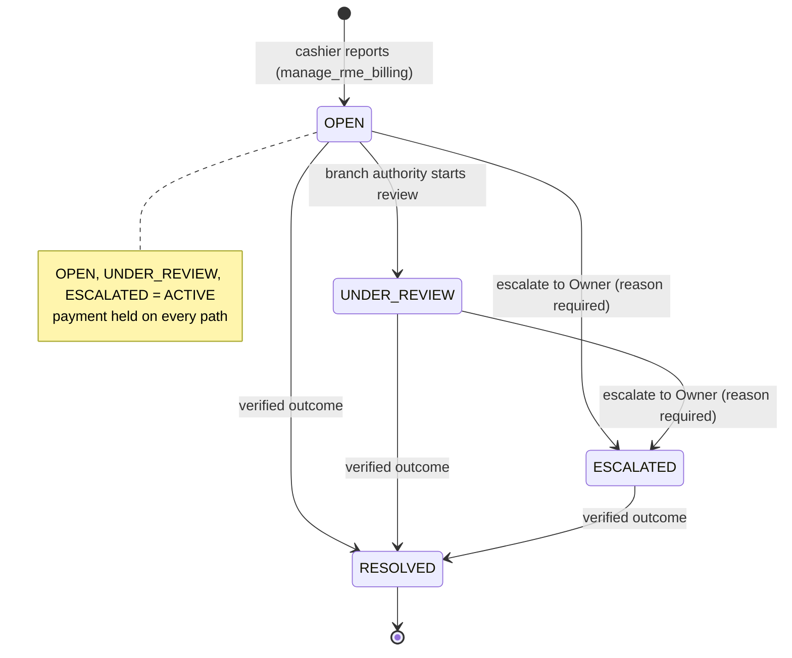
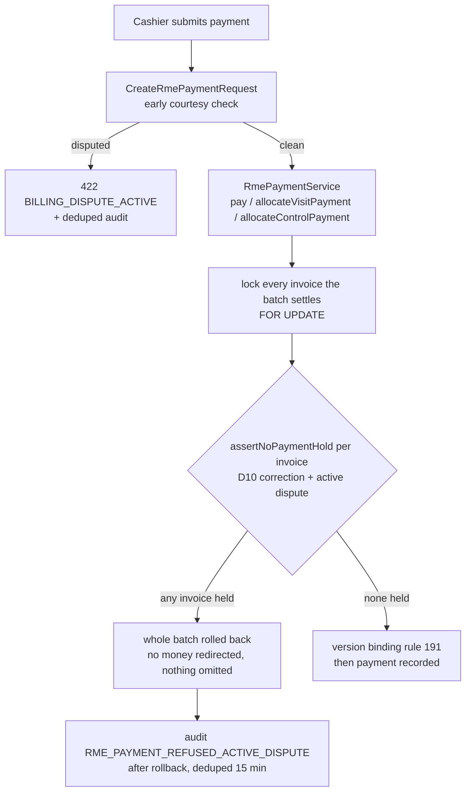

# RME billing dispute & escalation (OPS-OQ-1, rule 203)

**Owner policy:** OPS-OQ-1, approved for **all branches** — an RME invoice known to
be wrong is not collected at that amount, is not modified unilaterally, is escalated
to the responsible branch authority, stays financially unresolved until a legitimate
authorized resolution, is never marked PAID/CANCELLED/Rp0 merely because a dispute
exists, and the patient is never kept waiting for the invoice-correction pilot.

**Not in scope:** expanding the invoice-correction pilot (stays SPN4, maker 29,
checker 1), D21c/D21g/D22 (PENDING), D28 (unchanged), refund, payment reversal,
patient credit, Rp0 adjustment, post-payment correction.

## 1. Concepts

| Concept | What it is | What it is not |
|---|---|---|
| **Billing dispute** (`trx_rme_billing_disputes`) | A report that an issued invoice is known or suspected to be wrong, with a server-taken snapshot of the invoice at report time and an append-only timeline. | A correction. It changes no item, total, discount, status, version or payment. |
| **Payment hold** | While a dispute is active, every payment path refuses the invoice. | A payment block that can be switched off, or one that a correction decision releases. |
| **Correction** (rule 195–202, SPN4 only) | The maker/checker mechanism that changes an UNPAID invoice. | Something a dispute can trigger, widen or bypass. |
| **Resolution** | The only release of the hold, with an outcome the service verifies. | An override, waiver, or "close without evidence". |

## 2. State machine

The map lives in `RmeBillingDisputeStatus::TRANSITIONS`; RESOLVED is terminal and
enforced by the model. Notes can be added while active (reporter and reviewer); a
note is not a transition.

## 3. Payment hold — every path

The decisive check is the one under the lock: a report that committed before the
payment took the invoice lock holds it; one that rolled back does not (proven on
PostgreSQL, races B/C/J).

## 4. Authority

| Permission | Holder (as seeded) | May |
|---|---|---|
| `manage_rme_billing` | Kasir, Front Office, Admin Klinik… (existing) | report, add notes |
| `review_rme_billing_disputes` | **no operational role**; Super Admin via `'*'` | start review, escalate, resolve |
| `view_rme_billing_disputes` | Owner | read only |

Every action re-reads the persisted account under the invoice row lock
(`RmeBillingActorGuard::resolveUsable`) and the branch scope
(`RmeWorkingBranchScope`, server-resolved). Out-of-scope reads are 404. Which
branch-level account should review is **OPS-OQ-1a** (open owner question).

## 5. Resolution evidence

| Outcome | Verified by the service | Self-resolution |
|---|---|---|
| `CORRECTION_APPLIED` | the latest APPLIED correction produced the invoice's current version, and that version is newer than the disputed one; reference = correction number (server-filled) | allowed — the correction itself passed maker ≠ checker |
| `ORIGINAL_CONFIRMED_CORRECT` | invoice version unchanged since the report; reference recorded (6–120 chars) | **refused** (`SELF_RESOLUTION_FORBIDDEN`), Super Admin included |

No outcome while a correction is in flight (`BILLING_DISPUTE_CORRECTION_ACTIVE`).
Outside SPN4 an invoice whose original is genuinely wrong has no correction path:
the dispute stays ESCALATED and the invoice stays unresolved — the policy, not a gap
filled by an invented override.

## 6. Concurrency — lock order and linearization

Lock order everywhere: **invoice row → dispute row** (payments and corrections lock
the invoice first too), so the feature introduces no deadlock cycle.

| Race | Order | Result |
|---|---|---|
| A | report ∥ report | one dispute; loser `BILLING_DISPUTE_DUPLICATE` (lock + partial unique index) |
| B | report commits ∥ payment | payment held, 0 payments, 1 audit row |
| C | report rolls back ∥ payment | payment accepted, 0 disputes |
| D | payment commits ∥ report | dispute snapshots PARTIAL / paid 100.000 |
| E | resolution commits ∥ payment | payment accepted |
| F | resolution rolls back ∥ payment | payment held |
| G | correction submitted ∥ resolution | `BILLING_DISPUTE_CORRECTION_ACTIVE` |
| H | resolution ∥ resolution | one resolution; loser `BILLING_DISPUTE_INVALID_TRANSITION` |
| I | deactivation commits ∥ report | `ACTOR_UNUSABLE`, nothing written, audited |
| J | report ∥ visit payment selecting that receivable | whole batch held, 0 payments on both |

Linearization points: the active-dispute read of a payment (under the invoice lock),
and the actor re-read of a dispute action (after the invoice lock).

## 7. Notifications

In-app (`database` channel) only, after commit: report → review holders reaching
the branch; escalation → review + view holders. Recipients are filtered to usable
accounts in scope, never the actor. No recipient → `RME_BILLING_DISPUTE_ESCALATION_UNROUTED`.
Delivery failure → `RME_BILLING_DISPUTE_NOTIFICATION_FAILED`. Neither unwinds the
dispute or its hold. Messages carry the dispute and invoice numbers only.

## 8. Operations

- `php artisan rme:billing-dispute-status [--json] [--strict]` — run as the runtime
  user, never root. FAIL when an active hold sits in a branch no reviewer can reach;
  WATCH for a branch without a reviewer or an active dispute older than 7 days.
- Rollback: safe only while the status command reports 0 active disputes; otherwise
  forward-fix — the previous runtime cannot honour a hold.
