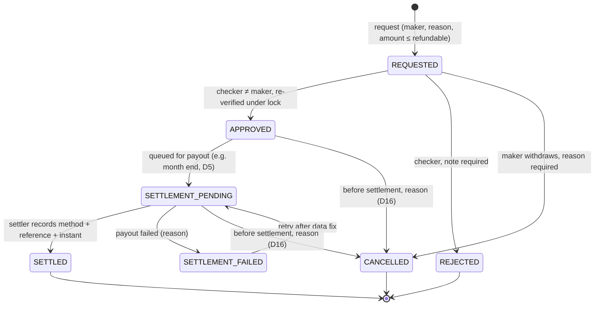

# RME Billing Refund — Technical Design (FEATURE-RME-BILLING-REFUND-1)

> **Superseded in part (2026-10-31) by `docs/architecture/rme-refund-request-approval-design.md`**
> (`PREPARATION-RME-BILLING-REFUND-REQUEST-APPROVAL-1`, rule 213). This document predates overpayment
> obligations (rule 207). Its §2.1 single table carrying request, decision AND settlement, and its §4
> refundable balance derived from `Σ payments − grand_total` minus commitments, are replaced by an
> obligation-consuming request table (Sprint 4) and a separate settlement record (Sprint 5). §1 (refund
> consumes an overpayment; a payment-entry error is a reversal) still holds. Kept as history.
>
> **Status: PROPOSED. Not implemented. Not activated.** Nothing in this document is production behaviour.
> Production behaviour is in rule 188 (CURRENT) and rule 189 (Phase 0, implemented).
> Decision codes D1–D23 are the register in `docs/AUDIT-RME-BILLING-CORRECTION-PAYMENT-REFUND-FOUNDATION-1.md` §26.
> D24–D26 are new in this sprint (see `docs/sprints/feature-rme-billing-refund-1.md` §4). Codes are per-register:
> the KTP-OCR consent "D7" is a different decision and is unrelated to receipt policy D7 here.

> **Update 2026-10-31:** implemented by `FEATURE-RME-BILLING-REFUND-REQUEST-APPROVAL-1` (rule 215) — the request and approval half of this proposal; settlement is not built. It ships with the flag `rme.billing_refund_request` OFF and an EMPTY pilot identity allowlist: built, not activated. Where this document reads as future or proposed, it records the state before implementation; decisions taken while implementing are in `docs/sprints/feature-rme-billing-refund-request-approval-1.md` §3–§4b.

---

## 1. Why refund execution is not built yet — the structural finding

The owner asked for refund **before** the rest of billing correction. The design below honours that priority, but
verification against the code shows refund cannot be the *first* executable module, independently of the open
decisions:

| Fact (CURRENT, verified) | Evidence |
|---|---|
| Every payment is capped at the invoice's remaining balance | `RmePaymentService::pay()` `amount > remainingBefore` → refused; `allocateControlPayment()` / `allocateVisitPayment()` cap with `min($remaining, …)` per invoice; `CreateRmePaymentRequest` caps at `remainingAmount()` / `total_payable` |
| An invoice's total never changes after creation | `RmeInvoiceService::create()` is the only writer of totals; no edit/void path (rule 188 §2) |
| Therefore `Σ payments ≤ grand_total` for every invoice | production 2026-10-16, read-only: **0 overpaid** of 6 invoices, 7 payments |

A refund returns money the clinic should not keep. With the ledger above, the server-derived refundable amount of
**every invoice is 0**. A refund module built today would have to either refuse every request (useless) or accept an
amount the ledger does not justify (unsafe — it would be the "ambiguous generic amount adjustment" this programme
forbids). The four real-world refund causes resolve as follows:

| Scenario | What actually happened | Accounting consequence | Can it be represented today? |
|---|---|---|---|
| **A. Genuine overpayment** | patient paid more than owed | refund the excess; invoice still PAID | **No** — overpayment is impossible while payments are capped and totals immutable |
| **B. Refund after an approved invoice reduction** | price corrected downward after payment | invoice total falls → excess appears → refund it | **No** — needs invoice correction (Phase C) + receipt snapshot (Phase E, D7) |
| **C. Payment reversal (payment-entry error)** | cashier recorded money that was never received / recorded twice | **no money moves**; the payment is reversed and the receivable reappears | **No** — and it is **not a refund**; needs its own reversal event (D26) |
| **D. Clinical cancellation** (e.g. printed Kawat Gigi ≤ 2×24 h policy) | treatment cancelled after payment | invoice reduced to what was consumed, then B | **No** — same dependency as B |

**Conclusion:** a refund is a *consumer* of an overpayment, and an overpayment is *produced* only by a correction.
Building refund first would mean manufacturing a balance the ledger does not contain. Refund execution therefore
follows Phase C (post-payment correction) and Phase E (receipt snapshot), as rule 188 §19 already sequences.
Prioritising refund means: design it first (this document), build it the moment its producer exists, and keep its
prerequisites moving now (Phase 0, shipped).

---

## 2. Data model (PROPOSED — additive migrations only)

### 2.1 `trx_rme_refunds`
| Column | Type | Rule |
|---|---|---|
| `id`, `uuid` | bigint / uuid | `uuid` UNIQUE |
| `refund_number` | string | UNIQUE; `RMEREF-{Ym WITA}-{000001}` generated under lock (do not copy BCF-07's lock-free MAX+1) |
| `branch_id` | FK `mst_branches` restrict | **= invoice branch**, never the requester's branch (D13) |
| `rme_invoice_id` | FK restrict | the single invoice the refund belongs to |
| `patient_id`, `clinic_visit_id` | FK restrict | denormalised from the invoice at request time |
| `source_correction_id` | FK nullable (Phase C table) | the correction that produced the overpayment |
| `refund_basis` | string, CHECK in (`OVERPAYMENT_AFTER_CORRECTION`, `CLINICAL_CANCELLATION`) | scenario B/D; scenario C is NOT a refund |
| `requested_amount` | decimal(15,2) | CHECK `> 0` |
| `approved_amount` | decimal(15,2) nullable | CHECK `> 0 AND <= requested_amount` |
| `status` | string, CHECK in the §3 set | |
| `reason` | text | required, ≥ 10 chars |
| `requested_by`, `requested_at` | FK users, timestamptz | |
| `decided_by`, `decided_at`, `decision_note` | | rejection note required |
| `settlement_method` | string nullable, CHECK in D5 set | D5 open (printed text says transfer at month end) |
| `settlement_reference` | string nullable | required for non-cash (audit §8) |
| `settled_by`, `settled_at` | | `settled_at` is the cash-out instant (WITA reporting) |
| `cancelled_by`, `cancelled_at`, `cancel_reason` | | D16 |
| timestamps | | **no soft delete** — a refund is a financial fact |

Indexes: partial UNIQUE `(rme_invoice_id) WHERE status IN ('REQUESTED','APPROVED','SETTLEMENT_PENDING','SETTLEMENT_FAILED')`
(one open refund per invoice); `(branch_id, settled_at)` for Model C; `(status, requested_at)` for queues.

### 2.2 `trx_rme_refund_payment_allocations` — the "original payment reference"
A refund is owed against an **invoice's** overpayment, but money was received as one or more **payments** (possibly in
a multi-invoice, cross-branch batch). Each refund records which original payments it returns money from:
`refund_id`, `rme_payment_id` (FK restrict), `amount` (CHECK `> 0`), UNIQUE `(refund_id, rme_payment_id)`.
Constraint enforced in the service under lock: `Σ allocations(payment) ≤ payment.amount` across all non-cancelled,
non-rejected refunds. Allocation is LIFO over the invoice's payments. **Payment rows are never touched** (Phase 0
model guard; rule 188 §3).

### 2.3 `trx_rme_refund_events` — append-only history
`refund_id`, `from_status`, `to_status`, `actor_id`, `occurred_at`, `metadata` jsonb (ids/amounts/codes only).
No `updated_at`. Mirrors every transition so the detail screen and audit never depend on overwritten columns.
Also written to `sys_audit_logs` via `AuditLogService` (vocabulary beside `RmeFinancialAuditEvent`).

All three tables join `PatientOwnedRecordRegistry` (BCF-13) so patient merge re-points them.

---

## 3. State machine



* **APPROVED never means money left the clinic.** Only `SETTLED` reduces cash.
* Terminal: `SETTLED`, `REJECTED`, `CANCELLED`. No transition out of `SETTLED` — a mistaken settlement is corrected by
  a new, separately audited event, never by editing the row.
* Every transition: one transaction, refund row `lockForUpdate`, status re-read under the lock, illegal transition →
  refusal, same-state repeat → idempotent no-op (replay-safe).

---

## 4. Refundable balance (server-derived, never from input)

Under the invoice row lock (the same row every payment path locks — one lock order, no deadlock):

```
overpaid(invoice)   = max(0, Σ payments.amount − invoice.grand_total)
committed(invoice)  = Σ requested_amount  for REQUESTED
                    + Σ approved_amount   for APPROVED, SETTLEMENT_PENDING, SETTLEMENT_FAILED, SETTLED
refundable(invoice) = max(0, overpaid − committed)
```

* Request: `requested_amount ≤ refundable` → else refused. Two concurrent requests serialize on the invoice lock and
  the partial unique index; the second sees the first's commitment.
* Approve: re-compute under lock; if `approved_amount > refundable + this request's own commitment` → `STALE`, refused.
* Partial and full refunds are both "≤ refundable"; nothing else distinguishes them.
* The receivable view must use the **same** ledger: an overpaid invoice is `PAID` with an explicit obligation, never a
  negative receivable (rule 188 §9). `remainingAmount()`'s clamp (BCF-04) must be paired with `overpaidAmount()`.

---

## 5. Authorization (PROPOSED — owner decisions D4, D18, D2)

| Capability | Permission | Proposed holder | Server rules |
|---|---|---|---|
| Request | `request_rme_refund` | Kasir (+ Front Office) | invoice in `RmeWorkingBranchScope`; context-bound roles pinned to working branch |
| Approve / reject | `approve_rme_refund` | Super Admin (D4) | **maker ≠ checker inside the transaction under the row lock** — `Gate::before` makes a policy check useless for Super Admin |
| Record settlement | `record_rme_refund_settlement` | separate from approval (D18) | whether settler ≠ approver is **D25** |
| Oversight read | `view_rme_refund_oversight` | Finance Klinik, Data Analyst — granted separately | `ClinicOversightScope` (never `RmeWorkingBranchScope`), GET-only, out-of-scope = 404 |
| Export | existing `export_oversight_data` | same | no KTP/NIK, formula-injection-safe CSV |

Before arming maker-checker, measure per-branch staffing (an enforced-but-unstaffable control is a stop-the-line
finding — the `LegacyRmeSodStaffing` pattern). Front Office holds Admin Klinik + Kasir permissions, so separation is
per **account**.

---

## 6. Routes and UI (PROPOSED)

```
KASIR
└── Billing Refund                 /rme/cashier/refunds
    ├── Ajukan Refund              GET/POST  …/create  (from an invoice with refundable > 0 only)
    ├── Pengajuan Saya             GET       …?mine=1
    └── Riwayat Refund             GET       …
APPROVAL
└── Persetujuan Refund             /approvals/rme-refunds
    ├── Menunggu Persetujuan       GET  ?status=REQUESTED
    ├── Disetujui                  GET  ?status=APPROVED,SETTLEMENT_PENDING
    └── Ditolak                    GET  ?status=REJECTED
BILLING CORRECTION (oversight, read-only)
└── Riwayat Billing Refund         /oversight/billing-refunds  (GET only)
```

Blade + Tailwind + Alpine, `x-ui.*` components, UIX tokens. The "Ajukan Refund" action is offered only where the
server reports `refundable > 0`, but that is a courtesy — the service refuses independently. Oversight columns: patient,
RM number, branch, invoice number, original payment(s), requested / approved / settled amounts, reason, requester,
approver, status, settlement instant, detail history; filters by WITA date range, branch, status, patient/invoice
search; pagination; print/PDF/export gated by `export_oversight_data`.

---

## 7. Refund document

`RMEREF-…` reference, invoice number, original payment number(s), patient, branch, amount, reason, approval (who/when),
settlement (method, reference, instant, settler), issue timestamp (WITA).
* Until `SETTLED` the document carries a prominent **"DISETUJUI — BELUM DICAIRKAN"** stamp and never prints a
  settlement block; after `SETTLED` it prints **"DICAIRKAN"** with the recorded instant.
* The original receipt is never replaced: it renders from the Phase E snapshot marked superseded (D7).
* Existing masking applies; no KTP/NIK.

---

## 8. Reporting — Model C (PROPOSED, D8/D9)

```
Gross collections(period, branch) = Σ payments.amount by paid_at (unchanged KPI 3)
Settled refunds(period, branch)   = Σ refunds.approved_amount WHERE status = SETTLED, by settled_at (WITA)
Net collections                   = Gross − Settled refunds
Refund obligations (as of now)    = Σ approved_amount WHERE status IN (APPROVED, SETTLEMENT_PENDING, SETTLEMENT_FAILED)
```

Attribution by **invoice branch** (D13). Closed periods are never restated. Existing KPI formulas (rule 186/187) are
not edited; Model C is added beside them, behind its own section, only after D8/D9.

---

## 9. Test matrix (minimum before activation)

Valid request · invalid/foreign/void payment · partial · full · excessive (> refundable) · duplicate (partial unique
index) · concurrent requests exceeding refundable (PostgreSQL, two sessions) · self-approval refused incl. Super Admin ·
unauthorized approval · cross-branch request/approval refused · settlement authorization · settlement idempotency
(replay = no-op) · concurrent settlement (one wins) · failed settlement + retry · refund after partial payment ·
carry-over batch (allocation stays on the original invoice's payments) · cross-branch batch attribution · Model C
reconciliation (gross − settled = net per branch) · WITA day boundaries for `settled_at` · original payment immutable
(Phase 0 guard) · original receipt preserved · audit rows PII-free · Finance Klinik / Data Analyst read-only (403 on
every write route) · Finance laboratory role untouched · Cashier / Receivables / Invoice regression.

---

## 10. Activation sequence

1. Owner decisions: D2, D4, D5, D6, D7, D8, D9, D12, D13, D16, D18, D24–D26 (see sprint doc §4).
2. Phase A (correction request/approval foundation) and Phase C (post-payment correction with `overpaidAmount()`).
3. Phase E (receipt snapshot) — before any post-payment correction or refund document.
4. Phase D (this design): migrations → services → policies → UI, flag `rme.billing_refund` default OFF.
5. Seed `PermissionSeeder` → `RoleSeeder` → `permission:cache-reset` (in that order).
6. Staffing measurement for maker ≠ checker per branch.
7. Real-device / real-user verification on a non-production refund before enabling for a branch.
