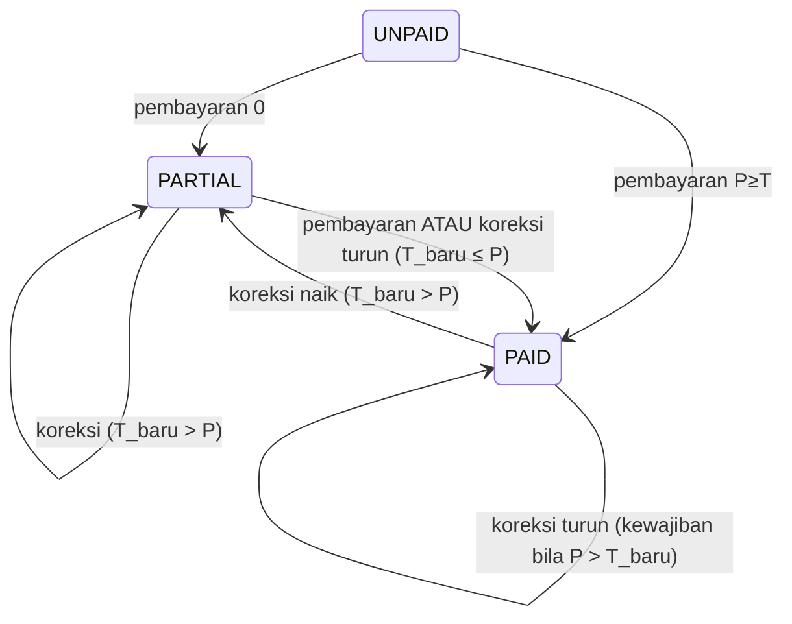
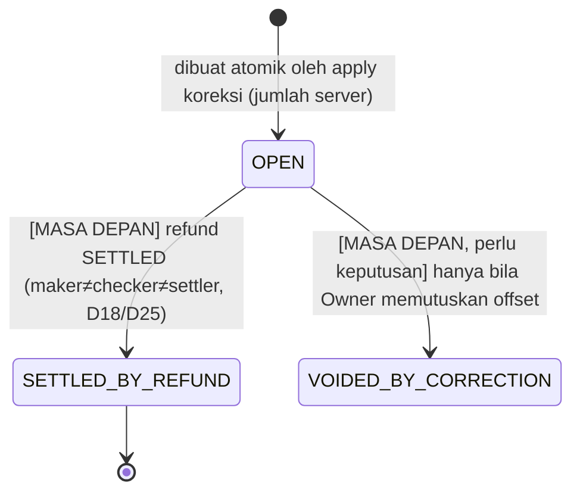

# Desain Koreksi Tagihan RME Setelah Pembayaran (PARTIAL / PAID)

> **Status: keputusan Owner PP-1…PP-10 `OWNER_POLICY_APPROVED` (ratifikasi 2026-10-25) — desain ini menjadi dasar implementasi; tetap `NOT_IMPLEMENTED` dan aktivasi diblokir PP-10.** Status asli: ~~PROPOSED — persiapan, tidak diimplementasikan, tidak diaktifkan.~~
> Tidak ada isi dokumen ini yang merupakan perilaku produksi. Perilaku produksi ada
> di rule 188–205. Setiap kebijakan di sini menunggu keputusan Owner PP-1…PP-10
> (`docs/decisions/rme-postpayment-correction-owner-decision-proposals.md`).
>
> Tugas: `PREPARATION-RME-POSTPAYMENT-INVOICE-CORRECTION-1` · ADR: `docs/adr/0012-rme-postpayment-invoice-correction.md`
> Baseline terverifikasi 2026-10-25 15:10 WITA: produksi `20303a5b92f7bc85d0b34abfbc1c880ef49d6112`
> (tree `058d66ff`, tag `fix-rme-payment-submission-idempotency-1-go`), basis kanonik
> `97e561b0` (dokumen saja di atas `20303a5b`), rule terbaru 205.

Daftar isi: §1 Fakta produksi · §2 Audit arsitektur (Graphify + sumber) · §3 Matriks
skenario finansial A–L · §4 Matriks invarian finansial · §5 Diagram transisi status ·
§6 Model data usulan · §7 Rencana konkurensi PostgreSQL · §8 Desain keamanan &
model ancaman · §9 Rencana rekonsiliasi finansial · §10 Rencana keamanan migrasi ·
§11 Kompatibilitas rollback · §12 Matriks uji TDD · §13 Rencana sprint implementasi ·
§14 Kriteria penerimaan · §15 Gerbang rilis produksi.

---

## 1. Fakta produksi (read-only, 2026-10-25 15:10 WITA)

Diambil dengan `psql` sebagai `postgres`, `default_transaction_read_only=on`
(dikonfirmasi `on`), tanpa REPL, tanpa penulisan.

| Ukuran | Nilai |
|---|---|
| Tagihan per status | PAID 6 (Rp8.548.000), PARTIAL 1 (Rp4.000.000), UNPAID 1 (Rp0 — #36) |
| Pembayaran | 9 baris, Rp10.548.000 |
| Tagihan kelebihan bayar (`Σ paid > grand_total`) | **0** |
| Tagihan dengan >1 pembayaran | 2 (#35, #38) |
| Batch pembayaran multi-tagihan / lintas cabang | 0 / 0 |
| Cabang dengan tagihan PARTIAL/PAID | hanya SPN4 |
| Kandidat lab pada tagihan RME | 2 (#38, #42 — keduanya `pending_review`) |
| Koreksi | **1 — `RMECOR-202610-000001`, PRE_PAYMENT, APPLIED** |
| Versi dokumen | 2 (v0 ORIGINAL + v1 REVISION untuk #42) |
| Dispute tagihan | 0 |
| Peninjau dispute cabang aktif | **1** (user 11, cabang id 5 = SPN4, diberikan user 1 pada 03:21:58 UTC) |
| `trx_rme_payment_submissions` | 0 baris |

**Bukti baru yang belum tercatat di dokumen mana pun.** Pada 2026-10-25
**11:20–11:24 WITA** terjadi koreksi pra-bayar nyata pertama:

| Waktu (UTC) | Kejadian | Aktor |
|---|---|---|
| 03:20:10 | Tagihan #42 (SPN4) dibuat, Rp6.000.000 | — |
| 03:20:52 | Koreksi #1 SUBMITTED, Rp6.000.000 → Rp5.000.000 (selisih −Rp1.000.000) | user 29 |
| 03:21:58 | Peninjau dispute SPN4 ditetapkan (user 11) | user 1 |
| 03:23:22 | APPROVED → APPLIED (D1a, satu transaksi), v0 + v1 dibekukan | user 1 |
| 03:24:00 (`paid_at` 03:23:00) | Pembayaran #50 Rp5.000.000 → tagihan PAID | kasir user 29 |
| 03:24:00 | Kandidat lab #13 untuk #42 dibuat (pembayaran lunas) | sistem |

Rekonsiliasi cepat: Σ item #42 = Rp5.000.000 = `grand_total`; v0 `grand_total_cents`
= 600.000.000, v1 = 500.000.000; audit SUBMITTED/APPROVED/APPLIED masing-masing 1,
DOCUMENT_VERSION_ISSUED 2, INVOICE_CREATED 1, PAYMENT_RECORDED 1. Sesi aplikasi
user 1 (terakhir 03:23:33) dan user 29 (terakhir 03:41:53) tercatat.

**Batas pembacaan ini.** Alasan koreksi (30 karakter) tidak memuat referensi
persetujuan Owner yang dapat dikenali, dan catatan keputusan kosong. Dokumen ini
**tidak** menyatakan bahwa kasus ini disetujui Owner, **tidak** memverifikasi Sprint 2,
dan **tidak** mengubah status Sprint 2 (`OPERATIONAL_BLOCKED` menurut brief). Bukti
ini harus diverifikasi oleh tugas verifikasi closure Sprint 2 tersendiri (lihat §15
RG-0). Catatan: `paid_at` (03:23:00) lebih awal 22 detik dari `applied_at` karena
`paid_at` dibulatkan ke menit; rekonsiliasi berurutan memakai `created_at`, bukan
`paid_at`.

---

## 2. Audit arsitektur

### 2.1 Graphify

Graf Graphify di checkout utama dibangun dari branch lama dan tidak memuat modul
ini, sehingga **tidak dipakai**. Graf dibangun ulang di worktree tugas:
`graphify update app --no-cluster` (AST-only, tanpa LLM) → **18.974 node, 40.855 edge**,
mencakup `RmeInvoiceCorrectionService`, `RmePaymentService`, `RmeBillingDisputeService`,
`RmeControlReceivableService`, `RmePaymentSubmissionService`, `RmeInvoiceSnapshot`,
`RmeInvoiceDocumentVersion`, `RmeLabIntegrationService`, `OversightKpiRepository`,
`RmeWorkingBranchScope`, `ClinicOversightScope`, `RmeFinancialAuditEvent`.

| Kueri Graphify | Hasil graf | Cek silang sumber |
|---|---|---|
| `path RmeInvoiceCorrectionService → RmePaymentService` | 4 hop lewat `RmeFinancialAuditEvent` (INFERRED) | **Tidak ada panggilan langsung.** Keduanya berbagi repositori: `RmePaymentService` mendapat `RmeInvoiceCorrectionRepositoryInterface` (D10 `assertNoActiveCorrection`); layanan koreksi membaca `$invoice->payments()` (kelayakan/staleness). Graf benar: tidak ada edge call. |
| `path RmePaymentService → RmeBillingDisputeService` | lewat `now()` (INFERRED, noise) | Pembayaran memakai `RmeBillingDisputeRepositoryInterface` (`assertNoActiveDispute`), bukan layanannya. |
| `path RmeBillingDisputeService → RmeInvoiceCorrectionService` | lewat `auditlogservice` import | Dispute membaca `corrections->activeForInvoice` dan `latestAppliedForInvoice` (resolusi `CORRECTION_APPLIED`). |
| `path RmePaymentService → RmeControlReceivableService` | lewat import `branchservice` | Konstruktor pembayaran menerima `RmeControlReceivableService $carryOver` langsung — graf melewatkan edge injeksi konstruktor (keterbatasan AST). |
| `path RmeInvoiceCorrectionService → OversightKpiRepository` | lewat import `db` | Tidak ada ketergantungan; oversight membaca tabel langsung via SQL (`grand_total − COALESCE(paid)` dengan filter `> 0`). |
| `explain RmeInvoiceCorrectionService` | degree 44, 37 method | Cocok dengan sumber (1.287 baris). |

**Kesimpulan cek silang:** graf AST andal untuk keanggotaan method dan import, tetapi
edge `INFERRED` lewat utilitas bersama (`now()`, `db`) adalah noise, dan injeksi
konstruktor tidak menjadi edge. Semua ketergantungan di bawah diverifikasi di sumber.

### 2.2 Rantai Invoice → … → Reporting (terverifikasi di sumber)

```
RmeInvoice (trx_rme_invoices: status, grand_total, correction_version)
 ├─ RmeInvoiceItem (item; diganti HANYA oleh applyLocked)
 ├─ RmePayment (trx_rme_payments; immutable — rule 189)
 │    └─ RmePaymentSubmission (trx_rme_payment_submissions; UNIQUE intent_key — rule 205)
 ├─ alokasi: satu baris pembayaran per tagihan; batch = payment_batch_uuid (tanpa tabel alokasi)
 ├─ piutang: remaining = max(0, grand_total − Σ paid)  (model, kasir, oversight, dashboard)
 ├─ RmeInvoiceCorrection (trx_rme_invoice_corrections)
 │    ├─ maker  = requested_by   (PilotIdentity maker 29)
 │    ├─ checker= decided_by     (PilotIdentity checker 1; maker≠checker per akun, di layanan)
 │    ├─ approval = approve() → applyLocked() dalam SATU transaksi (D1a)
 │    ├─ lines (KEEP/CHANGE/ADD/REMOVE) → "adjustment" atas item
 │    └─ events (append-only) + sys_audit_logs (RmeFinancialAuditEvent, PII-free)
 ├─ RmeInvoiceDocumentVersion (v0 ORIGINAL + vN REVISION, SHA-256, immutable — D7)
 ├─ RmeBillingDispute (laporan; menahan pembayaran — rule 203/204)
 ├─ LabCaseCandidate (dibuat setelah PAID; D23 menolak koreksi)
 └─ Reporting: KPI kas = Σ payments per paid_at; piutang = UNPAID/PARTIAL clamp;
    DoctorPerformance billed = Σ grand_total / Σ item subtotal (berubah bila dikoreksi)
 [BELUM ADA] Refund obligation · Refund · Reversal · Kredit pasien
```

### 2.3 Batas dan ketergantungan yang ditemukan

| Area | Temuan (sumber) | Implikasi pasca-bayar |
|---|---|---|
| Batas pembayaran imutabel | `RmePayment` menolak update/delete; `trx_rme_payment_submissions` FK restrict | Koreksi tidak boleh menulis tabel pembayaran apa pun |
| Ketergantungan versi | `correction_version` dibaca oleh form pembayaran (rule 191), dispute (`invoice_correction_version_at_report`), audit pembayaran, snapshot | Setiap apply menaikkan versi → form pembayaran lama ditolak; dispute membandingkan versi |
| Fingerprint | `RmeInvoiceSnapshot::fingerprint()` memuat status, versi, item, **dan pembayaran (id+jumlah)** | Pembayaran baru setelah pengajuan otomatis menjadi `INVOICE_CONTENT_CHANGED` → STALE |
| Kelayakan saat ini | `prePaymentIneligibility()`: pembayaran ada → `CORRECTION_TYPE_NOT_ENABLED`; bukan UNPAID → `CORRECTION_INVOICE_NOT_UNPAID` | Perlu fungsi kelayakan kedua, bukan pelonggaran fungsi lama |
| Staleness saat ini | `staleReason()`: pembayaran ada → `PAYMENT_RECORDED`; status ≠ UNPAID → `INVOICE_STATUS_CHANGED` | Untuk pasca-bayar: stale bila ledger (`Σ paid`, daftar pembayaran) atau status berbeda dari snapshot |
| Sanity apply | `applyLocked()` melempar `LogicException` bila status ≠ UNPAID atau pembayaran ada | Harus menjadi cabang tipe-spesifik; untuk pasca-bayar status diturunkan dari ledger |
| Model penyesuaian finansial | Tidak ada tabel penyesuaian umum; "penyesuaian" = baris koreksi + versi dokumen | Kewajiban kelebihan bayar = entitas baru |
| Ketergantungan settlement | Status ditulis oleh `refreshInvoiceStatus()` (privat di `RmePaymentService`); `paid ≥ total ⇒ PAID` | Turunkan status dengan rumus yang sama, satu sumber (helper bersama) |
| Titik integrasi refund | Desain refund §2.1 sudah memiliki `source_correction_id` dan `refund_basis = OVERPAYMENT_AFTER_CORRECTION` | Kewajiban kelebihan bayar menjadi input refund |
| Otorisasi cabang | Koreksi: cabang dari baris tagihan yang dikunci + `RmeInvoiceCorrectionPilotScope` (SPN4) + `RmeWorkingBranchScope`; carry-over: cabang yang sama saja (OD-1a) | Kewajiban dan piutang baru milik cabang tagihan |
| Urutan lock PG | Semua jalur pembayaran: tagihan rute dulu, lalu origin/piutang (FIFO); koreksi: tagihan → koreksi; dispute: tagihan dulu | Tambahkan kewajiban SETELAH koreksi; tidak ada lock baru di depan tagihan |
| Idempotensi | Koreksi: `idempotency_key` UNIQUE + replay; pembayaran: intent HMAC + `invoice_balances` (rule 205) | Saldo yang ditampilkan form berubah setelah apply → `PAYMENT_BALANCE_CHANGED` (benar) |
| Kwitansi | Dirender live, hanya bila PAID (`RmePaymentController::receipt`) | Kwitansi lama harus di-snapshot (Fase E) |
| Pelaporan | Oversight/dashboard clamp `max(0, …)` + filter `> 0` / status UNPAID/PARTIAL; `paidAmount()` dan SQL ringkasan kasir menghitung mentah | Tagihan kelebihan bayar harus `PAID` + kewajiban terpisah, tidak pernah piutang negatif |
| Kandidat lab | Dibuat hanya dari jalur pembayaran saat tagihan menjadi PAID (`generateLabCandidatesIfPaid`) | Koreksi yang membuat PAID tidak memicu kandidat; D23 menolak tagihan berkandidat (PP-8) |

---

## 3. Matriks skenario finansial A–L

Angka ilustrasi (bukan data produksi). `T` = total tagihan, `P` = Σ pembayaran.
Rumus: `outstanding = max(0, T − P)`, `overpaid = max(0, P − T)`.

| # | Skenario | T asli | P historis | T koreksi | Outstanding | Overpaid | Penyesuaian (baris koreksi) | Kewajiban refund | Versi tagihan | Status | Diizinkan | Dilarang |
|---|---|---|---|---|---|---|---|---|---|---|---|---|
| A1 | PARTIAL turun, tetap di atas P | 4.000.000 | 2.000.000 | 3.000.000 | 1.000.000 | 0 | CHANGE/REMOVE, Δ −1.000.000 | — | n→n+1 | PARTIAL→PARTIAL | apply; bayar sisa setelahnya | apply saat D10/dispute aktif menahan pembayaran (pembayaran ditolak, koreksi boleh) |
| A2 | PARTIAL turun di bawah P | 4.000.000 | 2.000.000 | 1.500.000 | 0 | 500.000 | Δ −2.500.000 | OPEN 500.000 | n→n+1 | PARTIAL→PAID | apply + kewajiban atomik | refund otomatis; piutang negatif |
| B | PARTIAL naik | 4.000.000 | 2.000.000 | 5.000.000 | 3.000.000 | 0 | CHANGE/ADD, Δ +1.000.000 | — | n→n+1 | PARTIAL | apply; penagihan biasa di cabang tagihan | penagihan otomatis; penagihan di cabang lain (OD-1a) |
| C | PAID turun | 5.000.000 | 5.000.000 | 4.000.000 | 0 | 1.000.000 | Δ −1.000.000 | OPEN 1.000.000 | n→n+1 | PAID→PAID | apply + kewajiban atomik; kwitansi lama dicap DIREVISI | refund otomatis; mengubah pembayaran |
| D | PAID naik | 5.000.000 | 5.000.000 | 6.000.000 | 1.000.000 | 0 | Δ +1.000.000 | — | n→n+1 | PAID→PARTIAL | apply; tagih sisa; kwitansi live tidak tersedia sampai lunas lagi | membuka kembali kunjungan; membatalkan kandidat lab (D23 menolak bila ada) |
| E | T koreksi = P | 4.000.000 | 2.000.000 | 2.000.000 | 0 | 0 | Δ −2.000.000 | — | n→n+1 | PARTIAL→PAID | apply; kandidat lab = PP-8 | membuat pembayaran Rp0 palsu |
| F | Banyak pembayaran historis | 3.000.000 | 1.000.000 + 2.000.000 | 2.500.000 | 0 | 500.000 | Δ −500.000 | OPEN 500.000 (per tagihan; alokasi ke pembayaran asli = tugas refund, LIFO) | n→n+1 | PAID | apply; snapshot memuat semua pembayaran | memilih pembayaran mana yang "dikurangi"; mengubah salah satu baris |
| G | Kontrol lintas cabang (OD-1) | origin cabang A | dibayar di A | — | milik A | milik A | koreksi milik cabang tagihan | milik cabang tagihan | — | — | koreksi oleh maker yang lingkupnya mencakup cabang tagihan + pilot allowlist | koreksi/penagihan/kewajiban dicatat atas cabang aktor; carry-over lintas cabang (OD-1a) |
| H | Dispute aktif (rule 203) | — | — | — | — | — | koreksi boleh diajukan; pembayaran tetap ditahan | — | — | — | apply lalu resolusi dispute `CORRECTION_APPLIED` (diverifikasi sistem) | resolusi dispute saat koreksi aktif; dispute menahan atau melepas apa pun selain pembayaran |
| I | Koreksi aktif/konflik | — | — | — | — | — | — | — | — | — | satu koreksi aktif per tagihan; tipe ditentukan server | koreksi kedua (`CORRECTION_ALREADY_ACTIVE`); tipe dari klien |
| J | Pembayaran & koreksi bersamaan | — | — | — | — | — | — | — | — | — | serialisasi di lock tagihan; D10 menolak pembayaran saat koreksi aktif; pembayaran yang commit lebih dulu masuk snapshot | form pembayaran lama setelah apply (ditolak versi/saldo — rule 191/205) |
| K | Kewajiban refund belum selesai | 5.000.000 | 5.000.000 | (sudah 4.000.000, OPEN 1.000.000) | 0 | 1.000.000 | koreksi baru **ditolak** `CORRECTION_OVERPAYMENT_OBLIGATION_OPEN` | tetap OPEN | tetap | PAID | menunggu modul refund | menyesuaikan/menghapus kewajiban lewat koreksi |
| L | Koreksi berulang | v0 5.000.000 | 5.000.000 | v1 4.500.000 (OPEN 500.000) → v2 ditolak (K) | — | — | rantai v0→v1→…; total asli selalu dari v0 (D28) | satu kewajiban per koreksi | +1 per apply | diturunkan | koreksi berikutnya setelah kewajiban selesai | menimpa versi; total asli dari baris live setelah v>0 |

Catatan: **tidak ada satu skenario pun yang menulis ulang pembayaran historis.**
Pasca-bayar ⇒ `P > 0`, sehingga status `UNPAID` tidak pernah menjadi hasil.

---

## 4. Matriks invarian finansial

| ID | Invarian | Ditegakkan di (usulan) | Bukti uji |
|---|---|---|---|
| FI-1 | Baris pembayaran tidak berubah: jumlah, `Σ`, dan hash baris identik sebelum/sesudah apply | model `RmePayment` (sudah) + tidak ada kode koreksi yang menulis `trx_rme_payments` | hash baris + uji mutasi |
| FI-2 | Total dihitung server dalam sen; total terapan = total disetujui, else rollback | `applyLocked()` (sudah) | uji rekonsiliasi |
| FI-3 | `outstanding − overpaid = T − P`; tidak keduanya > 0 | helper ledger bersama | properti/tabel |
| FI-4 | Status hanya hasil turunan: `0<P<T ⇒ PARTIAL`, `P ≥ T ⇒ PAID`; tidak pernah UNPAID untuk pasca-bayar | helper status bersama (dipakai pembayaran & koreksi) | matriks A–F |
| FI-5 | Kewajiban = `max(0, P − T_baru)`, dibuat di transaksi yang sama, tidak dibuat bila 0 | layanan koreksi | A2, C, F |
| FI-6 | Tidak ada piutang negatif di mana pun; kelebihan bayar tidak masuk `SUM` piutang | filter/clamp yang ada + uji regresi semua konsumen | regresi oversight/dashboard/kasir |
| FI-7 | Koreksi tidak memindahkan uang: tidak ada pembayaran, refund, reversal, settlement | layanan koreksi | delta tabel = 0 |
| FI-8 | v0 dibekukan sekali; vN per apply; kwitansi terbit dirender dari snapshot | `freezeVersion()` (sudah) + snapshot kwitansi (baru, Fase E) | versi dokumen |
| FI-9 | Total asli dari v0 (D28); total usulan Rp0 ditolak (D21g) | `zeroOriginalIneligibility()` (sudah, tipe-agnostik) | uji D28 |
| FI-10 | ≤1 koreksi aktif per tagihan; ≤1 kewajiban OPEN per tagihan | partial unique index + lock | race PG |
| FI-11 | Koreksi, kewajiban, piutang milik **cabang tagihan**, tidak pernah cabang aktor | baris tagihan yang dikunci | uji IDOR |
| FI-12 | Setiap transisi: event append-only + audit PII-free dalam transaksi yang sama | `recordTransition()` (sudah) + event kewajiban | delta audit |
| FI-13 | `correction_version` naik tepat 1 per apply | `applyCorrectionTotals()` (sudah) | versi |
| FI-14 | KPI kas (Σ pembayaran per `paid_at`) tidak berubah oleh koreksi | tidak ada penulisan pembayaran | regresi KPI |
| FI-15 | D10: tidak ada pembayaran selama koreksi aktif (semua tipe) | `assertNoActiveCorrection()` (sudah, tipe-agnostik) | uji D10 |
| FI-16 | Dispute menahan pembayaran sampai resolusi terverifikasi; koreksi tidak menyelesaikan dispute sendiri | rule 203 (sudah) | uji dispute |

---

## 5. Diagram transisi status

### 5.1 Koreksi (state machine tidak berubah; tipe ditetapkan server)

```mermaid
stateDiagram-v2
  [*] --> SUBMITTED: submit (maker 29) — tipe = ledger (P>0 ⇒ POST_PAYMENT)
  SUBMITTED --> APPROVED: approve (checker 1) — event ditulis
  APPROVED --> APPLIED: apply dalam transaksi YANG SAMA (D1a); tidak pernah terlihat transaksi lain
  SUBMITTED --> REJECTED: reject (checker, catatan wajib)
  SUBMITTED --> CANCELLED: cancel (maker, alasan wajib)
  SUBMITTED --> STALE: revalidasi gagal di bawah lock
  APPLIED --> [*]
  REJECTED --> [*]
  CANCELLED --> [*]
  STALE --> [*]
```



`APPROVED` tetap ada di skema untuk jalur pemulihan pra-D1a; untuk pasca-bayar
diusulkan **tidak ada jalur pemulihan** (approve selalu atomik).

### 5.2 Status tagihan sebagai turunan ledger



### 5.3 Kewajiban kelebihan bayar (Sprint 3 hanya membuat `OPEN`)



Hanya `OPEN` yang dibangun di Sprint 3. Tidak ada transisi keluar dari `OPEN` sebelum
modul refund dan keputusannya ada.

---

## 6. Model data usulan (migrasi aditif saja)

### 6.1 `trx_rme_invoice_corrections` — kolom tambahan (nullable, tanpa backfill)

| Kolom | Tipe | Aturan |
|---|---|---|
| `invoice_status_at_request` | string(20) | status tagihan saat submit (dari snapshot) |
| `paid_payment_count_at_request` | integer | jumlah baris pembayaran saat submit |
| `outstanding_after`, `overpaid_after` | decimal(15,2) | ditulis saat APPLIED, CHECK `>= 0`, CHECK bukan keduanya > 0 |
| `invoice_status_after` | string(20) | status turunan setelah apply |

`paid_total_at_request` sudah ada. Baris PRE_PAYMENT lama tetap NULL.

### 6.2 `trx_rme_overpayment_obligations` (baru)

| Kolom | Tipe | Aturan |
|---|---|---|
| `id`, `uuid` | bigint / uuid | `uuid` UNIQUE |
| `obligation_number` | string(40) | UNIQUE, `RMEOVP-{Ym}-{id 6 digit}` setelah insert (pola nomor koreksi, tanpa MAX+1) |
| `branch_id` | FK `mst_branches` restrict | = cabang tagihan |
| `rme_invoice_id`, `patient_id`, `clinic_visit_id` | FK restrict | dari tagihan yang dikunci |
| `source_correction_id` | FK `trx_rme_invoice_corrections` restrict, **UNIQUE** | satu kewajiban per koreksi |
| `amount` | decimal(15,2) | CHECK `> 0` |
| `invoice_version` | integer | versi tagihan yang menimbulkannya |
| `status` | string(30) | CHECK `IN ('OPEN')` di Sprint 3 (diperluas aditif oleh sprint refund) |
| `created_by`, `created_at` | FK users, timestamptz | = checker yang menerapkan |
| timestamps | | **tanpa soft delete** |

Index: partial UNIQUE `(rme_invoice_id) WHERE status = 'OPEN'`; `(branch_id, status)`;
`(status, created_at)`.

### 6.3 `trx_rme_overpayment_obligation_events` (baru, append-only)

`obligation_id`, `from_status`, `to_status`, `actor_id`, `occurred_at`, `metadata`
jsonb (id/jumlah/kode saja). Tanpa `updated_at`. Model menolak update/delete.

### 6.4 Snapshot kwitansi (Fase E, baru — prasyarat aktivasi)

`trx_rme_receipt_snapshots`: satu baris per kwitansi yang pernah diterbitkan
(`rme_invoice_id`, `invoice_version`, `snapshot` jsonb, `sha256`, `issued_at`,
`issued_by`), immutable. Kwitansi untuk versi lama dirender dari snapshot dengan cap
**"DIREVISI — lihat versi ke-N"**. Alternatif yang lebih kecil (render kwitansi
lama dari versi dokumen vN terkait) dievaluasi di P3 §13; keputusan presentasi = PP-5.

### 6.5 Yang sengaja TIDAK dibuat

Tabel refund, settlement, reversal, kredit pasien, piutang negatif, alokasi
kewajiban ke pembayaran, kolom `overpaid` di `trx_rme_invoices` (nilai selalu
diturunkan dari ledger, tidak disimpan ganda).

---

## 7. Rencana konkurensi PostgreSQL

**Urutan lock (satu-satunya):**

```
L1  trx_rme_invoices            FOR UPDATE   (tagihan yang dikoreksi — sama dengan jalur pembayaran & dispute)
L2  trx_rme_invoice_corrections FOR UPDATE   (koreksi tersebut)
L3  trx_rme_overpayment_obligations          (insert; dan FOR UPDATE kewajiban OPEN bila ada — untuk menolak K)
```

* Tidak ada lock baru di depan L1. Kunjungan (`trx_clinic_visits`) **tidak dikunci**
  oleh koreksi.
* Jalur pembayaran mengunci tagihan rute lalu origin/piutang (FIFO); koreksi hanya
  mengunci satu tagihan ⇒ tidak ada siklus (siklus butuh dua pengunci multi-baris).
* Dispute mengunci tagihan dulu ⇒ serial dengan koreksi.
* Semua keputusan (kelayakan, ledger `Σ paid`, staleness, D28, kewajiban terbuka,
  identitas akun) dibuat **setelah** L1. Akun dibaca ulang setelah L1 (titik
  linearisasi, rule 201 §29).
* Insert kewajiban mengambil KEY SHARE pada baris tagihan (FK) — kompatibel dengan
  FOR UPDATE milik transaksi yang sama.
* Backstop database: `trx_rme_inv_corr_one_active_uq` (sudah) + partial unique
  kewajiban OPEN (baru) + UNIQUE `source_correction_id` (baru).
* Deadlock: tidak diharapkan; bila PostgreSQL membatalkan, transaksi approve
  diulang ≤3 kali dengan keputusan ulang penuh (pola rule 205 §26/26a), lalu
  `CORRECTION_CONCURRENT_RETRY`.
* Isolasi: READ COMMITTED + lock baris eksplisit (sama dengan sistem saat ini).

**Uji race PostgreSQL wajib** (pola `tests/Feature/RmeInvoiceCorrection/race_child.php`,
layanan nyata di kedua sisi, koneksi penulis kloning):

| # | Race | Hasil yang diharapkan |
|---|---|---|
| R1 | approve(pasca-bayar) vs pembayaran baru | salah satu serial; pembayaran ditolak D10 atau koreksi STALE |
| R2 | dua approve bersamaan | satu APPLIED; yang lain no-op replay |
| R3 | submit vs pembayaran | pembayaran ditolak (D10) atau koreksi melihat pembayaran di snapshot |
| R4 | dua submit tipe berbeda | satu aktif; lainnya `CORRECTION_ALREADY_ACTIVE` |
| R5 | approve vs pengajuan dispute | serial di L1; dispute melihat versi baru atau koreksi melihat dispute (tidak memengaruhi apply) |
| R6 | approve vs penonaktifan akun checker | rule 201 §29: penonaktifan yang belum commit kalah |
| R7 | dua apply yang menimbulkan kewajiban pada tagihan yang sama | satu kewajiban OPEN; yang lain ditolak K |
| R8 | approve vs pembayaran multi-tagihan yang mencakup tagihan ini | tanpa deadlock; serial |

---

## 8. Desain keamanan & model ancaman

### 8.1 Kontrol

| Kontrol | Desain |
|---|---|
| Maker–Checker | maker≠checker per AKUN di layanan, di bawah L1, termasuk Super Admin (`Gate::before` membuat policy tidak berguna) — sama dengan pra-bayar |
| Otorisasi khusus kasus | setiap koreksi pasca-bayar wajib referensi persetujuan Owner per kasus (PP-2); checker menerima persetujuan langsung dari Owner, bukan dari teks maker (rule 202) |
| Identitas pilot | `RmeInvoiceCorrectionPilotIdentity` (29 submit, 1 approve/reject) diterapkan juga pada tipe pasca-bayar (usulan PP-1); tidak diperluas |
| Isolasi cabang | cabang dari baris yang dikunci; `RmeInvoiceCorrectionPilotScope` (SPN4); `RmeWorkingBranchScope`; out-of-scope = 403/404 |
| Snapshot imutabel | `original_snapshot`/`proposed_snapshot` (jsonb, schema-versioned, fingerprint) — sudah |
| Preservasi pembayaran | tidak ada kode koreksi yang menulis tabel pembayaran; diuji dengan hash baris |
| Penyesuaian finansial | hanya lewat baris koreksi + versi dokumen |
| Kewajiban refund | jumlah diturunkan server; immutable; tanpa jalur penghapusan; tidak ada settlement di Sprint 3 |
| D10 | tipe-agnostik (sudah) |
| OPS-OQ-1 | dispute tetap menahan pembayaran; resolusi `CORRECTION_APPLIED` diverifikasi sistem |
| Idempotensi pembayaran | rule 205: form lama ditolak setelah apply (versi + saldo) |
| Proteksi versi | `invoice_version_at_request` + fingerprint (termasuk pembayaran) |
| Audit | event append-only + `sys_audit_logs` PII-free, transaksi yang sama; penolakan diaudit setelah rollback |
| Rollback | flag pasca-bayar OFF; histori tidak pernah dihapus |

**Tidak ada perluasan:** pilot SPN4 tidak diperluas; peninjau dispute (rule 204) tidak
mendapat otoritas finansial tambahan — designee tetap tanpa edit tagihan, koreksi,
refund, penghapusan utang, atau PAID manual.

### 8.2 Model ancaman (STRIDE ringkas)

| # | Ancaman | Vektor | Mitigasi | Residu |
|---|---|---|---|---|
| T1 | Self-approval | Super Admin mengajukan & menyetujui | cek per akun di layanan | — |
| T2 | Memproduksi kelebihan bayar palsu lalu refund | koreksi turun kolusif | maker≠checker + persetujuan Owner per kasus + refund dengan settler terpisah (masa depan) | kolusi 2 akun + Owner (organisasional) |
| T3 | IDOR cabang | `rme_invoice_id` dari cabang lain | cabang dari baris dikunci + pilot scope | — |
| T4 | Tipe koreksi dipalsukan | klien mengirim `PRE_PAYMENT` pada tagihan berbayar | tipe diturunkan server dari ledger di bawah L1 | — |
| T5 | Tampilan basi | approve atas snapshot lama | fingerprint memuat pembayaran + versi | — |
| T6 | Pembayaran di tengah koreksi | race | D10 + L1 | — |
| T7 | Manipulasi kewajiban | mengubah/menghapus jumlah | immutable di model, CHECK, tanpa route tulis | akses DB langsung (di luar aplikasi) |
| T8 | Piutang negatif / KPI salah | konsumen SQL mentah | clamp/filter + regresi | konsumen baru di masa depan → aturan rule 206 |
| T9 | Penghapusan bukti | delete kwitansi/versi | immutable + tanpa soft delete | — |
| T10 | PII di audit | alasan bebas | audit hanya id/jumlah/kode; teks ≥10, tolak 13+ digit (pola dispute) | — |
| T11 | Akun nonaktif | sesi lama | `ActiveAccountResolver` setelah L1 | — |
| T12 | Rp0 / total negatif | koreksi #36 | D28 + CHECK + D21g | — |
| T13 | Kandidat lab yatim | koreksi menghapus item lab | D23 menolak | — |
| T14 | Pengembalian uang di luar sistem | kasir mengembalikan tunai | SOP: dilarang sampai refund ada; kewajiban OPEN terlihat | organisasional |

---

## 9. Rencana rekonsiliasi finansial

Setiap koreksi pasca-bayar yang APPLIED direkonsiliasi read-only
(`default_transaction_read_only=on`) dengan delta yang diharapkan:

| Ukuran | Delta yang diharapkan |
|---|---|
| `trx_rme_invoice_corrections` | +1 (APPLIED, POST_PAYMENT) |
| `trx_rme_invoice_correction_events` | +3 (SUBMITTED, APPROVED, APPLIED — sama dengan koreksi #1 di produksi) |
| `trx_rme_invoice_document_versions` | +1 (vN) atau +2 bila v0 belum ada |
| `trx_rme_payments` | **0**, hash baris identik |
| `trx_rme_payment_submissions` | 0 oleh koreksi |
| `trx_rme_overpayment_obligations` | +1 bila `P > T_baru`, else 0 |
| `sys_audit_logs` | pra-bayar +5 (rule 202) + 1 bila kewajiban dibuat |
| `trx_rme_invoices.correction_version` | +1 |

Pemeriksaan: `Σ item = grand_total`; `grand_total = proposed_grand_total`;
`outstanding_after − overpaid_after = grand_total − Σ paid`; status = turunan;
`amount kewajiban = overpaid_after`; v0 `integrityHolds()`; dispute aktif (bila
ada) masih aktif sampai resolusi; KPI kas per hari tidak berubah; total piutang
oversight = `Σ outstanding` tagihan UNPAID/PARTIAL. SQL read-only disertakan di
SOP draf §7.

---

## 10. Rencana keamanan migrasi

1. Hanya migrasi aditif: tabel baru + kolom nullable; tanpa backfill, tanpa ALTER
   tipe, tanpa DROP.
2. CHECK baru dibuat di PostgreSQL (driver-guarded seperti migrasi 2026-10-17).
3. FK `restrictOnDelete`; tanpa cascade.
4. `down()` hanya menghapus tabel baru dan menolak bila tabel berisi baris.
5. Deploy: `migrate --force` di dalam VPS lewat `scripts/deploy-vps-runner.sh`;
   backup pra-deploy otomatis; **tidak pernah** `migrate:fresh`/`db:wipe`.
6. Migrasi tidak mengubah baris lama; koreksi #1 (PRE_PAYMENT) tidak tersentuh.
7. Seeder: izin baru (bila ada) lewat `PermissionSeeder` → `RoleSeeder` →
   `permission:cache-reset`, setelah diff produksi vs seeder (role `Tester RME`
   tidak dikelola seeder).

## 11. Kompatibilitas rollback

| Kondisi | Rollback aman? | Tindakan |
|---|---|---|
| Flag pasca-bayar OFF, 0 koreksi pasca-bayar aktif | Ya | matikan flag + `config:cache` sebagai `daengtisiams` |
| Ada koreksi pasca-bayar SUBMITTED | Tidak langsung | reject/cancel dulu (tidak diblokir flag pasca-bayar — usulan) karena D10 menahan pembayaran |
| Kode kembali ke `20303a5b` | Ya bila 0 koreksi pasca-bayar aktif | runtime lama menolak submit pasca-bayar; approve lama akan menandai STALE (`PAYMENT_RECORDED`) — tidak merusak, tetapi jangan diandalkan |
| Kewajiban OPEN ada | Ya, data dipertahankan | runtime lama mengabaikan tabel baru; tagihan tetap PAID; kewajiban tetap terlihat setelah maju kembali |
| Snapshot kwitansi ada | Ya | runtime lama merender live (kembali ke perilaku sebelumnya) — dicatat sebagai degradasi presentasi |

Data finansial (koreksi APPLIED, versi, kewajiban, event, audit) **tidak pernah
dihapus** saat rollback.

---

## 12. Matriks uji TDD (ditulis lebih dulu, gagal dulu)

| Kelompok | Kasus minimum |
|---|---|
| Kelayakan | A1, A2, B, C, D, E, F menerima; Rp0 asli/D28 menolak; total usulan Rp0 menolak; kandidat lab (D23) menolak; kunjungan batal menolak; kewajiban OPEN (K) menolak; koreksi aktif (I) menolak; total negatif menolak |
| Tipe | tipe diturunkan server; klien yang mengirim tipe diabaikan/ditolak |
| Ledger | FI-3/FI-4/FI-5 untuk setiap skenario; status turunan memakai helper yang sama dengan pembayaran |
| Pembayaran | FI-1 hash baris identik; tidak ada insert ke tabel pembayaran/submission |
| Kewajiban | dibuat atomik; jumlah server; tidak dibuat bila 0; immutable; tanpa delete; partial unique |
| Staleness | pembayaran baru setelah submit (bila D10 dilewati) → STALE; perubahan versi → STALE |
| Otorisasi | maker≠checker termasuk Super Admin; identitas pilot 29/1; non-pilot ditolak; cabang di luar pilot ditolak; akun nonaktif `ACTOR_UNUSABLE`; peninjau dispute tidak bisa mengajukan/menyetujui |
| Cabang | koreksi/kewajiban atas cabang tagihan; IDOR lintas cabang ditolak; Kontrol lintas cabang (G) |
| D10 | pembayaran ditolak saat koreksi pasca-bayar aktif (semua jalur, termasuk control_only) |
| Dispute | koreksi boleh saat dispute aktif; resolusi `CORRECTION_APPLIED` setelah apply; ditolak saat koreksi aktif |
| Idempotensi | replay submit; replay approve = no-op; form pembayaran lama ditolak versi/saldo |
| Dokumen | v0 sekali, vN per apply; kwitansi lama dari snapshot + cap; tidak ada render ulang live untuk versi lama |
| Pelaporan | piutang oversight/dashboard/kasir tidak negatif; tagihan kelebihan bayar tidak masuk piutang; KPI kas tetap |
| Konkurensi PG | R1–R8 (§7) di PostgreSQL 16, tidak di-skip |
| Rollback | flag OFF menolak submit/approve pasca-bayar; reject/cancel tetap bisa |
| Regresi | seluruh suite koreksi pra-bayar, pembayaran, idempotensi, dispute, kasir, piutang, oversight |
| Mutasi | hapus lock, hapus cek maker≠checker, hapus cek kewajiban OPEN, hapus derivasi status, hapus D28 → setiap mutan harus terbunuh (PG untuk mutan linearisasi) |

## 13. Rencana sprint implementasi (`FEATURE-RME-POSTPAYMENT-INVOICE-CORRECTION-1`)

| Fase | Isi | Prasyarat | Migrasi |
|---|---|---|---|
| P0 | Owner mencatat PP-1…PP-10 di register (OWNER_POLICY_APPROVED); verifikasi closure Sprint 2 atas koreksi #1 | — | — |
| P1 | Uji gagal dulu (§12) | P0 | — |
| P2 | Skema aditif §6.1–6.3 | P1 | ya |
| P3 | Fase E snapshot kwitansi §6.4 | P0 (PP-5) | ya |
| P4 | Domain: kelayakan pasca-bayar, tipe dari ledger, staleness ledger, helper status bersama, kewajiban atomik, penolakan K, flag baru | P2 | — |
| P5 | UI: panel koreksi pada tagihan PARTIAL/PAID; halaman persetujuan menampilkan dibayar/sisa/kelebihan sebelum→sesudah; daftar kewajiban read-only | P4 | — |
| P6 | Oversight/pelaporan: kewajiban OPEN per cabang (read-only, PP-9) | P4 | — |
| P7 | Regresi + PG race + mutasi + review keamanan | P4–P6 | — |
| P8 | CI, merge, deploy **flag OFF**, verifikasi produksi | P7 | — |
| P9 (tugas terpisah) | Aktivasi pilot SPN4 29/1 setelah persetujuan Owner | P8 | — |

Refund execution (D4/D5/D6/D18/D25) **di luar** sprint ini dan menjadi konsumen kewajiban.

## 14. Kriteria penerimaan

1. Semua PP yang diperlukan berstatus `OWNER_POLICY_APPROVED` di register sebelum P2.
2. Uji §12 hijau di SQLite **dan** PostgreSQL 16; R1–R8 dieksekusi (bukan skip).
3. FI-1…FI-16 terbukti oleh uji; mutan kritis terbunuh.
4. Tidak ada penulisan ke `trx_rme_payments`/`trx_rme_payment_submissions` oleh koreksi.
5. Deploy dengan flag pasca-bayar OFF; sidik jari finansial produksi identik sebelum/sesudah deploy.
6. Tidak ada piutang negatif di semua konsumen (diuji).
7. Kwitansi yang sudah terbit tetap dapat dirender dari snapshot.
8. Pilot tetap SPN4, identitas 29/1; tidak ada role baru yang mendapat izin koreksi.

## 15. Gerbang rilis produksi

| Gerbang | Syarat |
|---|---|
| RG-0 | Verifikasi closure Sprint 2 dijalankan ulang atas bukti koreksi #1 (§1), termasuk bukti persetujuan Owner per kasus — oleh tugas verifikasi, bukan oleh implementasi ini |
| RG-1 | Keputusan Owner PP-1…PP-10 tercatat |
| RG-2 | CI wajib hijau pada SHA kandidat persis; Full Suite dilaporkan apa adanya (SKIPPED ≠ PASS) |
| RG-3 | Review keamanan: tidak ada CRITICAL/HIGH terbuka |
| RG-4 | Deploy lewat `scripts/deploy-vps-runner.sh` **di dalam VPS**, `exit=0`, `DEPLOY OK`, SHA produksi = merge SHA |
| RG-5 | Sidik jari finansial produksi diambil tepat sebelum deploy dan identik sesudahnya |
| RG-6 | Flag pasca-bayar OFF setelah deploy; probe kesiapan melaporkan pasca-bayar NOT_ACTIVE |
| RG-7 | Aktivasi (tugas terpisah): persetujuan Owner untuk aktivasi + kasus nyata yang disetujui per kasus; tidak ada kasus yang dibuat-buat |
