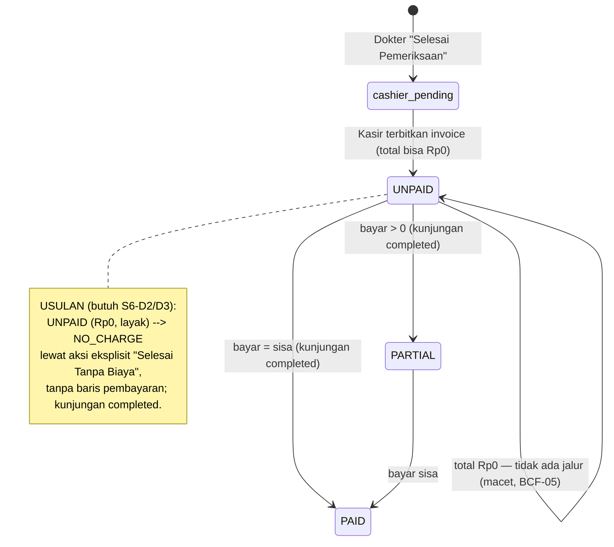

# Paket Keputusan Owner — Konsultasi & Kontrol Rp0 (Sprint 6/7)

**Program:** DAENGTISIAMS-RME-BILLING-CORRECTION · **Task:** `FEATURE-RME-RP0-CONTROL-CONSULTATION-1`
**Status:** `OWNER_DECISION_RECORDED` (2026-11-01) — S6-D1 … S6-D8 dijawab Owner; implementasi
`FEATURE-RME-RP0-CONTROL-CONSULTATION-1` dibangun dengan flag `rme.zero_value_closure` **OFF**. Lihat §9.
*(Saat dokumen ini pertama ditulis statusnya `SPRINT6_PREPARATION` / `OWNER_DECISION_PENDING`; jawaban
Owner datang di sesi yang sama.)*
**Disusun:** 2026-11-01 (WITA) · **Rule:** `.cursor/rules/217-rme-rp0-consultation-control.mdc`

Owner meminta Sprint 2 ditunda sementara dan Sprint 6 dikerjakan. Itu keputusan **prioritas**, bukan
persetujuan D21g, D22, D21c atau D11. Dokumen ini adalah gerbang keputusan yang diwajibkan sebelum kode
yang mengubah produksi ditulis.

| Sprint | Status (tidak berubah oleh dokumen ini) |
|---|---|
| 1 | GO |
| 2 | `NO_GO_OPERATIONAL_BLOCKED` (ditunda, tidak ditutup) |
| 3 / 4 / 5 | `IMPLEMENTATION_GO`, flag **OFF** |
| 6 | **CURRENT — preparation, menunggu keputusan Owner** |
| 7 | PENDING |

Penutupan operasional program: **1/7**.

---

## 1. Basis yang diukur

| Item | Nilai |
|---|---|
| Base repositori | `e3e81b13` (tip `feature/sprint-26-phase-26-8-stabilization-closure-go-watch-no-go-report`) |
| Runtime produksi | `a550e00d` = tag `feature-rme-refund-settlement-1-implementation-go` (diverifikasi di VPS) |
| Rule terakhir | 216 (217 masih kosong sebelum dokumen ini) |
| Cara ukur produksi | SQL read-only (`SET default_transaction_read_only = on`), tanpa tinker, tanpa tulis |

## 2. Fakta — kode (base `e3e81b13`)

1. **Invoice Rp0 bisa diterbitkan oleh kasir mana pun** yang berwenang menagih. `CreateRmeInvoiceRequest`
   menerima `unit_price` dan `discount` `min:0`; harga manual (D21 revisi) tidak memeriksa kategori. Tidak ada
   pemeriksaan "layak gratis" saat penerbitan.
2. **Invoice dibuat `UNPAID`** (`RmeInvoiceService::create`), termasuk bila totalnya Rp0.
3. **Pembayaran Rp0 tidak mungkin**: `CreateRmePaymentRequest` mewajibkan `amount ≥ 0.01` dan tidak melebihi
   sisa tagihan (= 0). Jadi invoice Rp0 **tidak pernah bisa menjadi `PAID`** — dan memang tidak boleh lewat
   pembayaran palsu.
4. **Kunjungan hanya bisa `completed` dari `cashier_pending` lewat layanan pembayaran**
   (`ClinicVisitService::transitionStatus`, Sprint 62.1). Tiga jalur penyelesaian di `RmePaymentService`
   semuanya mensyaratkan ada uang yang diterima:
   - `completeVisitAfterCashierPayment` — invoice harus `PAID`/`PARTIAL`;
   - `completeVisitAfterCashierBatch` — harus ada pembayaran di batch;
   - `completeControlVisitIfSettled` — kunjungan Kontrol yang invoicenya sisa 0 selesai **hanya bila ada
     pembayaran lain di batch yang sama**.
5. **Akibatnya:** Konsultasi Rp0 pada kunjungan **baru** tidak punya jalur penyelesaian sama sekali (macet di
   `cashier_pending` selamanya). Kontrol Rp0 hanya selesai bila pasien kebetulan membayar piutang lain.
6. **Pelaporan:** `OwnerDashboardRmeLabKpiService` menghitung `DRAFT`+`UNPAID` sebagai "invoice belum
   dibayar" → invoice Rp0 ikut menggelembungkan angka itu (BCF-05). Total piutang **tidak** terpengaruh
   (rumus `remaining > 0`). `DoctorPerformanceReportService` menghitung item Rp0 sebagai item tertagih tetapi
   tidak pernah "lunas". Papan serah-terima kasir menampilkan kunjungan Rp0 sebagai **"Siap Bayar"**.
7. **Koreksi:** D28 (rule 201) menolak koreksi atas invoice yang total ASLInya Rp0; pembuat proposal koreksi
   menolak baris/total Rp0 baru (`CORRECTION_RP0_NOT_PERMITTED`). Keduanya **tetap berlaku**.
8. **Tidak ada jalur VOID** invoice di layanan; status `VOID` hanya konstanta.
9. Kolom `trx_rme_invoices.status` **tidak punya CHECK constraint** — status baru dapat ditambahkan secara
   aditif, tetapi setiap pembaca status (dashboard, piutang, laporan, sengketa, koreksi, refund) harus
   ditinjau.

## 3. Fakta — produksi (diukur 2026-11-01, read-only)

| Ukuran | Nilai |
|---|---|
| Invoice aktif | 9 (Σ grand total Rp24.548.000) — 7 `PAID`, 1 `PARTIAL`, **1 `UNPAID` Rp0** |
| Pembayaran | 10 (Σ Rp22.548.000) |
| Invoice Rp0 | **#36**, SPN4, `UNPAID`, satu baris `TRT-CONS` (Konsultasi Dokter) Rp0, 0 pembayaran |
| Kunjungan #36 | #57, `visit_type = control` (induk #56), status `completed` 2026-10-11 15:23:34 UTC |
| Mengapa selesai | Pada detik yang sama kasir menagih piutang **lain** pasien yang sama (pembayaran #47, Rp1.500.000, invoice #38, batch) — jalur `completeControlVisitIfSettled` |
| Baris Rp0 di invoice ber-total > 0 | 0 |
| Kunjungan `cashier_pending` | 1 — #63 SPN4 (2026-10-13, `new`, **belum ada invoice**) — temuan terpisah, bukan Rp0 |
| Data master | `TRT-CONS` "Konsultasi Dokter" (kategori `consultation`); `TRT-FREESC` "Scalling Voucher Gratis" (kategori `preventive`) |

Kesimpulan: kasus nyata satu-satunya (#36) membuktikan cacat: kunjungan Kontrol Rp0 baru bisa ditutup karena
uang **yang tidak ada hubungannya** kebetulan dibayar, dan invoice-nya tetap tercatat "belum dibayar"
selamanya. Invoice #36, #42, #43 **tidak disentuh** oleh pekerjaan ini.

## 4. Alur aktual vs alur yang diusulkan

## 5. Invarian keuangan yang diusulkan (berlaku apa pun pilihan Owner)

| Kode | Bunyi |
|---|---|
| `RP0_DOES_NOT_CREATE_FAKE_PAYMENT` | Tidak pernah menulis baris `trx_rme_payments` bernilai 0 atau simbolis. |
| `RP0_DOES_NOT_INCREASE_REVENUE` | Pendapatan = uang diterima; penutupan Rp0 menambah 0. |
| `RP0_DOES_NOT_CREATE_FALSE_RECEIVABLE` | Invoice Rp0 yang ditutup tidak masuk piutang/“belum dibayar”. |
| `RP0_DOES_NOT_ERASE_REAL_RECEIVABLE` | Hanya invoice yang total ASLI-nya Rp0 yang bisa ditutup; piutang cabang/kunjungan lain tidak disentuh (OD-1a). |
| `RP0_DOES_NOT_WRITE_REFUND` / `…PATIENT_CREDIT` | Tidak menyentuh refund (rule 215/216) maupun kredit pasien (D6 dikecualikan). |
| `RP0_DOES_NOT_BYPASS_BILLING_DISPUTE` | Invoice yang sedang disengketakan (rule 203) tidak bisa ditutup. |
| `RP0_DOES_NOT_BYPASS_D28` | D28 tetap; penutupan Rp0 bukan koreksi. |
| `RP0_DOES_NOT_BYPASS_DISCOUNT_POLICY` | Rp0 karena diskon penuh atas tindakan berbayar **tidak** layak (D21c tetap PENDING). |
| `RP0_DOES_NOT_MODIFY_HISTORICAL_INVOICES` | Tidak ada backfill; #36 hanya bisa disentuh atas keputusan terpisah. |
| `RP0_IS_NOT_PAID` | Status hasil penutupan bukan `PAID` dan tidak memicu kandidat lab (`generateForPaidInvoice`). |

## 6. Keputusan yang diminta dari Owner

Setiap keputusan dicatat dengan tiga status terpisah: `OWNER_POLICY_APPROVED`,
`REPOSITORY_POLICY_RECORDED`, `TECHNICAL_ENFORCEMENT_DEPLOYED`. **Saat dokumen ini ditulis, ketiganya
belum ada untuk S6-D1…S6-D8.** Rekomendasi bukan keputusan.

### S6-D1 — Kategori yang sah bernilai Rp0  (menjawab D21g untuk lingkup Sprint 6)
- **A (rekomendasi):** hanya **Konsultasi Dokter** (`TRT-CONS` / kategori `consultation`) dan **Kontrol**
  (`visit_type = control` yang diturunkan server dari `follow_up_of_visit_id`). Sesuai `APPROVED_SCOPE` rule
  188 §12. Kelayakan ditentukan dari `treatment_id` + kategori, **tidak pernah** dari deskripsi atau input klien.
- B: A + `TRT-FREESC` (voucher scaling gratis).
- C: Tindakan apa pun yang diberi harga Rp0 oleh kasir (status quo — tidak direkomendasikan).
- Sub-pertanyaan: pada kunjungan Kontrol, apakah **semua** baris harus Konsultasi/Kontrol, atau baris tindakan
  lain bernilai Rp0 juga diperbolehkan? (Rekomendasi: hanya baris `TRT-CONS`, atau baris apa pun **hanya**
  bila Owner menyebutkannya.)

### S6-D2 — Kapan invoice Rp0 yang sah boleh ditutup  (menjawab D22)
- **A (rekomendasi):** aksi eksplisit **"Selesai Tanpa Biaya"** oleh orang berwenang setelah server memeriksa
  kelayakan. Invoice menjadi status terminal baru **`NO_CHARGE`** ("Tanpa Biaya" — bukan "Lunas"), tanpa baris
  pembayaran; kunjungan `cashier_pending → completed` di transaksi yang sama.
- B: otomatis saat penerbitan bila semua baris layak (tanpa langkah manusia).
- C: tidak ada jalur (status quo — invoice tetap `UNPAID`, kunjungan bisa macet).
- Dipisahkan dengan tegas: saldo invoice 0 ≠ pemeriksaan klinis selesai ≠ kunjungan selesai ≠ uang diterima.
- Sub-pertanyaan: invoice historis **#36** — dibiarkan apa adanya (rekomendasi) atau ditutup lewat keputusan
  terpisah dengan referensi Owner?

### S6-D3 — Siapa yang berwenang menyatakan layanan gratis
- **A (rekomendasi):** kasir yang sudah berwenang menagih di cabang itu (`manage_rme_billing` + cakupan
  cabang), dengan kelayakan yang **diperiksa sistem** (S6-D1), dicatat audit, tanpa persetujuan kedua.
- B: maker–checker — kasir mengajukan, Supervisor RME / reviewer cabang menyetujui.
- C: dokter menandai "tanpa biaya" saat pemeriksaan, kasir menutup.
- Catatan: Super Admin `Gate::before` tidak boleh melewati aturan bisnis (kelayakan, sengketa, cabang).

### S6-D4 — Koreksi atas invoice yang sudah Rp0
- **A (rekomendasi):** D28 **tetap** di Sprint 6. Invoice `NO_CHARGE` tidak bisa dikoreksi; bila ternyata
  pasien harus membayar, jalur koreksi Rp0 dibahas di sprint/keputusan terpisah.
- B: izinkan koreksi naik dari Rp0 lewat alur persetujuan baru (bukan koreksi biasa) — lingkup sprint terpisah.
- C: buka koreksi biasa untuk Rp0 (tidak direkomendasikan — melewati D28).

### S6-D5 — Pelaporan
- **A (rekomendasi):** kunjungan Rp0 dihitung sebagai **kunjungan klinis** dan muncul sebagai metrik terpisah
  (`LEGITIMATE_RP0_VISITS`, `RP0_CONSULTATIONS`, `RP0_CONTROLS`); **tidak** dihitung "belum dibayar", **tidak**
  masuk piutang, pendapatan +0; laporan kinerja dokter menampilkan "Tanpa Biaya" terpisah dari "Lunas".
- B: kunjungan Rp0 dikeluarkan dari semua laporan keuangan; hanya muncul di hitungan klinis.
- Periode yang sudah ditutup tidak diubah.

### S6-D6 — Yang dikecualikan dari Sprint 6
- **A (rekomendasi):** voucher (`TRT-FREESC`), layanan amal, tindakan komplimenter, diskon, koreksi, dan
  write-off **tidak** termasuk.
- B: voucher termasuk (hanya bila S6-D1 = B).

### S6-D7 — Cabang
- **A (rekomendasi):** semua cabang RME aktif (Kontrol sudah lintas cabang, OD-1); cabang invoice selalu cabang
  kunjungan, tidak pernah dari request.
- B: pilot SPN4 dulu. Pembatasan pilot koreksi/refund **tidak** diwarisi otomatis.

### S6-D8 — Aktivasi
- **A (rekomendasi):** dikirim dengan flag baru **OFF**; aktivasi produksi = keputusan Owner terpisah setelah
  deploy terverifikasi dan SOP kasir.
- B: aktif saat deploy.

## 7. Desain teknis (disusun sebelum jawaban Owner; dibangun setelahnya — lihat rule 217)

- Modul `RmeInvoice`: `RmeZeroValueClosureService` (keputusan bisnis di service) → `RmeInvoiceRepositoryInterface`;
  FormRequest + Policy (`closeZeroValue`) + controller tipis; flag `rme.zero_value_closure` default OFF
  (capture `env_value`, rule 92).
- Migrasi aditif: kolom `zero_value_category`, `zero_value_closed_by`, `zero_value_closed_at`,
  `zero_value_reason` di `trx_rme_invoices`, plus CHECK konsistensi (`status = 'NO_CHARGE'` ⇔ kolom terisi,
  `grand_total = 0`). Tanpa backfill.
- Di bawah `lockForUpdate` invoice + kunjungan: total ASLI (`correction_version 0`) = 0; tiap baris layak
  (S6-D1); tidak ada sengketa terbuka; tidak ada koreksi aktif; tidak ada pembayaran; kunjungan
  `cashier_pending`; aktor aktif + cakupan cabang (`RmeBillingActorGuard`); idempotent.
- Audit `INVOICE_ZERO_VALUE_CLOSED` di transaksi yang sama.
- Pembaca status yang wajib ditinjau: dashboard Owner/cabang, piutang, kinerja dokter, papan kasir,
  sengketa (rule 203), koreksi (D28), refund (rule 215/216), kandidat lab, laporan RME.
- Uji PostgreSQL 16: penutupan vs pembayaran, vs koreksi, vs sengketa, vs penutupan ganda, vs nonaktif akun,
  vs perubahan konteks cabang.

## 8. Yang TIDAK dilakukan oleh tahap preparation (sebelum jawaban Owner)

Tidak ada kode runtime, migrasi, izin, flag, rute, atau perubahan data. Tidak ada deploy (`NO_RUNTIME_DELTA`).
Tidak ada GO tag implementasi. Sprint 2 tetap `NO_GO`; flag Sprint 3/4/5 tetap OFF; invoice #36/#42/#43 tidak
disentuh; D21c, D21g, D22, D11, D28 tidak berubah statusnya.

## 9. Jawaban Owner (2026-11-01, dicatat di register)

| Kode | Jawaban |
|---|---|
| S6-D1 | **A** — Konsultasi Dokter + Kontrol. **Sub-keputusan:** di kunjungan Kontrol **semua baris** boleh Rp0 (bukan hanya Konsultasi). |
| S6-D2 | **A** — aksi eksplisit "Selesai Tanpa Biaya" → status `NO_CHARGE`; invoice historis #36 dibiarkan. |
| S6-D3 | **A** — kasir cabang, kelayakan diperiksa sistem, tanpa persetujuan kedua. |
| S6-D4 | **A** — D28 tetap. |
| S6-D5 | **A** — klinis ya, uang 0; metrik terpisah. |
| S6-D6 | **A** — kecualikan semuanya (voucher juga di Kontrol; diskon penuh bukan gratis). |
| S6-D7 | **A** — semua cabang RME. |
| S6-D8 | **A** — flag OFF, aktivasi terpisah. |

Status per keputusan: `OWNER_POLICY_APPROVED` + `REPOSITORY_POLICY_RECORDED`.
`TECHNICAL_ENFORCEMENT_DEPLOYED` hanya ditambahkan setelah verifikasi produksi — dan flag tetap OFF.
Aktivasi produksi = keputusan Owner terpisah (`ACTIVATION-RME-RP0-CONTROL-CONSULTATION-1`).
