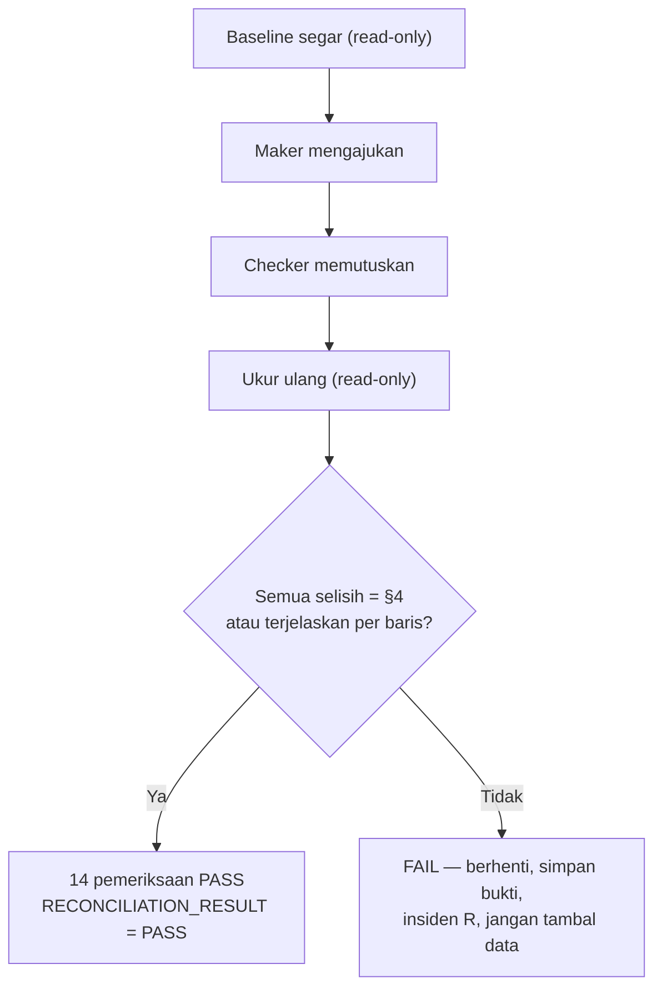

# Formulir Rekonsiliasi Keuangan — Koreksi Tagihan (Pilot SPN4)

Bagian dari SOP `docs/operations/rme-invoice-correction-pilot-sop-spn4.md`.
Aturan: rule 196 §10–§11 (baseline segar sebelum, rekonsiliasi sesudah),
rule 202.

**Pelaksana:** IT (query read-only). **Penanda tangan:** `RECONCILIATION_OWNER`
yang ditunjuk Owner di formulir persetujuan.

## 1. Aturan

1. Baseline diambil **segar, tepat sebelum** Maker mengajukan. Angka historis
   (mis. dari laporan sprint) **tidak pernah** menggantikan baseline.
2. Semua query **read-only**: transaksi dipaksa `default_transaction_read_only`.
   Tidak ada `UPDATE`/`INSERT`/`DELETE`, tidak ada REPL (`tinker`/psysh) di
   produksi.
3. Hasil hanya memuat id, nominal, status, kode, hash — **tidak ada** nama
   pasien, NIK, nomor rekam medis, atau isi klinis. Hasil yang sudah terisi
   tidak di-commit ke repositori bila memuat data pasien; dokumen bukti
   penutupan hanya memuat angka dan id.
4. Selisih yang **tidak dapat dijelaskan** → `RECONCILIATION_RESULT = FAIL`,
   **berhenti**, simpan bukti, ikuti matriks insiden R. **Jangan pernah**
   menambal baris keuangan agar rekonsiliasi lolos.
5. `NOT_PERFORMED` tidak pernah dilaporkan sebagai `PASS`.

## 2. Cara menjalankan query (IT, di VPS, sebagai root)

```bash
runuser -u postgres -- env PGOPTIONS="-c default_transaction_read_only=on" \
  psql -X -q -d asia_dental_lab_pilot -At -F ' | ' -v ON_ERROR_STOP=1 -v inv=<INVOICE_ID> <<'SQL'
show default_transaction_read_only;            -- harus: on
-- tempel query di §3 di sini
SQL
```

`<INVOICE_ID>` adalah id numerik tagihan (bukan nomor invoice). Baris pertama
keluaran **harus** `on`; jika tidak, hentikan.

Residu yang diterima: query dijalankan sebagai superuser `postgres`, dan mode
read-only hanyalah default sesi yang secara teknis dapat dimatikan oleh
superuser. Pengamannya prosedural: query di §3 tidak memuat `SET`, `UPDATE`,
`INSERT`, `DELETE`, atau DDL, dan baris pertama membuktikan mode `on`. Peran
basis data khusus baca (least-privilege) **belum ada** di produksi; membuatnya
adalah perubahan DDL produksi yang memerlukan sprint dan persetujuannya sendiri.

## 3. Query

### 3.1 Tagihan sasaran

```sql
select 'invoice', i.id, i.invoice_number, b.code, i.status, i.subtotal, i.discount_total,
       i.grand_total, i.correction_version
  from trx_rme_invoices i join mst_branches b on b.id = i.branch_id
 where i.id = :inv;
select 'paid_total', coalesce(sum(amount), 0), count(*)
  from trx_rme_payments where rme_invoice_id = :inv and deleted_at is null;
select 'items_count_fp', count(*),
       md5(coalesce(string_agg(id || '|' || coalesce(treatment_id::text, '') || '|' || description
            || '|' || qty || '|' || unit_price || '|' || discount || '|' || subtotal
            || '|' || coalesce(doctor_id::text, ''), ';' order by id), ''))
  from trx_rme_invoice_items where rme_invoice_id = :inv;
select 'invoice_corrections', id, correction_number, status, requested_by, decided_by, applied_by,
       invoice_version_at_request, applied_invoice_version, original_grand_total,
       proposed_grand_total, difference_amount
  from trx_rme_invoice_corrections where rme_invoice_id = :inv order by id;
select 'document_versions', id, version_number, version_kind, document_reference,
       source_correction_id, snapshot_sha256
  from trx_rme_invoice_document_versions where rme_invoice_id = :inv order by version_number;
```

### 3.2 Sidik jari global (untuk membuktikan tidak ada baris lain yang berubah)

```sql
select 'invoices', count(*), coalesce(sum(grand_total), 0) from trx_rme_invoices;
select 'items', count(*), coalesce(sum(subtotal), 0) from trx_rme_invoice_items;
select 'payments', count(*), coalesce(sum(amount), 0) from trx_rme_payments;
select 'corrections', count(*) from trx_rme_invoice_corrections;
select 'correction_lines', count(*) from trx_rme_invoice_correction_lines;
select 'correction_events', count(*) from trx_rme_invoice_correction_events;
select 'document_versions', count(*) from trx_rme_invoice_document_versions;
select 'active_corrections', count(*) from trx_rme_invoice_corrections where status in ('SUBMITTED','APPROVED');
select 'approved_unapplied', count(*) from trx_rme_invoice_corrections where status = 'APPROVED';
select 'audit_rows', count(*), max(id) from sys_audit_logs;
select 'audit_correction_actions', action, count(*) from sys_audit_logs
 where action like 'RME_INVOICE_CORRECTION_%' or action = 'RME_INVOICE_DOCUMENT_VERSION_ISSUED'
    or action = 'RME_PAYMENT_REFUSED_ACTIVE_CORRECTION'
 group by action order by action;
select 'role_has_permissions', count(*) from role_has_permissions;
```

### 3.3 Jejak koreksi (sesudah penerapan, `<CORRECTION_ID>` = id koreksi)

```sql
select 'events', from_status, to_status, actor_id
  from trx_rme_invoice_correction_events where rme_invoice_correction_id = <CORRECTION_ID> order by id;
select 'audit', id, entity_type, entity_id, action, performed_by
  from sys_audit_logs
 where (entity_type = 'trx_rme_invoice_corrections' and entity_id = <CORRECTION_ID>)
    or (entity_type = 'trx_rme_invoice_document_versions'
        and entity_id in (select id from trx_rme_invoice_document_versions where rme_invoice_id = :inv))
 order by id;
```

## 4. Perubahan yang DIHARAPKAN untuk satu koreksi pertama yang diterapkan

Dihitung dari kode (`RmeInvoiceCorrectionService`), dari baseline tepat sebelum
pengajuan sampai sesudah **Setujui & Terapkan**:

| Ukuran | Selisih yang diharapkan |
|---|---|
| Tagihan (jumlah) | **0** — tidak ada tagihan baru |
| Tagihan sasaran `grand_total` | = total usulan yang disetujui Owner |
| Tagihan sasaran `correction_version` | **+1** (0 → 1) |
| Tagihan sasaran status | tetap **UNPAID** |
| Item tagihan | sesuai operasi: HAPUS menghapus baris (tersimpan di snapshot v0), TAMBAH menambah, UBAH mengubah |
| Pembayaran | **0** — tidak ada pembayaran baru, tidak ada yang berubah |
| Koreksi | **+1**, status **APPLIED** |
| Baris koreksi | **+N** (satu per baris usulan, termasuk yang tetap) |
| Event koreksi | **+3** (`→SUBMITTED`, `SUBMITTED→APPROVED`, `APPROVED→APPLIED`) |
| Versi dokumen | **+2** (v0 ORIGINAL, v1 REVISION `<nomor invoice>-REV1`) |
| Baris audit | **+5** (SUBMITTED, APPROVED, APPLIED, DOCUMENT_VERSION_ISSUED ×2) |
| Koreksi aktif sesudahnya | **0** |
| Koreksi berstatus APPROVED | **0** |
| `role_has_permissions` | **0** |

Selisih tambahan yang masih **dapat dijelaskan** (harus dicatat, bukan
disembunyikan):

- `RME_PAYMENT_REFUSED_ACTIVE_CORRECTION` +1 per percobaan pembayaran yang
  ditolak D10 selama koreksi aktif (tidak ada pembayaran tercatat);
- `RME_PAYMENT_REFUSED_INVOICE_VERSION` +1 per formulir pembayaran lama yang
  ditolak setelah penerapan;
- `RME_INVOICE_CORRECTION_REFUSED` +1 per percobaan tindakan yang ditolak karena
  otorisasi (identitas, cabang, akun tidak aktif) — tidak mengubah apa pun;
- aktivitas klinik lain yang sah pada tagihan/kunjungan **lain** di antara dua
  pengukuran — harus diidentifikasi per baris, bukan diasumsikan.

Jika koreksi **ditolak/dibatalkan**: koreksi +1 (status REJECTED/CANCELLED),
event +2, audit +2, versi dokumen **0**, tagihan sasaran tidak berubah sama
sekali (`correction_version`, total, sidik jari item sama).

Jika koreksi menjadi **Kedaluwarsa** (STALE) saat diputuskan: sistem
**menyimpan** status STALE lebih dulu, lalu menampilkan galat
`CORRECTION_STALE:<alasan>` — koreksi +1 (status STALE), event +2 (`→SUBMITTED`,
`SUBMITTED→STALE`), audit +2 (`RME_INVOICE_CORRECTION_SUBMITTED`,
`RME_INVOICE_CORRECTION_STALE`), versi dokumen **0**, tagihan sasaran tidak diubah
oleh koreksi ini. Perubahan tagihan yang membuatnya kedaluwarsa harus
diidentifikasi sendiri (tidak boleh terjadi lewat jalur resmi selama D10 aktif).

## 5. Formulir

```
==============================================================
REKONSILIASI KEUANGAN — KOREKSI TAGIHAN PILOT SPN4
==============================================================
CASE_ID                     : __________________
OWNER_APPROVAL_REFERENCE    : __________________

--- SEBELUM (baseline segar, sebelum Maker mengajukan) -------
Diambil pada (WITA)         : ____-__-__ __:__
INVOICE_ID                  : ______   No. invoice : RME-______-______
INVOICE_VERSION             : ______   (correction_version)
ORIGINAL_TOTAL              : Rp __________
PAID_TOTAL                  : Rp __________   (harus Rp0)
REMAINING_BALANCE           : Rp __________   (= ORIGINAL_TOTAL)
INVOICE_ITEMS_FINGERPRINT   : n=___  md5=________________________________
PAYMENT_COUNT               : ______  (tagihan ini; harus 0)
CORRECTION_COUNT            : ______  (global)   aktif: ______
SNAPSHOT_COUNT              : ______  (versi dokumen global)
AUDIT_COUNT                 : ______  (max id: ______)

--- SESUDAH (setelah keputusan Checker) ------------------------
Diambil pada (WITA)         : ____-__-__ __:__
CORRECTION_ID               : ______   No. koreksi : RMECOR-______-______
CORRECTION_STATUS           : __________   (APPLIED / REJECTED / CANCELLED / STALE)
NEW_INVOICE_VERSION         : ______
CORRECTED_TOTAL             : Rp __________
PAID_TOTAL                  : Rp __________   (harus tetap Rp0 sebelum kasir menagih)
NEW_REMAINING_BALANCE       : Rp __________   (= CORRECTED_TOTAL)
NEW_SNAPSHOT_REFERENCE      : v0 id=____ sha=________  v1 id=____ ref=__________-REV1
AUDIT_REFERENCE             : id ______ s.d. ______
OWNER_APPROVAL_REFERENCE    : __________________   (= di Alasan Koreksi)

--- PEMERIKSAAN (centang PASS / FAIL) --------------------------
[ ] 1  Tagihan asli terjaga (v0 ada, hash cocok; atau tagihan tak berubah bila ditolak)
[ ] 2  Snapshot asli tidak berubah
[ ] 3  Snapshot revisi ada (bila diterapkan)
[ ] 4  Total terkoreksi = PROPOSED_TOTAL persetujuan Owner
[ ] 5  Tidak ada tagihan ganda
[ ] 6  Tidak ada pembayaran ganda / baru
[ ] 7  Tidak ada koreksi ganda / koreksi aktif tersisa
[ ] 8  Tidak ada mutasi tanpa otorisasi (semua selisih global terjelaskan)
[ ] 9  Cabang benar (SPN4)
[ ] 10 Maker benar (requested_by = 29)
[ ] 11 Checker benar (decided_by = applied_by = 1)
[ ] 12 Sisa tagihan benar
[ ] 13 Versi tagihan benar (+1 bila diterapkan; tetap bila tidak)
[ ] 14 Audit lengkap (§4)

RECONCILIATION_RESULT       : [ ] PASS   [ ] FAIL   [ ] NOT_PERFORMED
Dilaksanakan oleh (IT)      : ____________
Ditandatangani oleh         : ____________ (RECONCILIATION_OWNER)
==============================================================
```



## 6. Protokol verifikator (rule 196 §11, keputusan Owner S2-V1)

Verifikator yang berwenang: **Owner menyaksikan langsung**; IT merekam bukti dari server
melalui jalur SSH kanonik. Verifikator hadir **sebelum** Maker mengajukan. Bila tidak bisa,
kasus tetap diproses dan tidak dipakai untuk penutupan pilot.

1. **Sebelum submit.** Baca dulu tabel koreksi (`active_corrections`, §3.2). Jalankan probe
   `--maker=29 --checker=1` sebagai pengguna runtime. Penutupan pilot butuh `LIVE_NOW=yes`
   dan Decision GO.
2. **"Siap" dicek di server, bukan dari jawaban.** Setiap operator login sendiri. IT memastikan
   ada `POST /login` milik akun itu dan baris sesi baru di tabel `sessions`. Alamat jaringan
   hanya dihitung, tidak pernah dicetak. Jawaban "siap" tanpa sesi di server berarti belum siap.
3. **Baseline segar** (§3.1 dan §3.2) diambil **tepat sebelum** submit, lalu sekali lagi tepat
   sebelum keputusan Checker. Catat waktu server (`now()`) dan sha256 berkas hasilnya.
4. **Aba-aba.** IT memberi aba-aba hanya setelah butir 2 dan 3 selesai. Checker memutuskan
   **segera** dan mengisi catatan persetujuan dengan rujukan Owner yang sudah ada. Label
   kolom ("Catatan Persetujuan") bukan rujukan.
5. **Sesudah keputusan.** Ukur ulang dan hitung baris audit **per aksi**. Membuka layar koreksi
   menulis baris `OVERSIGHT_BILLING_CORRECTION_VIEWED`; baris itu bukan selisih keuangan. Cek
   `integrityHolds()` v0/v1 dengan skrip read-only. Pastikan juga tagihan, item, dan pembayaran
   lain tidak berubah.
6. **Jangan menahan pembayaran.** Kasus yang dibiarkan menunggu demi pilot tidak sah untuk
   penutupan (rule 196 §8, §53), walaupun keputusannya teramati.
7. **Deploy (S2-V2).** Selama ada koreksi `SUBMITTED`/`APPROVED`, deploy hanya boleh dalam
   jendela yang disepakati dengan Checker. Status koreksi dicek sebelum dan sesudah deploy, dan
   SHA runtime dicatat di kedua sisi.
