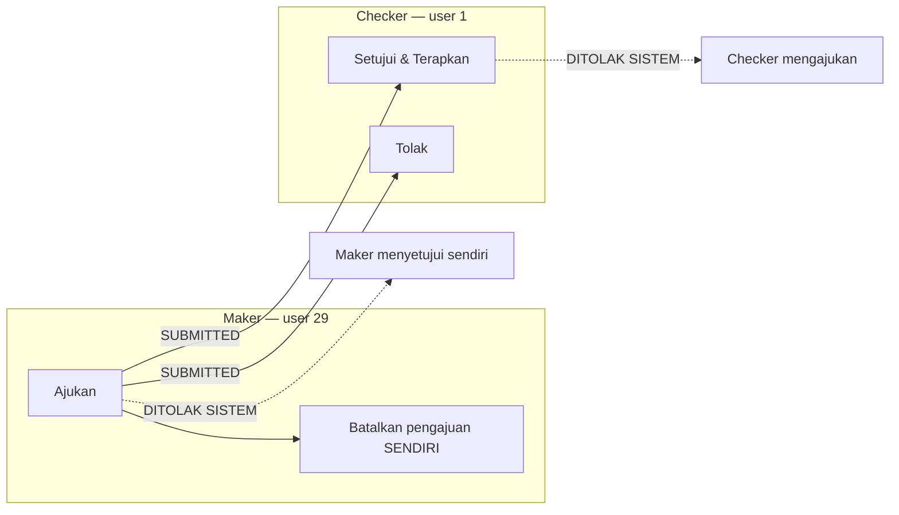
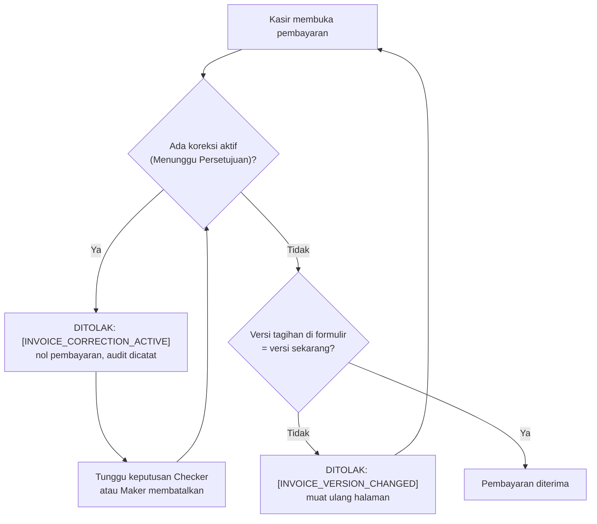

# Panduan Maker–Checker — Koreksi Tagihan Sebelum Pembayaran (Pilot SPN4)

Bagian dari SOP `docs/operations/rme-invoice-correction-pilot-sop-spn4.md`.
Berlaku untuk runtime produksi yang dikunci rule 195/197/201 (diverifikasi pada
`b3ec7133`). Semua nama tombol, label, dan kode di bawah ini diambil dari kode
aplikasi; jika layar menampilkan teks lain, **berhenti dan laporkan ke IT**.

## 1. Matriks tanggung jawab

| Langkah | Kasir SPN4 | Owner | Maker 29 | Checker 1 | IT |
|---|---|---|---|---|---|
| Menemukan kesalahan sebelum pembayaran | **L** | — | B | — | — |
| Memastikan kelayakan tagihan (SOP §5) | **L** | — | **L** | — | — |
| Persetujuan tertulis per kasus | I | **L** | I | I | — |
| Probe kesiapan + baseline read-only | — | — | — | I | **L** |
| Mengajukan koreksi | — | — | **L** | — | — |
| Menahan pembayaran (D10, otomatis) | **patuh** | — | — | — | — |
| Memeriksa dan menyetujui (= menerapkan) | — | — | ✗ | **L** | — |
| Menolak | — | — | ✗ | **L** | — |
| Membatalkan pengajuan sendiri | — | — | **L** | ✗ | — |
| Rekonsiliasi keuangan | — | tanda tangan | — | B | **L** |
| Menerima pembayaran sesudah koreksi selesai | **L** | — | — | — | — |

L = pelaksana, B = membantu, I = diberi informasi, ✗ = **dilarang dan ditolak sistem**.

## 2. SOP Maker — user 29 (Admin Sunu)

**Prasyarat:** kasus layak (SOP §5), persetujuan Owner tertulis sudah ada,
IT sudah melaporkan probe kesiapan = GO dan baseline sudah diambil.

1. **Login dengan akun sendiri.** Jangan memakai akun orang lain, jangan
   meminjamkan kata sandi.
2. **Pastikan akun aktif.** Jika sistem menampilkan "Akun Anda tidak aktif",
   berhenti dan hubungi IT/Owner (matriks insiden O).
3. **Pilih cabang kerja SPN4** di layar pemilihan konteks kerja setelah login.
4. **Buka tagihan yang ditunjuk:** menu *Rekam Medis Elektronik → Kasir RME* →
   kunjungan pasien → tagihan dengan nomor sesuai formulir Owner.
5. **Pastikan kelayakan** pada panel **Koreksi Tagihan**:
   - tombol **Ajukan Koreksi Tagihan** muncul → sistem menilai layak;
   - jika panel menampilkan alasan (mis. tagihan sudah dibayar, Rp0, ada koreksi
     aktif) → **jangan lanjut**, laporkan.
6. **Cocokkan dengan persetujuan Owner:** nomor invoice, Total Asli, item yang
   akan berubah, total yang benar.
7. **Tinjau tagihan asli** di kartu *Tagihan Asli (tidak berubah sampai koreksi
   diterapkan)*.
8. **Isi usulan** di kartu *Usulan Item Setelah Koreksi*:
   - baris yang tidak disentuh tetap seperti aslinya;
   - ubah Deskripsi / Tindakan / Qty / Harga Satuan / Diskon hanya pada baris
     yang disetujui Owner;
   - **Hapus** untuk menghapus item, **+ Tambah Item** untuk item baru;
   - dokter sebuah item tidak dapat dipindahkan (atribusi dokter tidak berubah);
   - tidak boleh ada baris Rp0 atau total Rp0 (ditolak sistem);
   - diskon hanya 0 sampai bruto baris (tidak ada kebijakan diskon baru — D21c
     PENDING).
9. **Isi Alasan Koreksi** (minimal 10, maksimal 1000 karakter): uraian singkat
   kesalahan + **nomor rujukan persetujuan Owner**. Jangan menulis NIK/KTP atau
   diagnosis.
10. **Bandingkan Pratinjau total usulan** dengan `PROPOSED_TOTAL` di formulir
    Owner. Berbeda → perbaiki dulu. (Total resmi dihitung ulang oleh server;
    pratinjau hanya alat bantu.)
11. **Klik Kirim Pengajuan Koreksi** sekali saja.
12. **Pastikan hasilnya:** pesan "Pengajuan koreksi RMECOR-YYYYMM-NNNNNN
    terkirim dan menunggu persetujuan akun lain." dan status **Menunggu
    Persetujuan**.
13. **Catat bukti** (tanpa data pasien): nomor koreksi `RMECOR-…`, nomor invoice,
    status, waktu (WITA). Serahkan ke Checker dan IT. Catat sebagai **teks** —
    jangan memotret layar mentah: halaman menampilkan nama dan nomor rekam medis
    pasien.

**Maker boleh:** MENGAJUKAN, dan MEMBATALKAN pengajuannya sendiri.
**Maker tidak boleh:** menyetujui, menerapkan, memakai akun Checker, melewati
layar (permintaan langsung ke sistem), atau menjalankan SQL keuangan.

Jika koneksi terputus saat mengirim: **jangan langsung kirim ulang**. Muat ulang
halaman tagihan dan lihat panel *Koreksi Tagihan*. Jika pengajuan sudah ada,
jangan membuat yang baru (sistem hanya mengizinkan satu koreksi aktif per
tagihan; formulir juga membawa kunci idempoten).

## 3. Blokir pembayaran (D10) — wajib dipatuhi kasir

Begitu koreksi berstatus **Menunggu Persetujuan** (atau baris lama **Disetujui —
Belum Diterapkan**), sistem **menolak setiap pembayaran** untuk tagihan itu —
pembayaran biasa, pembayaran kontrol, maupun pembayaran kunjungan beserta
piutang yang dipilih — di bawah kunci baris tagihan.

### 3.1 Yang terlihat di layar

- Halaman tagihan dan halaman pembayaran menampilkan:
  **"Tagihan sedang dalam proses koreksi. Pembayaran dapat dilanjutkan setelah
  proses koreksi selesai."** dan tombol pembayaran dinonaktifkan.
- Panel *Koreksi Tagihan* menampilkan "Ada pengajuan koreksi aktif:
  RMECOR-… — Menunggu Persetujuan. Tagihan belum berubah dan pembayaran ditahan
  sampai pengajuan diputuskan; persetujuan langsung menerapkan koreksi."
- Jika formulir pembayaran lama tetap dikirim, sistem menolak dengan pesan
  berawalan `[INVOICE_CORRECTION_ACTIVE]` dan mencatat audit
  `RME_PAYMENT_REFUSED_ACTIVE_CORRECTION`. Tidak ada pembayaran yang tercatat.

### 3.2 Apa yang dilakukan kasir

| Keadaan | Tindakan |
|---|---|
| Koreksi aktif | Jangan menerima uang. Jelaskan ke pasien bahwa tagihan sedang diperiksa. Tunggu keputusan Checker. |
| Pasien tidak dapat menunggu | Jangan menahan pasien. Maker boleh **membatalkan** pengajuan agar blokir lepas; keputusan atas pasien diambil manajemen (SOP §8, OPS-OQ-1). |
| Halaman pembayaran sudah terbuka sebelum koreksi diterapkan | **Tutup dan muat ulang.** Sistem menolak formulir lama dengan `[INVOICE_VERSION_CHANGED] Tagihan ini telah dikoreksi sejak halaman pembayaran dibuka…` |
| Ragu apakah pembayaran sudah tercatat | Jangan mengirim ulang. Buka riwayat pembayaran tagihan; laporkan ke IT bila janggal. |

### 3.3 Kapan blokir lepas

| Keputusan | Akibat | Pembayaran |
|---|---|---|
| Diterapkan (Setujui & Terapkan) | tagihan berubah ke versi baru | lanjut — **muat ulang halaman**, bayar sesuai total baru |
| Ditolak | tagihan tetap asli | blokir lepas — lihat catatan di bawah |
| Dibatalkan | tagihan tetap asli | blokir lepas — lihat catatan di bawah |
| Kedaluwarsa | tagihan tidak diubah koreksi ini | blokir lepas — lihat catatan di bawah |

**Blokir lepas ≠ boleh menagih.** Setelah Ditolak/Dibatalkan/Kedaluwarsa,
tagihan kembali ke nominal asli. Tagih nominal itu **hanya** bila Checker/Owner
menyimpulkan tagihan asli memang benar. Jika kesalahan masih diketahui, kasir
**tidak** memungut nominal asli seolah-olah benar; keputusan pembayaran oleh
manajemen (OPS-OQ-1, SOP §8–§9.1). Pembayaran tidak dapat ditarik kembali, dan
tagihan yang sudah dibayar tidak dapat lagi dikoreksi di pilot ini.

**Jangan pernah** menguji blokir D10 dengan pembayaran sungguhan. Perilaku itu
sudah dibuktikan oleh rangkaian uji PostgreSQL (rule 196 §12). Jangan mengubah
status pembayaran secara manual.

## 4. SOP Checker — user 1 (IT Support)

**Prasyarat:** pengajuan berstatus Menunggu Persetujuan, formulir persetujuan
Owner tersedia.

1. **Login dengan akun sendiri.**
2. **Buka antrean:** menu *Persetujuan Koreksi* → pilih nomor `RMECOR-…`.
3. **Verifikasi nomor invoice** = `INVOICE_REFERENCE` di formulir Owner.
4. **Pastikan cabang** (kolom *Cabang (cabang invoice)*) = **SPN4**.
5. **Pastikan pengaju** (*Diajukan oleh*) = **Admin Sunu** (akun user 29). Layar
   menampilkan nama akun, bukan nomor id.
6. **Pastikan persetujuan Owner langsung dari Owner**: terima/baca formulir
   persetujuan melalui kanal Owner sendiri — **bukan** pesan yang diteruskan
   Maker atau kasir. Formulir berstatus DISETUJUI, dan rujukannya sama dengan
   yang tercantum di *Alasan Koreksi*. Rujukan di Alasan Koreksi diketik Maker,
   jadi itu saja **bukan** bukti persetujuan.
7. **Verifikasi Total Asli** = `ORIGINAL_TOTAL`.
8. **Verifikasi Total Usulan** = `PROPOSED_TOTAL`, dan *Selisih Usulan* =
   `DIFFERENCE`.
9. **Verifikasi setiap baris** (kolom *Operasi*, Subtotal Asli → Subtotal
   Usulan, *Tindakan berubah*) = `CORRECTED_ITEMS`. Baris yang tidak disebut
   Owner harus tetap.
10. **Verifikasi alasan** masuk akal dan tidak memuat NIK/diagnosis.
11. **Pastikan belum ada pembayaran:** buka *Lihat Tagihan*; riwayat pembayaran
    kosong, status Belum Dibayar.
12. **Pastikan versi tagihan masih yang diajukan:** jika tagihan sudah berubah,
    sistem sendiri akan menandai koreksi **Kedaluwarsa** saat diputuskan.
13. **Putuskan:**
    - semua cocok → isi *Catatan persetujuan (opsional)* dengan rujukan Owner →
      klik **Setujui & Terapkan** sekali saja;
    - ada yang tidak cocok → isi *Alasan penolakan (wajib)* (minimal 10
      karakter) → klik **Tolak**.
14. **Verifikasi hasil:**
    - disetujui → pesan "Koreksi disetujui dan langsung diterapkan. Dokumen asli
      tersimpan sebagai versi v0 dan revisi baru diterbitkan." dan status
      **Diterapkan**;
    - ditolak → pesan "Koreksi ditolak." dan status **Ditolak**.
15. **Catat bukti** sebagai teks (tanpa data pasien, tanpa tangkapan layar
    mentah) dan serahkan ke IT untuk rekonsiliasi.

**Checker boleh:** MENYETUJUI (= menerapkan) dan MENOLAK.
**Checker tidak boleh:** mengajukan koreksi, menyetujui tanpa persetujuan Owner,
memanggil penerapan di luar tombol resmi, atau menyetujui pengajuannya sendiri
(ditolak sistem `SELF_APPROVAL_FORBIDDEN`, termasuk Super Admin).

Jika layar menampilkan "Akun Anda tidak ditunjuk untuk mengambil keputusan atas
pengajuan ini dalam pilot koreksi tagihan." → Anda tidak memakai akun user 1.
Berhenti.

## 5. Verifikasi penerapan otomatis (D1a)

Status di repositori: `SUBMITTED → APPROVED → APPLIED`, tetapi **persetujuan dan
penerapan adalah satu transaksi** di `RmeInvoiceCorrectionService::approve()`.
Status `APPROVED` tidak pernah terlihat tersimpan oleh transaksi lain. Jika apa
pun menolak penerapan (tagihan berubah, total tidak cocok, cabang bukan RME,
akun tidak aktif, total asli Rp0), **persetujuan juga batal**: koreksi tetap
`SUBMITTED` atau menjadi `STALE`.

Setelah **Setujui & Terapkan** berhasil, IT memeriksa (read-only, lihat formulir
rekonsiliasi):

| Periksa | Harus |
|---|---|
| Pemberi keputusan | `decided_by = 1`, `applied_by = 1` |
| Pengaju | `requested_by = 29`, berbeda dari pemberi keputusan |
| Cabang | `branch_id` koreksi = cabang tagihan = SPN4 |
| Versi tagihan | `correction_version` naik tepat 1 (`invoice_version_at_request` + 1 = `applied_invoice_version`) |
| Total tagihan | `grand_total` = `proposed_grand_total` yang disetujui |
| Snapshot asli | dokumen **v0 ORIGINAL** ada (bila koreksi pertama), hash tetap utuh |
| Snapshot revisi | dokumen **v1 REVISION** ada, rujukan `<nomor invoice>-REV1`, `source_correction_id` = id koreksi |
| Audit | `RME_INVOICE_CORRECTION_APPROVED` dan `RME_INVOICE_CORRECTION_APPLIED` dengan `application_mode = AUTO_ON_APPROVAL`, plus `RME_INVOICE_DOCUMENT_VERSION_ISSUED` untuk v0 dan v1 |
| Tidak ganda | satu koreksi APPLIED, tidak ada koreksi aktif tersisa, tidak ada tagihan/pembayaran baru |
| Tidak menggantung | tidak ada koreksi berstatus `APPROVED` |

Klik ganda pada persetujuan tidak menerapkan dua kali (formulir dikunci, dan
persetujuan ulang atas koreksi yang sudah APPLIED tidak melakukan apa pun).

Jangan menyatakan PASS tanpa bukti transaksi nyata di produksi. Tanpa koreksi
nyata, status ini **NOT_PERFORMED**.

## 6. Penolakan dan pembatalan

### 6.1 Checker menolak

- Hanya user 1. Alasan wajib (minimal 10 karakter).
- Hasil: status **Ditolak**, tagihan tetap asli (versi tidak berubah), tidak ada
  dokumen revisi, snapshot asli tidak disentuh, event + audit
  `RME_INVOICE_CORRECTION_REJECTED` tercatat.
- Blokir D10 lepas. Penagihan mengikuti §3.3: nominal asli ditagih hanya bila
  tagihan asli memang benar; bila kesalahan masih diketahui → manajemen
  (OPS-OQ-1).
- Jika masih ada kesalahan nyata, kasus baru memerlukan persetujuan Owner baru.

### 6.2 Maker membatalkan

- Hanya pengaju sendiri (user 29), untuk pengajuan yang masih aktif. Alasan
  wajib. Tombol **Batalkan Pengajuan** di halaman detail koreksi.
- Hasil: status **Dibatalkan**, tagihan tetap asli, audit
  `RME_INVOICE_CORRECTION_CANCELLED`, blokir D10 lepas. Penagihan mengikuti §3.3 (bukan otomatis
  menagih nominal asli bila kesalahan masih diketahui).
- Pembatalan adalah jalan pelepasan D10 yang sengaja tidak dibatasi daftar
  identitas pilot — agar tagihan tidak pernah tertahan.

### 6.3 Maker menjadi tidak aktif

- Sistem menolak setiap tindakan akun tidak aktif (`ACTOR_UNUSABLE`), termasuk
  pembatalan. Jangan mengaktifkan ulang akun "sebentar" tanpa keputusan Owner.
- Pengajuan `SUBMITTED` milik maker yang tidak aktif tetap dapat **ditolak** oleh
  Checker → blokir lepas.
- Baris lama `APPROVED` (pra-D1a; produksi: 0 baris) tidak dapat **ditolak**
  (`APPROVED → REJECTED` bukan transisi). Jalan pelepasannya: Checker menekan
  **Terapkan Koreksi** (jalur pemulihan) — hanya bila koreksi itu masih
  disetujui Owner, tagihan tidak berubah, dan total aslinya bukan Rp0 — atau
  pembatalan oleh maker-nya. Bila total aslinya Rp0 **dan** maker-nya tidak
  aktif, tidak ada jalan pelepasan: reaktivasi maker yang disetujui Owner dan
  diaudit → pembatalan → nonaktif lagi. **Tidak pernah** dengan mengedit
  database (rule 201 §16).

### 6.4 Pengajuan pada tagihan Rp0

- Pengajuan baru ditolak sistem (`CORRECTION_ORIGINAL_TOTAL_ZERO`).
- Jika ada pengajuan lama pada tagihan Rp0: **jangan disetujui** (sistem juga
  menolak). Selesaikan dengan **Tolak** (Checker) atau **Batalkan** (Maker).

### 6.5 Yang tidak ada dan tidak boleh dibuat

Tidak ada "perbaikan data keuangan" di luar alur ini: tidak ada SQL keuangan,
tidak ada REPL di produksi, tidak ada edit manual status/total/pembayaran, tidak
ada penghapusan koreksi, event, audit, atau versi dokumen.
