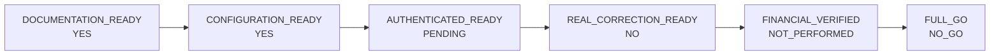

# Serah Terima Operasional — Koreksi Tagihan Sebelum Pembayaran (Pilot SPN4)

Bagian dari SOP `docs/operations/rme-invoice-correction-pilot-sop-spn4.md`.
Isi: materi pelatihan singkat (§1), daftar periksa kesiapan induk (§2), matriks
kesiapan GO (§3), probe kesiapan (§4), serah terima dan tanda tangan (§5).

**Untuk:** Front Office SPN4, Maker (user 29), Checker (user 1), Owner, IT,
pengawas keuangan (Finance Klinik / Data Analyst).

---

## 1. Materi pelatihan (satu halaman)

### 1.1 Alur dalam 8 langkah

1. **Kasir** menemukan kesalahan nyata pada tagihan **sebelum** pasien membayar.
2. **Kasir** memastikan: cabang SPN4, Belum Dibayar, nol pembayaran, total lebih
   dari Rp0.
3. **Kasir** mengisi formulir persetujuan dan memberi tahu **Maker** dan **Owner**.
4. **Owner** menyetujui **tagihan ini** secara tertulis (atau tidak).
5. **IT** menjalankan probe kesiapan (harus GO) dan mengambil baseline.
6. **Maker (user 29)** mengajukan koreksi. Pembayaran tagihan itu **otomatis
   diblokir**.
7. **Checker (user 1)** mencocokkan dengan persetujuan yang diterima **langsung
   dari Owner** (bukan diteruskan Maker/kasir), lalu **Setujui &
   Terapkan** atau **Tolak**.
8. **IT** merekonsiliasi. Jika **diterapkan**, kasir memuat ulang halaman dan
   menerima pembayaran sesuai tagihan baru. Jika **ditolak/dibatalkan** sementara
   kesalahan masih diketahui, kasir **tidak** menagih nominal asli seolah-olah
   benar — keputusan pembayaran oleh manajemen (OPS-OQ-1).

### 1.2 Daftar periksa kelayakan (semua harus "ya")

- [ ] Cabang **SPN4**
- [ ] Status **Belum Dibayar**
- [ ] **Tidak ada** pembayaran, termasuk sebagian
- [ ] Total asli **lebih dari Rp0**
- [ ] Tidak ada pengajuan koreksi lain yang aktif
- [ ] Kesalahannya **nyata** (bukan permintaan potongan harga)
- [ ] **Persetujuan tertulis Owner untuk tagihan ini**
- [ ] User 29 dan user 1 **login sendiri**

### 1.3 Lima larangan keras

1. **Jangan** mengajukan atau menyetujui tanpa persetujuan Owner untuk tagihan itu.
2. **Jangan** memakai akun orang lain atau berbagi kata sandi.
3. **Jangan** menerima pembayaran ketika tagihan sedang dikoreksi (sistem juga
   akan menolak). Setelah koreksi ditolak/dibatalkan, jangan menagih
   nominal yang diketahui salah seolah-olah benar.
4. **Jangan** mencoba mengoreksi tagihan **Rp0**, tagihan **dibayar sebagian**,
   atau tagihan **lunas**.
5. **Jangan** menahan pasien, menunda pembayaran, atau membuat kesalahan dengan
   sengaja demi pilot.

### 1.4 Pemisahan peran

- **Maker (29)** hanya MENGAJUKAN dan boleh MEMBATALKAN pengajuannya sendiri.
- **Checker (1)** hanya MENYETUJUI (= langsung menerapkan) atau MENOLAK.
- Tidak ada satu akun pun yang boleh mengajukan **dan** menyetujui koreksi yang
  sama — sistem menolaknya, termasuk Super Admin.

### 1.5 Peringatan D10

Selama koreksi **Menunggu Persetujuan**, layar menampilkan "Tagihan sedang dalam
proses koreksi. Pembayaran dapat dilanjutkan setelah proses koreksi selesai."
Tunggu keputusan. Setelah diputuskan, **muat ulang halaman** sebelum menerima
pembayaran.

### 1.6 Rekonsiliasi dan eskalasi

- IT membandingkan angka sebelum/sesudah. Selisih yang tidak terjelaskan =
  berhenti dan lapor ke Owner. Tidak ada yang "membetulkan" data secara manual.
- Ragu? Ikuti rantai: Kasir → Maker → Owner → Checker → IT. Matriks lengkap:
  `rme-invoice-correction-incident-escalation.md`.

### 1.7 Contoh (ILUSTRASI — bukan transaksi pilot nyata)

> **Contoh ilustratif.** Angka dan nomor di bawah ini rekaan untuk pelatihan,
> tidak merujuk pasien atau tagihan sungguhan, dan tidak boleh dicatat sebagai
> bukti pilot.
>
> Tagihan `RME-YYYYMM-NNNNNN` di SPN4 berisi "Scaling" qty **2** @ Rp 300.000 =
> Rp 600.000. Pasien hanya menerima satu tindakan. Kasir melihatnya sebelum
> pasien membayar; status Belum Dibayar, nol pembayaran. Owner menyetujui
> secara tertulis: ubah qty 2 → 1, total Rp 600.000 → Rp 300.000, rujukan
> `OWNER-COR-SPN4-YYYYMMDD-01`. Maker 29 mengajukan dengan alasan "Qty scaling
> tertagih 2, seharusnya 1 — OWNER-COR-SPN4-YYYYMMDD-01". Checker 1 mencocokkan
> Total Asli, Total Usulan, dan baris yang berubah, lalu **Setujui & Terapkan**.
> Tagihan menjadi Rp 300.000 (versi v1), v0 tersimpan, kasir memuat ulang
> halaman dan menerima pembayaran Rp 300.000.

---

## 2. Daftar periksa kesiapan induk

Kolom **Tingkat** memakai enam status yang **tidak boleh digabung** menjadi satu
"siap/tidak siap":

| Tingkat | Arti | Setara rule 196 |
|---|---|---|
| `DOCUMENTATION_READY` | SOP, formulir, panduan, matriks lengkap dan terverifikasi terhadap kode | — |
| `CONFIGURATION_READY` | fitur ON, SPN4 terdaftar, identitas 29/1 valid, izin peran sesuai | `PILOT_ACTIVE` |
| `AUTHENTICATED_READY` | 29 dan 1 sedang bertugas, login sendiri, probe `LIVE_NOW=yes` GO | `PILOT_LIVE` → `AUTHENTICATED_VERIFIED` |
| `REAL_CORRECTION_READY` | ada tagihan nyata yang layak + persetujuan Owner untuk kasus itu | prasyarat `FINANCIAL_CORRECTION_VERIFIED` |
| `FINANCIAL_VERIFIED` | satu koreksi nyata SUBMITTED → APPLIED dan rekonsiliasi PASS | `FINANCIAL_CORRECTION_VERIFIED` |
| `FULL_GO` | semua di atas + CI/aturan/keamanan/kebersihan, lalu tag penuh | `FULL_ACTIVATION_GO` |

Status di bawah diukur read-only di produksi **2026-10-23 11:30 UTC (19:30 WITA)**,
runtime `b3ec7133`. Setiap pelaksanaan pilot **wajib mengukur ulang** — jangan
mewarisi angka ini.

| # | Bagian | Pemeriksaan | Tingkat | Status 2026-10-23 |
|---|---|---|---|---|
| A | Kesiapan produksi | SHA runtime = tag GO terakhir, kesehatan 200, worker aktif, 0 failed job, kunci deploy bebas | CONFIGURATION | **PASS** (`b3ec7133`, 200×4, 0 failed) |
| B | Feature flag | `rme.invoice_correction` enabled via env | CONFIGURATION | **PASS** |
| C | Allowlist SPN4 | `PILOT_DECLARED=SPN4 ADMITTED=SPN4` | CONFIGURATION | **PASS** |
| D | Identitas Maker 29 | aktif, Front Office, identitas pilot maker | CONFIGURATION | **PASS** |
| E | Identitas Checker 1 | aktif, Super Admin + Owner, identitas pilot checker | CONFIGURATION | **PASS** |
| F | Pemeriksaan akun aktif | penjaga `ActiveAccountResolver` / `ACTOR_UNUSABLE` di runtime | CONFIGURATION | **PASS** (kode) |
| G | Validasi tagihan layak | ada tagihan positif, Belum Dibayar, nol pembayaran di SPN4 | REAL_CORRECTION | **TIDAK ADA** (0 kandidat; #36 Rp0, #41 PARTIAL) |
| H | Otorisasi Owner | formulir per kasus | REAL_CORRECTION | **PENDING** (tidak ada kasus) |
| I | Alur Maker | SOP §2 panduan Maker–Checker | DOCUMENTATION | **SIAP** |
| J | Alur Checker | SOP §4 panduan Maker–Checker | DOCUMENTATION | **SIAP** |
| K | Blokir D10 | terbukti di uji PostgreSQL; diamati langsung saat koreksi nyata | DOCUMENTATION / FINANCIAL | dokumen **SIAP**; pengamatan langsung **PENDING** |
| L | Versi tagihan | pengikatan versi pembayaran + Kedaluwarsa | DOCUMENTATION | **SIAP** (kode); nyata **PENDING** |
| M | Snapshot | v0 beku, v1 terbit, hash utuh | FINANCIAL | **PENDING** (0 versi dokumen di produksi) |
| N | Jejak audit | +5 audit, +3 event per koreksi pertama | FINANCIAL | **PENDING** |
| O | Rekonsiliasi | formulir + query read-only tervalidasi | DOCUMENTATION / FINANCIAL | formulir **SIAP**; pelaksanaan **NOT_PERFORMED** |
| P | Pemulihan insiden | matriks A–R, penghentian darurat | DOCUMENTATION | **SIAP** |
| Q | Kriteria GO penuh pilot | rule 196 §1 + §6 | FULL_GO | **NO_GO** |
| R | Retensi bukti | formulir terisi di kanal klinik; repositori hanya angka/id/rujukan | DOCUMENTATION | **SIAP** |
| S | Tanda tangan operasional | §5 di bawah | AUTHENTICATED | **PENDING** (operator nyata) |

**Ringkasan:**

| Tingkat | Status |
|---|---|
| `DOCUMENTATION_READY` | **YES** |
| `CONFIGURATION_READY` | **YES** |
| `AUTHENTICATED_READY` | **PENDING** (`LIVE_NOW=no`, tidak ada sesi 29/1) |
| `REAL_CORRECTION_READY` | **NO** (tidak ada kasus nyata) |
| `FINANCIAL_VERIFIED` | **NOT_PERFORMED** |
| `FULL_GO` | **NO_GO** |

---

## 3. Matriks kesiapan GO



| Untuk mencapai | Bukti yang dibutuhkan | Siapa | Dapat diotomasi? |
|---|---|---|---|
| `AUTHENTICATED_READY` | 29 dan 1 login sendiri saat shift SPN4; probe `LIVE_NOW=yes`, Decision GO; baris sesi milik mereka sendiri | operator nyata + IT | **tidak** — tidak boleh login atas nama mereka |
| `REAL_CORRECTION_READY` | tagihan positif Belum Dibayar dengan kesalahan nyata + formulir Owner terisi | kasir + Owner | **tidak** — kasus hanya tertangkap |
| `FINANCIAL_VERIFIED` | 1 koreksi SUBMITTED → APPLIED, rekonsiliasi 14 pemeriksaan PASS | Maker, Checker, IT | **tidak** |
| `FULL_GO` | semua di atas + bukti CI/aturan/keamanan/kebersihan, tag `verification-rme-invoice-correction-prepayment-pilot-1-go` pada SHA runtime yang ter-deploy | IT | sebagian (bukti teknis) |

Tag penuh itu **satu-satunya** tag penutupan pilot (rule 196 §14/§18). Kesiapan
operasional ini **tidak** membuat tag apa pun.

---

## 4. Probe kesiapan (IT)

Dijalankan **di VPS, hanya sebagai user runtime** (perintah menolak root):

```bash
cd /var/www/asia-dental-lab-v2
runuser -u daengtisiams -- env HOME=/tmp php artisan rme:invoice-correction-readiness --maker=29 --checker=1
```

| Baris | Harus |
|---|---|
| `STATE` | `PILOT_ACTIVE` |
| `FLAG_ENABLED` | `true env_resolution=env` |
| `PILOT_DECLARED` / `ADMITTED` | `SPN4` / `SPN4` |
| `PILOT_IDENTITIES` | `valid=yes maker=29 checker=1` |
| `APPLICATION` | `AUTO_ON_APPROVAL` |
| `PAIR … VALID` | `yes` |
| `PAIR … LIVE_NOW` | `yes` **hanya** saat kedua operator sedang bertugas |
| `Decision` | `GO` sebelum Maker mengajukan |

`WATCH` dengan `PAIR_MAKER_NOT_ON_SHIFT_IN_PILOT` adalah keadaan istirahat yang
sah (rule 195 §28b). **Jangan pernah** "memperbaikinya" dengan membuka sesi atas
nama operator, mengubah jadwal/konteks kerja, sesi, lease perangkat, atau kata
sandi. Kolom `status=online` di tabel konteks kerja **bukan** bukti sedang
bertugas; `users.last_login_at` tidak ditulis oleh kode mana pun dan bukan bukti
login.

Hasil 2026-10-23 11:30 UTC: `STATE=PILOT_ACTIVE`, `PILOT_IDENTITIES valid=yes
maker=29 checker=1`, `POSITIVE_UNPAID_UNSETTLED_INVOICES_IN_PILOT=0`, `VALID=yes`,
`LIVE_NOW=no`, `[WATCH] PAIR_MAKER_NOT_ON_SHIFT_IN_PILOT`, **Decision: WATCH**.

---

## 5. Serah terima dan tanda tangan

Diisi oleh orang yang bersangkutan saat sesi serah terima nyata. **Jangan diisi
atas nama orang lain dan jangan diisi dengan waktu karangan.**

| Peran | Nama | Sudah membaca SOP induk, formulir, panduan, matriks | Tanggal (WITA) | Paraf |
|---|---|---|---|---|
| Front Office SPN4 | | [ ] | | |
| Maker — user 29 | | [ ] | | |
| Checker — user 1 | | [ ] | | |
| Owner | | [ ] | | |
| IT | | [ ] | | |
| Pengawas keuangan | | [ ] | | |

Penandatanganan ini adalah bukti **pelatihan**, bukan bukti `AUTHENTICATED_VERIFIED`
atau koreksi keuangan.
