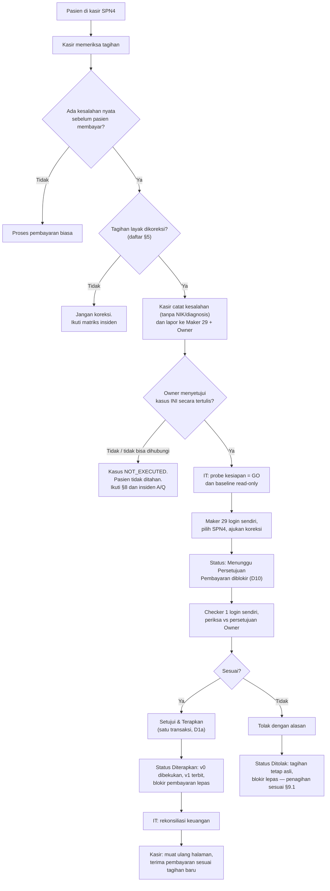
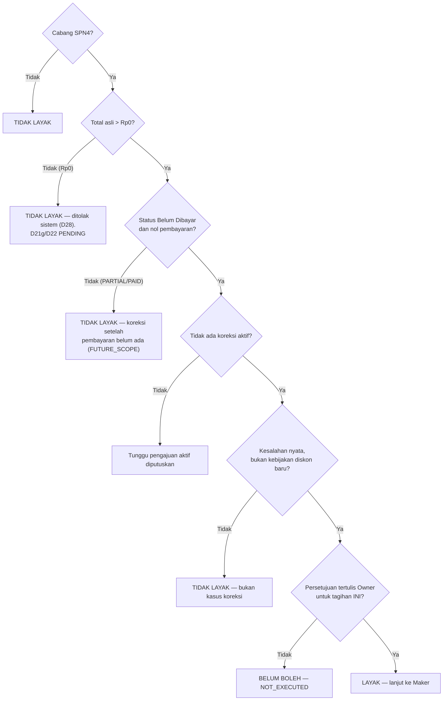
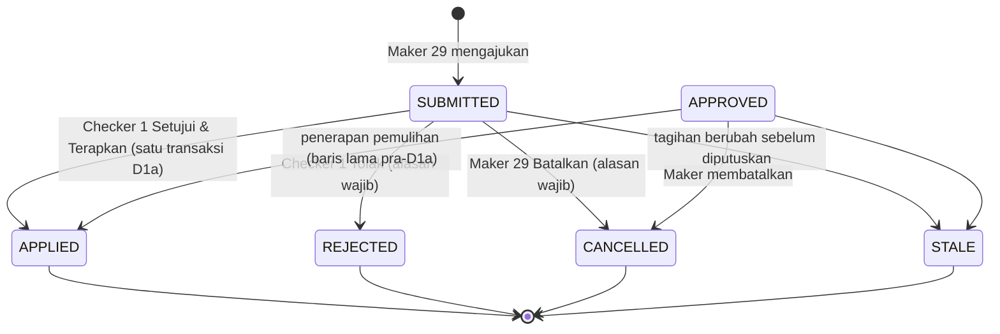

# SOP Pilot Koreksi Tagihan Sebelum Pembayaran — Cabang Sunu (SPN4)

**Dokumen induk.** Dokumen pendamping:

| Dokumen | Isi |
|---|---|
| `docs/operations/rme-invoice-correction-owner-approval-template.md` | Formulir persetujuan Owner per kasus |
| `docs/operations/rme-invoice-correction-maker-checker-guide.md` | Langkah Maker (user 29), blokir pembayaran D10, langkah Checker (user 1), verifikasi penerapan otomatis, penolakan dan pembatalan |
| `docs/operations/rme-invoice-correction-financial-reconciliation.md` | Formulir rekonsiliasi sebelum/sesudah |
| `docs/operations/rme-invoice-correction-incident-escalation.md` | Matriks insiden dan eskalasi |
| `docs/operations/rme-invoice-correction-operator-handoff.md` | Materi pelatihan, daftar periksa kesiapan induk, serah terima |

Aturan yang mengikat dokumen ini: rule 195 (aktivasi), 196 (tangga verifikasi),
197 (identitas pilot), 201 (penjaga tagihan Rp0), 202 (prosedur operasional).
Register keputusan Owner: `docs/decisions/rme-billing-correction-owner-decisions.md`.

> Dokumen ini tidak membuat keputusan Owner baru. Jika ada yang tidak diatur di
> sini atau di register, tanyakan ke Owner — jangan mengarang kebijakan.

## 1. Untuk apa fitur ini

Koreksi tagihan dipakai ketika **tagihan RME yang sudah diterbitkan ternyata salah
dan pasien BELUM membayar sama sekali**. Tagihan yang sudah terbit tidak boleh
diedit langsung (keputusan D21 butir 6). Satu-satunya jalan resmi adalah:

1. **Maker** (user 29) mengajukan koreksi,
2. **Checker** (user 1) memeriksa lalu **menyetujui** — persetujuan langsung
   **menerapkan** koreksi dalam satu langkah (D1a),
3. dokumen asli dibekukan sebagai **versi v0**, tagihan baru diterbitkan sebagai
   **versi v1**, dan semua langkah tercatat di log audit (D7).

Selama koreksi masih aktif, **pembayaran tagihan itu diblokir oleh sistem** (D10).

## 2. Ruang lingkup pilot (dikunci di kode)

| Hal | Nilai | Dasar |
|---|---|---|
| Cabang | **SPN4 — Cabang Sunu** saja | D1c, `config/rme_invoice_correction.php` |
| Pengaju (Maker) | **user 29** (Admin Sunu) saja | D1d/D1e, rule 197 |
| Pemeriksa (Checker) | **user 1** (IT Support) saja | D1d/D1e, rule 197 |
| Jenis koreksi | **sebelum pembayaran** saja | rule 190/195 |
| Harga | diketik manual oleh kasir | D21 (manual pricing) |
| Tagihan Rp0 | **ditolak sistem** | D28 / rule 201 (D21g dan D22 masih PENDING) |

Akun lain — termasuk Front Office lain dan Super Admin lain — **ditolak oleh
sistem** walaupun perannya punya izin. Mengubah daftar akun atau cabang adalah
keputusan Owner baru yang harus melalui perubahan kode yang direview, bukan
pengaturan di layar.

**Di luar pilot (FUTURE_SCOPE, tidak boleh dilakukan):** koreksi setelah
pembayaran, refund, pembatalan pembayaran, kredit pasien, penyesuaian Rp0,
kewenangan diskon (D21c), cabang selain SPN4.

## 3. Peran dan tanggung jawab

| Peran | Siapa | Boleh | Tidak boleh |
|---|---|---|---|
| Kasir / Front Office SPN4 | siapa pun yang bertugas di kasir SPN4 | menemukan kesalahan, memastikan tagihan belum dibayar, melapor ke Maker dan Owner | mengajukan koreksi (kecuali dia user 29), mengubah tagihan, menerima pembayaran saat koreksi aktif |
| Maker | user 29 | mengajukan koreksi, membatalkan pengajuannya sendiri | menyetujui, menerapkan, memakai akun orang lain |
| Checker | user 1 | menyetujui (= menerapkan), menolak | mengajukan koreksi, menyetujui tanpa persetujuan Owner |
| Owner | pemilik klinik | memberi persetujuan tertulis **per kasus** | memberi "persetujuan umum" untuk tagihan yang belum ada |
| IT | penanggung jawab teknis | menjalankan probe kesiapan, mengambil baseline dan rekonsiliasi read-only | login sebagai operator, mengubah data keuangan, menjalankan REPL di produksi |
| Pengawas Keuangan | Finance Klinik / Data Analyst | melihat riwayat koreksi (layar *Billing Correction*, hanya baca) | mengajukan/menyetujui koreksi |

> Catatan pemisahan tugas: sistem menjamin **akun** Maker ≠ akun Checker. Sistem
> tidak bisa membuktikan bahwa dua akun dipegang dua **orang** yang berbeda, atau
> bahwa Owner dan pemegang akun Checker adalah orang yang berbeda. Persetujuan
> Owner dan persetujuan Checker tetap dua tindakan yang dicatat terpisah.

## 4. Alur lengkap

## 5. Syarat tagihan layak dikoreksi (pohon keputusan)

Semua syarat harus terpenuhi. Satu saja gagal → **jangan ajukan**.

| # | Syarat | Cara memeriksa | Dijamin sistem? |
|---|---|---|---|
| 1 | Tagihan milik **SPN4** | kolom Cabang di halaman tagihan | ya (`BRANCH_NOT_IN_PILOT`, halaman 404) |
| 2 | Tagihan **ada** dan terbit | nomor invoice `RME-YYYYMM-NNNNNN` tampil | ya |
| 3 | **Total asli > Rp0** | Total Asli di halaman tagihan | ya (`CORRECTION_ORIGINAL_TOTAL_ZERO`) |
| 4 | Status **Belum Dibayar** (UNPAID) | badge status | ya (`CORRECTION_INVOICE_NOT_UNPAID`) |
| 5 | **Tidak ada** pembayaran sebagian | riwayat pembayaran kosong | ya (`CORRECTION_TYPE_NOT_ENABLED`) |
| 6 | **Tidak ada** pembayaran apa pun tercatat | riwayat pembayaran kosong | ya |
| 7 | Tidak ada koreksi lain yang **aktif** | panel *Koreksi Tagihan* tidak menampilkan pengajuan aktif | ya (`CORRECTION_ALREADY_ACTIVE`) |
| 8 | Versi tagihan **terkini** | muat ulang halaman sebelum mengajukan | ya (koreksi jadi Kedaluwarsa bila tagihan berubah) |
| 9 | Kunjungan tidak dibatalkan, belum ada kandidat lab | panel menampilkan alasan bila tidak layak | ya (`CORRECTION_VISIT_CANCELLED`, `CORRECTION_LAB_CANDIDATES_EXIST`) |
| 10 | Ada **kesalahan nyata** (salah tindakan, qty, harga, item terlewat, item ganda) | penilaian kasir + Owner | **tidak** — tanggung jawab manusia |
| 11 | Revisi **tidak** membutuhkan kebijakan diskon baru (D21c PENDING) dan tidak membuat baris/total Rp0 | penilaian kasir + Owner | sebagian (Rp0 ditolak; diskon dibatasi 0 ≤ diskon ≤ bruto baris) |
| 12 | **Persetujuan tertulis Owner untuk tagihan INI** | formulir persetujuan | **tidak** — tanggung jawab manusia |
| 13 | Maker 29 tersedia dan login sendiri | — | ya untuk identitas |
| 14 | Checker 1 tersedia dan login sendiri | — | ya untuk identitas |
| 15 | Fitur aktif dan izin akun lolos | probe kesiapan IT = GO | ya |

**Yang TIDAK pernah boleh dipakai sebagai kasus pilot:**

- tagihan **#36** (Rp0, Belum Dibayar) — ditolak sistem, D21g/D22 PENDING;
- tagihan **#41** (dibayar sebagian) — di luar pilot sebelum pembayaran;
- tagihan yang **sengaja dibuat salah** untuk membuka kasus;
- tagihan yang pembayarannya **ditunda** supaya tetap Belum Dibayar;
- pasien atau kunjungan sintetis/percobaan;
- kasus yang membutuhkan keputusan diskon baru (D21c PENDING).

Tidak setiap tagihan Belum Dibayar adalah kasus koreksi. Kasus pilot hanya
"tertangkap", tidak pernah "dibuat" (rule 196 §3).

## 6. SOP Front Office / Kasir SPN4 — menemukan kesalahan

Bahasa sederhana untuk petugas kasir.

1. **Pasien datang ke kasir.** Buka halaman tagihan pasien seperti biasa.
2. **Periksa tagihan** sebelum menerima uang: tindakan, jumlah (qty), harga,
   diskon, total.
3. **Jika ada kesalahan nyata sebelum pasien membayar**, berhenti dulu. Jangan
   menerima pembayaran untuk tagihan itu.
4. **Pastikan status tagihan "Belum Dibayar"** dan riwayat pembayarannya kosong.
5. **Pastikan tidak ada pembayaran apa pun**, termasuk pembayaran sebagian.
6. **Pastikan total asli lebih dari Rp0.** Tagihan Rp0 tidak bisa dikoreksi.
7. **Catat kesalahannya** di formulir persetujuan Owner
   (`rme-invoice-correction-owner-approval-template.md`): nomor invoice, item
   yang salah, apa yang seharusnya, total asli, total yang benar. Gunakan
   formulir kertas atau kanal internal klinik yang sudah biasa dipakai untuk
   komunikasi dengan Owner — **bukan** grup chat umum.
8. **Beri tahu Maker (user 29)** bahwa ada kasus calon koreksi.
9. **Minta persetujuan Owner untuk kasus ini.** Owner harus menyebut nomor
   invoice, perubahan yang disetujui, dan total yang benar.
10. **Lanjutkan hanya jika semua syarat di §5 terpenuhi** dan Owner sudah
    menyetujui secara tertulis.

### 6.1 Apa yang termasuk kesalahan nyata

Contoh: tindakan yang ditagih bukan tindakan yang diberikan; qty salah; harga
satuan salah ketik; item tertagih dua kali; item yang diberikan terlewat. Bukan
kesalahan nyata: pasien meminta potongan harga, harga ingin "disesuaikan"
setelah tawar-menawar, atau perubahan yang membutuhkan kebijakan diskon baru.

### 6.2 Informasi yang boleh dan tidak boleh dicatat atau dibagikan

| Boleh | Tidak boleh |
|---|---|
| Nomor invoice, nomor koreksi (`RMECOR-…`), cabang, nominal, deskripsi item, nama tindakan | NIK/KTP, nomor rekam medis di kanal umum, diagnosis, riwayat medis, foto pasien/KTP, kata sandi, kode OTP |

Kolom **Alasan Koreksi** di sistem juga mengingatkan: jangan menulis NIK/KTP.

**Jangan memotret layar mentah sebagai bukti.** Halaman tagihan dan halaman
koreksi menampilkan nama pasien dan nomor rekam medis. Bukti dicatat sebagai
teks: nomor invoice, nomor koreksi, status, nominal, waktu.
Nama pasien sudah ada di sistem — tidak perlu ditulis ulang di formulir yang
beredar di luar sistem.

### 6.3 Siapa yang boleh meminta dan menyetujui

- **Mengajukan** koreksi di sistem: hanya **user 29**.
- **Memberi persetujuan bisnis**: hanya **Owner**, per kasus, tertulis.
- **Menyetujui di sistem** (= menerapkan): hanya **user 1**, setelah ada
  persetujuan Owner.

### 6.4 Situasi khusus (ringkas — detail di matriks insiden)

| Situasi | Yang dilakukan |
|---|---|
| Owner tidak bisa dihubungi | §8 — pasien tidak ditahan, kasus NOT_EXECUTED |
| Pembayaran mendesak, pasien harus segera pulang | §8 — pasien tidak ditahan; kasir tidak memutuskan sendiri |
| Tagihan Rp0 | Jangan diajukan. Ditolak sistem (D28). Laporkan ke Owner (D21g/D22 PENDING) |
| Tagihan sudah dibayar sebagian (PARTIAL) | Jangan diajukan. Koreksi setelah pembayaran belum tersedia. Laporkan ke Owner |
| Tagihan sudah lunas (PAID) | Jangan diajukan. Refund/koreksi setelah pembayaran belum tersedia. Laporkan ke Owner |

## 7. Persetujuan Owner — prinsip

- Persetujuan harus **spesifik untuk satu tagihan** dan menyebut perubahan
  keuangannya. Formulir: `rme-invoice-correction-owner-approval-template.md`.
- Otorisasi sprint, perintah "selesaikan pilot", atau persetujuan umum **bukan**
  persetujuan kasus (rule 196 §9).
- Tidak ada tanda tangan, waktu, atau nomor persetujuan yang boleh dikarang.
- **Checker memastikan persetujuan langsung dari Owner** melalui kanal Owner
  sendiri — bukan dari pesan yang diteruskan Maker atau kasir, dan bukan hanya
  dari nomor rujukan yang diketik Maker di Alasan Koreksi.
- Formulir yang sudah diisi **tidak** disimpan di repositori. Repositori hanya
  boleh memuat **nomor rujukan** persetujuan (tanpa data pasien) pada dokumen
  bukti penutupan pilot.

## 8. Jika Owner tidak dapat menyetujui sebelum pasien harus membayar

1. **Jangan menahan pasien** demi bukti pilot (rule 196 §21).
2. **Jangan mengubah tagihan** dan jangan mengajukan koreksi tanpa persetujuan.
3. **Jangan melewati Maker-Checker**, jangan melewati blokir D10, jangan
   membuat persetujuan palsu.
4. **Jangan memungut nominal yang diketahui salah seolah-olah kesalahannya sudah
   selesai.** Kasir tidak memutuskan sendiri.
5. **Eskalasi ke manajemen klinik** sesuai praktik yang berlaku.
6. Catat kasus sebagai **`NOT_EXECUTED`** dengan alasan singkat tanpa data
   pasien (mis. "Owner tidak dapat dihubungi sebelum pasien pulang").
7. `NOT_EXECUTED` hanya berlaku untuk momen di kasir. Bila tagihan dilaporkan
   sebagai **Ketidaksesuaian Tagihan** karena memang salah (bukan demi pilot),
   pembayaran ditahan dan tagihan tetap Belum Dibayar. Tagihan itu **tetap boleh
   menjadi kasus pilot** bila kemudian Owner menyetujui **tagihan itu** secara
   tertulis dan Maker 29 serta Checker 1 login sendiri. Urutannya: ajukan →
   halaman pembayaran menampilkan kedua blokir → Setujui & Terapkan → laporan
   diselesaikan dengan hasil **Selesai dengan koreksi tagihan yang telah
   diterapkan** (diverifikasi sistem) →
   pasien membayar nominal yang sudah dikoreksi (rule 196 §8).

**Kebijakan Owner OPS-OQ-1 (sudah dijawab, berlaku di SEMUA cabang — rule 203).**
Bila tagihan diketahui salah dan koreksi belum disetujui:

1. **Jangan memungut** nominal yang diketahui salah.
2. **Jangan mengubah** tagihan sendiri.
3. Pada halaman tagihan, klik **Laporkan Ketidaksesuaian Tagihan**. Sistem
   **menahan pembayaran** tagihan itu di semua jalur kasir dan meneruskan kasus
   ke penanggung jawab cabang.
4. Tagihan **tetap belum selesai** secara keuangan (Belum Dibayar/Sebagian) sampai
   ada penyelesaian yang sah. Laporan tidak membuat tagihan Lunas, Dibatalkan,
   atau Rp0.
5. **Pasien boleh pulang.** Jangan menahan pasien demi menyelesaikan pilot koreksi.

Kebijakan ini **tidak memperluas pilot koreksi** (tetap SPN4, Maker 29, Checker 1,
D28 tetap berlaku). Tagihan yang diketahui salah tetap **tidak dipakai sebagai
kasus pilot** tanpa persetujuan Owner untuk kasus itu (rule 196 §21). Panduan
lengkap: `docs/operations/rme-billing-dispute-sop.md`.

## 9. Siklus status koreksi

Nama status sesuai sistem (`RmeInvoiceCorrectionStatus`):

| Kode | Label di layar | Pembayaran |
|---|---|---|
| `SUBMITTED` | Menunggu Persetujuan | **diblokir** |
| `APPROVED` | Disetujui — Belum Diterapkan | **diblokir** (hanya baris lama sebelum D1a; sejak D1a status ini tidak pernah terlihat tersimpan) |
| `APPLIED` | Diterapkan | blokir lepas — tagih sesuai **versi baru** |
| `REJECTED` | Ditolak | blokir lepas — tagihan tetap asli; lihat §9.1 |
| `CANCELLED` | Dibatalkan | blokir lepas — tagihan tetap asli; lihat §9.1 |
| `STALE` | Kedaluwarsa (Tagihan Berubah) | blokir lepas — tagihan tidak diubah koreksi ini; lihat §9.1 |

Catatan D1a: secara internal sistem mencatat `SUBMITTED → APPROVED → APPLIED`
(dua event dan dua baris audit), tetapi keduanya terjadi dalam **satu
transaksi**. Transaksi lain tidak pernah melihat status `APPROVED` tersimpan.
Jika penerapan gagal, persetujuan juga batal dan koreksi tetap `SUBMITTED` (atau
menjadi `STALE`).

### 9.1 Blokir pembayaran lepas ≠ boleh menagih nominal yang salah

Setelah koreksi **Ditolak**, **Dibatalkan**, atau **Kedaluwarsa**, sistem tidak
lagi memblokir pembayaran dan tagihan kembali ke nominal **asli**. Itu belum
berarti nominal asli benar:

- Jika Checker/Owner menyimpulkan **tagihan asli memang benar** (tidak ada
  kesalahan), pembayaran biasa dilanjutkan.
- Jika **kesalahan masih diketahui** — mis. pengajuan dibatalkan karena pasien
  tidak bisa menunggu, atau ditolak karena usulannya keliru — kasir **tidak**
  memungut nominal asli seolah-olah benar: laporkan **Ketidaksesuaian Tagihan**
  (OPS-OQ-1, rule 203, §8) — pembayaran ditahan sampai penanggung jawab cabang
  menyelesaikannya. Pembayaran tidak dapat ditarik kembali:
  begitu dibayar, tagihan menjadi Lunas/Sebagian dan **tidak dapat lagi
  dikoreksi** di pilot ini (koreksi setelah pembayaran dan refund belum ada).
- Koreksi ulang membutuhkan pengajuan baru dan persetujuan Owner baru.

## 10. Status kesiapan saat dokumen ini terbit

Diukur read-only di produksi 2026-10-23 (lihat dokumen bukti sprint
`docs/sprints/preparation-rme-invoice-correction-pilot-operational-readiness-1.md`):

| Tingkat | Status |
|---|---|
| Dokumentasi (SOP ini) | siap |
| Konfigurasi (fitur ON, SPN4, identitas 29/1 valid) | siap |
| Operator sedang bertugas (`LIVE_NOW`) | belum — menunggu shift nyata |
| Kasus nyata yang layak | **tidak ada** (0 tagihan positif Belum Dibayar di SPN4) |
| Koreksi keuangan nyata + rekonsiliasi | belum dilakukan |
| Penutupan penuh pilot | **NO_GO** |
