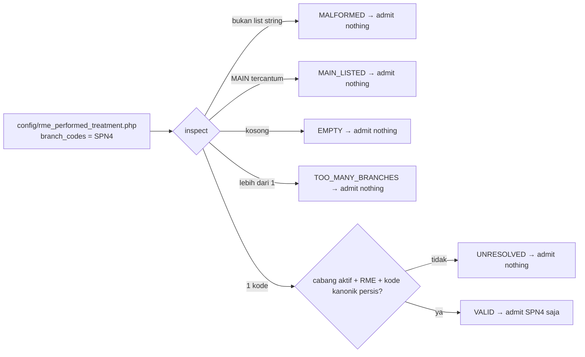

# ACTIVATION-RME-DOCTOR-PERFORMED-TREATMENTS-1 — Pilot satu cabang (SPN4) "Tindakan Dilakukan"

**Program:** DAENGTISIAMS-RME-BILLING-CORRECTION. **Aturan:** rule 219 §14–§15a. **Keputusan Owner:** DPT-Q2 … DPT-Q10
diratifikasi oleh `RATIFICATION-RME-DOCTOR-PERFORMED-TREATMENTS-OWNER-DECISIONS-1` (merge `df248f36`); penetapan DPT-Q8
dijawab Owner dalam sesi 2026-11-02 ≈ 05:05 WITA.

## 1. Baseline otoritatif

| Item | Nilai |
|---|---|
| Base remote saat mulai | `584e2bd6`; setelah Phase A `df248f36` (tree `6429289f`) |
| Runtime produksi | `931c716c` / tree `150679aa`, tag exact-match `feature-rme-doctor-performed-treatments-1-implementation-go` |
| Flag di produksi | `FEATURE_RME_DOCTOR_PERFORMED_TREATMENTS` dan `FEATURE_RME_ZERO_VALUE_CLOSURE` tidak di-set → OFF |
| Tabel DPT di produksi | 0 deklarasi, 0 tindakan |
| Cabang RME aktif | TLK1, LDK2, ATG3, SPN4 (MAIN bukan RME) |
| Kohort dokter | 15 dokter aktif tertaut akun, semuanya terdaftar praktik di keempat cabang |
| Kunjungan 7 hari terakhir | SPN4 = 2; cabang lain 0 |
| Checkout VPS | satu path untracked `storage/runtime-home/` (wajib dipertahankan, bukan perubahan kode) |

## 2. Penetapan Owner (DPT-Q8)

| Field | Nilai |
|---|---|
| PILOT_BRANCH_CODE / NAME | `SPN4` / Cabang Sunu |
| AUTHORIZED_DOCTOR_COHORT | semua dokter penangan resmi (`visit.doctor_id`) di SPN4 — tanpa allowlist identitas tambahan |
| OPERATOR_TRAINING | `OWNER_ATTESTED` — Owner menyatakan sudah dilakukan; tidak ada catatan kehadiran dan tidak diklaim |
| ACTIVATION_WINDOW | segera setelah deploy terverifikasi |
| OPERATIONAL_ACCEPTANCE_OWNER | tidak disebut terpisah; Owner yang menetapkan |

## 3. Temuan pra-aktivasi

1. **Flag bersifat GLOBAL.** `RmePerformedTreatmentFeatureGuard::enabled()` hanya membaca satu switch. Menyalakannya
   saja akan membuka fitur di keempat cabang. Maka aktivasi butuh allowlist cabang server-side (rule 219 §15).
2. **Semua konsumen melewati service.** Halaman RME (`workspaceFor`), kasir (`cashierProjectionFor` → `evidenceFor`),
   rule 218 (`evidenceFor`) — sehingga satu predikat `enabledFor($visit)` menutup semuanya. Tiga FormRequest membaca guard
   langsung dan ikut diubah.
3. **Pola allowlist sudah ada dua kali** (`RmeInvoiceCorrectionPilotScope`, `RmeRefundRequestPilotScope`), versi lunak
   (melewati entri non-string). Fitur ini memakai resolver baru yang KETAT dan dapat dipakai ulang
   (`BranchAllowlistResolver`); dua kelas lama sengaja tidak disentuh (pilot keuangan, review terpisah) — kandidat
   konsolidasi tercatat.
4. **LOW-2 (void consent) tidak terjangkau di produksi.** `RmeVisitConsentService::void()` tidak punya pemanggil —
   tidak ada route, controller, maupun command. Tetap ditutup sebelum ada pemanggil (§5).

## 4. Desain admisi pilot

```mermaid
flowchart TD
  R[POST rute Tindakan Dilakukan] --> M[middleware: complete_rme_examination + visit.room]
  M --> F{FormRequest: enabledFor(visit)?}
  F -- tidak --> N404[404 — sama seperti flag OFF]
  F -- ya --> P{Policy recordPerformedTreatments}
  P -- tidak --> N403[403]
  P -- ya --> S1{Service authorize: flag ON?}
  S1 -- tidak --> X1[DPT_NOT_ENABLED]
  S1 -- ya --> S2{cabang kunjungan di-admit pilot?}
  S2 -- tidak --> X2[DPT_BRANCH_NOT_IN_PILOT]
  S2 -- ya --> A[dokter penangan + consent + encounter]
  A --> L[kunci baris kunjungan]
  L --> S3{cabang baris TERKUNCI di-admit?}
  S3 -- tidak --> X3[DPT_BRANCH_NOT_IN_PILOT]
  S3 -- ya --> W[tulis baris append-only + audit]
```



Super Admin melewati setiap policy lewat `Gate::before`, jadi keputusan pilot dibuat di service SEBELUM resolusi aktor,
dan sekali lagi pada baris yang terkunci.

## 5. LOW-2 — void consent

**Penilaian ulang (runtime saat ini):** `void()` tidak punya pemanggil produksi → `REACHABLE_IN_PRODUCTION=NO`.
**Penilaian risiko rilis:** bukan pemblokir. **Tindakan:** tetap ditutup sekarang, karena perbaikannya kecil dan
membuat entry point masa depan aman secara default:

- `void()` mengunci baris kunjungan dulu (`visit → consent`, urutan yang sama dengan penulisan klinis yang memeriksa
  consent di bawah kunci itu), lalu membaca ulang consent di bawah kunci.
- Bukti PostgreSQL 16 (proses child nyata): **N1** penulisan yang menunggu di belakang void → ditolak
  `DPT_CONSENT_REQUIRED`, 0 baris; **N2** void yang menunggu di belakang penulisan → berurutan sesudahnya, baris ditulis di
  bawah consent yang masih sah; **N3** dua void bersamaan → hanya satu yang berhasil.
- Mutasi "hapus kunci kunjungan di `void()`" dan "hapus pembacaan ulang" — lihat §8.3.
- Authoring RME tulisan tangan dan odontogram **tidak** mengunci baris kunjungan sebelum cek consent (diverifikasi:
  tidak ada `lockForUpdate` kunjungan di modul MedicalRecord/Odontogram). Tanpa pemanggil void, ini tidak terjangkau;
  sprint yang menambah UI void wajib memeriksanya ulang (rule 219 §12a).

## 6. Matriks ACT-DPT → test

| ID | Test |
|---|---|
| 001, 012 | `RmePerformedTreatmentPilotScopeTest` ACT-DPT-001, -012 |
| 002 | `RmePerformedTreatmentRegressionTest` (flag OFF tidak berubah) |
| 003 | ACT-DPT-003 |
| 004 | ACT-DPT-004, -004b (404 HTTP) |
| 005–007 | ACT-DPT-005, -006, -006b (×4), -006c, -006d, -006e, -007 (×2) |
| 008 | ACT-DPT-008 |
| 009 | ACT-DPT-009 |
| 010 | ACT-DPT-010 |
| 011 | ACT-DPT-011 (model basi) + race **O** (PostgreSQL) |
| 012b | ACT-DPT-012b (rollback dengan menyempitkan allowlist) |
| 013–028, 030 | suite yang sudah ada: `Recording`, `ControlClassification`, `Security`, `Regression` (dijalankan ulang, hijau) |
| 024b | ACT-DPT-024b (policy) |
| 029 | ACT-DPT-029 (deklarasi opsional) |
| 031 | ACT-DPT-031 (snapshot rule 218 tetap v1 di luar pilot) |
| 032–040 | `BillingConsistency` (detektif, tanpa harga/pembayaran) + ACT-DPT-033/049, -034 |
| 041 | races **N1**, **N2** |
| 042, 044, 046 | races B, E, A/H (sudah ada) |
| 043 | race F (sudah ada) |
| 045 | ACT-DPT-012 (flag OFF → permintaan berikutnya ditolak) |
| 047, 048 | `Security` DPT-063…076 + ACT-DPT-004b |
| 049 | ACT-DPT-033/049 |
| 050 | ACT-DPT-012, -012b (baris & audit bertahan) |

## 7. Readiness pilot

| Domain | Status |
|---|---|
| Penetapan cabang Owner | VERIFIED (sesi 2026-11-02) |
| Kohort dokter | VERIFIED — dokter penangan resmi; 15 dokter aktif tertaut |
| Flag kanonik | VERIFIED — `rme.doctor_performed_treatments`, default OFF |
| Pembatasan cabang server-side | PASS (lokal + PG16) |
| Penolakan lintas cabang | PASS |
| Otorisasi dokter / ruangan / consent | PASS (suite lama + baru) |
| Integritas rekam klinis | PASS |
| Proyeksi kasir | PASS (di luar pilot = null) |
| Rule 218 detektif | PASS |
| NO_CHARGE | OFF (diuji: default committed OFF) |
| Pelatihan operator | `OWNER_ATTESTED` (bukan bukti kehadiran) |
| Prosedur rollback | READY (rule 219 §14) |
| Deploy runtime / baseline keuangan / review keamanan | lihat §8–§9 |

## 8. Bukti lokal

### 8.1 TDD
RED (sebelum kode produksi): suite baru 31 test → **26 gagal, 5 lulus** (yang lulus adalah invarian yang memang sudah
benar: flag OFF, opsional, tanpa efek keuangan, flag committed OFF). GREEN: lihat 8.2.

### 8.2 Suite

| Run | Hasil |
|---|---|
| `tests/Feature/RmePerformedTreatment` — SQLite | 140 lulus, 18 skip (race khusus PostgreSQL), 0 gagal |
| `tests/Feature/RmePerformedTreatment` — **PostgreSQL 16.15** | **158 lulus / 593 asersi, 0 skip** (termasuk race N1–N3, O) |
| Regresi berbasis dependensi (filter 18 token: DPT, zero-value, consent, odontogram, medical record, clinic visit, oversight, invoice correction, kasir, refund, room/patient scope, devflow, critical-gate coverage, legacy closure) — SQLite | 2.516 test: 2.414 lulus, 102 skip (PG-only), 0 gagal |
| Regresi yang sama — **PostgreSQL 16.15** | **2.516 lulus, 0 skip, 0 gagal** (1.143 s) |
| Critical filter CI (100 token, dua varian identik) | memilih 7.673 test termasuk 32 test suite baru — dijalankan oleh CI sebagai otoritas |

Rekonsiliasi: jumlah test = jumlah yang dipilih `--list-tests`; tidak ada yang hilang diam-diam.

### 8.3 Mutation testing

Harness copy-revert (setiap mutan diterapkan dengan substitusi tepat-satu, file dipulihkan dengan copy dan diverifikasi
sha256 sama dengan aslinya; mutan yang tidak teraplikasi dilaporkan `NOT_APPLIED`, bukan "killed"). Baseline hijau
dikonfirmasi lebih dulu.

| Mutan | Target | Hasil |
|---|---|---|
| M01 | flag diabaikan di `enabledFor()` | KILLED |
| M02 | pilot meng-admit cabang apa pun | KILLED |
| M03 | cek pilot di `authorize()` dihapus | KILLED |
| M04 | pembacaan ulang cabang di bawah kunci dihapus (SQLite) | **SURVIVED → test diperketat → KILLED** |
| M04b | sama, diuji race O PostgreSQL | KILLED |
| M05 | batas cabang dinaikkan ke 2 | KILLED |
| M06 | MAIN tercantum ditoleransi | KILLED |
| M07 | entri non-string dilewati (versi lunak) | KILLED |
| M08 | cabang ber-kode alias di-admit | KILLED |
| M09 | FormRequest mengabaikan `enabledFor()` | KILLED |
| M10 | cek pilot di policy dihapus | KILLED |
| M11 | `evidenceFor()` memakai flag global | KILLED |
| M12 | probe meloloskan config invalid | KILLED |
| M13 | probe `--expect=on` tidak dicek | KILLED |
| M14 | kunci kunjungan di `void()` consent dihapus | KILLED (race N1 PG16) |
| M15 | pembacaan ulang consent di bawah kunci dihapus | KILLED (race N3 PG16) |

Tambahan setelah review keamanan: M16 gate `stateFor()` dihapus, M17 gate `historyFor()` dihapus, M18 tabrakan kode
cabang live ditoleransi — ketiganya KILLED.

**19/19 terbunuh, 0 bertahan.** M04 adalah temuan nyata: ACT-DPT-011 semula hanya mengasersi "ada penolakan", dan
scope cabang kerja di policy menolak dengan kode lain sehingga menyamarkan hilangnya pembacaan ulang. Asersi kini menuntut
`DPT_BRANCH_NOT_IN_PILOT`; mutan dijalankan ulang dan terbunuh. M13 terbunuh karena test `--expect=on` yang gagal pada
flag OFF ditambahkan sebelum harness dijalankan (celah ditemukan saat membaca test).

### 8.4 Review keamanan independen

Subagen read-only (diberi kode, bukan kesimpulan). **CRITICAL 0 · HIGH 0 · MEDIUM 0.** Tidak ada pemblokir rilis.

| # | Temuan | Tindakan |
|---|---|---|
| 1 | LOW — `stateFor()`/`historyFor()` publik tanpa gate flag/pilot | DIPERBAIKI: keduanya kini `enabledFor()`; test ACT-DPT-012b; mutan M16/M17 |
| 2 | INFO — parser "ketat" tetap trim/upper-case | docblock dikoreksi (ketat = bentuk; normalisasi hanya bisa menamai cabang berkode kanonik itu) |
| 3 | INFO — kode cabang live duplikat tidak ditolak | DIPERBAIKI: tabrakan → dibuang → `UNRESOLVED`; ACT-DPT-006f; mutan M18 |
| 4 | INFO — docblock `void()` mengklaim "setiap" penulisan klinis | dikoreksi: hanya DPT yang memeriksa consent di bawah kunci kunjungan; RME/odontogram tidak (sudah ada sebelumnya) |
| 5 | INFO — `void()` pada kunjungan soft-deleted tanpa kunci | diterima: tidak ada penulisan klinis yang bisa berpacu (kunjungan terhapus ditolak di bawah kunci) |
| 6 | INFO — 404 vs 403 mengungkap keanggotaan pilot | diterima: informasi yang diungkap dapat diabaikan, hanya bagi pemegang `complete_rme_examination` |
| 7 | INFO — `--expect=on` tidak mengunci kode cabang | seremoni wajib membaca `admitted=SPN4` (rule 219 §14) |
| 8 | INFO — `admits()` ±5 query per penulisan | diterima: sengaja tanpa memo agar keputusan di bawah kunci selalu segar |

Butir yang diverifikasi TIDAK rentan: flag global mencapai cabang non-pilot (semua konsumen tergating), spoofing cabang,
bypass Super Admin, TOCTOU (declare/record/void), parsing fail-closed, deadlock void consent (tidak ada kode yang
mengunci consent dulu), PII probe, pelemahan identitas dokter/consent/ruangan, dan `config:cache` (tanpa `env()`).

## 9. Bukti rilis

Diisi oleh commit evidence setelah merge, deploy, dan seremoni aktivasi.
