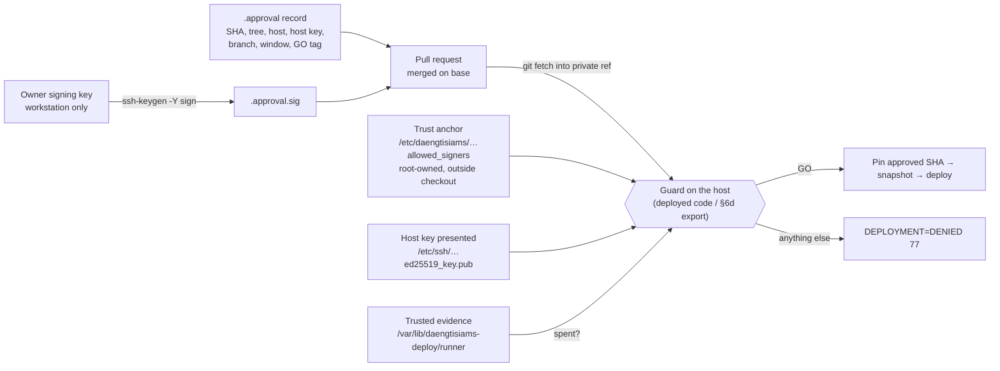

# DMS-RELEASE-GUARD-TRUST-HARDENING-1 — release guard trust hardening (rule 231)

Rule: `.cursor/rules/231-release-guard-trust-hardening.mdc` (extends rule 229) · Domain index:
`.claude/rules/deploy-infra.md` AIR-DEP-37 · Procedure: `docs/runbooks/production-host-identity.md` §6b, §6d ·
Record format: `deploy/release-approvals/README.md` · Recovery: `docs/runbooks/vps-deploy-rollback-runbook.md`
(Troubleshooting) · Manifest: `.sprint/current.yml` (`DMS-RELEASE-GUARD-TRUST-HARDENING-1`, go_tag
`dms-release-guard-trust-hardening-1-go`) · Base: `feature/sprint-26-phase-26-8-stabilization-closure-go-watch-no-go-report`
at `55990b3b` · Branch: `fix/dms-release-guard-trust-hardening-1`.

**Status: MERGED (`d707a3e349408c049148ca7061dac018dd4a1669`, post-merge CI green) — release approval in preparation;
not deployed, no GO tag.** Deployment needs the owner's signature on the release record, the trust anchor on the host,
and the owner's separate written approvals (§12).

## 1. Owner request (CG-22)

On 2026-11-14 the owner asked for every Release Guard follow-up of Sprint 8D (rule 229 §8) to be completed without
weakening anything already in production: an approval trust model that can be verified independently, approvals bound
to the exact SHA and the production host, protected deployment evidence, one lock for deploy and rollback, immutable
execution and host-bound evidence kept, every dangerous operation fail-closed, and no release or rollback policy change
without documentation and approval. Approval to implement is not approval to merge or deploy; production deployment
needs a separate owner authorisation of the exact final SHA, run on the Biznet host, never from a workstation.

## 2. Audit

Method: a full read of `deploy-vps-runner.sh`, `deploy-vps.sh`, `deploy-immutable-exec.sh`, `rollback-vps.sh`,
`lib/release-approval.sh`, `lib/deploy-runner-evidence.sh`, the authority and rule 229, plus an **independent audit by
a separate agent given only the code** (no hypothesis), with throwaway reproductions in a scratch directory. Nothing on
production was changed during the audit.

| # | Finding | Actor | Severity | Disposition |
|---|---|---|---|---|
| A1 | Approvals bind but do not authenticate: anyone able to push to the unprotected base can write a record naming `APPROVED_BY=owner` | pusher | HIGH | **Fixed** — signature + host anchor (§4.1) |
| A2 | Runner evidence in `storage/logs/deploy-runner`, which the deploy `chown -R`s to the runtime user; root then writes predictable `deploy-<stamp>.*` paths with `: >`, `>`, `>>` — a planted symlink clobbers any root file (`/etc/sudoers` → owner lock-out; reproduced) | runtime user | HIGH | **Fixed** — trusted directory outside the checkout + exclusive claim (§4.2) |
| A3 | Forged success evidence: a runtime user can write status/record/log that pass `verify` (reproduced: `DEPLOY RUNNER OK` for a run that never happened); a failed-after-checkout deploy can be turned into a GO | runtime user | HIGH | **Fixed** — trusted directory, per-file checks, signer/host-key binding |
| A4 | Deploy and rollback lock separately (`<role>.lock`): both can rewrite the checkout, vendor and assets at once; two allow-listed lock roots allow two "exclusive" runs | operator | HIGH | **Fixed** — one `release.lock`, one accepted root (§4.3) |
| A5 | Replay: after a rollback the same approval passes the forward-only check again inside its window (rule 229 §9 claimed it stopped) | operator, pusher | MEDIUM | **Fixed** — approval spent by the deploy it completes |
| A6 | A killed run never writes a status: `verify` says "pending" forever; snapshots and private refs stay; a kill mid-checkout leaves `.git/index.lock`, making every later run fail **after** its backup | crash | MEDIUM | **Fixed** — `INTERRUPTED` verdict, `follow` stops, reconciliation inside the lock, early index-lock refusal |
| A7 | Two `start`s in the same second share one deploy id: the second truncates the first run's log and record | operator | LOW | **Fixed** — exclusive claim, live-run refusal |
| A8 | Rollback: a tag named like an abbreviated SHA outranks the commit (`rollback-vps.sh 3627f506` lands where the tag points; reproduced) | pusher | MEDIUM | **Fixed** — ambiguity refusal |
| A9 | Rollback runs `git fetch --tags --prune` outside the lock: one rewritten remote tag makes it fail (reproduced: "would clobber existing tag") — every rollback blocked; pruning rewrites shared refs while a deploy may run | pusher, operator | MEDIUM | **Fixed** — local resolution, single-tag private-ref fetch |
| A10 | The deploy runs PHP (`composer install` → `package:discover`, `artisan migrate`, gates) and `chown`/`chmod -R`/`find -exec chmod` **as root** over runtime-owned `storage/` and `bootstrap/cache`: a planted `bootstrap/cache/routes-v7.php` is `require`d by root; a symlinked `storage/logs` turns the private-path `chmod -R` host-wide (`o-rwx` on `/usr/bin/sudo`; reproduced with coreutils 9.4) | runtime user | **HIGH** | **Open — owner decision OD-1** (§8). Pre-existing; not made worse |
| A11 | Rollback targets need only be ancestors of HEAD, not commits that were deployed | operator | LOW | **Open — owner decision OD-2** (rollback-policy change) |
| A12 | `verify`'s `APP_DIR`/runtime-identity file come from root's environment | root | — | Inside the trust boundary (root); documented |

Mitigated already, re-confirmed: deploy+deploy concurrency (flock), branch moving before/after the pin, `FETCH_HEAD`
races, forged `DMS_DEPLOY_*` variables, DB dump symlink writes (`private-db-dump.sh`), `.git` config/hooks (root-owned).

## 3. Threat model

**Assets:** the production checkout and what it serves (clinical data at rest is out of the deploy's reach, but the
deploy runs as root); the decision "this exact commit may go to production"; the evidence that a deploy happened as
approved; the ability to roll back.

**Actors and boundaries:**

| Actor | Can | Cannot (after rule 231) |
|---|---|---|
| Owner (approver) | hold the signing key on their workstation; provision the anchor; sign one record | — |
| Pusher without the key (compromised token, collaborator, CI bot) | write any file on the base branch, move/delete tags | produce `<id>.approval.sig` that verifies; make a host trust a key; replay a spent approval |
| Runtime user (`daengtisiams`, e.g. after a PHP RCE) | write `storage/`, `bootstrap/cache` | write, plant or rewrite runner evidence; reach the lock root or the anchor — **but see A10/OD-1: can still become root at the next deploy** |
| Operator (dmsadmin via `sudo -n`) | run the runner, rollback, `verify` | start a second run beside a live one; deploy and roll back at once; deploy an unsigned, expired or spent approval |
| Root on the host | anything | — (inside the trust boundary; stated, not defended) |

**Trust chain after rule 231:** the owner's private key → signs the record bytes → the record names repository, host,
host key, branch, commit, tree, GO tag, window, evidence → merged on the base → fetched by the host into a private ref
→ verified against the host's anchor (root-owned, outside the checkout) by the guard of the **currently deployed**
code (or, once, of the approved export, §6d) → the commit pinned and snapshotted → the run's evidence written to a
root-only directory → `verify` re-binds evidence to git objects, the host key and the signer.

## 4. Design

### 4.1 Approval contract 2

- `DMS_APPROVAL_CONTRACT=2` (contract 1 refused) and `DMS_APPROVAL_HOST_KEY_SHA256`, which must equal the authority's
  pinned `DMS_PRODUCTION_HOST_KEY_SHA256` and the fingerprint of `DMS_PRODUCTION_HOST_KEY_FILE` as observed on the host.
- `<id>.approval.sig` from the same fetched commit object (regular file, ≤ 4096 bytes, armored), verified by streaming
  both blobs from git into `ssh-keygen -Y verify -f <anchor> -I <APPROVED_BY> -n dms-release-approval`. The verdict must
  name a good signature by that principal; the signer's key fingerprint is printed, logged
  (`DEPLOY_APPROVAL_SIGNER=`) and recorded.
- The anchor path comes from the authority beside the executing program and is pinned for production in
  `config/deployment_entrypoint.php` (`pinned_authority_values`, enforced by `DeploymentEntrypointScanner`); at run time
  `scripts/lib/trusted-path.sh` requires it to be canonical, outside the checkout, root/deploy-uid owned and not
  group/world-writable, with the same property up the directory chain.
- **Why SSH signatures:** OpenSSH 8.1+ ships the primitive on every host involved (Ubuntu 24.04 production: OpenSSH 9.6;
  WSL2 workstation 9.6; CI runners), the namespace separates release approvals from git or file signatures, the
  allowed-signers format supports principals, namespaces and key validity windows, and anyone with the public key can
  re-verify an approval offline with one command. No new package, service or secret is introduced on the host.
- **Single use:** a release id deploys once. The bootstrap writes `spent/<release-id>.spent` inside the release lock
  when the deploy program succeeds; `dms_release_approval_spent` refuses a release with that record or with a trusted
  runner record of `result_exit=0`, inside the guard, before the GO line — in the runner and again inside the lock.
  Keying on the release id (not the record blob) means no other signed version of a deployed release can be replayed;
  writing the record in the bootstrap means a deploy run without the runner spends it too. `verify` additionally
  requires the bootstrap to have verified the same record blob the runner verified before launch.

### 4.2 Evidence contract 4

Directory `DMS_PRODUCTION_DEPLOY_EVIDENCE_DIR` (`/var/lib/daengtisiams-deploy/runner`), created `0700` on first start,
never chmod-ed into trust; a live launcher blocks a second start (75); the record is claimed with `set -C`, the log
likewise; the record carries `evidence_dir`, `host_key_sha256`, `boot_id`, `approval_signature_blob`,
`approval_signer_key`, `launcher_pid`. `verify` checks the directory and every file before reading, then the contract-3
facts plus the new bindings; `INTERRUPTED` when the boot id changed or the launcher is no longer a live
`dms-deploy-runner`. The legacy directory is left untouched; only `verify-transition` reads it.

### 4.3 One release lock and recovery

`release.lock` for both roles, then `deploy.lock` and `rollback.lock` (transition: an older bootstrap locks only its
role), all `flock -n`; the snapshot stages accept only `<root>/release.lock`, held, in the single root the bootstrap
would choose. Inside the locks: stale snapshot directories and private refs of dead processes are removed, and a stale
`.git/index.lock` is a FATAL refusal for a human to clear.

### 4.4 Rollback resolution

A full SHA is an object (`git cat-file`), never a ref and never fetched; an abbreviated SHA is refused; any other name
is resolved only as `refs/tags/<name>`, locally first, and an unknown tag is fetched alone into a private ref; never
`--tags --prune`. The documented interface (`<commit>` or a GO tag) and the policy are unchanged.

## 5. Diagrams



```mermaid
sequenceDiagram
  participant O as Operator (sudo -n)
  participant R as Runner
  participant B as Bootstrap
  participant D as deploy-vps.sh (snapshot)
  O->>R: start --release-id --approved-sha
  R->>R: guard (signature, host key, spent) — DENIED → nothing written
  R->>R: evidence dir trusted? live launcher? claim id (set -C)
  R-->>O: deploy_id (launcher detached, launcher_pid recorded)
  R->>B: deploy-vps.sh → bootstrap
  B->>B: flock release.lock, deploy.lock, rollback.lock (else BUSY 75)
  B->>B: reconcile stale snapshots/refs; refuse stale index.lock
  B->>B: guard again inside the lock → pin → git archive snapshot
  B->>D: run from snapshot (lock held, fds closed in child)
  D->>D: assert release.lock held in the one lock root
  D-->>B: exit code → status + result_exit in record
  O->>R: verify <deploy-id> → trusted dir/files, contract 4 → OK / FAILED / INTERRUPTED / TAMPERED …
```

```mermaid
stateDiagram-v2
  [*] --> Claimed: record + log created exclusively
  Claimed --> Running: launcher alive
  Running --> Finished: status written (exit=N)
  Running --> Interrupted: launcher gone or new boot, no status
  Finished --> OK: exit=0, all contract-4 checks
  Finished --> Failed: exit≠0 (approval not spent)
  Finished --> NotEvidence: UNTRUSTED / TAMPERED / FOREIGN / MISMATCHED / INCOMPATIBLE
  Interrupted --> [*]: next run reconciles snapshot; approval not spent
```



## 6. Implementation

| File | Change |
|---|---|
| `scripts/lib/trusted-path.sh` (new) | Canonical/outside-checkout/owner/mode/ancestor checks; host-key fingerprint; boot id |
| `scripts/lib/release-approval.sh` | Contract 2, signature verification, host-key binding, `.sig` allowed after the commit, single use |
| `scripts/lib/deploy-runner-evidence.sh` | Contract 4, trusted run/files, `FOREIGN` host key, signature blob, signer in the log, `INTERRUPTED` |
| `scripts/deploy-vps-runner.sh` | Evidence dir from the authority, trusted prepare, live-run refusal, exclusive claim, new record fields, `trust-check`, `follow` stops on a dead launcher |
| `scripts/deploy-immutable-exec.sh` | `release.lock` + role locks, holder note, recovery, index-lock refusal, signer line |
| `scripts/deploy-vps.sh`, `scripts/rollback-vps.sh` | Snapshot stage requires `release.lock` in the one lock root; rollback target resolution |
| `scripts/deploy-runner-quarantine-stale-status.sh` | Also takes `release.lock` |
| `deploy/production-host.conf` | Host key file, trust anchor, evidence directory |
| `config/deployment_entrypoint.php`, `app/Support/Deploy/DeploymentEntrypointScanner.php` | Markers, forbidden markers, required keys, `pinned_authority_values` |
| `tests/Pest.php`, `tests/Feature/Deploy/*` | Signed sandbox (ephemeral keys, anchor, host key, evidence outside the checkout); new `DeployHardenReleaseGuardTrustTest`; existing suites moved to contract 2/4 and the shared lock |
| Rules, runbooks, README, index | Rule 231, rule 229/92 SUPERSEDED markers, AIR-DEP-02/08/33/35/37, runbook §6b/§6d and troubleshooting, record README, `.sprint/current.yml` |

No schema, migration, permission, role, route, JS/CSS or package change; no feature flag, queue worker, scheduler, KTP
timer or branch-lock change.

## 7. Tests and security regression

See §9.1 for the measured numbers. Coverage of the scenarios the owner listed:

| Required scenario | Tests |
|---|---|
| Valid approved SHA | `approves a record signed by the approver key…`; rule 229 suite `approves exactly the commit…`, `pins exactly the approved commit…`, `binds an approved run…` |
| Invalid approval | rule 229 `refuses a record whose facts do not match` (incl. contract 1, another host key), `refuses a record it would have to execute…`, symlinked record/evidence/signature |
| Forged approval | `refuses an approval that the host cannot authenticate` (unsigned, intruder key, edited after signing, other namespace, unmapped principal, not armored, oversized), `stops a pusher who rewrites a signed record`, `trusts only an anchor…` (8 cases), `binds the approval to the host key…` |
| Expired approval | rule 229 dataset: expired, future-dated, open-ended, inverted window, impossible date |
| SHA mismatch | rule 229 `never substitutes another commit…`, `refuses an approved SHA that is not a full…`, tree/blob objects |
| Branch moves before / after the pin | rule 229 `refuses when the branch moved past…`, `keeps the approved commit when the branch moves after the pin` |
| Manipulated runner evidence | contract suite datasets (UNTRUSTED, TAMPERED, FOREIGN, MISMATCHED, INCOMPATIBLE …), `refuses evidence kept inside the checkout…`, `never proves a run from evidence that was tampered with…`, `never writes through a file planted at a future run identifier` |
| Two concurrent deploys | lock suite `a second concurrent deployment fails closed…`; rule 229 `serialises two approved runs…` |
| Deploy and rollback at once | `keeps a deploy and a rollback out of each other's critical section` (both directions), `still excludes a bootstrap from a tree older than rule 231…`, `holds the pre-231 role locks too…` |
| Recovery after interruption | `reports a killed run as INTERRUPTED, frees the lock and lets the next run clean up` (real SIGKILL of the launcher's session), `reports a run whose launcher is still alive as pending…` (incl. pid reuse, host restart), `says a run it holds no evidence for is NOT-FOUND`, `refuses to start over a git lock…` (4 lock files), `removes the private approval refs…`, lock suite `released when the deployment process is killed` |
| Replay after rollback | `spends an approval with the deploy it completes…`, `cannot replay another signed version of a release…`, `refuses a spent release inside the lock too…`, `does not spend an approval on a deploy that failed` |
| Deploy-id collision, planted entries | `never writes through, opens or reuses an entry planted at a run identifier` (symlink, dangling symlink, file, FIFO) |
| Rollback resolution | `resolves a rollback target locally, refuses ambiguity…` (9 cases, real `rollback-vps.sh` pre-stage) |
| Deployment security foundation regression | §9.1 regression filter (DeployHarden, runtime identity, secrets, dumps, entrypoint, rollback, shell guard, host identity, AI-instruction contract) |

## 8. Open owner decisions (not implemented here)

- **OD-1 DEPLOY-PRIVSEP (HIGH, pre-existing, A10).** Until the deploy stops running PHP and recursive ownership/mode
  changes as root over runtime-owned trees, a runtime compromise becomes root at the next deploy or rollback, and every
  host-side guarantee of rules 229/231 is moot in that scenario. Recommended next security sprint: run artisan,
  composer scripts and cache rebuilds as the runtime user (`as_runtime` exists), delete runtime-writable PHP caches as
  root only through `-P`/`O_NOFOLLOW`-safe paths before any root PHP execution, and drop privileges (`runuser`) for
  `chmod`/`find` over trees the runtime user owns. Changing it touches every mutation step of `deploy-vps.sh` and needs
  its own design, review and a controlled production test (rule 221).
- **OD-2 Rollback floor / deployed-history rollback (A11).** Restrict rollback targets to commits with trusted
  `DEPLOY RUNNER OK` evidence (or GO tags), and optionally forbid rolling back below this release (which would restore
  the unsigned guard). A rollback-policy change: owner decision.
- **OD-3 Branch protection** on the base (required review, no force-push): still recommended; it complements and no
  longer substitutes for signatures.
- **OD-4 Approval-record CI category.** An approval-record PR still classifies `unknown_high_risk` (~1 h Critical Gate);
  the `.sig` file does not change that. A dedicated category remains the 8D §12.7 proposal.
- **OD-5 Key custody.** One approver key (`owner`); consider a second, offline key line in the anchor for recovery, and
  a `valid-before` on keys for rotation.

## 8b. Independent review of the implementation

A second agent, given only the diff and the rule's claims (read-only; no tests, no server), reviewed the change
adversarially. **No CRITICAL or HIGH finding**; in particular no signature check that can be satisfied without the
anchor key and no error path that prints GO or OK. Its findings and their disposition:

| # | Finding | Severity | Disposition |
|---|---|---|---|
| R1 | §6d anchor fingerprint step used `ssh-keygen -l -f <allowed_signers>`, which fails (not a key file); `trust-check` hid the same failure; a literal newline broke the printf | MEDIUM | **Fixed**: key part piped to `ssh-keygen -l -f -` (commands simulated locally); `trust-check` lists signer keys (asserted by a test) |
| R2 | Rollback ambiguity check bypassable when a tag AND a branch share a short-SHA name (`--symbolic-full-name` prints nothing); a full SHA that a ref also names was refused; hex-like names could still be fetched | MEDIUM | **Fixed**: full SHA = object only; abbreviated SHA refused; other names only `refs/tags/<name>`; hex never fetched (9 behavioural cases) |
| R3 | Rolling back below this release restores the unsigned rule 229 guard | MEDIUM | **Open — OD-2** (rollback floor is a rollback-policy change; stated in rule 231 §6) |
| R4 | Single use keyed on the record blob: a re-signed or restored older record of the same release could be replayed; the bootstrap could verify a different blob than the runner recorded | LOW–MEDIUM | **Fixed**: single use per release id; `verify` requires the same blob from runner and bootstrap |
| R5 | A deploy run without the runner never spent its approval; the lock was released before `result_exit=0` was appended | LOW | **Fixed**: the bootstrap writes `spent/<release-id>.spent` inside the lock |
| R6 | Launcher liveness by command line only (pid-reuse DoS) | LOW | **Fixed**: pid + start time (`/proc/<pid>/stat`) + owner |
| R7 | `verify` of a pre-231 id said "pending" | LOW | **Fixed**: `NOT-FOUND` with a pointer to the legacy location |
| R8 | §6d step 1 referenced `trust-check` on the old runner, which lacks it | LOW | **Fixed** in the runbook |
| R9 | `set -C` still opens an existing non-regular file (FIFO); a denied claim left an empty record | LOW | **Fixed**: any existing entry makes an id taken; own empty claim removed (tested with symlink, dangling symlink, file, FIFO) |
| R10 | Other git lock files; stale rollback-target refs; working-tree vs committed bytes when signing | NIT | **Fixed** (index/HEAD/packed-refs/config/refs locks; rollback refs reconciled; sign the committed blob) |
| R10b | Launcher umask unpinned (≥ 022 under sudo); host-key binding cannot tell a disk-image clone; deleting a record does not revoke it before `NOT_AFTER` (single use and the window bound it); the git-lock refusal also fires while an operator's own `git status` holds `index.lock` | NIT | Accepted and documented (fail-closed or inside the stated boundary) |
| R11 | Test gaps: collision path not exercised, spent-inside-lock untested, signer line unasserted | — | **Fixed**: deterministic planted-entry test, inside-lock and bootstrap-only spend tests, signer assertion |

## 8c. Second independent review (merged code, before the release approval)

On 2026-11-14, after the merge, a fresh agent reviewed the trust-critical scripts at `d707a3e3` adversarially. It was
given the code and the threat model, not this document's conclusions. It ran the real `scripts/lib/release-approval.sh`
against a throwaway origin, anchor and host key (OpenSSH 9.6p1; the temporary directory was deleted). **No way was
found to obtain `RELEASE APPROVAL: GO` or a launched deploy without the approver's signing key**:

- A good owner signature gave GO.
- Each of these was DENIED: another key's signature, the owner's key under namespace `git`, a filename with a newline
  or non-ASCII after the approved commit, release id `REL-X`, a present spend marker, and an evidence directory with
  mode `0755`.
- Record parsing and signature verification use the same blob id. The deployed commit is always the operator's
  `--approved-sha`, exported from the object, so nothing pushed after it is deployed.

These findings are NOT fixed in this release; each is a follow-up:

| # | Finding | Severity | Disposition |
|---|---|---|---|
| S1 | A rollback given a tag name that the host never fetched (deploys fetch `--no-tags`) force-fetches that tag from origin. A pusher can create or move it to any ancestor of HEAD, including an unapproved intermediate commit, whose `composer`/`npm`/artisan steps the rollback then runs as root | MEDIUM | **Open — extends OD-2.** Until fixed, roll back only by a full 40-character SHA, never by a tag name |
| S2 | Rolling back below rule 231 restores the unsigned rule 229 guard | LOW | Open — OD-2 (= R3) |
| S3 | Comment lines in a record accept any bytes, so ESC/CR can make the displayed record differ from the signed one (a what-you-see-is-what-you-sign gap, not a GO bypass) | LOW | Open. Until fixed, every record is checked to be printable ASCII before the owner signs |
| S4 | `verify-transition` still reads the runtime-writable legacy evidence in `storage/logs/deploy-runner` | LOW | Open: remove the action (the runbook already forbids its use) |
| S5 | `deploy-immutable-exec.sh` ignores a failed spend write (`\|\| true`); only a direct, root-only `deploy-vps.sh` run has no other spend source | LOW | Open |
| S6 | §6c/§6d export: `install -d` accepts an existing directory; the provenance step hashes only the runner | NIT | Open. Until fixed, the operator confirms the directory is absent and compares every exported file with its blob |
| S7 | `trust-check` reports READY for an empty or malformed anchor (the deploy still fails closed); the runner's guard fetches outside the lock (operational denial only) | NIT | Open. Until fixed, the anchor fingerprint and line count are checked directly |
| S8 | The documented signing command `git show … \| ssh-keygen -Y sign …` fails on a workstation where `DISPLAY` is set and no `ssh-askpass` exists (WSLg): with stdin a pipe, OpenSSH asks askpass, not the terminal (reproduced with a throwaway key: exit 255, "incorrect passphrase") | LOW (docs) | Open: correct §6d C and the record README to sign the file with stdin on the terminal, then verify against the committed blob (§12) |

## 9. Evidence

### 9.1 Local verification (this PR's head)

Local runs on the final tree of this PR, 2026-11-14, WSL2, PHP 8.3.6, OpenSSH 9.6. Counts are Pest's own summary
lines; a skip is reported as a skip, never as a pass.

| Run | Database | Passed | Failed | Skipped | Assertions |
|---|---|---|---|---|---|
| `DeployHardenReleaseGuardTrustTest` (new, rule 231) | none | 59 | 0 | 0 | 321 |
| `DeployHardenApprovedShaGuardTest` (rule 229, moved to contract 2) | none | 114 | 0 | 0 | 541 |
| `DeployHardenRunnerEvidenceContractTest` (contract 4) | none | 116 | 0 | 0 | 628 |
| `DeployHardenConcurrencyLockTest` (after its single-use fix) | none | 8 | 0 | 0 | 35 |
| DEVFLOW focused set (`sprint:test-plan` filters + the deploy-security filters; contains all of the above) — **final tree** | SQLite | 2,812 | 0 | 12 | 18,599 |
| Deploy-security regression filter, one step earlier | SQLite | 555 | 1 | 1 | 5,132 |
| Same filter on the untouched base `55990b3b` (without the AI-instruction suite; its warnings were only the missing environment file in a fresh worktree) | SQLite | 452 | 0 | 0 | 2,195 |

The one failure in the earlier regression run was `the lock is released after a successful deployment`: it deployed
the same approved release twice and still expected the second run to succeed. Under single use the second run now
takes the lock and is refused as spent before it pins anything; the test asserts exactly that, and the final focused
set (which contains the whole filter) ran clean. The new suite also passed three consecutive runs unchanged before the
review fixes (51/51 each).

Skips, all environmental and outside this change: Poppler absent (1), `setfacl` absent (1, default-ACL dump test),
Redis disabled (1), and 9 PostgreSQL-only tests (availability probes and row/advisory-lock tests) that skip on
SQLite. No database code changed, so no PostgreSQL run was needed for this diff (CG-20).

**Governance (migrated disposable SQLite, `APP_ENV=local`, removed afterwards):** `foundation:deployment-entrypoint-check`
GO (the approval-guard posture includes every rule 231 marker, forbidden marker, required key and pinned value),
`foundation:deployment-rollback-check` GO (11/11), `deploy:forbidden-command-check` clean (11 scripts),
`foundation:security-compliance-check` GO (9/9), `foundation:ci-runtime-control-check` GO (6/6),
`foundation:devflow-check --strict` GO, `sprint:manifest-check` GO, `sprint:scope-audit --strict` GO,
`devflow:base-ref-check --strict` canonical base resolved.

**Static:** `bash -n` on the eight changed scripts; Laravel Pint `--test` passed on every changed PHP file; `php -l`
clean. `sprint:test-plan` escalates the diff to the full required suite (categories `config`, `deployment`,
`ci_cd`) — see §9.2.

### 9.2 Not run / deferred

- **Full Suite: DEFERRED** by the global temporary policy (CG-18); not run, not claimed.
- **ShellCheck: NOT RUN.** Fetching and executing the ShellCheck release binary was refused by this session's
  permission policy (the asset digest from GitHub had been obtained, but the download/execute step was not allowed);
  syntax was checked with `bash -n` on every changed script. Run ShellCheck 0.11.0 (`-x -P SCRIPTDIR`) before merge if
  the owner wants the 8D-level static check.

## 10. Release states

| State | Status |
|---|---|
| IMPLEMENTED | yes (this PR) |
| TESTED | locally (§9.1) |
| CI VERIFIED | yes — PR head `ae92a66f` (run 43570269130) and merge `d707a3e3` (push run 43579662147): Critical Gate 9,958 passed (49,241 assertions) each; Full Suite deferred (CG-18), not passed |
| MERGED | yes — squash `d707a3e349408c049148ca7061dac018dd4a1669` on 2026-11-14 09:15 UTC, owner-authorised, pinned to `ae92a66f`; tree `ff52ee26` identical to the tested head's |
| APPROVED FOR DEPLOYMENT | partly — the owner signed the release record (§12.4); still needs the approval PR merged, backup custody confirmed, the trust anchor and the owner's production authorisation (§12.3) |
| DEPLOYED | no |
| VERIFIED | no |
| GO TAGGED | no |

## 11. Production release readiness

**Read-only observations, 2026-11-14 06:42 UTC (14:42 WITA)** — after `production-target-check --remote` →
`PRODUCTION_TARGET=VERIFIED`. Nothing on the host was changed.

| Fact | Observed | Meaning for this release |
|---|---|---|
| OS / OpenSSH | Ubuntu 24.04.5 LTS, OpenSSH 9.6p1 | `ssh-keygen -Y verify` available |
| Tools | `flock`, `setsid`, `ssh-keygen`, git 2.43.0 | all present |
| HEAD / tracked tree | `82f1eeba` (8D release), 0 modified tracked files | forward deploy possible |
| Guard in the checkout | rule 229 present (`approve_or_deny`), rule 231 absent | **the first deploy must use §6d** |
| Host key | `SHA256:i3AsyL0o…O2bc` = `DMS_PRODUCTION_HOST_KEY_SHA256` | host-key binding will hold |
| `/`, `/var`, `/var/lib`, `/etc`, app root | `root:root 755` | trusted chain for anchor and evidence |
| `storage/logs` | `daengtisiams:daengtisiams 2770` | confirms A2 on production |
| `/var/lib/daengtisiams-deploy`, `/etc/daengtisiams` | absent | evidence dir created on first start; **anchor not provisioned (owner, §6d B)** |
| Locks | `deploy.lock`, `rollback.lock` free; `release.lock` absent; no `dms-deploy-runner` process | no deploy or rollback running |
| BK-2 | `ON_SERVER=OK`, `OFF_SERVER=OK`, alerts none, newest package acknowledged off-server | §6b step 3 gate satisfied at that time |
| Health (canonical URL) | `/health/live`, `/health/ready`, `/health/lb`, `/login` 200; `/storage/…` 403 | serving normally |
| Disk | 48 GB free | ample |

**Rollback readiness.** The release changes no migration, route, seeder, package or front-end asset, so a code-only
rollback to `82f1eeba` stays compatible with the data. After this release, `rollback-vps.sh` itself takes the shared
`release.lock` and resolves `82f1eeba` locally by full SHA. Rolling back below this release restores the rule 229
guard (OD-2); the next forward deploy then uses §6d again. Historical evidence in `storage/logs/deploy-runner/` is left
untouched.

**Release path (each step needs the owner).**
1. Owner merge decision for this PR (squash, pinned to the tested head).
2. §6d A–B: the owner's signing key and the trust anchor on the host (an owner-authorised production change).
3. Written owner approval of the exact merged SHA, recorded in this document; the contract-2 record prepared and
   **signed by the owner** (§6d C); approval PR merged (it runs the whole Critical Gate, OD-4).
4. §6d steps 0–7 on the Biznet host (never from a workstation), `verify <deploy-id>` → `DEPLOY RUNNER OK`, smoke, then
   the GO tag `dms-release-guard-trust-hardening-1-go` on the approved commit (CG-16).

These observations are a snapshot; re-check them immediately before any deploy.

## 12. Release candidate and owner approval (CG-22)

### 12.1 The release candidate (verified 2026-11-14 11:16 UTC = 19:16 WITA, read-only)

| Fact | Value |
|---|---|
| Release id / GO tag | `dms-release-guard-trust-hardening-1` / `dms-release-guard-trust-hardening-1-go` (absent on origin) |
| Release SHA | `d707a3e349408c049148ca7061dac018dd4a1669` = origin base tip, PR #628 merge commit |
| Release tree | `ff52ee26bb32de05272a08268c50650dcd922532` = tree of the tested PR head `ae92a66f` |
| Target | Biznet production `DaengtisiaMS`, `/var/www/asia-dental-lab-v2`; `PRODUCTION_TARGET=VERIFIED`; the host presents `SHA256:i3AsyL0oSwqSAwNfgv215Cl01i87buYtH5ugTe8O2bc` (`/etc/ssh/ssh_host_ed25519_key.pub`) = `DMS_PRODUCTION_HOST_KEY_SHA256` |
| Production before | HEAD `82f1eeba1ec25c81db3cefa1d2b235d022973904` (8D release), tracked tree clean, rule 229 present, rule 231 absent → **§6d** |
| Delta from production | 6 commits (`c548bc25`, `32c4a760`, `b220a143`, `03d64654`, `55990b3b`, `d707a3e3`): deploy scripts, the deployment governance scanner, `config/ci_runner.php`, `config/deployment_entrypoint.php`, rules, tests, docs. **No migration, route, seeder, package, front-end asset or clinical code** |
| CI | §10 (Critical Gate 9,958 passed on the PR head and on the merge commit; Full Suite deferred) |
| Reviews | §8b and §8c: no CRITICAL or HIGH; no GO without the signing key |
| Rollback target | `82f1eeba1ec25c81db3cefa1d2b235d022973904`, code only, **by full SHA** (S1), only on the owner's go-ahead; it restores the rule 229 guard (OD-2) |
| BK-2 (09:14 UTC) | host `ON_SERVER=OK`, `OFF_SERVER=OK`, 13/13 acknowledged, 0 pending, alerts none; workstation verdict OK — re-checked before the deploy |

**OD-1 DEPLOY-PRIVSEP, evaluated for this release (read-only, 09:30 UTC).** The risk is pre-existing (the 8D deploy ran
the same root steps) and this release adds no root execution over runtime-writable paths; it moves runner evidence out
of `storage/`, which removes A2. Exploitation needs code execution as the runtime user, whose shell is `nologin` and
who has no sudo. Indicators on the host were clean:

- The only symlinks under `storage/` and `bootstrap/cache` are the rule 229 runner's own `latest.*` links to sibling
  evidence files.
- No file there is owned by anyone but root or the runtime user.
- Every `bootstrap/cache` file dates from the 8D deploy (2026-11-14 01:15 UTC).
- The five `storage/*.php` files are tracked repository files from the original checkout.

These checks are repeated immediately before the start. OD-1 stays OPEN; accepting it for this deploy is the owner's
decision (§12.3).

### 12.2 The approval record and its signature

The owner's release signing key is a dedicated ED25519 key, passphrase-protected and held by the owner. The owner
reported on 2026-11-14 that private and public key files are mode `600` and that `ssh-keygen -y` asks for the
passphrase. Its public fingerprint, checked from the public half only, is
`SHA256:0WGGTlMDzLPGAhQaRG+Ag7BqoypSLinSNOHalZKtgt4`. The assistant never read the private key, never asked for the
passphrase and never signed. The key's location is private and is not recorded here.

The record `deploy/release-approvals/dms-release-guard-trust-hardening-1.approval` (contract 2) names this
candidate. `APPROVED_AT` is the moment the owner confirms and signs, and `NOT_AFTER` is that moment plus the window the
owner chooses (at most 72 hours). Before the signature, the record is checked locally against the guard's format and
fact rules and is printable ASCII only (S3).

The owner signs the record **file** in their own terminal (S8), and the signature is then verified against the
**committed** blob with the owner's public key, so the signed bytes are exactly the bytes the host reads.

### 12.3 Owner decisions

| Gate | Status |
|---|---|
| Signing key created, protected, fingerprint confirmed | **done** (owner, 2026-11-14) |
| Offline backup custody of the signing key confirmed | pending — owner (required before release) |
| Record signed by the owner | **done** — 2026-11-14T11:57:40Z (19:57:40 WITA), by the owner in their own interactive terminal; window to 2026-11-15T11:57:40Z (2026-11-15 19:57:40 WITA); verified in §12.4 |
| Written approval of the exact release `d707a3e349408c049148ca7061dac018dd4a1669` (tree `ff52ee26bb32de05272a08268c50650dcd922532`) | **done** — the owner's written statement "OWNER SIGNED APPROVAL — COMPLETED" (2026-11-14, after signing) quotes the SHA, tree, release id, signing fingerprint and window |
| Production authorisation: service interruption, OD-1 acceptance for this deploy, rollback authority, read-only clinical smoke | pending — owner, separate from the signature |
| Merge of the approval PR (record, signature, this document) | pending — owner |
| Trust anchor `/etc/daengtisiams/release-approvers.allowed_signers` on the host (production change, §6d B) | pending — owner |
| §6d deploy on the Biznet host | pending — owner |
| GO tag `dms-release-guard-trust-hardening-1-go` after production verification | pending — owner |

### 12.4 Verification of the signed record (2026-11-14, workstation, read-only)

The owner ran the signing script; the assistant then read the record, its signature and the owner's PUBLIC key only.

| Check | Result |
|---|---|
| Record | `deploy/release-approvals/dms-release-guard-trust-hardening-1.approval`, 1002 bytes, git blob `184a4c209c03268bd4545059fc9a01cf1b24ed9e`; the prepared template with `APPROVED_AT=2026-11-14T11:57:40Z`, `NOT_AFTER=2026-11-15T11:57:40Z` (24 h); printable ASCII, LF, no CR (S3) |
| Signature | `….approval.sig`, 318 bytes, armored, git blob `f03c984bd5909f3f7db22a30c454a9212216684c` |
| Positive | `ssh-keygen -Y verify -I owner -n dms-release-approval` → `Good "dms-release-approval" signature for owner with ED25519 key SHA256:0WGGTlMDzLPGAhQaRG+Ag7BqoypSLinSNOHalZKtgt4` |
| Negative controls | namespace `git`, principal `attacker`, and one changed byte in the record: each refused (exit 255) |
| After commit | the committed blobs are byte-identical to the signed files, the signature verifies against the committed blob, and the guard-mirroring local check passes (format, facts, window, evidence quotes the SHA, only approval records and docs follow the release commit) |

The record and signature are never edited: any change needs a new signature (and, once spent, a new release id).
