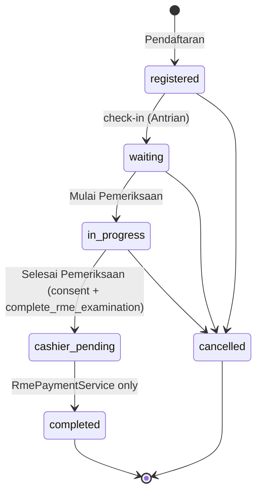

# DMS-RME-REVISION-PROGRAM-5 — clinical workflow, examination and consent audit

- **Programme:** RME revision programme under owner policy `DMS-FULL-DEVELOPMENT-PRODUCTION-TESTING-20261104`
  (rule 221 §7), mission `DMS-RME-REVISION-PROGRAM-5` (P0, CLINICAL_AUDIT / CRITICAL_HOTFIX / SECURITY_FIX),
  2026-11-06. Continuation of [[dms-rme-revision-program-1]] … [[dms-rme-revision-program-4]].
- **Status:** IN PROGRESS — implementation and local verification complete; CI, merge, deploy and production
  evidence are recorded in §8 as they land.
- **Base:** `feature/sprint-26-phase-26-8-stabilization-closure-go-watch-no-go-report` @ `0989dadd` (resolved from
  `origin` after fetch; `devflow:base-ref-check --strict` → `BASE_SOURCE=remote_tracking_ref`; the local base ref was
  stale at `9eabff07` and was not used). Production ran `bb82475e` (Program 4 GO), read from the Biznet host before
  work began; the base was one docs-only commit (#600) ahead.
- **Branch:** `feature/dms-rme-revision-program-5`.
- **Canonical rule:** `.cursor/rules/223-rme-clinical-workflow-integrity.mdc` (new; extends rules 109, 134, 135, 199;
  supersedes nothing). Domain entries AIR-RMC-38..41 in `.claude/rules/rme-clinical.md`.
- **Work category under the Foundation-First Sprint Lock:** clinical correctness / security fix (allowed before
  Foundation GO). The lock is unchanged. No new clinical feature, no schema, migration, permission, route or JS/CSS
  change.

## 1. Governance preflight

### 1.1 Owner approval (recorded per CG-22)

| Id | Decision | Source |
|---|---|---|
| OD-P5 | Audit the clinical workflow CW-01..CW-11 (registration, queue, doctor/room, Mulai Pemeriksaan, consent timing, RME authoring, pre-consent odontogram, UI/server parity, Selesai Pemeriksaan, cashier handoff, history) | Mission brief 2026-11-06, §0, §5–§16 |
| OD-P5-scope | Correct VERIFIED defects that violate existing canonical requirements only; record anything needing a new product decision; do not redesign correct workflows | Same brief, §0, §2 |

### 1.2 Preflight evidence

- Production `PRODUCTION_TARGET=VERIFIED` (Biznet `DaengtisiaMS`, `139.190.106.38`, pinned host key); HEAD `bb82475e`;
  nginx / php8.3-fpm / postgresql active; BK-2 and db-backup timers ran 2026-11-06 02:30 WITA.
- No open PR; both peer sessions offline. Mission worktree `/home/fikri/Projects/dms-rme-revision-program-5`.
- DEVFLOW: `devflow:base-ref-check --strict` 0 · `foundation:devflow-check --strict` GO · `foundation:shared-service-audit
  --strict` GO · `sprint:manifest-check` GO · `sprint:test-plan` (escalation to the full required suite → deferred under
  CG-18; targeted regression in §6 instead).
- Database for every local test: a throwaway PostgreSQL **16.15** container on tmpfs. Never the production database.

## 2. The workflow audited

| state | Odontogram write | RME write | Consent sign | Selesai Pemeriksaan |
|---|---|---|---|---|
| registered / waiting | DENY | DENY | DENY | DENY |
| in_progress, consent unsigned | ALLOW (rule 134) | DENY | ALLOW | DENY |
| in_progress, consent valid | ALLOW | ALLOW | (re-sign via void) | ALLOW, other guards apply |
| cashier_pending / completed / cancelled | DENY | DENY | DENY | n/a |
| front-desk-only account, any state | **DENY (CW5-05)** | **DENY (CW5-05)** | ALLOW in_progress | DENY |

Method: four read-only reviewers, one per segment (CW-01..03, CW-04..06, CW-07..08, CW-09..11), each told to cite the
line that allows a defect and the rule that forbids it. Every candidate was then verified by the coordinator against the
code and reproduced RED on PostgreSQL 16 before any change. Three reviewers independently found CW5-01.

## 3. Findings

### 3.1 Verified defects (corrected)

| Id | Defect | Rule violated | RED evidence (PG 16.15) |
|---|---|---|---|
| CW5-01 | `transitionStatus()` validated the map against the request's copy and wrote with an unconditional UPDATE, no row lock. A cancel racing "Selesai Pemeriksaan" resurrected a cancelled visit as `cashier_pending` (billable, `cancelled_at` set), or cancelled a visit already at the cashier. `assignRoom()` had the same stale `isTerminal()` check. | AIR-RMC-01 (terminal states, fixed map); rule 199 §27b residual | 01a–01d refused nothing; 01f: no `FOR UPDATE` on `trx_clinic_visits` |
| CW5-02 | Detail Kunjungan "Buat Rekam Medis" was gated on `can('create', MedicalRecord)` alone — a live form before consent and on not-yet-started visits | AIR-RMC-25 ("never `can('create', MedicalRecord)` alone"), rule 135 | 02a, 02c: form present |
| CW5-03 | Rekam Medis page "Selesai Pemeriksaan" asked only `completeExamination` — no consent, no `transition` (room guard); Detail Kunjungan asks all three | rule 135 matrix, rule 134 §6 | 03: form present before consent |
| CW5-04 | Handwriting editor, "+ Tambah Halaman RM" and diagnosis forms gated on `can('update')` alone, opening onto writes the service refuses | AIR-RMC-25 | 04: editor + diagnosis form present before consent |
| CW5-05 | Front-desk-only accounts (Admin Klinik, Front Office) hold `manage_clinic_visits` for registration, and that alone let them chart the active odontogram and write the RME by direct request | rule 134 §1 ("Doctor authorization"), §7 ("non-Doctor still refused"), rule 108 §12, DPT-064 | 05a/b: capability true; 05c: an Admin Klinik PATCH **created an odontogram row** |
| CW5-06 | MR store stored the raw request `source_visit_id`: another patient's visit recorded as a sheet's source; a nonexistent id → FK violation → HTTP 500 | AIR-RMC-23 ("IDOR-validated `?source_visit_id=`") | 06a: foreign id stored; 06b: HTTP 500 |
| CW5-07 | `RmeVisitConsentService::sign()` asserted the window on the request's copy, outside the lock | AIR-RMC-06 | 07: consent created on a cancelled visit |
| CW5-08 | Consent refusal told users signing opens "setelah dokter menyelesaikan pemeriksaan" (the moment it closes); success promised "Pembayaran kini dapat diproses" | AIR-RMC-06, AIR-RMC-11 | 08a |

RED: **16 failed / 4 passed** (the four are the deliberate regression controls 01e, 02b, 05d, 05e).

### 3.2 Verified safe (no change)

- Registration pins the branch server-side for context-bound roles and re-checks it in the service; it never writes
  `clinic_room_id`; the visit edit is an allow-list; acting accounts must be active.
- Queue and worklist exclude `cashier_pending`/`completed`/`cancelled`, are branch-scoped, and apply doctor room scope;
  `applyRoomScope()` and `deniesActiveVisitOutsideRoom()` agree.
- `VALID_TRANSITIONS` matches AIR-RMC-01; `TransitionStatusRequest` rejects `completed`; `completed` only from
  `cashier_pending` via `RmePaymentService`; a null actor is refused every other transition.
- Consent: signable only `in_progress`; patient/doctor/branch from the visit; immutable; valid = latest non-voided.
- Positive RME authority: exactly one `in_progress` encounter, actor scope, same-encounter consent; every current-RME
  writer funnels through it (writer table in the private audit report).
- Pre-consent odontogram (rule 134): no consent condition; own-chart, encounter, branch and patient checks; GET writes
  nothing; odontogram finalize never changes the visit.
- No clinical document changes visit status; the only path to `cashier_pending` is the guarded transition route.
- Invoice creation locks the visit, reads status from the locked row, refuses a missing or non-FINAL record and a
  second active invoice; the cashier list is branch- and status-scoped; consent never gates payment.
- History is never consent-gated; the odontogram history is strictly read-only; handwriting streams privately.

### 3.3 Requires an owner decision (recorded, not changed — CG-22)

| Id | Finding | Why it is not a defect fix |
|---|---|---|
| OD-5-1 | Perawat and Supervisor RME may author the RME/odontogram (any `manage_clinic_visits` holder who is not front-desk-only) | Rule 134 says "Doctor"; the system grants nurses examination completion. Who authors is a product decision |
| OD-5-2 | The front office may start (`waiting → in_progress`) and cancel an examination server-side, though Detail Kunjungan hides the buttons | A pinned test deliberately keeps front-office transitions; rule 108 §12 vs FIX-07 practice conflict |
| OD-5-3 | Room re-assignment is accepted on `cashier_pending` (and `in_progress`) visits and rewrites `doctor_id` | Changes doctor attribution after the exam; no rule forbids it explicitly |
| OD-5-4 | A deactivated doctor stays selectable/auto-assignable for up to 30 minutes (presence dropped on their next request) | The rule's literal trigger is the account's next request |
| OD-5-5 | Nothing prevents two non-terminal visits for one patient (authoring then fails closed by design) | Rule 109 §2b accepts this |
| OD-5-6 | A new sheet can target a non-encounter sibling visit of the same patient while another encounter is consented | Interplay with the patient-centric RM book (Sprint 64.0.2) |
| OD-5-7 | Doctor room isolation is not applied to RME writes reached through the canonical (historical) visit URL | Rule 138 §4 vs rule 109 §2b wording |
| OD-5-8 | Consent re-sign is unreachable from the UI; a double submit creates two consents; the consent-number generator races | UI flow and idempotency design |
| OD-5-9 | Consent signatures are stored on the `local` private disk, not `ClinicalEvidenceStorage` | Rule 121 vs AIR-RMC-13 wording; a storage migration |
| OD-5-10 | A cancelled visit is accepted as a Kontrol prior visit; doctor-scoped count widgets ignore room/patient scope | Not listed by AIR-RMC-30 / AIR-RMC-21 |

### 3.4 Residuals (availability only, integrity preserved by unique indexes)

- R5-1 `PatientDoctorAssignmentService::ensureAssignedFromVisit()` catches a unique violation and re-queries inside
  the same PostgreSQL transaction (25P02 → HTTP 500) — reachable only by a concurrent duplicate assignment.
- R5-2 Two concurrent registrations at one branch on one day can compute the same `queue_number`
  (`UNIQUE(branch_id, visit_date, queue_number)` refuses the second → HTTP 500).
- R5-3 Handwriting store commits a draft before authorization/validation and writes the file before the DB row.
- Documentation drift (code comments only): `OdontogramService`/`OdontogramController`/`OdontogramPolicy` comments
  still say consent gates the odontogram; `RmeInvoiceService` comment says finalize moves the visit;
  `RmeVisitConsentService::requiresConsentBeforeRmeAuthoring()` has no callers.

## 4. Implementation

| File | Change |
|---|---|
| `app/Modules/ClinicVisit/Interfaces/ClinicVisitRepositoryInterface.php`, `…/Repositories/ClinicVisitRepository.php` | New `lockForStatusDecision()` — the visit row at FOR NO KEY UPDATE (the strength `RmeInvoiceService::create()` already uses, see §5 M1) |
| `app/Modules/ClinicVisit/Services/ClinicVisitService.php` | CW5-01: `transitionStatus()` locks the row and re-decides on it (`assertTransitionAllowedOnLockedRow()`); `assignRoom()` re-checks `isTerminal()` under the lock |
| `app/Modules/Consent/Services/RmeVisitConsentService.php` | CW5-05: `actorMayWorkOnEncounter()` refuses the front-desk-only tier; CW5-07: `sign()` locks the visit, re-asserts the window before any file write, and records the doctor from the locked row |
| `app/Support/AccessControl/FrontOfficeRole.php` | CW5-05: `CLINICAL_ROLES` + `isVisitFrontDeskOnly()` — the tier defined once |
| `app/Modules/ClinicVisit/Policies/ClinicVisitPolicy.php` | `isFrontOfficeOnly()` delegates to `FrontOfficeRole` (no behaviour change) |
| `app/Modules/ClinicVisit/Controllers/ClinicVisitController.php` | CW5-02: passes `canCreateRecordHere` |
| `app/Modules/MedicalRecord/Controllers/MedicalRecordController.php` | CW5-06: `source_visit_id` through `resolveSourceVisit()` |
| `app/Modules/Consent/Controllers/RmeVisitConsentController.php` | CW5-08: truthful refusal and success messages |
| `resources/views/rme/visits/show.blade.php` | CW5-02: disabled control + reason + a real GET link to the workspace, no form, unless capable |
| `resources/views/rme/visits/medical-record/show.blade.php` | CW5-03/04: finish button, editor and diagnosis forms on the capability; truthful read-only banner |
| `resources/views/rme/visits/medical-record/empty.blade.php`, `resources/views/rme/visits/odontogram/show.blade.php` | Truthful read-only message for an account that may not author a consented live encounter (no "fetch a consent", no "past visit") |

## 5. Security and clinical review

Independent reviewer (`code-review-limited` agent, read the diff cold — not the author): **CRITICAL 0, HIGH 0.**

| # | Severity | Finding | Resolution |
|---|---|---|---|
| M1 | MEDIUM | The new locks were `FOR UPDATE`, which conflicts with the `FOR KEY SHARE` every FK insert takes on the visit; `RmeInvoiceService.php:181-192` already documents a real 40P01 from exactly that | FIXED — `lockForStatusDecision()` at FOR NO KEY UPDATE for all three paths; asserted on PG (CW5-01f) |
| L1 | LOW | Controller comment claimed the server asserts the same authority as the stricter "this visit" UI check | FIXED — comment states the UI is stricter; server sibling targeting recorded as OD-5-6 |
| L2 | LOW | Empty workspace and odontogram page gave the front office the wrong reason | FIXED — truthful "Hanya dapat dibaca" branches |
| L3 | LOW | Actor abilities are asked on the pre-lock copy; only status/consent are re-decided under the lock | Recorded residual (rule 223 §6a) |
| L4 | LOW | `sign()` named the doctor from the pre-lock copy | FIXED — doctor from the locked row (CW5-07+ asserts it) |
| L5 | LOW | A concurrent double submit now shows "transition not allowed" instead of silently re-writing `started_at` | Accepted, documented (rule 223 §6a) |
| L6 | LOW | Disabled-button text implied a record might still become creatable on a finished visit | FIXED — wording accurate in every state |
| L7 | LOW | Who loses access: only accounts holding Admin Klinik / Front Office and none of Doctor, Perawat, Supervisor RME, Super Admin; Owner, Kasir and role-less direct-permission users unaffected; consent, registration, room placement and cashier work unaffected | Confirmed. Production, read-only (2026-11-06 ~04:00 WITA, `asia_dental_lab_pilot`, session `READ ONLY`): 8 front-desk-only accounts, all active; **0** medical records recorded or finalized, **0** odontograms created/updated, **0** handwriting rows or pages written by any of them; 0 visits `in_progress`. The refusal removes no observed workflow |
| T | LOW | Tests: any refusal counted as a pass; no positive controls for room/sign/front-desk HTTP; lock asserted only for transitions | FIXED — refusals assert the error key; positive controls CW5-01d+, CW5-05c+, CW5-07+; lock asserted for all three paths |

Return value / instance semantics: preserved (every caller ignores the return; the caller's instance is refreshed).
PostgreSQL: no caught-and-continued database error; refusals are `ValidationException`s after a successful SELECT.

## 6. Tests

- New `tests/Feature/RME/RmeClinicalWorkflowIntegrityTest.php`: RED 16 failed / 4 passed on unmodified code (20
  tests) → GREEN 20/20 → after the review, 24 tests (refusal keys, three positive controls, lock strength on all three
  paths, front-desk wording) → GREEN 24/24 on PostgreSQL 16.15.
- Three existing assertions (`FixClinicOpsVisitActionsTest` ×2, `RoomAssignmentWorklistTest` ×1) had passed by
  coincidence: "the clinician can reach Rekam Medis from the visit detail" was satisfied only because the POST store
  form's `action` URL equals the Rekam Medis show URL — a form the server refused before consent. The detail card now
  carries a real GET link, so the same assertions hold for the right reason; no test was edited.
- Targeted dependency regression on PostgreSQL 16.15 (final code), one process: `tests/Feature/RME`,
  `RmePerformedTreatment`, `AccessControl`, `Auth`, `Branch`, `FrontOfficeDevice`, `Pilot`, `ClinicOversight`,
  `LegacyCompleteness`, `DoctorDeviceWebAuthn`, `RmeZeroValueClosure`, `RmePaymentIdempotency`,
  `RmeInvoiceCorrection`, `RmeBillingDispute`, `RmeRefundRequest`, `RmeRefundSettlement`, `RmeManualPricing`,
  `RmeTariffAuthority`, `Cicd`, `Foundation/DevflowAiInstructionSystemTest` → **6,115 passed / 0 failed / 0 skipped,
  25,676 assertions** (counted from JUnit). The payment → `completed` path through the new locked re-check is covered
  there (RmePayment*, RmeZeroValueClosure, the DPT two-process race suite).
- Local gates: `pint --test` 0 · `git diff --check` clean · `view:cache` compiles · `sprint:manifest-check` GO ·
  `sprint:scope-audit --strict` GO · `foundation:devflow-check --strict` GO · `foundation:shared-service-audit
  --strict` GO · `foundation:ci-runtime-control-check --strict` GO · `foundation:security-compliance-check` GO ·
  `foundation:cicd-enterprise-gate-check` GO · `architecture:ui-governance-check --strict` pass ·
  `foundation:roadmap-check --strict` GO.
- CI selection verified with the exact filters: both critical-gate variants list **9,333** tests (Program 4: 9,309)
  including all 24 of this suite; no helper redeclare collision.
- Graphify refreshed inside the worktree (`graphify update .`, ignored by git); the primary checkout was not touched.
- CI selection: `RmeClinicalWorkflowIntegrity` token in BOTH critical-gate variants; suite declared in
  `config/ci_runner.php` `critical_gate_mandatory_suites` (CG-19).
- Full Suite: **DEFERRED** under CG-18 (the classifier escalates; the temporary policy defers). Not passed.

## 7. Foundation rule synchronisation

- New `.cursor/rules/223-rme-clinical-workflow-integrity.mdc`.
- `.claude/rules/rme-clinical.md`: AIR-RMC-38..41 and the canonical-rule index row.
- Pointers: rule 134 §7 (the "non-Doctor" pin and its gap), rule 135 §8 (extended surfaces), rule 199 §27b CLOSED.
- Rule 134 stays authoritative for pre-consent odontogram editing; rule 135 for capability-mirrored controls.

## 8. CI, merge, deploy and production verification

Pending.

## 9. Cleanup

Pending.
