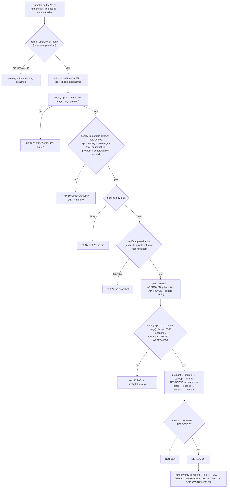
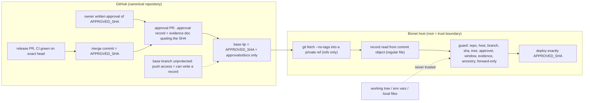
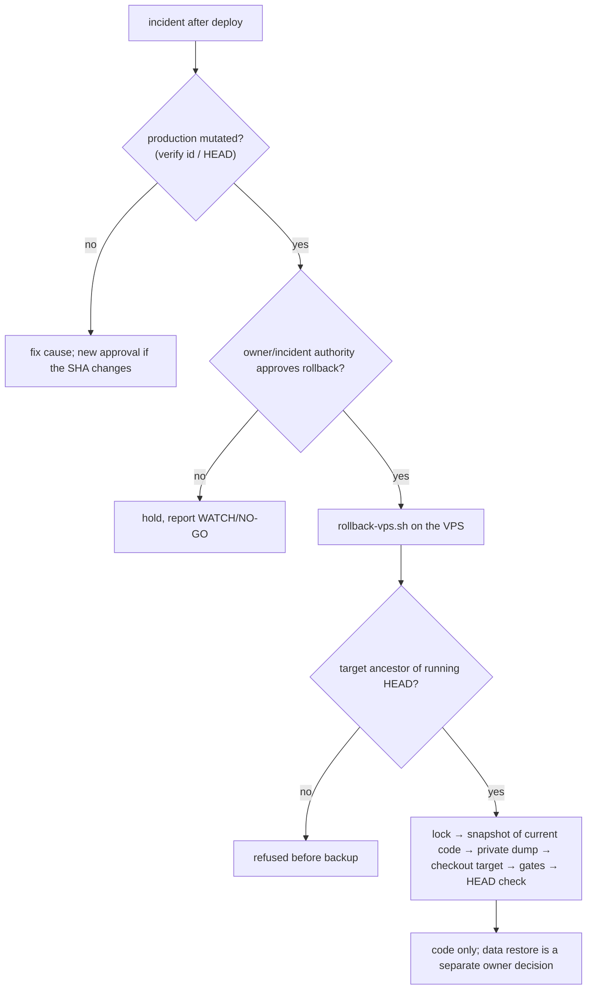

# DMS-RME-REVISION-PROGRAM-8D-APPROVED-SHA-GUARD-1 — exact approved release SHA (8D PR2)

Rule: `.cursor/rules/229-exact-approved-release-sha-guard.mdc` · Domain index: `.claude/rules/deploy-infra.md`
AIR-DEP-35 · Procedure: `docs/runbooks/production-host-identity.md` §6b, §6c · Record format:
`deploy/release-approvals/README.md` · Sprint manifest: `.sprint/current.yml` (DMS-RME-REVISION-PROGRAM-8D, PR2) ·
Previous 8D work: `docs/sprints/dms-rme-revision-program-8d.md` (PR1, #621, `dde7b9b6`).

## 1. Owner request (CG-22)

On 2026-11-14 the owner asked, as part of the Program 8D production release, for an exact approved commit SHA guard
on the production deploy path, implemented and released through the full DEVFLOW, with the deploy run on the Biznet
host and the GO tag `dms-rme-revision-program-8d-go` only after production verification. The request names separate
gates: merge needs the owner's merge decision, and production deployment needs a separate written owner approval of
the exact final release SHA. Neither is inferred from the implementation request. The release SHA is the merge
commit of this PR, not the historical 8D commit `dde7b9b6`.

## 2. The defect

`scripts/deploy-immutable-exec.sh` pinned `FETCH_HEAD` of the base branch. The pin was immutable once taken, but it
was not bound to the approved commit: anything pushed between the owner's approval and the fetch was deployed as if
approved. The only control was a human `git ls-remote` before `start` (runbook §6b step 2, rule 220 §13f, AIR-DEP-34),
with a race window until the bootstrap's own fetch. Two adjacent gaps: `scripts/sprint-release.sh` ran the runner with
no target and created the GO tag on local `HEAD`; a rollback accepted any resolvable ref.

## 3. Design

A deploy names a release and an exact commit: `start --release-id <id> --approved-sha <40-hex>`. It proceeds only when
`deploy/release-approvals/<id>.approval`, merged on the base after that commit, approves exactly it.

- **Verifier** `scripts/lib/release-approval.sh` (`dms_release_approval_verify`): every observed value is a parameter;
  the record is read from the fetched commit object with `git cat-file`, parsed (never sourced) with a strict
  KEY=VALUE grammar, and checked against the host authority (repository, host, branch, approvers), the commit (type,
  tree), the approved commit's own manifest (`go_tag`), a bounded validity window, an evidence document that quotes
  the SHA, merged ancestry with only approval records or `docs/**/*.md` after it, and a forward-only move. Any
  failure prints `DEPLOYMENT=DENIED` and returns 77.
- **Three enforcement points.** The runner (`approve_or_deny`) before any launch artifact or detached process; the
  bootstrap (`deploy-immutable-exec.sh --role deploy`) inside the flock, before the pin, snapshot, backup and checkout,
  with `--target-sha` refused for deploys; the snapshot copy of `deploy-vps.sh`, which re-asserts
  `TARGET == APPROVED` before its first mutation and at the final HEAD check.
- **No redirects.** The runner launches the deploy program beside itself; the `DEPLOY_SCRIPT` environment override
  was removed. The guard and the authority come from beside the executing program.
- **Evidence contract 3** binds `release_id`/`approved_sha` in the record to `RELEASE APPROVAL: GO`, one
  `DEPLOY_APPROVED_SHA=`, the pinned target and the checkout HEAD.
- **Release wrapper** needs the approval with `--apply` before anything else and tags the approved commit only.
- **Rollback** targets must be ancestors of the running checkout (before the hand-over and again before the backup).
- **Governance**: `DeploymentEntrypointScanner::approvalGuardPosture()` and rule `DH1-R011` make
  `foundation:deployment-entrypoint-check` fail if any marker of the guard disappears; the authority declares
  `DMS_PRODUCTION_REPOSITORY`, `DMS_PRODUCTION_DEPLOY_BRANCH`, `DMS_PRODUCTION_RELEASE_APPROVERS`.

**Trust model.** The guard binds; it does not authenticate. The record is read by content address from the canonical
base branch, which has no GitHub protection (checked 2026-11-12): anyone able to push to the base can write a record,
and `APPROVED_BY` is an attribution, not a signature. The governance is that a record is written only after the
owner's written approval of the full SHA and merged through a pull request the owner merges (CG-22); account
separation is verifiable, human separation is not (CG-07). Root on the production host is inside the trust boundary.

**Bootstrap paradox.** Production runs 8C (`b0c0bd62`), whose runner has no guard. The release that installs the guard
is launched by the guarded runner exported from the approved commit object into a new root-only directory (§6c),
after a SHA-256 provenance check against the object; nothing in the live checkout is edited and no bypass exists.
Proven end to end by `bootstraps the first guarded deploy from the approved release object without the legacy runner`.

## 4. Diagrams (reflect the code in this PR)

Deployment execution and the approval chain:

Authorization chain and trust boundaries:

Rollback decision:

## 5. Threat model

Entry point / trust boundary / before / now / automated test / failure behaviour. "Test" names are in
`tests/Feature/Deploy/DeployHardenApprovedShaGuardTest.php` unless noted.

| # | Threat | Entry point · boundary | Before this PR | Mitigation now | Test | Failure behaviour |
|---|---|---|---|---|---|---|
| 1 | Branch moved before fetch | push to base · GitHub→VPS | deployed the new tip | diff rule: only approvals/docs after the SHA | `refuses when the branch moved past…` (5 cases) | DENIED 77, nothing launched |
| 2 | Branch moved after fetch | push mid-deploy · VPS | pin held (DEPLOY-HARDEN-1) | pin = approved SHA, snapshot from it | `keeps the approved commit when the branch moves after the pin` | deploys the approved SHA only |
| 3 | Unauthorized approval | approval PR · GitHub | none | approver allowlist; merged-PR provenance; evidence doc quotes SHA | `refuses a record whose facts do not match` (approver) | DENIED 77 |
| 4 | Missing approval | operator · VPS | none | record required at fetched tip | `refuses a release with no merged approval record` | DENIED 77 |
| 5 | Expired / revoked approval | stale record · VPS clock | none | `NOT_AFTER`, ≤ 72 h window, forward-only | `…facts do not match` (window cases), `never moves production backwards…` | DENIED 77 |
| 6 | Malformed SHA | operator args | branch name accepted | full 40-hex lowercase only | `refuses an approved SHA that is not a full…` (7 cases) | DENIED 77 |
| 7 | SHA names an unexpected object | operator args | n/a | object type must be commit; tree must match | `…names a tree or blob…`, `another tree` | DENIED 77 |
| 8 | Detached runner launched unapproved | runner start/run · VPS | always launched | `approve_or_deny` before any artifact | `launches nothing for an unapproved start` (7 cases) | DENIED 77, empty run dir |
| 9 | Forged success log | storage/logs (runtime-writable) | contract 2 checks | contract 3 approval binding + HEAD check | evidence suite approval cases | `UNVERIFIED`/`MISMATCHED`, exit 4 |
| 10 | Stale evidence | old run files | `STALE` on HEAD drift | unchanged + contract-2 records `INCOMPATIBLE` | evidence suite | exit 4 |
| 11 | Foreign-host evidence | copied storage | `FOREIGN`/`FROZEN` | unchanged | evidence suite | exit 4 |
| 12 | Interrupted SSH | operator link | detached runner | unchanged; runbook: follow the same id, never restart | runner suites | run continues; verify by id |
| 13 | Concurrent deploys | two operators | flock, exit 75 | unchanged; approval inside the lock | `serialises two approved runs…`, `DeployHardenConcurrencyLockTest` | second exits 75 before pin |
| 14 | Corrupted snapshot | /run lock root | trust checks | unchanged; snapshot from the approved object | `DeployHardenImmutableEntrypointTest` | fatal before program |
| 15 | Missing runtime identity authority | live overlay | fail closed | unchanged | `RuntimeIdentityIsolation*` | NOT GO before mutation |
| 16 | Wrong production host | SSH alias / host | preflight in snapshot | also refused before launch by the guard | `refuses the wrong host and the frozen host` | DENIED 77 |
| 17 | Backup failure | pg_dump | aborts before checkout | unchanged | `PrivateDatabaseDumpCreationTest`, entrypoint contracts | NOT GO before checkout |
| 18 | Dirty tracked worktree | production tree | fail closed | unchanged | entrypoint contracts | NOT GO before backup |
| 19 | Rollback to an invalid ref | rollback-vps.sh | any resolvable ref | ancestor of running HEAD, twice | `a rollback refuses a target outside the deployed history…` | refused before backup |
| 20 | GO tag without verified success | sprint-release.sh / manual | tagged local HEAD | tag approved SHA only, after `run` OK and HEAD check; CG-16 | `the release wrapper … tags the approved commit` | no tag |

Also covered: wrong repository (`refuses a checkout whose origin…`), record injection and forgery
(`refuses a record it would have to execute…`, working-tree record ignored), unmerged commit
(`refuses an approved commit that is not merged…`). Residual, accepted and documented: root on the host can bypass
any host-side check; the runtime user can edit `storage/logs` evidence files (contract 3 makes a consistent forgery
require editing record, log and the root-owned checkout HEAD together).

## 6. Independent review

A fresh reviewer (a separate agent given the code, the threat list and the required properties, not the author's
conclusions) attacked `fd10e2c5` with throwaway repositories. Findings and dispositions, all fixed in `c20c1935`
unless stated:

| # | Severity | Finding (proved = reproduced) | Disposition |
|---|---|---|---|
| 1 | HIGH | `deploy-immutable-exec.sh --snapshot-ref` let an approved deploy run another commit's program (proved) | Deploy refuses `--snapshot-ref`; each role runs only its own program; test |
| 2 | MEDIUM | a failed `git diff` read as "nothing follows" → GO (proved) | `git diff-tree` inside `if !` → DENIED; fault-injection test |
| 3 | MEDIUM | guard read the shared `FETCH_HEAD`, which a rollback's `fetch --tags` can overwrite (proved) | Private per-run ref, removed on every path; test. Shared deploy/rollback lock: follow-up |
| 4 | MEDIUM | forged `DMS_DEPLOY_*` variables reached the snapshot stage (proved, pre-existing root cause) | Snapshot stages require the bootstrap's root-only snapshot and a held lock; behavioural test on the real scripts |
| 5 | MEDIUM | comment claimed the merge path is enforced; base is unprotected | Comment and rule corrected; branch protection / signed approvals: owner follow-up |
| 6 | MEDIUM | contract 3 rested on runtime-writable files | `verify` re-reads both approval blobs from git and matches approval path; root-owned run directory: follow-up |
| 7 | LOW | a local path spelling `OWNER/REPO` passed (proved) | `OWNER/REPO` authority needs a GitHub URL; test |
| 8 | LOW | `safe.directory` override in the guard | Removed |
| 9 | LOW | re-deploy after a rollback could fail only after the backup | Local branch must be fast-forwardable, checked before anything; test. Rollback cannot undo a rollback, and a commit with code after it cannot be re-approved: intended |
| 10 | LOW | GO tag name / release id not cross-checked | Tag name = approved commit's `go_tag`; approval path cross-checked in `verify` |
| 11 | NIT | symlink blob could pass as evidence | Record and evidence must be regular files; test |

**Round 2** (re-verification of `c20c1935`, same reviewer): fixes 2, 3, 4, 6, 7, 8 and 11 held under fresh attacks
(including `diff.external`/`diff.orderFile` config and a deleted tree object for fix 2, and a real bootstrap → real
`deploy-vps.sh` run with only the lock-root literal swapped to prove fix 4 refuses no legitimate run). New findings,
fixed in the next commit:

| # | Severity | Finding | Disposition |
|---|---|---|---|
| R2-1 | HIGH | `--overlay <file>:scripts/deploy-vps.sh` (or a library) replaced approved bytes after the export (proved) | Each role accepts only the `deploy/runtime-identity.conf` overlay, checked before the lock; test (legit overlay still passes) |
| R2-2 | LOW | an absent local branch skipped the fast-forward check; the checkout would create it at the tip (proved) | Denied; test |
| R2-3 | LOW | `verify` accepted any matching blob in the object store | The blob must be the approval file at the recorded commit, which must carry the approved commit; tests |
| R2-4 | NIT | an interrupted guard could leave its private ref | The bootstrap's exit trap removes `refs/dms-release-approval/<pid>-*` |

Test gaps it named were closed: ordering contracts ignore comment lines, the concurrency test waits for the lock
holder instead of a timer (3/3 repeat runs green), and negative tests exist for each finding. The rollback ancestry
refusal remains a static contract: `rollback-vps.sh`'s hand-over stage hard-codes the production path.

**Owner follow-ups (not in this PR, none blocks this release in the author's assessment):** GitHub branch protection
on the base (or signed approval commits checked against pinned signers); a root-owned deploy run directory; a single
lock shared by deploy and rollback.

## 7. Verification (local, this PR's head)

Measured numbers are recorded in §9 after the final run. Methods: PHP 8.3.6 CLI on WSL2; deploy suites need no
database; governance commands on a migrated disposable SQLite database with `APP_ENV=local` (the established method,
memory note: the default `production` env reports FAIL identically on the untouched base); ShellCheck 0.11.0 (official
static binary, SHA-256 verified against GitHub's published asset digest) with `-x -P SCRIPTDIR`.

## 8. Release states

| State | Status |
|---|---|
| IMPLEMENTED | yes (this PR) |
| TESTED | locally, see §9 |
| CI VERIFIED | pending (exact PR head) |
| MERGED | pending owner merge decision |
| APPROVED FOR DEPLOYMENT | pending written owner approval of the merge SHA + approval record PR |
| DEPLOYED / VERIFIED / GO TAGGED | pending; recorded in the approval-record evidence update (docs-only, after the SHA) |

## 9. Evidence

Local runs on the PR head (code at `1d519184`; this section is the only later change), 2026-11-14, WSL2, PHP 8.3.6.
Counts are Pest's own summary lines; a skip is reported as a skip, never as a pass.

| Run | Database | Tests | Assertions | Failed | Skipped |
|---|---|---|---|---|---|
| `DeployHardenApprovedShaGuardTest` (new) | none | 107 | 491 | 0 | 0 |
| `DeployHardenRunnerEvidenceContractTest` (contract 3) | none | 93 | 510 | 0 | 0 |
| Deploy regression filter (`DeployHarden`, runtime identity, secrets, dumps, ENT-11, DH1, rollback check, shell guard, identity guard, AI-instruction contract) | SQLite | 468 | 4,676 | 0 | 1 |
| DEVFLOW focused set (`sprint:test-plan` filters + the deploy filters above) | SQLite | 2,718 | 18,014 | 0 | 12 |
| 8D suites of record (consent signature bound, consent gate/HTTP, prescription integrity, clinical write authority, document read scope + allowlist, number-sequence lock, evidence write-lock concurrency) | PostgreSQL 16.15, disposable schema (dropped) | 151 | 461 | 0 | 0 |

Skips, all environmental and outside this change: `setfacl` absent (default-ACL dump test), Poppler absent (1),
Redis disabled (1), and 9 PostgreSQL-only lock tests that skip on SQLite.

**Governance (migrated disposable SQLite, `APP_ENV=local`):** `foundation:deployment-entrypoint-check` GO (with
`approval_guard` ok), `foundation:deployment-rollback-check` GO, `deploy:forbidden-command-check` clean (11 scripts),
`foundation:security-compliance-check` GO, `foundation:ci-runtime-control-check` GO, `foundation:devflow-check
--strict` GO, `sprint:manifest-check` GO, `sprint:scope-audit --strict` GO, `foundation:shared-service-audit --strict`
0 errors, `devflow:base-ref-check --strict` canonical base resolved.

**ShellCheck 0.11.0** (`-x -P SCRIPTDIR`) on the seven changed scripts: no finding except two SC2329 notes on the
bootstrap's trap handlers, identical on the untouched base.

**Full Suite:** DEFERRED by the global temporary policy (CG-18). `sprint:test-plan` escalates this diff to the full
required suite (categories `ci_cd`, `config`, `deployment`); it was not run and is not claimed.

**Production, read-only, 2026-11-13 16:48 UTC (2026-11-14 00:48 WITA):** `production-target-check --remote` →
`PRODUCTION_TARGET=VERIFIED`; HEAD `b0c0bd62`, 0 modified tracked files; nginx, `php8.3-fpm`, PostgreSQL active; FPM
workers run as `daengtisiams`; 47 GB free; `/health/lb`, `/health/live`, `/health/ready`, `/login` → 200 and
`/storage/…` → 403 on `https://daengtisia.online`; `migrate:status --pending` → none; BK-2 `ON_SERVER=OK`,
`OFF_SERVER=OK`, 12/12 packages acknowledged off-server (newest `BK2-20261112T183001Z`), no alerts; no deploy,
rollback or runner process. The release delta from `b0c0bd62` changes no migration, route, seeder, package or
front-end asset, so a code-only rollback to `b0c0bd62` stays compatible. These are observations at that time, to be
re-checked immediately before any deploy.
