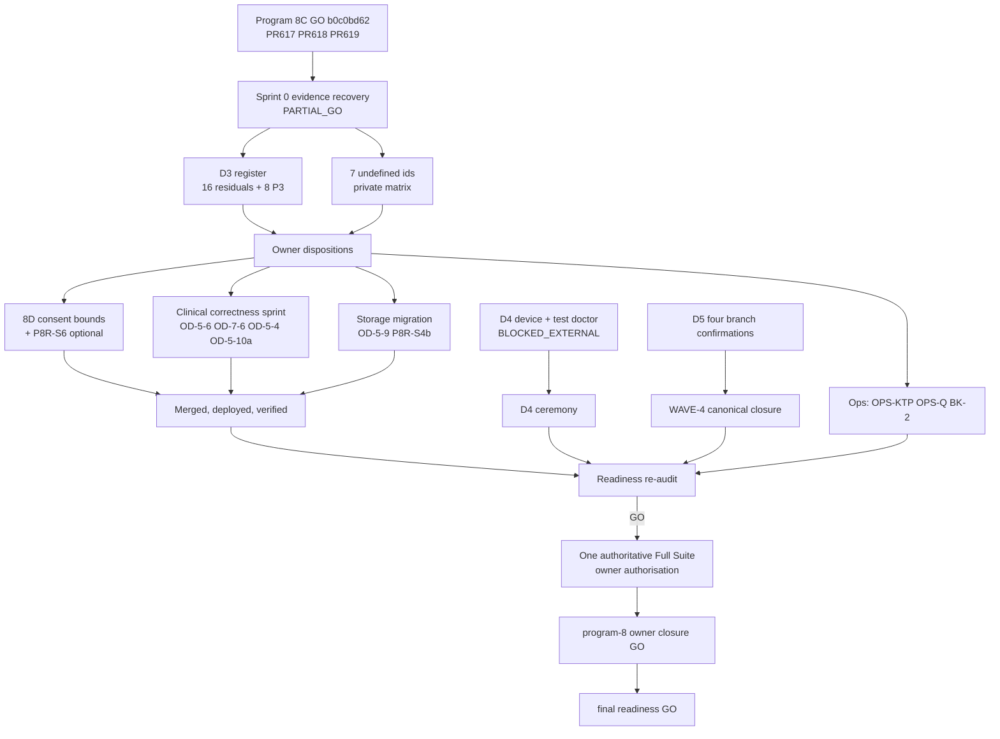

# DMS-RME-REVISION-SPRINT-0-COMPLETION-1 — Sprint 0 evidence recovery

**Date:** 2026-11-12 (WITA = UTC+8). **Type:** governance / evidence audit, documentation only (no application,
test, config, CI or manifest change). **Base:** `15583586` (remote base tip, PR #619). **Production runtime (last
recorded):** `b0c0bd62`, Program 8C, tag `dms-rme-revision-program-8c-go`. **Parent checkpoint:**
[[dms-rme-revision-program-8-owner-operational-closure]] (PARTIAL_GO).

This record continues the parent checkpoint's open register. It does not restart the programme. It recovers the
evidence behind every open item, classifies it against code, tests and canonical rules, and says what is still
missing. **No item is closed, accepted or fixed here.** The owner's answer on the residuals ("Not yet, keep them
open", recorded 2026-11-07 in the 8C record §1 and carried by the 2026-11-07/08 checkpoint) still stands; a
recommendation below is a proposal for the owner, not a disposition.

## Verdict

```text
SPRINT_0_STATUS                          = PARTIAL_GO — not GO (see below)
EVIDENCE_RECOVERED                       = 10/16 residuals; 8/8 P3 groups (P8R-S4b inside one is undefined); 7/7 additional items (BK-2 not re-measured)
OPEN_REGISTER_IDS_UNDEFINED              = 7 (R7-F, P8-FIX1, P8-SEED, OPS-SAT, R8A-3, RA-4, P8R-S4b); decided D3-NEW-3/5 detail also private (§4)
D3  Owner Decision Register              = OPEN — 16 residuals + 8 P3 groups without owner disposition (unchanged)
D4  Dedicated real-device verification   = BLOCKED_EXTERNAL (unchanged, not re-measured)
D5  Legacy WAVE-4 closure                = OPEN — awaiting SPN4, TLK1, LDK2, ATG3 confirmations (unchanged, not re-measured)
8D  Consent-signature bounds (candidate) = BLOCKED_APPROVAL — plan in §8, no code written
P0 / P1 defects verified                 = 0 / 0 (closest to P1: OD-5-6, OPS-KTP — reasons in §5.2)
CODE_CHANGED                             = NO (docs and one rule sentence only)
PRODUCTION_DEPLOYMENT                    = NOT_REQUIRED_DOCS_ONLY
GO tag for this sprint                   = NOT CREATED — a docs-only change receives no GO tag (docs/governance/go-tag-exceptions.md)
dms-rme-revision-program-8-owner-operational-closure-go = NOT CREATED
dms-rme-final-readiness-go               = NOT CREATED
FULL_SUITE_STATUS                        = SKIPPED_BY_GLOBAL_TEMPORARY_POLICY
FULL_SUITE_EXECUTION_COUNT               = 0
GLOBAL_TEMPORARY_FULL_SUITE_POLICY_ACTIVE = YES
CLINIC_REOPENING                         = NOT AUTHORISED
```

PARTIAL_GO (the parent checkpoint's label) means **not GO**: the record is complete for what the public repository
holds, and Sprint 0 cannot be GO while seven open-register ids have no definition in any record this audit can read
(§4). Their definitions sit in the owner's private Owner Decision Matrix, which is not on this workstation.

## 1. Scope, authority and environment

The mission brief (owner, 2026-11-12) asks for Sprint 0 completion. That means evidence recovery for the 16
residuals, the 8 P3 groups and the additional items, a corrective-sprint decision, and release only of what has
owner approval. The brief states that completing Sprint 0 is not approval of the backlog's product decisions. No
owner decision was given in this session, so CG-22 leaves every row open.

| Item | Measured |
|---|---|
| Workspace | `/home/fikri/Projects/dms-dev-win11`, branch `dev/dms-win11-20261111`, HEAD `15583586`, clean, no upstream |
| Remote base | `devflow:base-ref-check --strict`: `BASE_SOURCE=remote_tracking_ref`, `BASE_SHA=15583586`, merge base equal; local base ref stale at `9eabff07` (not used) |
| Local vs remote vs production | local HEAD = remote base = `15583586`; base = 8C runtime `b0c0bd62` + one docs commit (#619) |
| GO tags | `dms-rme-revision-program-1-go` … `-8c-go` present; `-8c-go` (tag object `11701e2f`) peels to `b0c0bd62`; no final or closure tag (correct) |
| Mission worktree | `/home/fikri/Projects/dms-rme-sprint-0-evidence-recovery-1`, branch `docs/dms-rme-revision-sprint-0-evidence-recovery-1`, cut from the remote base with `--no-track` (CG-02) |
| Protected worktrees | `legacy-import-hub-1a` (3 uncommitted entries) and `security-f4b-clinic-calendar-inventory-1` (43 entries, no upstream): inspected read-only, not touched |

### 1.1 What this workstation can and cannot do (new Windows 11 / WSL2 environment)

| Capability | State | Consequence |
|---|---|---|
| `git fetch` (public repository) | works | baseline reconciled |
| `git push` / GitHub API | **no credential helper; `gh` not installed** | PR, exact-head CI and merge cannot be performed from here |
| SSH to production | **no SSH configuration or keys** | no `production-target-check --remote`, no runtime SHA, no D4/D5/BK-2 re-measure; the host key must not be re-fetched (CG-14) |
| Public URL `https://daengtisia.online` | works | read-only health checks only (§12) |
| Private evidence package | **not present** (searched the WSL home and the Windows profiles) | the Owner Decision Matrix and private review records are unavailable |
| Graphify | **not installed**, no `graphify-out/` in the mission worktree | dependency graph drawn by hand (§9); installing it is the owner's call |
| PHP 8.3.6, `vendor/`, PostgreSQL 16.15 (local, online) | available | DEVFLOW and governance suites ran (§11) |

## 2. Method

Three read-only evidence passes (Programs 5–6, Program 7, Programs 8–8C) recovered each item's origin record,
canonical rule, code path, tests and later PRs. The auditor then re-checked every claim used in a recommendation
against code at `15583586`. Classes follow the brief: bug, security risk, clinical correctness, billing issue,
feature request, documentation drift, operational blocker, testing gap, owner decision. Priority follows the brief:
P0 clinical security, financial integrity or a time-sensitive release blocker; P1 verified clinical integrity,
authorization or privacy; P2 reliability, concurrency or workflow correctness; P3 UX, docs or low risk. Risk is
written `C·S·F·O` (clinical · security · financial · operational) with `–` none, `L` low, `M` medium. A
"recommendation" is a proposal for the owner, not a decision.

Every fact below comes from the public repository (records, rules, code, tests); nothing comes from the private
matrix, which was unavailable. The parent checkpoint kept its per-item matrix private because the repository is
public. This record contains no exploit detail beyond what earlier public records and rules 227/228 already state,
but it does rank risks per item: whether to publish it is the owner's call when the PR is opened.

## 3. Evidence matrix — the 16 residuals

| Item | What it is (origin) | Class | Risk C·S·F·O | Code / tests at `15583586` | Code req. | Recommendation | Pri |
|---|---|---|---|---|---|---|---|
| OD-5-4 | A deactivated doctor stays selectable and auto-assignable for up to 30 min, until the account's next request drops its presence (program-5 :109) | bug (account lifecycle) | L·L·–·L | `UserService::deactivate()` only flips `is_active` (`UserService.php:89-91`); presence is dropped only by `EnsureAccountIsActive` on that user's next request; selectors check the Doctor master record, not the account. Tests: `ActiveAccountSessionTest` "drops the presence of a deactivated doctor…" (next-request path), `ClinicVisitBranchAuthorityTest` "refuses an examining doctor whose account has been deactivated" (compensating). No test covers the window | yes | FIX: deactivation drops presence at once, or selectors check the account. Tightens only | P2 |
| OD-5-5 | Nothing prevents two non-terminal visits for one patient; authoring then fails closed (program-5 :110) | owner decision (availability) | L·–·–·L | `ClinicVisitService::create()` has no open-visit check; `ActiveEncounterResolver::currentFor()` returns null for two `in_progress`. Rule 109 §2b accepts it. Tests: `RmeExamConsentCorrectiveTest` "fails closed when the patient has TWO examinations in progress", `RmePerformedTreatmentConcurrencyTest` DPT-RACE-M | only for a registration guard | ACCEPT-AS-RESIDUAL (integrity holds, defined by rule 109) | P3 |
| OD-7-5 | A failed lab-candidate generation has no retry or backfill; the redacted log line is the only trace (program-7 :109) | feature request | –·–·L·L | Caught and logged after commit (`RmePaymentService.php:1758-1780`); generator idempotent; no command or route regenerates. Test: `RmePaymentLabCandidateFailureLogPrivacyTest` (never rolls the payment back; redaction) | yes (small backfill) | ACCEPT-AS-RESIDUAL; revisit on the first logged failure or before the lab-candidate queue is relied on | P3 |
| OD-7-6 | The mass-upload batch policy decides odontogram-batch visibility with the RME workspace scope (program-7 :110, "latent") | security risk (latent authz-scope mismatch) | –·L·–·– | `LegacyMassUploadBatchPolicy` injects only `LegacyRmeWorkspaceScope` (`:11`, `:39`); `LegacyOdontogramWorkspaceScope` exists and is unused here. Test: `LegacyMassUploadWorkflowTest` covers RME batches only | yes (pick scope by `import_type`) | FIX: small, fully testable authorization change | P2 |
| OD-7-7 | Two concurrent logins: a lease minted by a login still in flight has no `sessions` row yet, so the first browser can be evicted (program-7 :111, D1) | bug (concurrency) | –·–·–·L | `IncumbentSessionProbe` checks `sessions` rows only, no grace for a fresh lease. Test pins current behaviour: `DoctorSingleSessionLeaseTest` "an incumbent whose sessions row is gone is dead…". No dual session, no bypass (program-8 :69) | yes if fixed (changes rule 153 contract) | ACCEPT-AS-RESIDUAL (needs a double submit; worst case evicts the same doctor's first browser) | P3 |
| R7-1 | Narrowed residual: the earliest eligible visit changing between two first saves, or a patient merge (program-7 :125-130; corrected by Program 8, rule 225) | clinical correctness | L·–·–·– | `PatientRmWorkspaceResolver` + savepoint-adopt converge the described race. Tests: `RmeConcurrentFirstWriteIntegrityTest` (R6-1), `PatientCentricRmWorkspaceTest`. Nothing covers the narrowed case (not reproduced) | no | ACCEPT-AS-RESIDUAL. Rule 224 still carried the wrong "book-less patient" wording: corrected here (§10) | P3 |
| R7-F | **NOT FOUND** — named only in the parent checkpoint list | unknown | ? | — | ? | Owner publishes a neutral one-line definition (§4) | ? |
| P8-FIX1 | **NOT FOUND** — named only in the parent checkpoint list | unknown | ? | — | ? | §4 | ? |
| P8-SEED | **Unbound** — strongest candidate: the development `DatabaseSeeder` chain stops at `ProductionSeeder` (program-8 :133-134, INFO) | bug (dev tooling), if bound | –·–·–·L | `DatabaseSeeder.php:38` calls `ProductionSeeder`, which assigns `Technician::first()` through the eligibility re-check that refuses it (inferred from code, not executed) | yes (dev seeder) | Confirm the id, then FIX dev-only. Never seed production (CG-14) | P3 |
| OPS-SAT | **Unbound** — strongest candidate: `SubmitSatusehatItemJob` relies on a sweep that is not registered (program-7 :157, DEFERRED) | operational blocker (latent), if bound | –·–·–·L | `routes/console.php` schedules no SATUSEHAT sweep; the `satusehat` queue is absent from the worker unit, waived while `satusehat.enabled` is false (default false) | yes, before SATUSEHAT is enabled | Confirm the id; ACCEPT with a hard trigger: fix before `satusehat.enabled=true` | P3 |
| R8A-2 | A refused permission holder who sends an invalid payload gets a validation error before the 403 (program-8a :189, review F10, INFO) | security risk (information-free ordering) | –·L·–·– | `StoreRmePrescriptionRequest::authorize()` / `Update…` return `true`; the controller authorizes after injection; route permission gate still applies; no write occurs. No test pins the ordering | yes if fixed (small) | ACCEPT-AS-RESIDUAL | P3 |
| RA-1 | The 8A post-merge push run was cancelled by the workflow's own `cancel-in-progress`; its Full Suite job never executed (re-audit :59) | testing gap (CI evidence) | –·–·–·L | `.github/workflows/foundation-evidence-gates.yml` concurrency `cancel-in-progress: true`; never counted as PASS (rule 107) | no | DOC-ONLY / ACCEPT (Full Suite deferred under CG-18 anyway) | P3 |
| RA-3 | One pre-existing untracked runtime directory in the production checkout (re-audit :41, INFO) | operational (hygiene) | –·–·–·L | N/A (production tree); not re-verified (no SSH) | no | ACCEPT + OPS-ACTION: record which component owns the directory | P3 |
| RA-4 | **NOT FOUND**, and listed twice: decided "a separately governed corrective sprint" (checkpoint §D3 decided rows; 8C §1) and also open without disposition (checkpoint 16-residual list) | unknown | ? | — | ? | §4: reconcile the double listing and publish a neutral definition | ? |
| OD-6-1 | Two devices adding the same new handwriting page number resolve last-writer-wins (program-6 :113) | owner decision (optimistic concurrency) | L·–·–·– | Medical-record row locked, then update-or-insert by page number; the earlier object stays on disk. Tests: `RmeClinicalEvidenceWriteLockConcurrencyTest`, `RmeClinicalEvidenceWriteIntegrityTest`. No explicit two-add test | yes if adopted (revision token + client) | ACCEPT-AS-RESIDUAL (no object lost; needs two devices on one book at once) | P3 |
| R8A-3 | **NOT FOUND** — named only in the re-audit D3 row and the checkpoint list | unknown | ? | — | ? | §4 | ? |

Every row above: status **OPEN**, owner decision **"Not yet, keep them open"** (2026-11-07, 8C record §1), no later
PR changed the behaviour (last touching commits all predate the item or did not alter it).

### 3.1 Acceptance criteria for the rows recommended FIX

| Item | Acceptance criteria (if the owner approves the fix) |
|---|---|
| OD-5-4 | A deactivated doctor account is not selectable, not auto-assigned and not room-resolved from the moment of deactivation (test inside the 30-minute window); no other account's presence changes |
| OD-7-6 | An odontogram mass-upload batch is visible only under `LegacyOdontogramWorkspaceScope`; RME batches unchanged; creator-sees-own preserved; negative test for an RME-only governor |
| P8-SEED | (after the id is confirmed) the development seeder chain completes on a fresh database; nothing reachable by production |

## 4. Evidence gaps — open-register ids with no definition in the repository

| Id | Where it appears | Search performed | Best candidate (labelled guess) |
|---|---|---|---|
| R7-F | parent checkpoint list only (added by #619) | `R7-F`, `R7 F`, `R7F`, `R7-[A-Z]`; archive grep; `git log --all --grep/-S` | Program 7 review follow-ups (shared advisory-lock helper; `PatientDoctorAssignmentService` querying its model directly against CG-04) — still not done |
| P8-FIX1 | parent checkpoint list only | `FIX1`, `FIX-1`, archive, history (only unrelated CICD-FIX-1 hits) | Program 8 browser test-fixture defect (`SunuBranchCodeLookupBrowserTest` ×2, program-8 :128) |
| P8-SEED | parent checkpoint list only | `SEED`, seeder | development seeder chain (strong match, program-8 :133-134) |
| OPS-SAT | parent checkpoint list only | `OPS-SAT`, SATUSEHAT | unregistered SATUSEHAT sweep (strong match, program-7 :157) |
| R8A-3 | re-audit D3 row and checkpoint list, name only | 8A record defines only R8A-1, R8A-2 | 8A review F7 (`markPrinted()` outside the authoring authority, declared intended in rule 226 §1.7a) or the missing Prescription regression category in `sprint:test-plan` |
| RA-4 | 8C §1 and checkpoint, name only; re-audit labels only RA-1, RA-2, RA-3, RA-5 | — | a re-audit finding kept in the private package (Dusk suite not re-run, or the restore-drill artifact path RA-5) |
| P8R-S4b | parent checkpoint P3 list only; no P8R-S4 or S4a exists anywhere | `S4b`, `P8R-S4` | a consent-signature storage item paired with OD-5-9 |

Outside the open register, the **decided** pair D3-NEW-3 / D3-NEW-5 is also not defined publicly: the checkpoint
gives only its condition (handwriting, cross-branch page content) and keeps the analysis private. Their match to
rule 227 §8a/§8b (§6) is this audit's inference, not a recorded binding.

**Dependency:** the private Owner Decision Matrix (kept outside the public repository by design). This audit does not
invent content for these ids. **Close the gap** by having the owner add one neutral line per id (what it is, its
class, no exploit detail) to the next record, or by making the private package available to the auditor.

## 5. P3 backlog — the 8 groups

| Group | What it is (origin) | Class | Risk C·S·F·O | Code / tests at `15583586` | Code req. | Recommendation | Pri |
|---|---|---|---|---|---|---|---|
| **P8R-S6** (time-sensitive) | RME invoice (`RME-YYYYMM-…`) and payment (`RMEPAY-YYYYMM-…`) month prefixes come from UTC `now()`, not `ClinicalClock` (rule 227 §21) | billing issue (document-number label) | –·–·L·L | `RmeInvoiceNumberGeneratorService.php:15` and `RmePaymentNumberGeneratorService.php:15` use `now()->format('Ym')`; the consent generator already uses `ClinicalClock::today()` (`RmeVisitConsentNumberGeneratorService.php:26`). Effect: a document issued 00:00–07:59 WITA on the 1st carries the previous month's prefix; numbers stay unique (lock keyed by the same string). No test pins the prefix month | yes (2 files + tests) | FIX, folded into 8D if the owner approves (§8). See §5.1 on the deadline | P2 |
| OD-7-3 | A doctor may print or export a published legacy RME archive (program-7 :107) | owner decision | –·L·–·– | Allowed by design (rule `93-legacy-rme-void-clinical-read`; routes in the `view_legacy_rme_archive` group; policy branch + treating-relationship scope). Tests pin the allowed behaviour (`LegacyRmeClinicalReadPrintTest`, `LegacyRmeDoctorClinicalBranchContextTest`). The `DoctorRoomScopeService` docblock's blanket "never print, export or download" (written for RME/Odontogram) is broader than rule 138 §6's three routes and can be read to cover legacy archives | only if the owner chooses deny (behaviour change, flips tests) | OWNER-DECISION; if kept, fix the docblock only | P3 |
| OD-5-6 | Once a patient has sheets, a new RM sheet is created on the visit in the URL; the server does not require it to be the consented encounter (program-5 :111) | clinical correctness (sheet attribution) | L·–·–·– | `MedicalRecordController.php:474` targets the submitted visit; `MedicalRecordPolicy::create` and `createDraftOn` check patient-level authority only. The UI is stricter (`canCreateRecordHere`, `ClinicVisitController.php:381-398`). UI tests CW5-02a/b/c; **no server-side test** | yes | FIX after owner confirmation. AIR-RMC-25 already sets the direction for a UI/server mismatch: server DENY, never relax | P2 |
| OD-5-10 | (a) A cancelled visit is accepted as a Kontrol prior visit at registration; (b) doctor-facing count widgets are branch-scoped only (program-5 :115) | (a) clinical correctness; (b) owner decision | L·–·–·– | (a) `ClinicVisitRegistrationGuard::followUpViolation` has no status filter; billing already refuses a cancelled parent for Rp0 (`RmeZeroValueEligibility`). (b) counts only, no patient data. No registration-side test | (a) yes, small; (b) only if wanted | (a) FIX; (b) ACCEPT-AS-RESIDUAL | P3 |
| OD-5-9 + P8R-S4b | Consent signatures are stored on the `local` disk, not through `ClinicalEvidenceStorage` (program-5 :114); P8R-S4b undefined (§4) | security risk (defence in depth) + rule drift | –·L·–·– | `config/rme_consent.php:39` → `local` = `storage/app/private`, `serve => true` (`config/filesystems.php:33-39`). Reads are policy-gated and no-store; the framework's local file route needs a signed URL (none generated); nginx denies `/storage/`. Contradicts AIR-DEP-21 and rule `121-clinical-evidence-private-storage` §1–2 (single storage authority; never a served disk). Test pins `disk('local')` (`RmeVisitConsentGateTest`) | yes (storage migration with key-preserving copy, rule `121-clinical-evidence-private-storage` §6) | FIX as its own storage-migration sprint, owner-scheduled | P2 |
| OD-7-1 | A Kontrol visit whose parent receivable is already cleared goes through `pay()` and completes on a PARTIAL invoice (program-7 :105) | billing issue (lifecycle) + rule drift | –·–·L·– | `RmePaymentController` takes the Kontrol allocation only when `has_carry_over`; otherwise `pay()` → completes on PARTIAL. No money lost. No test for this path. AIR-RMB-04 and rule 207 §C7 state "a Kontrol visit with a PARTIAL invoice stays `cashier_pending`", broader than the code | unknown (yes if the owner wants the hold) | OWNER-DECISION; until then the rule text stays (the stronger statement is not weakened to match the code) | P3 |
| OD-5-8 (UX) | Consent re-sign is unreachable from the UI and a double submit creates two consents; the numbering part was closed by 8B (program-5 :113) | owner decision (correction flow) + latent duplicate evidence | L·–·–·– | `RmeVisitConsentController::create` redirects to an existing consent; `store`/`sign()` lock and re-check the window but not an existing valid consent; `void()` has no route. Numbering: `RmeDocumentNumberSequenceLockTest`. Re-sign/double-submit: no test | yes (void route + re-sign entry + duplicate guard, as one unit per rule 109 §2b) | OWNER-DECISION on the correction-flow design, then FIX as one unit | P3 |
| OPS-KTP | The KTP temporary-scan prune timer is not installed in production (program-8 :94, re-audit :89) | operational (privacy retention) + rule drift | –·L·–·L | Units exist (`deploy/systemd/daengtisiams-ktp-temp-prune.{timer,service}`, TTL 24 h); tests `PatientKtpCameraOcrTest` (timer prunes; live scan kept). Rule 182 §13 says it "runs daily", which production does not do | no (ops install) | OWNER-DECISION, then OPS-ACTION | P2 |

### 5.1 P8R-S6 and the 2026-12-01 boundary

The parent checkpoint asks for a decision before **2026-12-01 00:00 WITA** *if billing is live*. Measured facts:

- The mismatch window is 00:00–07:59 WITA on the first day of a clinic month (UTC is still on the previous month).
  Numbers remain unique; only the month label of a document issued in that window is wrong.
- Repository evidence says billing is not operationally live: the production database is declared a TESTING
  database (owner, 2026-11-05) and clinic reopening is not authorised. Production invoice activity could not be
  re-measured (no SSH from this workstation).
- So the deadline condition is not met on the evidence available, but it is not disproven either.

To have the fix in production before the boundary, the owner must approve it and a code-bearing sprint must be
merged, deployed (Biznet runner, on the host) and verified before 2026-11-30 16:00 UTC. Otherwise the earliest
affected documents are those issued 2026-12-01 00:00–07:59 WITA, and only if billing is used in that window.

### 5.2 Why nothing is rated P1

The brief's P1 is a *verified* clinical-integrity, authorization or privacy defect. Two items come closest:

- **OD-5-6** is verified in code, but its reach is narrow. It needs an actor who already holds patient-level
  authoring authority (a consented encounter exists), it bypasses the UI (which refuses), and it attaches a sheet to
  another visit of the **same** patient. No cross-patient or cross-branch effect was found. P2, and the first item to
  re-rate if a reachable UI path is found.
- **OPS-KTP**: the missing control is verified, but the timer was deliberately not started (owner policy), and
  whether temporary KTP scans exist on the host could not be measured from here. P2, and it becomes P1 if scans
  older than the 24 h TTL are found in production.

## 6. Additional items

| Item | State at `15583586` | Class | Next action |
|---|---|---|---|
| Consent signature 1 MB bound | **Confirmed.** `StoreRmeVisitConsentRequest.php:54-55` has no `max`; both `RmeVisitConsentService` `decode()` calls (`:500`, `:514`) pass no `maxLength`, so consent signatures are bounded only by the generic 3,500,000 payload and the pixel caps (rule 228 §10.3, §15) | security hardening (LOW) | 8D, BLOCKED_APPROVAL (§8) |
| Two policy docblocks | **Confirmed.** `MedicalRecordPolicy.php:70` and `OdontogramPolicy.php:134` still describe the pre-8C read scope; the code follows rule 228 §5 | documentation drift (comment) | 8D |
| Unsigned prescription print / send | **Confirmed.** `RmePrescriptionController::print()` authorizes `print` and renders without any signature condition (rule 228 §12.4). WhatsApp send is disabled by default (`DisabledWhatsAppGateway` unless explicitly enabled) | owner decision | Owner: refuse print/send until the named doctor signs, or keep. Not implemented without that decision |
| D3-NEW-3 / D3-NEW-5 | DEFER WITH CONDITIONS (owner). Detail private (§4). Strongest candidate, **inferred**: rule 227 §8a/§8b, which match the code (handwriting scoped by the record book's branch; the RM workspace lists other branches' sheet metadata to front-desk accounts, bytes refused) | security risk (deferred) | Track the triggers: multi-branch front-desk handwriting use, or a confirmed cross-branch disclosure (then a blocker). If the inference holds, the §8b side is the cheaper fix (no schema) |
| OPS-Q | Worker inactive/disabled by owner policy; legacy uploads would stall at QUEUED. Timing unchanged: `retry_after` 90 s and `TimeoutStopSec` 150 s are below the legacy job timeout 240 s (`ProcessLegacyRmePdfImport.php:35`); worker `--timeout=120` | operational blocker (legacy uploads only) | **Register omission:** OPS-Q is in neither checkpoint list. Owner decision; fix the timing before any worker activation |
| BK-2 | WATCH at the 8C close (`OFF_SERVER=PENDING`, HDD locked) | operational (backup) | Not re-verifiable here; custodian unlock and an official pull are needed before any further deploy |
| Program 8C branches | `feature/dms-rme-program-8c-pr1-clinical-write-authority`, `feature/dms-rme-program-8c-pr2-integrity`, `docs/dms-rme-8c-release-evidence` remain on the remote; each tip's tree is **byte-identical** to its squash merge (trees `ff338474`, `022eb55f`, `7ca91568` = the trees of merges `3627f506`, `b0c0bd62`, `15583586`) | housekeeping | Safe to delete (no unmerged content). Not deleted here: CG-02 forbids removing branches this mission did not create. Owner action |

## 7. D4 / D5 dependency register

| Id | State | Blocked by | Needed to unblock | Evidence this sprint |
|---|---|---|---|---|
| D4-1 dedicated device | BLOCKED_EXTERNAL | owner: "Not available, keep BLOCKED" | a non-operational device enrolled through the canonical approval path with Android Keystore proof | none new (no production access) |
| D4-2 dedicated test doctor | BLOCKED_EXTERNAL | owner | a test-only account linked one-to-one in Master Data → Relasi Akun Dokter; never a real clinician | none new |
| D4-3 device-bound passkey | depends on D4-1, D4-2 | — | a device-bound passkey (synced passkeys are refused by design; never relax) | — |
| D4-4 ceremony | depends on D4-1…3 | — | genuine login, protected request, attributable denials (wrong room, unsigned consent, completed visit, non-named signer, unclassified cross-branch read), logout lease release, fresh audit watermark | — |
| D5-1 reconciliation (20 = 20) | MET at the checkpoint | — | — | not re-measured |
| D5-2 branch confirmations | **NOT MET** | SPN4, TLK1, LDK2, ATG3 | each branch states whether paper archives remain | none recorded in the repository |
| D5-3 nothing pending | MET at the checkpoint | — | — | not re-measured |
| D5-4 lapsed window, intake open | WATCH (owner left production unchanged) | D5-2 | canonical closure path (checkpoint §D5 steps 1–6, dry run then apply, on the host) or a dated, approved extension by the separate approver | — |

## 8. Corrective sprint candidate — DMS-RME-REVISION-PROGRAM-8D-CONSENT-SIGNATURE-BOUNDS-1

**Status: BLOCKED_APPROVAL.** Rule 228 §15 and the 8C record (§2, independent review: "recorded OPEN for the next
code sprint") name the consent bound and the docblocks as the next code sprint's work. That is the implementer's
disposition, not an owner "FIX NOW". The owner did approve P8R-S5 ("FIX NOW", canvas bounds), and the consent bound
is its unfinished remainder, but it surfaced in review round 2, after the approval, outside P8R-S5's approved scope.
The only owner answer on record for open items is "keep them open". The brief requires approval before coding
(§8 of the brief; CG-22), so no code was written.

| Field | Plan |
|---|---|
| Type / category | SECURITY_FIX (Foundation-First lock: allowed category security) |
| Scope (requirement is clear) | (1) `StoreRmeVisitConsentRequest`: `max:` `PrescriptionCanvasDecoder::MAX_SIGNATURE_PAYLOAD_LENGTH` on `consenter_signature` and `doctor_signature`; (2) `RmeVisitConsentService::sign()`: pass `maxLength: MAX_SIGNATURE_PAYLOAD_LENGTH` to both `decode()` calls, so a non-HTTP caller is bounded too; (3) correct the two docblocks. **Optional, separate owner yes/no:** (4) P8R-S6, invoice and payment prefixes from `ClinicalClock::today()` |
| App files | 4 (+2 with P8R-S6), under the 10-file `sprint:scope-audit --strict` limit |
| RED tests first | new `tests/Feature/RME/RmeVisitConsentSignatureBoundTest.php` (selected by the existing `RmeVisitConsent` critical-gate token in both runner variants; declare it in `critical_gate_mandatory_suites`): a payload of 1,000,001 characters is refused with 422 and writes no consent, no object, no number; exactly 1,000,000 passes the length check; a direct service call above the bound is refused; authorization and branch-isolation negatives unchanged. P8R-S6 cases go into `RmeDocumentNumberSequenceLockTest` with `Carbon::setTestNow('2026-11-30 16:30:00 UTC')` → prefix `202612`, and that file's `p8bnumInvoiceMonth()` helper (`now()->format('Ym')`) switches to `ClinicalClock`, or the suite becomes clock-dependent between 00:00 and 07:59 WITA on the 1st (CG-20) |
| Not changed | no schema, migration, permission, route, flag, enforcement scope, worker or timer; prescription bounds unchanged; consent identity rules unchanged |
| Rules | rule 228 §10.3 and §15 updated in place to "closed by 8D" (the rule records the gap; no supersession needed); one AIR line if a new invariant is added |
| Release | PR → exact-head CI → independent review → merge → deploy with the runner **on the Biznet host** → `verify <deploy-id>` → GO tag `dms-rme-revision-program-8d-…-go` declared in `.sprint/current.yml` |
| Blocked on | (a) owner approval of scope 1–3 and the yes/no on 4; (b) this workstation has no GitHub credential and no production SSH, so the PR and deploy need the owner's configured environment |

### 8.1 Corrective priority plan (proposal)

| Order | Work | Items | Gate |
|---|---|---|---|
| 1 | 8D consent bounds (+ P8R-S6 if approved) | consent 1 MB, docblocks, P8R-S6 | owner approval; before 2026-11-30 16:00 UTC only if billing goes live |
| 2 | Clinical correctness and authorization tightening | OD-5-6, OD-7-6, OD-5-4, OD-5-10(a) | owner approval (OD-5-6 needs a yes on "sheet only on the consented encounter") |
| 3 | Consent signature storage migration | OD-5-9 (+ P8R-S4b once defined) | owner scheduling; key-preserving copy; rule 121 §6 |
| 4 | Operations | OPS-KTP install, OPS-Q timing before any worker activation, BK-2 custodian unlock, RA-3 owner | owner decision per item |
| 5 | Owner decisions without code | OD-7-1, OD-7-3, OD-5-8 design, unsigned print, the ACCEPT proposals (OD-5-5, OD-7-5, OD-7-7, R7-1, R8A-2, RA-1, OD-6-1, OD-5-10(b), OPS-SAT trigger) | owner |

## 9. Dependency graph and critical path

Graphify is not installed in this environment; this graph is drawn by hand from the evidence above.



Critical path to `dms-rme-final-readiness-go`: owner definitions for the 7 ids → owner dispositions → approved
corrective sprints released → D4 ceremony and D5 closure (both external) → readiness re-audit GO → one authorised
authoritative Full Suite → closure tag → final readiness tag. D4 and D5 are the longest poles and are outside
engineering control.

## 10. Canonical rule consistency (CODE ↔ TEST ↔ RULE ↔ DOCS)

| # | Drift | Direction | Resolution |
|---|---|---|---|
| 1 | Rule 224 still described R7-1 as "two first saves opened from two different visits of a book-less patient", which Program 8 corrected in rule 225 (#607) | rule text wrong, code right | **Corrected in this sprint**: rule 224 now points to rule 225's corrected R7-1 scope. No invariant changes |
| 2 | The Program 7 record's review table (program-7 :199) carries the superseded "book-less patient" wording (its forward reference is at :128-130); Program 6 (:127-128) only says "the cross-visit case is R7-1" | history | Not rewritten (sprint history is immutable); this record and rule 225 are the correction |
| 3 | AIR-DEP-21 forbids private evidence under `storage/app/private`, and rule `121-clinical-evidence-private-storage` §1–2 make `ClinicalEvidenceStorage` the only authority and forbid a served disk; consent signatures live on the served `local` disk (OD-5-9) | code weaker than rule | Rule kept (the stronger invariant is not weakened to match code); WATCH until OD-5-9 is fixed |
| 4 | AIR-RMB-04 / rule 207 §C7: "a Kontrol visit with a PARTIAL invoice stays `cashier_pending`"; the no-carry-over path completes it (OD-7-1) | code weaker than rule | Rule kept; WATCH until the owner decides OD-7-1 |
| 5 | Rule 182 §13: the KTP prune "runs daily via the timer"; production has not installed it (OPS-KTP) | production state ≠ rule's design statement | Rule kept (it describes the shipped design); WATCH until OPS-KTP is decided |
| 6 | `DoctorRoomScopeService` docblock: a doctor "may never print, export or download" RME/Odontogram, a blanket statement broader than rule 138 §6's three routes that can be read to cover legacy archives, which rule `93-legacy-rme-void-clinical-read` and tests allow (OD-7-3) | comment ≠ rule | Comment-only; fix with the OD-7-3 decision |
| 7 | Two policy docblocks describe the pre-8C read scope | comment ≠ rule 228 §5 | 8D |
| 8 | RA-4 is both decided and open in the parent checkpoint | record inconsistency | Forward reference added to the checkpoint; owner to reconcile (§4) |
| 9 | OPS-Q (a recorded operational blocker) and RA-5 (re-audit WATCH: the production restore-drill evidence artifact is written only by a staging script that refuses production) are in neither checkpoint list | register omission | Listed here (OPS-Q in §6; RA-5 for the owner's register) |
| 10 | The knowledge-base module index did not link rule 228, Program 8C or the owner checkpoint | KB drift | **Corrected in this sprint** (`docs/knowledge-base/module-index.md`) |

Invariants re-checked and unchanged at `15583586`: BranchContext fail-closed; doctor room scope on prescriptions and
live-encounter writes (rule 228 §1–2); clinical role allowlists (§5); named-doctor signature only (§12); completed or
cancelled prescription read-only (§8); payment and receivable paths (no change in the files read except the 8B D2
numbering serialisation, #611);
published legacy archives untouched; inventory ledger-only (not touched); no global device enforcement change. No
two canonical rules were found to contradict each other. `FOUNDATION RULE SYNC = WATCH` (drifts 3–5 wait on owner
decisions).

## 11. DEVFLOW and tests

All commands ran in the mission worktree with a process-scoped disposable APP_KEY and a disposable SQLite file in the
session scratch directory. Nothing pointed at a real database.

| Command | Baseline `15583586` | Candidate `974f03a3` (tree `e4975320`) |
|---|---|---|
| `devflow:base-ref-check --strict` | GO (remote base `15583586`) | GO (`BASE_SOURCE=remote_tracking_ref`, merge base `15583586`, local base stale and not used) |
| `sprint:manifest-check` | GO | GO |
| `sprint:scope-audit --strict` | GO | GO |
| `foundation:devflow-check --strict` | GO | GO (registry 0 errors, 0 warnings) |
| `foundation:shared-service-audit --strict` | GO (10 / 0 errors / 0 warnings) | GO |
| `foundation:security-compliance-check` | FAIL on an unmigrated in-memory database (`Audit table: MISSING`); **GO 9/9** on a migrated disposable database | GO 9/9 (migrated disposable database) |
| `foundation:ci-runtime-control-check` | FAIL (chains to ENT-9 above); **GO 6/6** on the migrated database | GO 6/6 |
| `sprint:test-plan` | 0 changed files, no impacted category | 4 changed files, no impacted category; **FULL REQUIRED SUITE escalation** because the four doc paths match no category (rule 107: fail-closed local trigger) |
| `scripts/ci/resolve-gates.sh` (the CI classifier) | — | `gate_profile=docs_only`, `run_critical_tests=false`, `run_full_suite=false` (no manifest change, so the profile is genuine, AIR-CIT-02) |
| `git diff --check` / `pint --test --dirty` | — | clean / passed (no PHP changed) |

The planner escalation and the CI profile disagree by design: the planner escalates on any unmatched path, and rule
107 says that while the temporary policy is ACTIVE the Full Suite is not run (`--all-required` and `--regression`
are not used); targeted suites are run instead. Full Suite: **SKIPPED_BY_GLOBAL_TEMPORARY_POLICY**, execution count 0.

| Suite | Commit | Environment | Result (JUnit) |
|---|---|---|---|
| `DevflowAiInstructionSystemTest`, `ProductionShellCommandGuardTest`, `DeployHardenRunnerEvidenceContractTest` | `15583586` | PHP 8.3.6, SQLite | 115 tests, 2,884 assertions, 0 failed, 0 errors, 0 skipped |
| the same three + all of `tests/Feature/Cicd` (includes `ProductionHostIdentityGuardTest`, which scans `.cursor/rules/*.mdc`, and `CriticalGateSuiteCoverageTest`) + `Ent15EnterpriseDocumentationRunbookTest` | `974f03a3` | PHP 8.3.6, SQLite | **501 tests, 5,297 assertions, 0 failed, 0 errors, 1 skipped** |

The one skip is `PdfTempFileLifecycleContractTest` "it leaves nothing behind when the pdf itself cannot be read",
which skips when Poppler (`pdfinfo`) is not installed. It skips identically on the untouched base `15583586` (6
tests, 1 skipped), so it is pre-existing and environmental: **SKIPPED, not passed**.

Not run: the Full Suite (above); application suites (no application code changed); the browser suite. Pest prints
every test as a warning because the worktree has no environment file; JUnit is the count of record.

## 12. Production (read-only, public URL only)

| Check (`https://daengtisia.online`, 2026-11-12) | Result |
|---|---|
| `/login`, `/health/live`, `/health/ready`, `/health/lb` | 200 ×4 (≈0.15–0.22 s) |
| `/health/ready` components | database, cache, queue, storage, object_storage: `ok` |
| Guest `GET /rme/visits` | 302 → `/login` |
| Runtime SHA, migrations, failed jobs, logs, flags, worker/timers, enforcement scope, WAVE-4, BK-2 | **NOT VERIFIED** — no SSH access from this workstation; last recorded state is the 8C close |

`PRODUCTION_DEPLOYMENT = NOT_REQUIRED_DOCS_ONLY`. No production write, no deploy, no runner invocation.

## 13. Requirement contradictions reported (not worked around)

1. **Sprint 0 GO tag.** The brief recommends `dms-rme-revision-sprint-0-evidence-recovery-go`. CG-16 and
   `docs/governance/go-tag-exceptions.md` say a docs, rules or tests-only change receives no GO tag of its own, and a
   GO tag follows merge, deploy and production verification. Not created, independent of the evidence gaps.
2. **Obsidian structure.** The brief suggests a new `DaengtisiaMS/00-…10-…` vault tree. The repository's `docs/` is
   the Obsidian knowledge base, existing docs are never renamed or moved, and the vault worktree is locked. This
   record and the module index were updated in place instead.
3. **PR / CI / deploy chain.** Requested where applicable, but this workstation has no GitHub credential, no `gh`
   and no production SSH. The change is committed locally on the mission branch for the owner to push.
4. **Graphify.** Required by the brief; not installed. Installing a package is an owner decision (provenance review);
   §9 is a hand-drawn substitute.

## 14. Independent review

A separate read-only `general-purpose` subagent reviewed exactly `974f03a3` (tree `e4975320`) against base
`15583586`. It received file pointers and the project rules, not the auditor's conclusions, and was asked to try to
prove the record's claims wrong. It ran no tests and wrote nothing.

**Result: PASS WITH FINDINGS — no CRITICAL, no HIGH.** It checked 38 claims: 31 CONFIRMED, 5 WRONG, 2 UNVERIFIABLE
(the local test counts and the public production checks, which it did not re-run). The rule 224 edit was judged a
description correction only (no invariant changed). The GO-tag position, the 8D BLOCKED_APPROVAL status and the
Full Suite deferral were judged compliant. No CI-text, privacy or exploit-detail hazard was found.

| Finding | Severity | Resolution in this record |
|---|---|---|
| M1 after-change evidence missing; `ProductionHostIdentityGuardTest` not named | MEDIUM | §11 filled; that suite is part of `tests/Feature/Cicd`, which ran in full |
| M2 the undefined-id count omitted the decided D3-NEW-3/5, whose rule 227 binding was stated as fact | MEDIUM | count narrowed to the open register; D3-NEW-3/5 added to §4; §6 binding labelled an inference |
| M3 the `DoctorRoomScopeService` docblock quote was misattributed to legacy archives | MEDIUM | §5 and §10 #6 corrected |
| L1–L12 (wrong section and date references, hash labels, R7-1 wording location, "no change since Program 1", Full Suite status lines, test-helper clock gap, RA-5 omission, the P8R-S5 nuance, coverage qualifiers, module-index wording, sprint id spelling) | LOW | all corrected |
| INFO (rule slugs for `93-…` / `121-…`, rule 226 §1.7a, AIR-DEP-21 attribution, seeder wording, per-item matrix publication) | INFO | corrected; publication noted in §2 for the owner |

The corrections are in the follow-up commit on the same branch. The verdict lines did not move: PARTIAL_GO, 8D
BLOCKED_APPROVAL, no GO tag.

## 15. Files changed

- `docs/sprints/dms-rme-revision-sprint-0-evidence-recovery.md` (this record)
- `docs/sprints/dms-rme-revision-program-8-owner-operational-closure.md` (forward reference only)
- `docs/knowledge-base/module-index.md` (links to rule 228, 8C, the checkpoint and this record)
- `.cursor/rules/224-rme-clinical-evidence-write-integrity.mdc` (one sentence: R7-1 points to rule 225's corrected scope)

No `.sprint/current.yml` change (it stays Program 8C, as in the re-audit and the checkpoint). No new durable rule.

## 16. Next actions (owner)

1. Publish one neutral line for each of R7-F, P8-FIX1, P8-SEED, OPS-SAT, R8A-3, RA-4, P8R-S4b, and reconcile RA-4's
   double listing.
2. Decide 8D: approve scope 1–3, and say yes or no on P8R-S6 (deadline only if billing goes live before 2026-12-01).
3. Decide the unsigned-print question and OD-5-6 ("a new sheet only on the consented encounter").
4. Give dispositions for the 16 residuals and 8 P3 groups (§3, §5 proposals), and for OPS-Q and RA-5 (both missing
   from the checkpoint lists).
5. Push the mission branch from a credentialed environment and open a docs-only PR to the base branch.
6. Optionally delete the three byte-identical 8C branches.
7. D4: provide the dedicated device and test doctor. D5: collect the four branch confirmations.
