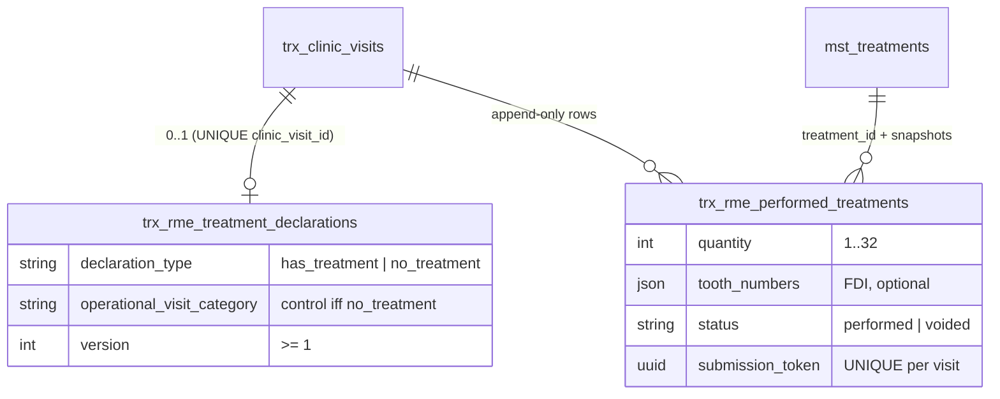
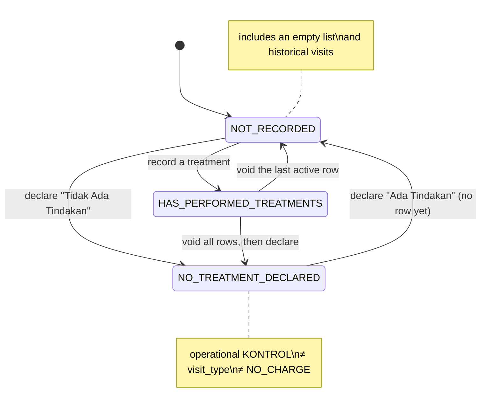
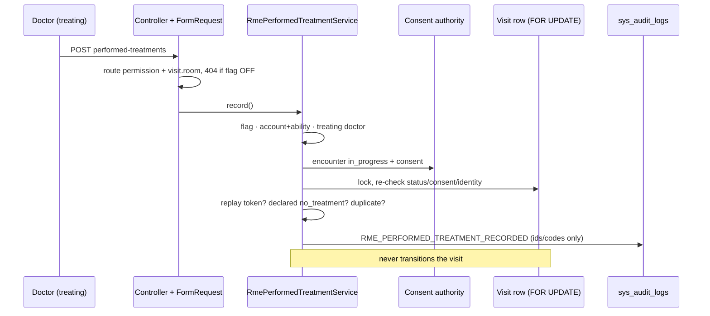

# FEATURE-RME-DOCTOR-PERFORMED-TREATMENTS-1 — "Tindakan Dilakukan" dokter (terstruktur)

- **Program:** DAENGTISIAMS-RME-BILLING-CORRECTION (P0)
- **Base:** `feature/sprint-26-phase-26-8-stabilization-closure-go-watch-no-go-report` @ `5324d646`
- **Owner decisions implemented:** CB-Q1, CB-Q3, DPT-Q1 (`OWNER_POLICY_REVISED_AND_APPROVED`)
- **Open owner questions:** DPT-Q2 … DPT-Q10 (`docs/decisions/rme-doctor-performed-treatments-owner-decision-package.md`)
- **Canonical rule:** `.cursor/rules/219-rme-doctor-performed-treatments.mdc` · **ADR:** 0016
- **Flag:** `rme.doctor_performed_treatments` — default **OFF**, not activated by this sprint
- **GO tag (reserved):** `feature-rme-doctor-performed-treatments-1-implementation-go`

## 1. Why

Rule 218 had to stay detective because nothing clinical recorded which treatments were performed (ADR 0015).
CB-Q1 named the source the system was missing: a structured record by the treating doctor. This sprint builds it,
plus DPT-Q1's explicit "Tidak Ada Tindakan" declaration, and wires it into rule 218 as a detective input.

## 2. Domain model

No `patient_id`, `branch_id`, price or payment column (rule 219 §1).

## 3. Derived state (DPT-Q1)

## 4. Write path

## 5. What changed

- New module `app/Modules/PerformedTreatment/**` (models, support, repository, service, requests, controller).
- `RmeVisitConsentService::assertPerformedTreatmentAuthoringAllowed()`; `ClinicVisitPolicy::recordPerformedTreatments`;
  `ClinicVisitRepositoryInterface::lockForUpdate()`.
- `App\Modules\Odontogram\Support\FdiToothNumbers` (shared with the odontogram request).
- Routes `rme.visits.performed-treatments.{declaration,store,void}` behind `permission:complete_rme_examination` +
  `visit.room`.
- RME page card "Tindakan Dilakukan"; cashier "Tindakan Dokter" projection; oversight counts per closure.
- Rule 218: signal `CBC_PERFORMED_TREATMENT_NOT_BILLED`, snapshot v2 with `doctor_evidence` (flag ON only).
- Patient merge activity detection: both tables registered.
- One additive migration `2026_11_02_100001`. No seeder, no permission, no role change.

## 6. What did not change

`visit_type` and its history; parent-visit derivation; rule 217 eligibility (it does not read the record); D21
manual pricing; D28; invoices #36, #42, #43, #44; payments; receivables; consent gate; explicit "Selesai
Pemeriksaan"; legacy archives; SATUSEHAT mapping; print composition; flags `rme.zero_value_closure`, post-payment
correction and refund (all OFF).

## 7. Evidence

Filled in only as measured. Nothing is pre-filled. Times WITA (UTC+8), 2026-11-01.

### 7.1 TDD
- RED: first run of the new suite before production code — 97 failed (missing classes). Security-review fixes:
  5 new tests RED first (race M wrote a row; DPT-092 answered 404; DPT-091 had no refusal), then GREEN.

### 7.2 Suites
- `tests/Feature/RmePerformedTreatment` final: **122 tests**. SQLite: 108 passed, 14 skipped (the PostgreSQL-only
  races). **PostgreSQL 16.15** (scratch container): 122/122, including races A–M
  (`RmePerformedTreatmentConcurrencyTest`).
- Wide financial regression on **PostgreSQL 16.15** (RmePerformedTreatment, RmeZeroValueClosure, PatientMerge,
  RmeInvoiceCorrection, RmeBillingDispute, ClinicOversight, RmeManualPricing, RmePaymentIdempotency,
  RmeRefundRequest, RmeRefundSettlement, RmeTariffAuthority, Clinical): **1511 tests, 0 failed, 7496 assertions**.
- Final local gate (SQLite): RmePerformedTreatment + Cicd + DevflowAiInstructionSystem + RmeZeroValueClosure —
  636 tests, 0 failed, 27 skipped (PostgreSQL-only); pint passed; `git diff --check` clean; `view:cache` ok.
- Wide SQLite regression (RME, RmeZeroValueClosure, PatientMerge, RmeInvoiceCorrection, RmeBillingDispute,
  ClinicOversight, Foundation, Clinical, RmeManualPricing, RmePaymentIdempotency, RmeRefundRequest,
  RmeRefundSettlement, RmeTariffAuthority, RmeOwnerReferenceRegistry, RmePerformedTreatment): 4088 tests,
  1 failure — `DevflowAiInstructionSystemTest` (a new path glob matched no TRACKED file); green once staged
  (`Cicd` + that suite 356/356).
- One fixture defect found on PostgreSQL: race K opened a second encounter for the same patient while the first
  was in progress; the server correctly refused it as ambiguous. The second leg now uses its own patient.

### 7.3 Mutation testing (copy-revert harness, checksum-verified restore)
- 31 mutants. Round 1: 21 killed, 8 survived, 1 not applied (its anchor moved with the MEDIUM-1 fix).
- Every survivor was a real test gap and got a test: M02 (derived category on a visit WITH treatments —
  DPT-023), M04 (inactive doctor reachable only for a scope-exempt account — DPT-098), M05 (Doctor role —
  DPT-097), M07 (write to a historical visit during a live encounter — DPT-093), M17 (same line predicate as the
  closure — DPT-094), M21 (policy branch scope — DPT-095), M27 (same-answer re-declaration is a no-op — DPT-096),
  M29 (post-lock encounter authority — race M, PostgreSQL only).
- Final: **31 killed, 0 survivors, 0 not applied**. M29 and M31 (visit row lock removed) are killed only by the
  PostgreSQL races, as expected.

### 7.4 Independent security review
- CRITICAL 0 · HIGH 0 · MEDIUM 1 · LOW 4 · INFO 1.
- Fixed: MEDIUM-1 a reused submission token with a different payload returned the old row as success
  (`DPT_SUBMISSION_REUSED`, DPT-091); LOW-1 encounter identity not re-checked after the lock (race M); LOW-4 the
  void route answered 404 vs 403 by row membership before authorizing (DPT-092).
- Recorded, not fixed here: LOW-2 a consent voided concurrently (pre-existing class shared with RME and odontogram
  authoring; fix belongs to the consent module); LOW-3 flag-OFF oversight tiles render zeros and route middleware
  answers before the FormRequest 404 (documented, rule 219 §14); INFO a Super Admin who is also the linked doctor
  skips the room guard (rule 138 exemption by design). Rule 219 §12a.

### 7.5 Graph
`graphify update .` → 42 908 nodes, 62 955 edges. No direct edge `RmePerformedTreatmentService → ClinicVisitService`
(shortest path is 4 hops through the shared `RmeVisitConsentService` import): the record cannot transition a visit.

### 7.6 DEVFLOW gates (local, PostgreSQL 16 scratch DB, base `5324d646` from the remote-tracking ref)
`devflow:base-ref-check --strict`, `sprint:manifest-check`, `sprint:scope-audit --strict` (8 modules),
`foundation:devflow-check --strict`, `foundation:shared-service-audit --strict`,
`foundation:ci-runtime-control-check --strict`, `foundation:security-compliance-check`,
`foundation:cicd-enterprise-gate-check`, `architecture:ui-governance-check --strict`,
`foundation:roadmap-check --strict`, `foundation:self-hosted-runner-check` — all exit 0, decision GO.

### 7.7 Full Suite
`FULL_SUITE=SKIPPED_NOT_PASS` — the Full Suite was not requested and the temporary global policy is ACTIVE (CG-18).
Substitute evidence is §7.2 (1511-test PostgreSQL regression), not a Full Suite pass.
