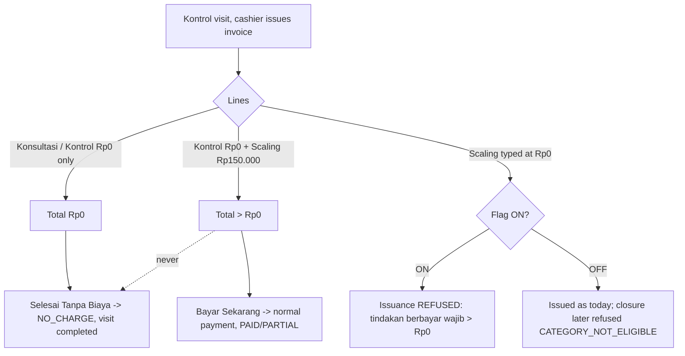
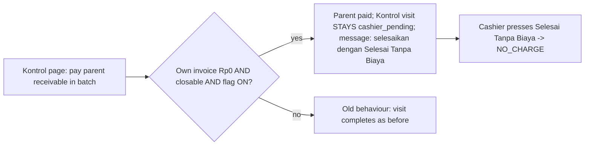

# HARDENING-RME-RP0-CLOSURE-OWNER-DECISIONS-AND-PAID-TREATMENT-1 — Konsultasi & Kontrol Rp0, hardening (Sprint 6/7)

**Program:** DAENGTISIAMS-RME-BILLING-CORRECTION · **Rule:** `.cursor/rules/217-rme-rp0-consultation-control.mdc` §9
**Parent:** `FEATURE-RME-RP0-CONTROL-CONSULTATION-1` (GO `feature-rme-rp0-control-consultation-1-implementation-go` @ `4520a276`)
**Owner decisions:** S6-Q1, S6-Q2, S6-Q3 (revised), S6-Q3a, S6-Q3b (2026-11-01) — register section
"S6-Q1, S6-Q2, S6-Q3 (revised), S6-Q3a, S6-Q3b"; package §10.
**SOP:** `docs/operations/rme-rp0-selesai-tanpa-biaya-sop.md` (Kontrol with paid treatments; incident procedure)

## 1. Why

The parent sprint shipped "Selesai Tanpa Biaya" with three items the Owner had not yet settled:

- S6-Q1 and S6-Q2 were engineering narrowings (fail-closed) awaiting confirmation.
- The S6-D1 sub-decision made **every** free line of a Kontrol eligible. Combined with D21 manual pricing,
  a branch account could type Rp0 on a normally paid treatment, link the visit to an earlier one, and close
  it with no payment (the independent review's MEDIUM-1).
- The Kontrol batch path could still complete a Rp0 Kontrol visit through an unrelated parent payment and
  leave its own invoice UNPAID (the #36 pattern).

The Owner approved S6-Q1/S6-Q2, revised S6-Q3, and answered two sub-questions in-session:

- **S6-Q3a:** the approved free services are the `consultation` category plus the reserved `control` category.
- **S6-Q3b:** the issuance guard covers Kontrol only and is gated by the flag.

The final S6-Q3 **supersedes the earlier creator ≠ closer recommendation**. S6-D3 stays: the branch cashier closes.

## 2. Flow — before and after

Before this sprint the left branch of the first diagram did not exist, so a Scaling typed at Rp0 on a Kontrol
was eligible for NO_CHARGE. In the second diagram, the "yes" branch completed the visit and stranded the invoice.

## 3. What was built

| Area | Change |
|---|---|
| `RmeZeroValueEligibility` | `isApprovedFreeTreatment()` is the one predicate, decided from treatment identity and master-data category. `consultation` is eligible everywhere; `control` only on a valid Kontrol. A free-text line is never free. `issuanceRefusal()` is shared with the issuance guard. No new refusal code. |
| `config/rme_zero_value_closure.php` | `control_service_category_codes = ['control']`, source-controlled and reserved. No master data uses it yet. |
| `RmeInvoiceService::create()` | `assertKontrolLinesIssuable()` runs after server pricing and before a number is drawn. It checks every **net**-Rp0 line on a server-derived Kontrol, which catches a 100% discount, using the closure's own per-line predicate `lineRefusalCode()`. It also refuses Rp0 lines on a Kontrol whose parent is invalid, and applies only while the flag is ON. |
| `RmePaymentService` | `heldForZeroValueClosure()` in `completeControlVisitIfSettled()` and `completeVisitAfterCashierBatch()`. Closable Rp0 invoices are held; all others keep their old behaviour. |
| `RmePaymentController` | When the visit was held, the redirect message tells the cashier the next step. Whether a hold happened is decided by the service's own predicate `isHeldForZeroValueClosure()`, so the message never appears with the flag OFF or on a non-zero invoice. |
| ClinicOversight | Read-only `oversight.billing-corrections.zero-value-closures.index`, using the existing gate, permission and branch scope. Per branch / closing cashier / doctor / treatment, plus anomalies. No patient identity. |
| Sidebar | "Tanpa Biaya (Rp0)" in the billing-correction oversight panel. |

No migration. No new permission, role grant or flag.

## 4. Mixed Kontrol + paid treatment (§9 of the brief)

A mixed invoice has a positive total, so the closure refuses it with `ZERO_VALUE_TOTAL_NOT_ZERO`. It is paid
through the ordinary payment. Nothing marks it NO_CHARGE, and the Kontrol line staying Rp0 does not make the
paid line free.

## 5. Residuals and limitations (recorded, not decided)

- **MEDIUM-1 is NARROWED, not closed (severity unchanged: MEDIUM, not release-blocking).** The named vector
  (a Kontrol link making a paid treatment free) is closed by code and tests. Under D21 the cashier still
  chooses each line's treatment, and nothing reconciles it with the medical record, so a performed paid
  procedure can still be billed as Konsultasi Dokter Rp0. What is free also depends on master-data category.
  The control here is detective only: the oversight breakdown and the self-issued count. Recommended
  follow-up (not built): an oversight cross-check of NO_CHARGE visits whose clinical record shows a procedure.
- **A held visit can be stranded if the flag is switched OFF after activation**, or if the parent is
  soft-deleted or master data changes later. The rollback step is in rule 217 §9.8: close held visits first.

- **NO_CHARGE is irreversible.** There is no approved recovery path. The SOP gives the incident procedure:
  `INCIDENT_REPORTED → FINANCIAL_REVIEW → OWNER_AUTHORIZATION_IF_REQUIRED → AUDIT_PRESERVATION →
  APPROVED_RECOVERY_PATH` (none yet). Recovery needs a separate Owner decision and sprint.
- **Ineligible Rp0 Kontrol invoices keep the old batch completion.** The visit completes and the invoice stays
  UNPAID, as with #36. Only closable invoices are held. Holding an ineligible one would strand the visit,
  because no action could close it.
- **Rp0 issuance outside Kontrol** stays D21g, PENDING (S6-Q3b).
- **The `control` category is reserved but unused.** Production records the Kontrol service as Konsultasi
  Dokter. No master data was created.
- **Historical invoices #36, #42 and #43 are untouched. Nothing was backfilled.**

## 6. Evidence

**Owner decisions:** `S6-Q1=OWNER_POLICY_APPROVED`, `S6-Q2=OWNER_POLICY_APPROVED`,
`S6-Q3=OWNER_POLICY_REVISED_AND_APPROVED`, S6-Q3a / S6-Q3b approved in-session. `RULES_SYNC=PASS`,
`OWNER_DECISION_REGISTER=UPDATED`, `RULE_CONTRADICTIONS=0` — every superseded statement is marked in place and
dated, never deleted.

### Tests (local)

| Run | Result |
|---|---|
| TDD red before the change | 9 failed / 21 passed. Every failure was old behaviour: the closure succeeded, issuance was accepted, or the visit completed. |
| Rp0 suites, SQLite (final code) | 105 passed, 12 skipped (PG-only races) |
| Broad financial regression, **PostgreSQL 16.15** (final code) | **3937 passed, 0 failed, 0 skipped**, 15 846 assertions, exit 0 |
| New oversight suite on PG16 (including the CHECK branch) | 10 passed |
| PG16 races A–L (Rp0) | 12/12 passed |
| Mutation | **29 mutants, 29 killed, 0 survivors**; residue 0 |
| DEVFLOW | 11/11 GO (manifest, scope 2 modules, devflow, shared-service, ci-runtime-control, security-compliance, cicd-enterprise, ui-governance, roadmap, base-ref, self-hosted-runner) |
| Static | repo-wide pint, `git diff --check`, `view:cache` clean |

**Mutation detail.** The first pass left one survivor, M23 (the oversight NO_CHARGE status filter removed).
On PostgreSQL it is equivalent, because the CHECK `trx_rme_invoices_no_charge_chk` binds the closure
provenance to the status. A two-way test then killed it: on PG the CHECK refuses that state, and elsewhere
the filter holds.

**PG16 concurrency — the 10 required scenarios:**

| Scenario | Race |
|---|---|
| Two closures | A |
| Batch vs closure | E, G, H |
| Dispute | B, C |
| Deactivation | D |
| Rollback | F |
| Branch switch | I |
| Mixed batch vs direct parent payment | J |
| Deadlock | K |
| Patient merge | L |

`DOUBLE_COMPLETION=0`, `FAKE_PAYMENTS=0`, `UNAUTHORIZED_NO_CHARGE=0`, `UNEXPLAINED_FINANCIAL_DELTA=0`,
`CRITICAL_DEADLOCKS=0`.

### Security review (independent)

`OPEN_CRITICAL=0`, `OPEN_HIGH=0`, `OPEN_RELEASE_BLOCKING_MEDIUM=0`.

- **Fixed before merge:**
  - MEDIUM — the issuance guard could be bypassed with a 100% discount. It now checks the **net** value of each line.
  - LOW — the issuance guard and the closure used different predicates. They now share one, `lineRefusalCode()`, and an invalid parent is refused at issuance.
  - LOW — the next-step message showed with the flag OFF. It is now driven by the service predicate.
  - INFO — the docblock was corrected.
- **Documented:** LOW — a held visit can be stranded on rollback (rule 217 §9.8).
- **MEDIUM-1 is NARROWED, not closed.** The severity is unchanged (§5).

### CI, merge, deploy

- **CI:** run `41269675695` on candidate `535f1df9` succeeded. Classifier, NSF-R012 Quality, NSF-R011 Critical,
  CICD-CTRL Selective Module, NSF-9, NSF-10 and the Android gate all passed. The second Critical variant was
  skipped by design.
- **Full Suite: `SKIPPED_NOT_PASS`.** The global temporary policy is ACTIVE and no authorisation was given.
- **Merge:** PR #576 was squash-merged as **`ba33f9bb`**. Its tree `2d1b684b` is identical to the candidate tree.
- **Deploy:** run inside the VPS via `scripts/deploy-vps-runner.sh start`. Result: `DEPLOY_EXIT_CODE=0`,
  `DEPLOY_STATUS=DEPLOY_OK` (20261101-043411), `DEPLOY_HEAD_TARGET_MATCH=YES`, `PRODUCTION_SHA_MATCH=YES`.
  - Production HEAD/tree = `ba33f9bb` / `2d1b684b`.
  - `Nothing to migrate`.
  - Runtime isolation: 107 GO.
  - Automated smoke GO. The `127.0.0.1/login` 404 warning is the known co-tenant shadow.

### Production verification (read-only, 2026-11-01 04:35 UTC / 12:35 WITA)

| Check | Before deploy (02:45 UTC) | After deploy |
|---|---|---|
| Invoices (count / total) | 10 / 31 048 000 | 10 / 31 048 000 |
| Payments (count / total) | 10 / 22 548 000 | 10 / 22 548 000 |
| #36 / #42 / #43 | UNPAID 0 / PAID 5 000 000 / PAID 12 000 000 | unchanged (correction versions 0/1/1) |
| NO_CHARGE invoices | 0 | 0 |
| failed_jobs | 0 | 0 |
| `laravel.log` bytes | 1 443 432 | 1 443 432 (delta 0) |

- **Flags:**
  - `rme.zero_value_closure`, `rme.invoice_postpayment_correction`, `rme.billing_refund_request` and `rme.billing_refund_settlement` are all OFF.
  - `rme.invoice_correction` is unchanged (env).
- **Route:** `oversight.billing-corrections.zero-value-closures.index` is registered (GET/HEAD only). A guest gets 302.
- **Health:** `/login`, `/health/live`, `/health/ready` and `/health/lb` all return 200. nginx, PHP-FPM and the queue worker are active.
- **Invoice #44** was created at 01:58 UTC, before the baseline and the deploy. It is genuine clinic activity and was not touched.
- **No master data was created.** The reserved `control` category does not exist in production (0 rows).
- **Nothing was activated, backfilled or written.** Sprint 2 stays NO_GO; Sprint 3–5 stay OFF.
