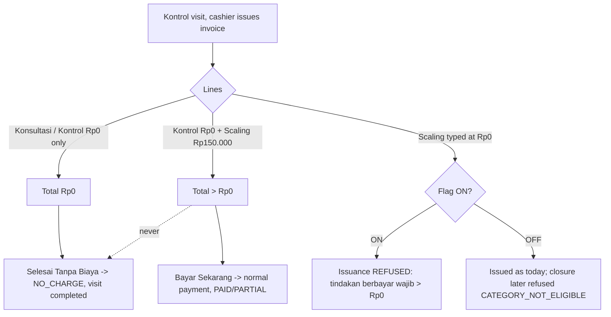
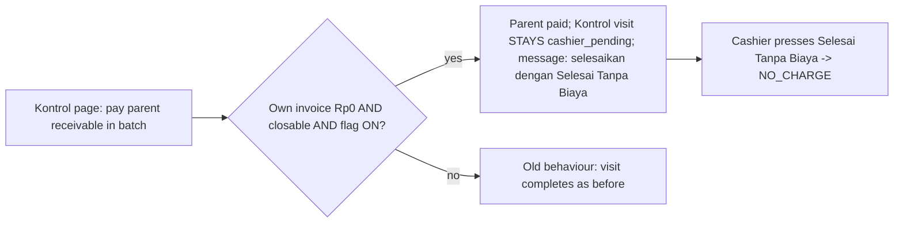

# HARDENING-RME-RP0-CLOSURE-OWNER-DECISIONS-AND-PAID-TREATMENT-1 — Konsultasi & Kontrol Rp0, hardening (Sprint 6/7)

**Program:** DAENGTISIAMS-RME-BILLING-CORRECTION · **Rule:** `.cursor/rules/217-rme-rp0-consultation-control.mdc` §9
**Parent:** `FEATURE-RME-RP0-CONTROL-CONSULTATION-1` (GO `feature-rme-rp0-control-consultation-1-implementation-go` @ `4520a276`)
**Owner decisions:** S6-Q1, S6-Q2, S6-Q3 (revised), S6-Q3a, S6-Q3b (2026-11-01) — register section
"S6-Q1, S6-Q2, S6-Q3 (revised), S6-Q3a, S6-Q3b"; package §10.
**SOP:** `docs/operations/rme-rp0-selesai-tanpa-biaya-sop.md` (Kontrol with paid treatments; incident procedure)

## 1. Why

The parent sprint shipped "Selesai Tanpa Biaya" with three items the Owner had not yet settled:

- S6-Q1 and S6-Q2 were engineering narrowings (fail-closed) awaiting confirmation.
- The S6-D1 sub-decision made **every** free line of a Kontrol eligible. Combined with D21 manual pricing,
  a branch account could type Rp0 on a normally paid treatment, link the visit to an earlier one, and close
  it with no payment (the independent review's MEDIUM-1).
- The Kontrol batch path could still complete a Rp0 Kontrol visit through an unrelated parent payment and
  leave its own invoice UNPAID (the #36 pattern).

The Owner approved S6-Q1/S6-Q2, revised S6-Q3, and answered two sub-questions in-session:

- **S6-Q3a:** the approved free services are the `consultation` category plus the reserved `control` category.
- **S6-Q3b:** the issuance guard covers Kontrol only and is gated by the flag.

The final S6-Q3 **supersedes the earlier creator ≠ closer recommendation**. S6-D3 stays: the branch cashier closes.

## 2. Flow — before and after

Before this sprint the left branch of the first diagram did not exist, so a Scaling typed at Rp0 on a Kontrol
was eligible for NO_CHARGE. In the second diagram, the "yes" branch completed the visit and stranded the invoice.

## 3. What was built

| Area | Change |
|---|---|
| `RmeZeroValueEligibility` | `isApprovedFreeTreatment()` is the one predicate, decided from treatment identity and master-data category. `consultation` is eligible everywhere; `control` only on a valid Kontrol. A free-text line is never free. `issuanceRefusal()` is shared with the issuance guard. No new refusal code. |
| `config/rme_zero_value_closure.php` | `control_service_category_codes = ['control']`, source-controlled and reserved. No master data uses it yet. |
| `RmeInvoiceService::create()` | `assertKontrolLinesIssuable()` runs after server pricing and before a number is drawn. It checks every **net**-Rp0 line on a server-derived Kontrol, which catches a 100% discount, using the closure's own per-line predicate `lineRefusalCode()`. It also refuses Rp0 lines on a Kontrol whose parent is invalid, and applies only while the flag is ON. |
| `RmePaymentService` | `heldForZeroValueClosure()` in `completeControlVisitIfSettled()` and `completeVisitAfterCashierBatch()`. Closable Rp0 invoices are held; all others keep their old behaviour. |
| `RmePaymentController` | When the visit was held, the redirect message tells the cashier the next step. Whether a hold happened is decided by the service's own predicate `isHeldForZeroValueClosure()`, so the message never appears with the flag OFF or on a non-zero invoice. |
| ClinicOversight | Read-only `oversight.billing-corrections.zero-value-closures.index`, using the existing gate, permission and branch scope. Per branch / closing cashier / doctor / treatment, plus anomalies. No patient identity. |
| Sidebar | "Tanpa Biaya (Rp0)" in the billing-correction oversight panel. |

No migration. No new permission, role grant or flag.

## 4. Mixed Kontrol + paid treatment (§9 of the brief)

A mixed invoice has a positive total, so the closure refuses it with `ZERO_VALUE_TOTAL_NOT_ZERO`. It is paid
through the ordinary payment. Nothing marks it NO_CHARGE, and the Kontrol line staying Rp0 does not make the
paid line free.

## 5. Residuals and limitations (recorded, not decided)

- **MEDIUM-1 is NARROWED, not closed (severity unchanged: MEDIUM, not release-blocking).** The named vector
  (a Kontrol link making a paid treatment free) is closed by code and tests. Under D21 the cashier still
  chooses each line's treatment, and nothing reconciles it with the medical record, so a performed paid
  procedure can still be billed as Konsultasi Dokter Rp0. What is free also depends on master-data category.
  The control here is detective only: the oversight breakdown and the self-issued count. Recommended
  follow-up (not built): an oversight cross-check of NO_CHARGE visits whose clinical record shows a procedure.
- **A held visit can be stranded if the flag is switched OFF after activation**, or if the parent is
  soft-deleted or master data changes later. The rollback step is in rule 217 §9.8: close held visits first.

- **NO_CHARGE is irreversible.** There is no approved recovery path. The SOP gives the incident procedure:
  `INCIDENT_REPORTED → FINANCIAL_REVIEW → OWNER_AUTHORIZATION_IF_REQUIRED → AUDIT_PRESERVATION →
  APPROVED_RECOVERY_PATH` (none yet). Recovery needs a separate Owner decision and sprint.
- **Ineligible Rp0 Kontrol invoices keep the old batch completion.** The visit completes and the invoice stays
  UNPAID, as with #36. Only closable invoices are held. Holding an ineligible one would strand the visit,
  because no action could close it.
- **Rp0 issuance outside Kontrol** stays D21g, PENDING (S6-Q3b).
- **The `control` category is reserved but unused.** Production records the Kontrol service as Konsultasi
  Dokter. No master data was created.
- **Historical invoices #36, #42 and #43 are untouched. Nothing was backfilled.**

## 6. Evidence

Filled in by the evidence commit after CI, merge, deploy and production verification.
