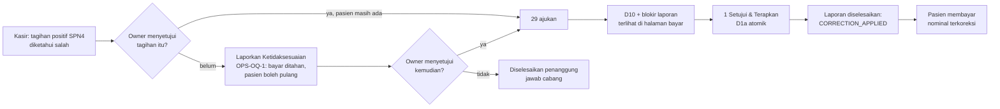

# VERIFICATION-RME-INVOICE-CORRECTION-PREPAYMENT-PILOT-CLOSURE

Program `DAENGTISIAMS-RME-BILLING-CORRECTION`, Sprint 2 of 7. Third verification
run of the live SPN4 pre-payment invoice correction pilot (maker user 29, checker
user 1). Rule 196 is the closure contract; this run adds rule 196 §8 (items 24–30)
and changes no runtime behaviour.

**Outcome: `PILOT_ACTIVE`, probe Decision WATCH, Full Pilot NO_GO,
`FINAL_DECISION=OPERATIONAL_BLOCKED`.** No runtime defect found, no runtime change,
no deploy (`NO_RUNTIME_DELTA`), no financial mutation, no tag. The two blockers are
unchanged since PILOT-1 and neither may be removed by automation:

1. **No eligible real case.** SPN4 holds 0 positive UNPAID invoices with zero
   payments. The only UNPAID invoice is #36 at Rp0 (refused in code by D28); the
   only PARTIAL invoice (#41) has a payment and is out of pre-payment scope. The
   last SPN4 invoice was created 2026-10-17 07:24:57 UTC, so no case could have
   arisen since PILOT-2.
2. **Operators not in session.** No session row exists for user 29 or user 1. User
   29's working context was last seen 2026-10-23 15:24:10 UTC (23:24 WITA) — newer
   than at PILOT-2, which proves user 29 was on shift then and nothing about now
   (rule 196 §22). The probe reports `LIVE_NOW=no`
   (`PAIR_MAKER_NOT_ON_SHIFT_IN_PILOT`). The run took place on a Saturday night
   (23:10 WITA), outside clinic hours.

Because there is no case, there is nothing for the Owner to authorize:
`OWNER_CASE_APPROVAL=PENDING (no candidate exists)`.

All times UTC unless marked WITA (UTC+8).

## 1. Repository and production baseline (measured 2026-10-24 15:10–15:15 UTC, read-only)

| Item | Value |
|---|---|
| Canonical base | `feature/sprint-26-phase-26-8-stabilization-closure-go-watch-no-go-report` @ `e9fb5c33` (PR #517, docs only) |
| Production HEAD / tree | `9e37b8557d10824d21eba9a1c802867120c9c058` / `3171940928ff77b2edba9081a22794964cae1911` |
| Production tag (exact match) | `hardening-rme-billing-dispute-branch-reviewer-control-payment-1-go` |
| Runtime delta base vs production | none — `e9fb5c33` adds only documentation on top of `9e37b855` |
| Production working tree | 1 untracked pre-existing dir `storage/runtime-home/` (not created by this task, left alone) |
| Deploy lock | free (`flock -n` succeeded); no deploy process |
| Open PRs at start | 0 |
| Health over `https://daengtisia.online` | `/login`, `/health/live`, `/health/ready`, `/health/lb` → 200 |
| Services | nginx, php8.3-fpm, queue worker, `postgresql@16-main` → active |
| `laravel.log` | 1 442 282 bytes, 163 ERROR lines; byte-identical after every probe in this task |
| Newest ERROR | 2026-10-24 06:52:34 — PostgreSQL connection refused during the `unattended-upgrades` restart recorded by Sprint 1A (pre-existing host residual, not task-caused) |
| Flag | `FEATURE_RME_INVOICE_CORRECTION=true`, `env_resolution=env` |
| Failed jobs / pending jobs | 0 / 0 |

### Previous sprint (1A) post-merge CI

Run `40103471660` (push of PR #517, `e9fb5c33`) finished **success** at
2026-10-24 15:00:17. Classifier, Quality, Critical, NSF-9, NSF-10, Phase 3 Android
gates success; the self-hosted Critical variant, the Selective Module gate and the
Full Suite were skipped by design (one Critical variant runs; Full Suite deferred
by the temporary policy). Sprint 1A closure evidence is complete.

### Financial fingerprint (no patient data)

| Measure | PILOT-2 (2026-10-23) | CLOSURE (2026-10-24) |
|---|---|---|
| Invoices (0 trashed) | 7 / Rp 7.548.000 | 7 / Rp 7.548.000 |
| Invoice items | 8 / Rp 7.548.000 | 8 / Rp 7.548.000 |
| Payments | 8 / Rp 5.548.000 | 8 / Rp 5.548.000 |
| Payment batches | 1 | 1 |
| Receivable (UNPAID + PARTIAL) | Rp 2.000.000 | Rp 2.000.000 |
| Invoices with `correction_version` ≠ 0 | 0 | 0 |
| Corrections / lines / events / document versions | 0 / 0 / 0 / 0 | 0 / 0 / 0 / 0 |
| Active corrections | 0 | 0 |
| Billing disputes / branch reviewer designations | — (pre-rule 203) | 0 / 0 |
| `sys_audit_logs` rows / correction actions | 1601 / 0 | 1601 / 0 (max id 1623, last row 2026-10-17 07:25:18) |
| `role_has_permissions` / `model_has_permissions` | 514 / 0 | 517 / 0 |

`role_has_permissions` 514 → 517 is exactly rule 203's three pairs (Owner
`view_rme_billing_disputes`; Super Admin `view_` + `review_rme_billing_disputes`);
Sprint 1A added none. Every invoice is SPN4: PAID 5 (Rp 3.548.000), PARTIAL 1
(Rp 4.000.000, paid Rp 2.000.000), UNPAID 1 (Rp 0). Latest SPN4 visit date
2026-10-13; two open SPN4 visits (1 `cashier_pending`, 1 `registered`) have no
invoice, are not candidates, and were not touched. No same-invoice, same-amount
payment pair exists within 120 s.

## 2. Owner decisions in force (register `docs/decisions/rme-billing-correction-owner-decisions.md`)

| Decision | State | Verified by |
|---|---|---|
| D1 maker ≠ checker | enforced per account, in the service, under the lock | identity matrix §4; security review Q1 |
| D1a approve auto-applies, one transaction | `APPLICATION=AUTO_ON_APPROVAL` | probe; security review Q6; PG suite |
| D1c SPN4 only | declared `[SPN4]`, admitted `[5]` | in-process `admits()` §4 |
| D1e maker 29 / checker 1 | `valid=yes`, `unusable=[]` | in-process `allows()` §4 |
| D7 immutable versions | model guard + hash check | security review Q6 |
| D10 active correction blocks payment | all four payment entry points, under the lock | Graphify §5; security review Q3 |
| D21 manual pricing | in force | `RmeManualPricing` suite |
| D28 Rp0 original refused | submit, approve, recovery apply | security review Q4; `ZeroOriginalGuard` suite |
| OPS-OQ-1 dispute hold | all four payment entry points | `rme:billing-dispute-status` GO, `ACTIVE_TOTAL=0` |
| OPS-OQ-1a branch reviewer | 0 designations; reviewer reach 1 per branch (Super Admin) | dispute status; SQL |
| OPS-OQ-1b Kontrol-only payment | deployed at `9e37b855` | `ControlOnlyPayment` suite |
| OD-1 / OD-1a | unchanged | `CrossBranchKontrolFinancialOwnership` suite |
| D21c, D21g, D22 | **PENDING** | not decided here |

No decision was made, changed or inferred by this run.

## 3. Pilot readiness probe

Command (refuses root): `runuser -u daengtisiams -- env HOME=/tmp php artisan rme:invoice-correction-readiness --maker=29 --checker=1`

```
STATE=PILOT_ACTIVE
FLAG_ENABLED=true env_resolution=env
PILOT_DECLARED=SPN4 ADMITTED=SPN4
PILOT_IDENTITIES valid=yes maker=29 checker=1 (owner D1e, rule 197)
APPLICATION=AUTO_ON_APPROVAL (owner D1a)
POSITIVE_UNPAID_UNSETTLED_INVOICES_IN_PILOT=0
PAIR maker=29 checker=1 distinct=yes designated=yes maker_ok=yes checker_ok=yes shared=SPN4 VALID=yes LIVE_NOW=no
[WATCH] PAIR_MAKER_NOT_ON_SHIFT_IN_PILOT 29 is eligible for SPN4 but holds no working context there now
Decision: WATCH   (exit 0)
```

User 1's live scope is ATG3, LDK2, SPN4, TLK1 (governance role) and pilot scope
SPN4. User 29's online-context row reads `status=online`, `last_seen_at`
2026-10-23 15:24:10; the probe read it without writing (`updated_at` unchanged).

`rme:billing-dispute-status`: `VERDICT=GO ACTIVE_TOTAL=0`, reachable reviewers 1 on
each of ATG3, LDK2, SPN4, TLK1; last 24 h: 0 refusals, 0 reports, 0 resolutions.

## 4. Pilot scope and identity (production, in-process, DB session forced read-only)

PHP piped over SSH stdin as `daengtisiams`; first statement
`SET SESSION CHARACTERISTICS AS TRANSACTION READ ONLY`, then a transaction that is
always rolled back; no tinker/psysh; `laravel.log` byte-identical afterwards.

| Check | Result |
|---|---|
| Feature guard | enabled |
| Declared / admitted | `["SPN4"]` / `[5]` |
| `admits()` | 5 true; 1, 2, 3, 4, 6 false; forged 999999 / 0 / −5 false |
| Identity list | valid, `maker_user_ids=[29]`, `checker_user_ids=[1]`, `unusable=[]` |

Every **active** holder of a correction permission (9 accounts), judged by the same
`allows()` the service calls under the lock:

| Account | Role | submit | approve | reject | apply |
|---|---|---|---|---|---|
| 29 | Front Office | **Y** | – | – | – |
| 1 | Super Admin + Owner | – | **Y** | **Y** | **Y** |
| 7, 8, 16, 17, 30, 31, 32 | Front Office | – | – | – | – |

## 5. Mutation paths (Graphify + source)

The canonical `graphify-out/graph.json` does not exist in the worktree and the
older canonical graph predates the correction module, so it was not used or
rewritten. A scoped AST graph of `app/Modules/RmeInvoice` + `routes/web.php` +
`config/rme_invoice_correction.php` was built in the session scratchpad
(`graphify update --no-cluster`: 1 095 nodes, 2 786 edges) and cross-checked by
grep for dependency-injected callers:

- `applyLocked()` ← only `approve()` and `apply()`.
- `assertNoPaymentHold()` (D10 `assertNoActiveCorrection()` + dispute hold) ← all
  four payment entry points: `pay()`, `allocateControlPayment()`,
  `allocateVisitPayment()`, `payControlInvoiceOnly()`.
- `recordPayment()` (the only RME payment insert) ← the same four, each after the hold.
- `assertActor()` ← correction `submit/decide/cancel/apply` and dispute `report/mutate`.
- Service callers: only the three RME controllers and three FormRequests (constants and
  refusal recording). No command, job or observer mutates a correction or payment.



## 6. Regression (local; `app/` byte-identical to production)

Task-owned worktree at `e9fb5c33`, local PHP 8.5 (CI and production run 8.3 — no
runtime code changed, so this re-runs shipped behaviour; it is not CI evidence).
Counts from JUnit. The worktree has no application environment file, so a throwaway
application key was passed as a process environment variable only (rule 196 §30).

Scope (both engines): `tests/Feature/RmeInvoiceCorrection`, `tests/Feature/RmeBillingDispute`,
`tests/Feature/RmeManualPricing`, `ActiveAccountSessionTest`, `RmePaymentTest`,
`RmePaymentExplicitActorTest`, `RmeInvoiceExplicitActorTest`, `CashierBillingTest`,
`CrossBranchKontrolFinancialOwnershipTest`, `ClinicVisitControlWorkflowTest`, both
receivable carry-over suites, `RmeReceivableFollowUpTest`; PostgreSQL also
`RmeBillingRefundPhase0InvoiceRaceConcurrencyTest`.

| Engine | Tests | Passed | Skipped | Failed | Assertions | Duration |
|---|---|---|---|---|---|---|
| SQLite (in-memory) | 757 | 711 | 46 | 0 | 2 878 | 575 s |
| PostgreSQL 16.15 (throwaway container `rmepc-pg16`, removed) | 760 | 760 | 0 | 0 | 3 251 | 1 276 s |

The 46 SQLite skips are exactly the four PostgreSQL-only concurrency suites
(SQLite compiles `lockForUpdate()` to nothing). On PostgreSQL all **49
concurrency/race cases executed and passed**: correction concurrency 10,
rejection/deactivation race 7, dispute concurrency 10, branch-reviewer and
Kontrol-only concurrency 19, invoice-creation race 3.

A first SQLite attempt without an application key reported 181 failures, every one
`MissingAppKeyException` (every HTTP/view test; no service test). That is an
environment fault of a worktree with no application environment file, not a
regression; with a throwaway key passed as an environment variable the same set
ran with 0 failures (rule 196 §30).

## 7. Payment idempotency audit (read-only)

| Question | Answer |
|---|---|
| Idempotency key / nonce in the request | none (`CreateRmePaymentRequest`, `RmePaymentController`) |
| DB uniqueness on payments | only `payment_number`; `payment_batch_uuid` is indexed, not unique |
| Refresh-replay | prevented by redirect-after-post on success |
| Double-click / network retry, PARTIAL amount | **not prevented** — both requests serialize on the invoice lock and both pass `amount ≤ remaining`; the form version token does not change on payment; the submit button has no in-flight disable |
| Second FULL payment after the first commits | refused (invoice PAID) — PG case K2 |
| Retry after the first attempt rolls back | exactly one payment — PG case K |
| Overpayment under concurrency | impossible — remaining recomputed under the lock; allocation paths cap with `min()` |
| Allocation paths | amount validated against a summary read **before** the lock; no assertion that the whole amount was allocated → a concurrent payment on the same receivable could leave part unrecorded |
| Production evidence | 0 same-invoice, same-amount payment pairs within 120 s |

`IDEMPOTENCY_AUDIT_RESULT=COMPLETE`, `CONFIRMED_DEFECTS=0` (no occurrence in
production), `REMAINING_RISKS=2` (both pre-existing LOW). Neither blocks the
correction pilot: the pilot is pre-payment and its reconciliation already requires
a payment-count delta of 0. Proposed separate fix:
`FIX-RME-PAYMENT-SUBMISSION-IDEMPOTENCY-1` (per-form submission token bound to the
invoice versions, plus an "all allocated" assertion in the two allocation paths) —
not done here (rule 196 §28).

## 8. Independent security review

A separate read-only reviewer (no tests, no artisan, no SSH) answered eight
questions against `e9fb5c33` with file:line evidence. **0 CRITICAL, 0 HIGH,
0 release-specific MEDIUM, 3 LOW, 2 INFO — all pre-existing.** The allocation
finding (F3) was re-verified in source by the session.

| # | Severity | Finding |
|---|---|---|
| F1 | LOW | No payment idempotency key: a double-submitted PARTIAL payment records a second real payment; overpayment impossible |
| F2 | LOW | `RmePaymentService::generateLabCandidatesIfPaid()` logs `$e->getMessage()` at warning level when lab-candidate generation fails; a database exception message can carry the bound free-text item description |
| F3 | LOW | Control/visit allocation validates against a pre-lock summary; a concurrent shrink silently under-records the remainder |
| F4 | INFO | v0 immutability is model-level + hash check; no database trigger |
| F5 | INFO | A correction may be applied on a disputed invoice; the hold stands until `resolve()` — by design |

Verdicts: identity (Q1), branch from persisted rows (Q2), both payment holds on all
four entry points (Q3), D28 at submit/approve/apply (Q4), correction/dispute
interplay (Q5), atomic apply and idempotent approve/apply (Q6), PII in audit
payloads (Q8) — all PASS.

## 9. What was NOT done, and why

| Step | Status | Reason |
|---|---|---|
| Maker login (29) | NOT PERFORMED | no session; only the operator may log in (rule 196 §3) |
| Checker login (1) | NOT PERFORMED | no session |
| Case discovery | 0 candidates | no positive UNPAID SPN4 invoice with zero payments |
| Genuine billing error | NOT AVAILABLE | no candidate to judge |
| Case-specific Owner approval | PENDING | nothing to authorize |
| Before snapshot / submit / D10 / approve / apply / reconciliation | NOT PERFORMED | no case, no approval, no operators |
| Deploy | NOT REQUIRED | `NO_RUNTIME_DELTA` (rule 196 §15) |
| Tag | NONE | rule 196 §14, §18 |
| Full Suite | SKIPPED | docs-only change; temporary Full-Suite policy ACTIVE |

## 10. Rules synchronization

- Rule 196 gains **§8 "Pilot closure re-run"** (items 24–30): a genuinely wrong
  invoice held by an OPS-OQ-1 dispute stays an eligible case after the patient
  leaves (supersedes in part the last sentence of §21); the order on a disputed
  invoice and why `CORRECTION_APPLIED` is system-verified; no power leaks across the
  pilot and the dispute reviewer; reconcile the dispute separately; the
  payment-idempotency audit result; the dispute layer is measured every run (517
  baseline); local regression needs a throwaway application key via environment
  only. No new rule number — rule 196 owns the closure contract.
- Rule 202 §18 gains one sentence: `NOT_EXECUTED` describes the counter moment only.
- SOP `docs/operations/rme-invoice-correction-pilot-sop-spn4.md` §8 gains item 7
  (Bahasa Indonesia) with the same procedure.
- `CLAUDE.md` gains a PILOT-CLOSURE section.

## 11. Operational handoff — how the pilot can still be closed

Unchanged from PILOT-2 §11, with one addition (rule 196 §24–27): if the Owner
cannot authorize while the patient is present and the invoice is genuinely wrong,
the cashier reports **Ketidaksesuaian Tagihan**; the patient leaves; when the Owner
later authorizes that invoice in writing and users 29 and 1 log in themselves, the
pilot proceeds: probe `LIVE_NOW=yes`, GO → fresh baseline → submit → both holds
observed by state → approve (auto-apply) → resolve the dispute with
`CORRECTION_APPLIED` → reconcile correction and dispute separately → only then tag
`verification-rme-invoice-correction-prepayment-pilot-1-go` on the deployed runtime.

## 12. Owner follow-ups

1. Close the pilot opportunistically with §11 — nothing in this repository can.
2. Decide whether to schedule `FIX-RME-PAYMENT-SUBMISSION-IDEMPOTENCY-1` (F1 + F3).
3. F2 (raw exception message in a log line) — small hardening, owner's priority.
4. D21c, D21g, D22 remain PENDING.

## 13. Results

| Field | Value |
|---|---|
| Implementation | PARTIAL — every safe step done; operator and financial steps not performable |
| Production runtime SHA | `9e37b8557d10824d21eba9a1c802867120c9c058` (unchanged) |
| Latest rule | 204 (rule 196 extended by §8; no new rule number) |
| Previous sprint (1A) CI | PASS — run `40103471660` |
| Feature flag | ON |
| Pilot branch / maker / checker | SPN4 / 29 / 1 |
| Pilot readiness | WATCH (`PILOT_ACTIVE`, `VALID=yes`, `LIVE_NOW=no`) |
| Eligible real invoice | NO (0 candidates) |
| Genuine billing error | NOT AVAILABLE |
| Owner case approval | PENDING |
| Maker / checker real authentication | PENDING / PENDING |
| Submission / D10 live / approval / auto-apply / snapshots | NOT PERFORMED |
| Financial reconciliation | NOT PERFORMED (fingerprint identical to PILOT-2) |
| Dispute compatibility | PASS (source + suites; `ACTIVE_TOTAL=0`) |
| OPS-OQ-1a / OPS-OQ-1b / D28 / SPN4 pilot | PRESERVED |
| PostgreSQL regression | PASS (760 / 0 skipped / 0 failed) |
| Payment idempotency audit | COMPLETE (0 confirmed defects, 2 pre-existing LOW risks) |
| Security review | PASS (0 CRITICAL / 0 HIGH / 0 release MEDIUM; 3 LOW, 2 INFO) |
| Graphify | PASS (scoped AST graph in scratchpad) |
| DataViz | NOT_NEEDED (no numeric movement; tables + one flow diagram) |
| Rules sync | PASS (rule 196 §8, rule 202 §18, SOP §8, CLAUDE.md) |
| Deploy required | NO (`NO_RUNTIME_DELTA`) |
| Full Suite | SKIPPED (docs-only; temporary Full-Suite policy ACTIVE) |
| Full Pilot GO / tag | NO_GO / NONE |
| Final decision | **OPERATIONAL_BLOCKED** — pilot stays `PILOT_ACTIVE` |
